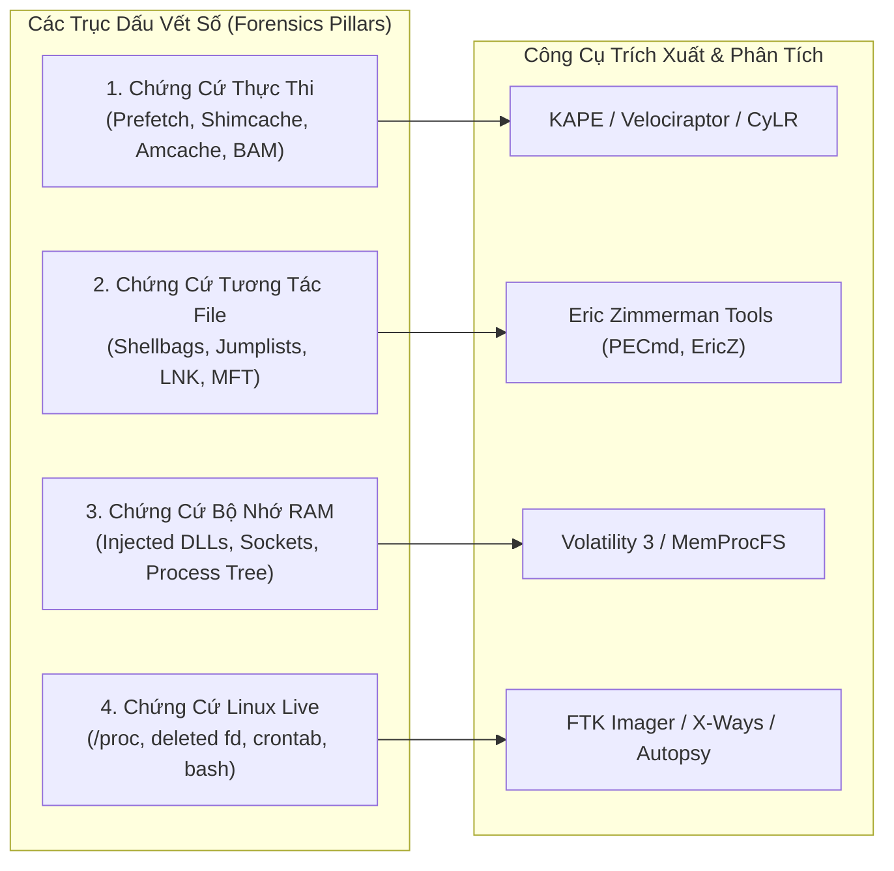
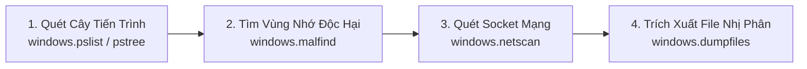

# Sổ Tay Điều Tra Kỹ Thuật Số và Phân Tích Dấu Vết DFIR Cho SOC

Tài liệu cung cấp cẩm nang thực chiến dành cho chuyên viên SOC Tier 2 và Tier 3 thực hiện điều tra số (Digital Forensics & Incident Response - DFIR), bao gồm việc trích xuất các dấu vết hành vi trên đĩa cứng (Disk Artifacts), hệ thống tập tin NTFS và phân tích bộ nhớ động (Memory Forensics) với Volatility 3.



---

## 1. Dấu Vết Thực Thi Lệnh Trên Windows (Evidence of Execution)

Khi kẻ tấn công chạy một phần mềm độc hại hoặc một công cụ dòng lệnh, hệ điều hành Windows luôn để lại các dấu vết thực thi bất biến dù tệp tin gốc có bị xóa khỏi đĩa.

### 1.1. Windows Prefetch (`C:\Windows\Prefetch\*.pf`)
* **Bản chất cơ chế:** Tính năng quản lý bộ nhớ của Windows nạp trước dữ liệu vào RAM để tăng tốc khởi động ứng dụng.
* **Quy tắc đặt tên:** `<TÊN_TIẾN_TRÌNH>-<HASH_ĐƯỜNG_DẪN>.pf` (Ví dụ: `CMD.EXE-A1B2C3D4.pf`).
* **Thông tin trích xuất:**
  * Thời điểm thực thi gần nhất (Last Run Time) và tối đa 8 mốc thời gian thực thi trước đó.
  * Tổng số lần khởi chạy (Run Count).
  * Danh sách toàn bộ các tệp tin, thư mục và DLL mà tiến trình này đã nạp vào bộ nhớ trong 10 giây đầu tiên hoạt động (giúp tìm ra tệp mã độc được gọi ngầm).
* **Công cụ phân tích:** `PECmd.exe` (Eric Zimmerman).
  ```cmd
  PECmd.exe -f "C:\Windows\Prefetch\POWERSHELL.EXE-B00B1234.pf" --csv C:\temp\output
  ```

### 1.2. Shimcache (Application Compatibility Cache)
* **Vị trí lưu trữ:** `SYSTEM\CurrentControlSet\Control\Session Manager\AppCompatCache`.
* **Đặc tính:** Được lưu trong bộ nhớ kernel và chỉ ghi xuống Registry khi hệ thống tắt máy (Shutdown) hoặc khởi động lại.
* **Thông tin trích xuất:**
  * Đường dẫn đầy đủ của tệp tin thực thi (kể cả tệp chạy từ ổ đĩa USB cắm ngoài).
  * Kích thước tệp tin (File Size).
  * Thời điểm chỉnh sửa gần nhất của tệp (`$STANDARD_INFORMATION` Last Modified Time).
  * Cờ thực thi (Executed Flag: `True` hoặc `False`).
* **Công cụ phân tích:** `AppCompatCacheParser.exe`.
  ```cmd
  AppCompatCacheParser.exe -f "C:\Windows\System32\config\SYSTEM" --csv C:\temp\output
  ```

### 1.3. Amcache (`C:\Windows\appcompat\Programs\Amcache.hve`)
* **Đặc tính vượt trội:** Là mỏ vàng pháp y số ghi lại chi tiết mọi chương trình thực thi, trình điều khiển (Driver) và tệp tin cài đặt.
* **Thông tin trích xuất:**
  * Mã băm SHA-1 của tệp tin thực thi (giúp tra cứu ngay trên VirusTotal mà không cần tìm lại file gốc).
  * Đường dẫn tệp, thời điểm biên dịch (Compilation Timestamp).
  * Khóa cài đặt phần mềm và các DLL liên kết.
* **Công cụ phân tích:** `AmcacheParser.exe`.
  ```cmd
  AmcacheParser.exe -f "C:\Windows\appcompat\Programs\Amcache.hve" --csv C:\temp\output
  ```

### 1.4. Background Activity Moderator (BAM / DAM)
* **Vị trí Registry:** `SYSTEM\CurrentControlSet\Services\bam\UserSettings\<UserSID>`.
* **Đặc tính:** Tính năng tiết kiệm pin quản lý ứng dụng chạy nền của Windows.
* **Thông tin trích xuất:** Lưu chính xác **đường dẫn thực thi kèm mốc thời gian thực tế chính xác tới từng giây** mà người dùng đó đã kích hoạt ứng dụng.

---

## 2. Dấu Vết Tương Tác Tệp Tin và Thư Mục (File Knowledge & Access)

Dùng để chứng minh kẻ tấn công hoặc nội gián đã mở thư mục nào, duyệt tệp tin nào và đánh cắp dữ liệu gì:

* **Shellbags (`UsrClass.dat`):** Lưu trữ tùy chọn hiển thị thư mục của người dùng trong Windows Explorer. Chứng minh người dùng hoặc kẻ tấn công **đã từng duyệt vào một thư mục cụ thể**, ngay cả khi thư mục đó nằm trên USB đã rút ra hoặc thư mục mạng đã ngắt kết nối.
* **LNK Shortcut Files (`%APPDATA%\Microsoft\Windows\Recent\`):** Tự động sinh ra khi người dùng mở tệp. Chứa thông tin về đường dẫn tệp gốc, kích thước tệp, loại ổ đĩa, địa chỉ MAC của card mạng máy tính và thời điểm mở tệp.
* **Jumplists (`%APPDATA%\Microsoft\Windows\Recent\AutomaticDestinations\`):** Danh sách các tệp tin thường dùng gắn với thanh Taskbar của từng ứng dụng (chứng minh tệp tài liệu nào được mở bằng Word/Excel).
* **Recycle Bin Forensics (`C:\$Recycle.Bin\<UserSID>\`):**
  * Tệp `$I<random>`: Chứa siêu dữ liệu (Metadata) gồm đường dẫn tệp gốc, kích thước và mốc thời gian xóa.
  * Tệp `$R<random>`: Chứa nội dung dữ liệu thực tế của tệp tin bị xóa.

---

## 3. Hệ Thống Tập Tin NTFS và Kỹ Thuật Phát Hiện Timestomping

Mọi tệp tin trên hệ thống tập tin NTFS đều có 2 thuộc tính thời gian nằm trong bảng Master File Table (`$MFT`):

1. **`$STANDARD_INFORMATION` ($SI):** Hiển thị trực tiếp trên giao diện Windows Explorer (Kẻ tấn công có thể dễ dàng sửa đổi mốc thời gian này bằng công cụ Timestomping như `timestomp.exe` hoặc PowerShell).
2. **`$FILE_NAME` ($FN):** Chỉ được nhân hệ điều hành (Kernel) cập nhật khi đổi tên hoặc di chuyển tệp. Các công cụ thông thường **không thể chỉnh sửa được $FN**.

> **Quy tắc vàng phát hiện Timestomping:** Nếu mốc thời gian khởi tạo của `$STANDARD_INFORMATION` **nhỏ hơn** mốc thời gian của `$FILE_NAME` (tức là ngày tạo hiển thị trên Explorer cổ hơn cả ngày hệ điều hành ghi nhận trong $FN), tệp tin đó 100% đã bị can thiệp làm sai lệch thời gian (Timestomped T1070.006).

* **Công cụ phân tích $MFT:** `MFTECmd.exe`.
  ```cmd
  MFTECmd.exe -f "C:\$MFT" --csv C:\temp\output --csvf mft_analysis.csv
  ```

---

## 4. Điều Tra Bộ Nhớ RAM Thực Chiến Với Volatility 3

Phân tích bộ nhớ RAM (Memory Forensics) là phương pháp tối thượng để bóc tách mã độc không tệp (Fileless Malware), trích xuất khóa mã hóa và truy tìm kết nối C2 ẩn giấu.



### 4.1. Lệnh 1: Quét Danh Sách và Cây Tiến Trình (`windows.pslist` / `windows.pstree`)
* **Mục đích:** Liệt kê toàn bộ tiến trình đang hoạt động trong bộ nhớ tại thời điểm trích xuất RAM.
* **Cú pháp:**
  ```bash
  python3 vol.py -f memory.raw windows.pstree
  ```
* **Dấu hiệu đáng ngờ:**
  * Hai tiến trình `lsass.exe` hoặc `explorer.exe` chạy song song (tiến trình giả mạo).
  * `svchost.exe` không có tiến trình cha là `services.exe`.
  * `cmd.exe` hoặc `powershell.exe` sinh ra từ `winword.exe` hoặc `w3wp.exe`.

### 4.2. Lệnh 2: Phát Hiện Vùng Nhớ Bị Tiêm Mã (`windows.malfind`)
* **Mục đích:** Quét toàn bộ không gian bộ nhớ tiến trình để tìm các đoạn mã có quyền thực thi và ghi bất thường (`PAGE_EXECUTE_READWRITE - RWX`), đặc trưng của kỹ thuật Process Injection / Process Hollowing / Cobalt Strike Beacon.
* **Cú pháp:**
  ```bash
  python3 vol.py -f memory.raw windows.malfind
  ```
* **Dấu vết chỉ điểm:** Vùng nhớ chứa tiêu đề thực thi PE (`4D 5A` - tức `MZ`) hoặc chuỗi mã máy shellcode (NOP Sled: `90 90 90`).

### 4.3. Lệnh 3: Rà Soát Kết Nối Mạng Ẩn (`windows.netscan`)
* **Mục đích:** Quét các cấu trúc socket TCP/UDP còn sót lại trong RAM (kể cả kết nối đã bị đóng trước đó vài phút).
* **Cú pháp:**
  ```bash
  python3 vol.py -f memory.raw windows.netscan
  ```
* **Dấu vết chỉ điểm:** Tiến trình hệ thống hợp lệ (`notepad.exe`, `explorer.exe`) duy trì kết nối ESTABLISHED tới cổng 4444 hoặc địa chỉ IP công cộng bên ngoài.

### 4.4. Lệnh 4: Trích Xuất Tệp Độc Hại Từ RAM (`windows.dumpfiles`)
* **Mục đích:** Trích xuất tệp thực thi hoặc tài liệu độc hại trực tiếp từ bộ nhớ đệm cache của hệ điều hành mà không cần tệp tin tồn tại trên ổ đĩa.
* **Cú pháp:**
  ```bash
  python3 vol.py -f memory.raw -o C:\temp\dump windows.dumpfiles --pid <PID_ĐỘC_HẠI>
  ```

---

## 5. Điều Tra Dấu Vết Trực Tiếp Trên Máy Chủ Linux (Linux Live Forensics)

Khi điều tra trực tiếp trên một máy chủ Linux bị xâm nhập:

### 5.1. Bóc Tách Thư Mục Nhân `/proc`
Thư mục `/proc` là cửa sổ phản ánh trực tiếp trạng thái kernel của toàn bộ tiến trình:
* `/proc/<PID>/exe`: Liên kết mềm (Symlink) trỏ trực tiếp vào tệp nhị phân gốc đang chạy (kể cả khi hacker đã gõ `rm -f /tmp/malware`, ta vẫn có thể copy lại tệp từ symlink này: `cp /proc/<PID>/exe /root/recovered_malware`).
* `/proc/<PID>/cmdline`: Tham số dòng lệnh đầy đủ được phân tách bởi ký tự null.
* `/proc/<PID>/fd/`: Danh sách toàn bộ các File Descriptor (tệp tin, socket mạng) mà tiến trình đang mở.
* `/proc/<PID>/environ`: Biến môi trường của tiến trình (giúp tìm API Key, Password bị lộ).

### 5.2. Phát Hiện Tiến Trình Ẩn và Tệp Đang Mở Bị Xóa
Kẻ tấn công thường chạy mã độc rồi xóa tệp gốc trên đĩa để tránh bị quét:
```bash
# Liệt kê toàn bộ tiến trình đang giữ file descriptor của các tệp đã bị xóa (deleted files):
lsof +L1
# Kết quả mẫu:
# evil_miner  12345  root    3u   REG   8,1  10485760   987654 /tmp/.x (deleted)
```

### 5.3. Rà Soát Lịch Sử Shell và Khôi Phục Dấu Vết
* Kiểm tra thuộc tính tệp `.bash_history` (phát hiện cờ bất biến `chattr +i` hoặc symlink trỏ về `/dev/null`):
  ```bash
  ls -la ~/.bash_history
  lsattr ~/.bash_history
  ```
* Khôi phục các lệnh đã gõ nhưng chưa ghi xuống đĩa (đang nằm trong bộ nhớ cache của phiên bash mở):
  ```bash
  strings /proc/<PID_BASH>/mem | grep -A 5 -B 5 "curl "
  ```

