# Sổ Tay Runbook Vận Hành Phân Loại, Ứng Phó và Săn Lùng Mối Đe Dọa (SOC Tier 1 - Tier 2 - Tier 3)

Tài liệu thiết lập quy chuẩn vận hành liên thông 3 cấp độ trong Trung tâm điều hành an ninh mạng (SOC):
* **SOC Tier 1 (Alert Triage & Validation):** Tiếp nhận cảnh báo, bóc tách lệnh, đối soát thành công, phân loại FP/TP trong vòng 15 phút.
* **SOC Tier 2 (Incident Response & Containment):** Xác định bán kính ảnh hưởng (Blast Radius), cô lập mạng khẩn cấp, thu thập chứng cứ khả biến (RAM, Triage Artifacts), triệt tiêu mã độc và phục hồi hệ thống.
* **SOC Tier 3 (Threat Hunting & Detection Engineering):** Săn lùng mối đe dọa chủ động (Hypothesis-driven Hunting), phân tích tĩnh/động mẫu mã độc, xây dựng luật phát hiện Splunk/Sigma mới và thực hiện điều tra nguyên nhân gốc rễ (Root Cause Analysis - RCA).

```mermaid
flowchart LR
    subgraph T1["SOC TIER 1 · Triage (15 phút)"]
        direction TB
        A1["Tiếp nhận Alert từ SIEM"] --> A2["Kiểm tra CommandLine & User"]
        A2 --> A3["Đối soát mã thành công (4624/200)"]
        A3 --> A4{"Đánh giá FP hay TP?"}
        A4 -- "FP" --> A5["Đóng Ticket & Note lý do"]
        A4 -- "TP" --> A6["Escalate khẩn cấp sang Tier 2"]
    end

    subgraph T2["SOC TIER 2 · IR & Containment (1 - 4 giờ)"]
        direction TB
        B1["Xác định Blast Radius toàn mạng"] --> B2["Thực thi Cô lập mạng (Isolation)"]
        B2 --> B3["Thu thập RAM & KAPE Triage"]
        B3 --> B4["Xóa Persistence & Reset Account"]
        B4 --> B5["Bàn giao mẫu độc sang Tier 3"]
    end

    subgraph T3["SOC TIER 3 · Hunt & Engineering (1 - 3 ngày)"]
        direction TB
        C1["Phân tích mã độc (Static/Dynamic)"] --> C2["Trích xuất IOC & Viết Yara Rule"]
        C2 --> C3["Threat Hunting ngược toàn hệ thống"]
        C3 --> C4["Viết Rule Splunk mới & Atomic Test"]
        C4 --> C5["Hoàn thiện Báo cáo RCA Post-Mortem"]
    end

    A6 ==> B1
    B5 ==> C1
    C4 -.->|"Cập nhật Playbook & Rule"| A1
```



---

## PHẦN 1: RUNBOOK VẬN HÀNH SOC TIER 1 (TRIAGE VÀ PHÂN LOẠI CẢNH BÁO)

### 1.1. Ma Trận Quy Trình 5 Bước Chuẩn Của Chuyên Viên L1

| Bước | Hành Động Cụ Thể Cần Thực Hiện | Câu Hỏi Sống Còn Cần Trả Lời | Công Cụ & Kênh Log Cần Truy Vấn |
| :--- | :--- | :--- | :--- |
| **Bước 1** | **Xác định Tài Sản & Danh Tính** | Máy bị cảnh báo là Server hay Workstation? User có thuộc Domain Admins/Service Account? | Splunk Asset Lookup, Active Directory, `whoami /groups` |
| **Bước 2** | **Bóc Tách Tiến Trình & Lệnh** | Lệnh chạy là script bảo trì hợp lệ của IT hay công cụ tấn công lạm dụng lệnh nội tại (LOLBins)? | Sysmon EventID 1, Windows 4688, Linux Auditd `EXECVE` |
| **Bước 3** | **Đối Soát Kết Quả Thực Thi** | Đòn tấn công có thành công không? Đăng nhập sai có kèm thành công? Web injection có trả về HTTP 200? | Windows Security 4624, IIS/Nginx Access Log `status=200` |
| **Bước 4** | **Tương Quan Hành Vi Đi Kèm** | Có kết nối C2 ra ngoài? Có tạo user mới? Có thả tệp tin lạ vào thư mục Temp/AppData? | Sysmon 3 (Network), Sysmon 11 (File), Security 4720 (User) |
| **Bước 5** | **Phân Loại & Quyết Định** | Đây là False Positive (đóng ca) hay True Positive (cần escalate ngay)? | Runbook Playbook tiêu chuẩn, Hệ thống Ticketing (Jira/SOAR) |

---

### 1.2. Thẻ Triage Cảnh Báo Nóng Cho SOC Tier 1

#### Playbook T1-EP01: Phát Hiện Tấn Công Dò Mật Khẩu (Brute Force Windows)
* **Kênh nhật ký:** Windows Security (`EventCode=4625` và `4624`).
* **Điều kiện kích hoạt:** Trong 5 phút xuất hiện trên 10 bản ghi 4625 thất bại từ cùng một địa chỉ IP.
* **Cú pháp SPL kiểm tra tức thời:**
```bash
index=windows sourcetype="XmlWinEventLog:Security" EventCode IN (4624, 4625)
| eval is_success = if(EventCode==4624, 1, 0), is_fail = if(EventCode==4625, 1, 0)
| stats sum(is_fail) as total_fails, sum(is_success) as total_success,
        values(TargetUserName) as users, values(SubStatus) as fail_reasons by IpAddress
| where total_fails >= 10
```
* **Cây quyết định phân loại:**
  * **False Positive (FP):** `total_success == 0`, `IpAddress` thuộc máy nội bộ hợp lệ, mã lỗi là `0xC000006A` (gõ nhầm pass) do ứng dụng Outlook/Mapped Drive tự động gửi lại mật khẩu cũ. -> **Hành động:** Đóng ticket, ghi nhận nguyên nhân cache credential, hướng dẫn user cập nhật mật khẩu.
  * **True Positive (TP):** `total_success >= 1` vào chính tài khoản bị brute force (kẻ tấn công đã dò trúng mật khẩu), hoặc cùng 1 IP thử danh sách dài trên 10 user khác nhau (Password Spraying). -> **Hành động:** Khóa tài khoản ngay, chuyển giao khẩn cấp lên Tier 2.

#### Playbook T1-EP18: Truy Cập Bộ Nhớ Tiến Trình LSASS (Nghi Ngờ Mimikatz)
* **Kênh nhật ký:** Sysmon `EventCode=10` (`TargetImage="*\\lsass.exe"`).
* **Cú pháp SPL kiểm tra:**
```bash
index=windows sourcetype="XmlWinEventLog:Microsoft-Windows-Sysmon/Operational" EventCode=10 TargetImage="*\\lsass.exe"
| search GrantedAccess IN ("0x1010", "0x1410", "0x1438", "0x1FFFFF")
| search NOT SourceImage IN ("*\\MsMpEng.exe", "*\\csfalconservice.exe", "*\\WazuhAgent.exe")
| table _time host SourceImage TargetImage GrantedAccess CallTrace
```
* **Cây quyết định:**
  * **FP:** `SourceImage` là tiến trình bảo mật chính hãng có chữ ký số hợp lệ (`MsMpEng.exe`). -> Đóng ticket, tune whitelist chữ ký.
  * **TP:** `SourceImage` là `powershell.exe`, `rundll32.exe`, `procdump.exe`, `taskmgr.exe` hoặc tiến trình không rõ nguồn gốc. -> **Escalate P1 ngay lập tức lên Tier 2 để cô lập máy**.

#### Playbook T1-WB02: Hành Vi Khai Thác Web Shell Qua Yêu Cầu HTTP POST
* **Kênh nhật ký:** Web Server Access Log (IIS/Apache/Nginx).
* **Cú pháp SPL kiểm tra:**
```bash
index=web_proxy cs_method=POST cs_uri_stem IN ("*.aspx", "*.php", "*.jsp")
| stats count as total_requests,
        count(eval(sc_status==200)) as success_requests,
        avg(sc_bytes) as avg_response_size by c_ip cs_uri_stem
| eval success_ratio = round((success_requests / total_requests) * 100, 2)
| where total_requests >= 5 AND success_ratio >= 80 AND avg_response_size > 500
```
* **Cây quyết định:**
  * **FP:** Endpoint là API upload hoặc form quản trị CMS hợp lệ của công ty.
  * **TP:** Tệp tin nằm trong thư mục tĩnh (`/uploads/`, `/assets/`, `C:\inetpub\wwwroot\images\`), nhận các truy vấn POST kèm tham số lệnh và trả về HTTP 200. -> **Escalate Tier 2 can thiệp xóa file**.

---

## PHẦN 2: RUNBOOK VẬN HÀNH SOC TIER 2 (ĐIỀU TRA SÂU, KHOANH VÙNG & CÔ LẬP KHẨN CẤP)

Khi Tier 1 xác nhận một cảnh báo là True Positive (TP), ca trực được chuyển giao ngay lập tức cho chuyên viên Tier 2 để thực hiện điều tra sâu và kích hoạt phương án ứng phó sự cố (Incident Response).

### 2.1. Quy Trình Xác Định Bán Kính Ảnh Hưởng (Blast Radius Assessment)

Chuyên viên L2 không bao giờ chỉ xử lý duy nhất chiếc máy bị nổ cảnh báo ban đầu, mà phải trả lời được câu hỏi: **"Kẻ tấn công đã di chuyển sang những máy chủ nào khác trong toàn mạng?"**

```bash
# Truy vấn toàn bộ các máy trạm/máy chủ mà tài khoản bị chiếm đoạt đã đăng nhập thành công qua mạng (Type 3) trong 24 giờ qua:
index=windows sourcetype="XmlWinEventLog:Security" EventCode=4624 LogonType=3 TargetUserName="<compromised_user>"
| stats earliest(_time) as first_login latest(_time) as last_login count by WorkstationName IpAddress host
```

---

### 2.2. Kịch Bản Cô Lập Mạng Khẩn Cấp (Emergency Network Containment)

Mục tiêu của cô lập là cắt đứt hoàn toàn liên lạc của máy bị nhiễm với mạng nội bộ và máy chủ điều khiển C2 ngoài Internet, nhưng **bắt buộc phải giữ lại luồng kết nối tới máy chủ Splunk SIEM / EDR Console** để tiếp tục giám sát.

#### Kịch Bản 1: Cô lập máy trạm Windows bằng dòng lệnh PowerShell / Netsh
Nếu hệ thống không có EDR Agent hỗ trợ nút bấm "Isolate", chuyên viên L2 thực thi kịch bản sau qua phiên quản trị từ xa hoặc can thiệp trực tiếp:

```powershell
# Bật toàn bộ tường lửa Windows
netsh advfirewall set allprofiles state on

# Đặt chính sách mặc định: Chặn toàn bộ Inbound và Outbound
netsh advfirewall set allprofiles firewallpolicy blockinbound,blockoutbound

# Xóa bỏ các rule tạm gây xung đột
netsh advfirewall firewall delete rule name="SOC_Allow_SIEM"
netsh advfirewall firewall delete rule name="SOC_Allow_DNS"

# Mở ngoại lệ duy nhất: Cho phép đẩy log về Splunk Indexer (IP 192.168.100.10, Port 9997)
netsh advfirewall firewall add rule name="SOC_Allow_SIEM" dir=out action=allow protocol=TCP remoteip=192.168.100.10 remoteport=9997

# Mở ngoại lệ cổng phân giải DNS nội bộ để EDR hoạt động (Domain Controller 192.168.100.50)
netsh advfirewall firewall add rule name="SOC_Allow_DNS" dir=out action=allow protocol=UDP remoteip=192.168.100.50 remoteport=53
```

#### Kịch Bản 2: Cô lập máy chủ Linux bằng iptables
```bash
# Lưu cấu hình iptables hiện tại vào file backup
iptables-save > /root/iptables_backup.rules

# Chặn đứng toàn bộ lưu lượng vào/ra mặc định
iptables -P INPUT DROP
iptables -P FORWARD DROP
iptables -P OUTPUT DROP

# Mở duy nhất luồng kết nối đẩy log về Splunk Heavy/Indexer (192.168.100.10)
iptables -A OUTPUT -p tcp -d 192.168.100.10 --dport 9997 -j ACCEPT
iptables -A INPUT -p tcp -s 192.168.100.10 --sport 9997 -m state --state ESTABLISHED -j ACCEPT

# Cho phép loopback nội bộ hệ điều hành
iptables -A INPUT -i lo -j ACCEPT
iptables -A OUTPUT -o lo -j ACCEPT
```

---

### 2.3. Quy Trình Thu Thập Chứng Cứ Khả Biến (Volatile Evidence Acquisition)

> **Cảnh báo sống còn của DFIR:** Tuyệt đối không được tắt nguồn máy tính (Shutdown/Reboot). Tắt máy sẽ làm biến mất toàn bộ dữ liệu trong bộ nhớ RAM, xóa sạch tiến trình ẩn giấu, khóa phiên kết nối socket và các tệp mã độc chạy ngầm không lưu đĩa (Fileless Malware).

1. **Thu thập bộ nhớ RAM:**
   * Sử dụng công cụ `winpmem.exe` hoặc `DumpIt.exe` để trích xuất toàn bộ bộ nhớ vật lý:
     ```cmd
     winpmem.exe -o C:\temp\memory_dump.raw
     ```
2. **Thu thập gói chứng cứ Artifacts thần tốc (KAPE / Velociraptor Triage):**
   * Sử dụng KAPE thu thập các tệp tin lưu vết hành vi:
     * **Evidence of Execution:** `C:\Windows\Prefetch\*.pf`, `Amcache.hve`, `RecentFileCache.bcf`.
     * **File System & Timeline:** `$MFT`, `$LogFile`, `$UsnJrnl`.
     * **Persistence & User Activity:** Registry Hives (`SAM`, `SYSTEM`, `SOFTWARE`, `NTUSER.DAT`), Web Browser History, Event Logs (`*.evtx`).

---

### 2.4. Triệt Tiêu Mối Đe Dọa và Khôi Phục (Eradication & Remediation)

* **Xóa bỏ dịch vụ mã độc độc hại:**
  ```cmd
  sc.exe stop "PSEXESVC"
  sc.exe delete "PSEXESVC"
  del /f /q C:\Windows\System32\evil_service.exe
  ```
* **Xóa tác vụ lập lịch độc hại:**
  ```cmd
  schtasks /delete /tn "Windows_Update_Backdoor" /f
  ```
* **Xử lý sự cố Golden Ticket / Chiếm quyền Domain:**
  * Nếu kẻ tấn công đã trích xuất được mã băm của tài khoản `krbtgt` trên Active Directory, toàn bộ vé Kerberos tạo ra đều có giá trị vĩnh viễn.
  * **Quy trình chuẩn:** Bắt buộc phải **đổi mật khẩu tài khoản `krbtgt` hai lần liên tiếp**, cách nhau đúng 24 giờ (để các dịch vụ hiện tại kịp đổi vé và vô hiệu hóa hoàn toàn vé cũ mà không làm gián đoạn hệ thống).
    ```powershell
    # Lần 1: Tạo mật khẩu mới cho krbtgt
    Set-ADAccountPassword -Identity krbtgt -Reset
    # Chờ 24 giờ để Replication hoàn tất toàn miền, sau đó thực hiện Lần 2:
    Set-ADAccountPassword -Identity krbtgt -Reset
    ```

---

## PHẦN 3: RUNBOOK VẬN HÀNH SOC TIER 3 (SĂN LÙNG MỐI ĐE DỌA, PHÂN TÍCH MÃ ĐỘC & KỸ NGHỆ PHÁT HIỆN)

Chuyên viên SOC Tier 3 chịu trách nhiệm xử lý các bài toán nâng cao: phân tích mẫu độc do Tier 2 bàn giao, chủ động đi săn các mối đe dọa ẩn mình chưa nổ cảnh báo (Proactive Threat Hunting) và hoàn thiện vòng lặp kỹ nghệ phát hiện (Detection Engineering Loop).

### 3.1. Kịch Bản Săn Lùng Mối Đe Dọa Chủ Động (Hypothesis-Driven Threat Hunting)

#### Giả Thuyết 1: Attacker tiêm mã độc vào tiến trình hợp lệ nhưng không lưu tệp (Process Injection)
* **Kỹ thuật MITRE:** T1055 (Process Injection), T1055.012 (Process Hollowing).
* **Truy vấn săn lùng Splunk (Đối soát CreateRemoteThread lạ):**
```bash
index=windows sourcetype="XmlWinEventLog:Microsoft-Windows-Sysmon/Operational" EventCode=8
| search TargetImage IN ("*\\explorer.exe", "*\\svchost.exe", "*\\lsass.exe", "*\\spoolsv.exe")
| search NOT SourceImage IN ("*\\csfalconservice.exe", "*\\MsMpEng.exe", "*\\vmtoolsd.exe")
| stats count values(SourceImage) as Injected_By, values(TargetImage) as Target, values(StartFunction) as Function by host StartAddress
| where count < 5
```

#### Giả Thuyết 2: Attacker lạm dụng tiến trình Living-off-the-Land (LOLBins) để kết nối ra ngoài
* **Truy vấn săn lùng:** Tìm các công cụ quản trị hệ thống (`certutil`, `bitsadmin`, `powershell`, `mshta`) phát sinh kết nối mạng ra ngoài Internet:
```bash
index=windows sourcetype="XmlWinEventLog:Microsoft-Windows-Sysmon/Operational" EventCode=3 Initiated=true
| search Image IN ("*\\certutil.exe", "*\\bitsadmin.exe", "*\\mshta.exe", "*\\regsvr32.exe", "*\\cscript.exe", "*\\wscript.exe")
| where NOT cidrmatch("10.0.0.0/8", DestinationIp) AND NOT cidrmatch("192.168.0.0/16", DestinationIp) AND NOT cidrmatch("172.16.0.0/12", DestinationIp)
| stats count earliest(_time) as first_seen latest(_time) as last_seen by host User Image DestinationIp DestinationPort
```

---

### 3.2. Quy Trình Phân Tích Mẫu Mã Độc (Malware Analysis Checklist)

Khi nhận tệp nhị phân từ Tier 2, Tier 3 thực hiện phân tích trong môi trường mạng cô lập (Sandbox / Remnux):

1. **Phân Tích Tĩnh (Static Analysis):**
   * Tính hàm băm tệp: `sha256sum sample.exe` -> Kiểm tra trên VirusTotal / AlienVault OTX.
   * Trích xuất chuỗi ký tự văn bản:
     ```bash
     strings -a -n 8 sample.exe | grep -iE "http|https|\.dll|\.pdb|powershell|cmd|reg add|token"
     ```
   * Nhận diện Packer / Cryptor: Kiểm tra độ entropy bằng Detect It Easy (DIE). Nếu entropy > 7.2, tệp tin đã bị mã hóa hoặc nén bằng UPX, Themida.
   * Soi bảng Import Table (PEStudio / CFF Explorer):
     * Các hàm nguy hiểm: `VirtualAllocEx`, `WriteProcessMemory`, `CreateRemoteThread` (dấu hiệu tiêm mã Process Injection).
     * `AdjustTokenPrivileges`, `OpenProcessToken` (dấu hiệu leo thang đặc quyền).

2. **Viết Luật Nhận Diện Mẫu Mã Độc (YARA Rule Authoring):**
   Tạo quy tắc YARA để nạp vào EDR/Wazuh quét toàn bộ ổ cứng máy trạm trong doanh nghiệp:
   ```yara
   rule APT_CobaltStrike_Custom_Beacon {
       meta:
           author = "SOC Tier 3 Detection Team"
           description = "Detects modified in-memory Cobalt Strike Beacon payload"
           date = "2026-08-28"
           severity = "Critical"
       strings:
           $str_pipe = "\\\\.\\pipe\\MSSE-%d-server" ascii wide
           $str_ua   = "Mozilla/5.0 (Windows NT 10.0; Win64; x64) AppleWebKit/537.36" ascii
           $hex_shellcode = { 48 83 EC 28 48 89 4C 24 20 48 8D 0D ?? ?? ?? ?? E8 ?? ?? ?? ?? }
       condition:
           uint16(0) == 0x5A4D and (2 of ($str*) or $hex_shellcode)
   }
   ```

---

### 3.3. Khép Kín Vòng Lặp Kỹ Nghệ Phát Hiện (Closed-Loop Detection Engineering)

Để ngăn chặn cuộc tấn công tương tự xảy ra trong tương lai, Tier 3 bắt buộc phải biến bài học thành luật phòng thủ tự động:

1. **Thực thi kiểm thử giả lập tấn công (Atomic Red Team Validation):**
   Sử dụng framework Atomic Red Team để mô phỏng lại kỹ thuật tấn công vừa xảy ra trên máy lab nhằm kiểm tra cảm biến có bắt được hay không:
   ```powershell
   # Giả lập kỹ thuật T1003.001 (LSASS Dump bằng comsvcs.dll)
   Invoke-AtomicTest T1003.001 -TestNumbers 1
   ```
2. **Triển khai luật phát hiện mới lên Splunk SIEM:**
   Chuyển đổi bài học thành Correlation Search hoặc Sigma Rule mới, gán nhãn MITRE ATT&CK và kích hoạt cảnh báo tự động về cho Tier 1.
3. **Báo cáo phân tích nguyên nhân gốc rễ (Root Cause Analysis - RCA):**
   Soạn thảo báo cáo kỹ thuật hoàn chỉnh: Kẻ tấn công vào bằng con đường nào (Initial Access Vector)? Lỗ hổng nào chưa được vá? Cơ chế nào của hệ điều hành bị lợi dụng? Đề xuất kiến trúc phòng thủ cứng hóa (Hardening Recommendations) cho ban lãnh đạo.
