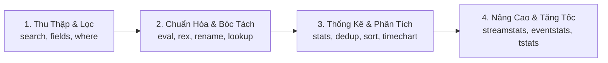

# Cẩm Nang Cú Pháp và Cách Dùng SPL Thực Chiến Cho SOC

Ngôn ngữ truy vấn dữ liệu Splunk Search Processing Language (SPL) là công cụ tác chiến hàng ngày của chuyên viên SOC. Toàn bộ câu lệnh trong SPL hoạt động theo cơ chế đường ống dẫn (Unix Pipeline `|`), trong đó dữ liệu đầu ra của câu lệnh phía trước trở thành dữ liệu đầu vào của câu lệnh phía sau.

> **Quy tắc vàng về hiệu năng trong SOC:** Lọc dữ liệu càng sớm càng tốt ở đầu đường ống (Search Early, Filter Early). Không bao giờ dùng lệnh tìm kiếm chung chung như `*` hoặc để `search` ở cuối đường ống sau khi đã kéo hàng triệu sự kiện thô về Search Head.

---

## 1. Bản Đồ 15 Lệnh SPL Cốt Lõi Trong SOC



---

## 2. Thẻ Tra Cứu Chi Tiết 15 Lệnh SPL

### Lệnh 1: `search` (Lọc và Tìm Kiếm Dữ Liệu Ban Đầu)
* **Chức năng:** Tìm kiếm các sự kiện khớp với từ khóa, trường dữ liệu và điều kiện logic boolean.
* **Cú pháp chuẩn:** `search index=<tên_index> sourcetype=<tên_sourcetype> [điều kiện]`
* **Lưu ý thực chiến:**
  * Các toán tử boolean `AND`, `OR`, `NOT` bắt buộc phải viết hoa.
  * Hạn chế tối đa dùng ký tự đại diện `*` ở đầu chuỗi (ví dụ: `*password` sẽ bắt Splunk quét toàn bộ từ điển chỉ mục, gây chậm gấp hàng chục lần so với `password*`).
* **Ví dụ mẫu SOC:**
```bash
index=windows sourcetype="XmlWinEventLog:Security" EventCode=4625 (TargetUserName="admin*" OR TargetUserName="root")
```

### Lệnh 2: `table` (Trích Xuất Bảng Dữ Liệu Hiển Thị)
* **Chức năng:** Chỉ giữ lại các trường được chỉ định và hiển thị dưới dạng bảng theo đúng thứ tự khai báo.
* **Cú pháp:** `table <field1> <field2> ... <fieldN>`
* **Ví dụ mẫu SOC:**
```bash
index=windows sourcetype="XmlWinEventLog:Security" EventCode=4624
| table _time host TargetUserName LogonType IpAddress
```

### Lệnh 3: `fields` (Tối Ưu Hóa Bộ Nhớ Và Băng Thông)
* **Chức năng:** Giữ lại (`fields +`) hoặc loại bỏ (`fields -`) các trường dữ liệu khỏi bộ nhớ trung gian của đường ống dẫn mà không làm thay đổi định dạng sự kiện gốc.
* **Lưu ý thực chiến:** Khác với `table` (lệnh biến đổi định dạng), `fields +` giúp Search Head yêu cầu Indexer chỉ nạp đúng các trường cần thiết, tiết kiệm tới 70% bộ nhớ RAM khi xử lý tập dữ liệu lớn.
* **Ví dụ mẫu SOC:**
```bash
index=firewall sourcetype="pan:traffic"
| fields + _time src_ip dest_ip dest_port action
```

### Lệnh 4: `rename` (Đổi Tên Trường Trực Quan)
* **Chức năng:** Đổi tên một hoặc nhiều trường dữ liệu để phục vụ báo cáo hoặc ánh xạ tạm thời theo chuẩn Common Information Model (CIM).
* **Cú pháp:** `rename <old_field> AS <new_field>`
* **Ví dụ mẫu SOC:**
```bash
index=windows EventCode=4624
| rename TargetUserName AS user, IpAddress AS src_ip, host AS dest_host
| table _time user src_ip dest_host
```

### Lệnh 5: `dedup` (Loại Bỏ Bản Ghi Trùng Lặp)
* **Chức năng:** Giữ lại bản ghi đầu tiên và loại bỏ các bản ghi trùng lặp tiếp theo dựa trên tổ hợp trường được chọn.
* **Cú pháp:** `dedup <field1> [field2] ...`
* **Ví dụ mẫu SOC:** Tìm danh sách các địa chỉ IP bên ngoài từng quét cổng hệ thống trong ngày mà không cần xem hàng nghìn bản ghi trùng:
```bash
index=firewall action=blocked
| dedup src_ip
| table src_ip dest_port
```

### Lệnh 6: `sort` (Sắp Xếp Bản Ghi)
* **Chức năng:** Sắp xếp kết quả tăng dần (`+` hoặc mặc định) hoặc giảm dần (`-`), có thể giới hạn số lượng bản ghi hiển thị.
* **Cú pháp:** `sort [-/+]<field> [limit=<N>]`
* **Ví dụ mẫu SOC:** Top 10 tài khoản bị đăng nhập sai nhiều nhất:
```bash
index=windows EventCode=4625
| stats count by TargetUserName
| sort - count
| head 10
```

### Lệnh 7: `stats` (Tập Hợp Thống Kê Dữ Liệu)
* **Chức năng:** Thực hiện các phép toán tổng hợp số học và thống kê trên các trường dữ liệu.
* **Các hàm thống kê trọng yếu:**
  * `count`: Đếm tổng số bản ghi.
  * `distinct_count(X)` hoặc `dc(X)`: Đếm số lượng giá trị duy nhất (không trùng lặp).
  * `values(X)`: Liệt kê danh sách các giá trị duy nhất của trường X (đã lọc trùng).
  * `list(X)`: Liệt kê toàn bộ các giá trị theo thứ tự xuất hiện (giữ nguyên bản ghi trùng).
  * `earliest(_time)`, `latest(_time)`: Mốc thời gian đầu tiên và cuối cùng xuất hiện sự kiện.
  * `avg(X)`, `sum(X)`, `min(X)`, `max(X)`: Tính trung bình, tổng, giá trị nhỏ nhất/lớn nhất.
* **Ví dụ mẫu SOC:**
```bash
index=windows EventCode=4625
| stats count as failed_attempts, dc(TargetUserName) as targeted_users, values(TargetUserName) as user_list by IpAddress
| where failed_attempts > 10
```

### Lệnh 8: `eval` (Tính Toán Logic Và Xử Lý Biểu Thức)
* **Chức năng:** Tạo trường mới hoặc ghi đè giá trị trường dựa trên phép tính số học, logic điều kiện hoặc hàm chuỗi.
* **Các hàm thường dùng trong SOC:**
  * `case(đk1, giá_trị_1, đk2, giá_trị_2, 1=1, mặc_định)`: Điều kiện rẽ nhánh nhiều trường hợp.
  * `if(điều_kiện, đúng, sai)`: Điều kiện rẽ nhánh đơn.
  * `len(chuỗi)`: Đo độ dài chuỗi ký tự (hữu ích săn DNS Tunneling).
  * `lower(chuỗi)`, `upper(chuỗi)`: Chuyển đổi định dạng chữ thường/chữ hoa.
  * `strftime(thời_gian, "%Y-%m-%d %H:%M:%S")`: Định dạng thời gian hiển thị.
  * `strptime(chuỗi_thời_gian, "%Y-%m-%d")`: Chuyển chuỗi sang Unix Epoch Timestamp.
* **Ví dụ mẫu SOC:**
```bash
index=web_logs
| eval response_category=case(
    status>=200 AND status<300, "Success_2xx",
    status>=400 AND status<500, "Client_Error_4xx",
    status>=500, "Server_Error_5xx",
    1=1, "Other"
  )
| stats count by response_category
```

### Lệnh 9: `where` (Bộ Lọc Điều Kiện Logic Sau Thống Kê)
* **Chức năng:** Lọc dữ liệu bằng biểu thức tính toán số học, so sánh giá trị giữa hai trường dữ liệu với nhau.
* **Phân biệt với lệnh `search`:**
  * `search` chỉ kiểm tra trường với một giá trị cố định (`search port=80`).
  * `where` có thể so sánh hai trường trực tiếp với nhau (`where src_ip == dest_ip` hoặc `where duration > threshold`).
* **Ví dụ mẫu SOC:**
```bash
index=network sourcetype="zeek:conn"
| stats sum(orig_bytes) as sent_bytes, sum(resp_bytes) as received_bytes by id.orig_h
| where sent_bytes > received_bytes * 10
```

### Lệnh 10: `rex` (Trích Xuất Trường Bằng Biểu Thức Chính Quy Regex)
* **Chức năng:** Trích xuất thông tin chưa được Splunk tự động nhận diện từ bản ghi thô `_raw` bằng cú pháp Named Capture Group `(?<tên_trường>mẫu_regex)`.
* **Cú pháp:** `rex field=<tên_trường> "(?<tên_trường_mới>biểu_thức_regex)"`
* **Ví dụ mẫu SOC:** Bóc tách tên tiến trình và tham số dòng lệnh từ bản ghi thô:
```bash
index=linux sourcetype="linux_audit" "type=EXECVE"
| rex field=_raw "a0=\"(?<executed_binary>[^\"]+)\""
| rex field=_raw "a1=\"(?<first_argument>[^\"]+)\""
| table _time host executed_binary first_argument
```

### Lệnh 11: `lookup` (Tra Cứu Danh Mục Bổ Trợ)
* **Chức năng:** Ghép nối dữ liệu sự kiện với bảng tra cứu ngoài (CSV hoặc KV Store) để bổ sung bối cảnh danh sách tài sản, danh tính nhân sự hoặc đối soát Threat Intel.
* **Cú pháp:** `lookup <tên_file_lookup> <khóa_khớp> OUTPUT <trường_cần_lấy>`
* **Ví dụ mẫu SOC:**
```bash
index=firewall action=allowed
| lookup threat_intel_ip.csv ip AS dest_ip OUTPUT threat_category, confidence_score
| where isnotnull(threat_category)
| table _time src_ip dest_ip threat_category confidence_score
```

### Lệnh 12: `timechart` (Trực Quan Hóa Chuỗi Thời Gian)
* **Chức năng:** Thống kê dữ liệu tổng hợp theo từng khoảng thời gian (Bucket) để vẽ biểu đồ đường, biểu đồ cột hoặc phát hiện bất thường theo dòng thời gian.
* **Tham số quan trọng:** `span=10m` (khoảng 10 phút), `span=1h` (khoảng 1 giờ), `span=1d` (khoảng 1 ngày).
* **Ví dụ mẫu SOC:**
```bash
index=windows EventCode=4625
| timechart span=15m count by TargetUserName
```

### Lệnh 13: `bin` / `bucket` (Phân Khoảng Dữ Liệu)
* **Chức năng:** Gom nhóm các giá trị số hoặc thời gian thành từng khoảng cố định.
* **Cú pháp:** `bin _time span=1h` hoặc `bin bytes span=100000`
* **Ví dụ mẫu SOC:**
```bash
index=proxy
| bin bytes span=1000000 as byte_range
| stats count by byte_range
```

### Lệnh 14: `streamstats` và `eventstats` (Tính Toán Thống Kê Theo Luồng)
* **`eventstats`:** Tính toán giá trị thống kê trên toàn bộ tập kết quả hiện thời và **gán ngược giá trị đó vào từng bản ghi** mà không làm mất đi chi tiết sự kiện ban đầu. Cực kỳ mạnh mẽ để tính độ lệch chuẩn (Z-Score) và so sánh từng bản ghi với mức trung bình của toàn mạng.
* **`streamstats`:** Tính toán tích lũy theo luồng sự kiện trôi qua (Running/Cumulative calculation). Dùng để tính khoảng thời gian giữa 2 sự kiện liên tiếp của cùng 1 IP (phát hiện C2 Beaconing).
* **Ví dụ mẫu SOC (Tính khoảng thời gian delta giữa 2 kết nối):**
```bash
index=network sourcetype="zeek:conn" id.resp_p=443
| sort 0 id.orig_h _time
| streamstats current=true window=2 range(_time) as time_diff by id.orig_h
| where time_diff > 0
| stats count avg(time_diff) as mean_interval stdev(time_diff) as jitter by id.orig_h id.resp_h
```

### Lệnh 15: `tstats` (Tối Ưu Tăng Tốc Tìm Kiếm Trên Data Model)
* **Chức năng:** Truy vấn trực tiếp trên các tệp chỉ mục tóm tắt tăng tốc `.tsidx` của Data Model đã được Accelerated. Bỏ qua hoàn toàn việc đọc tệp `_raw` trên đĩa cứng, giúp tốc độ tìm kiếm nhanh hơn từ 10 đến 100 lần.
* **Cú pháp:** `| tstats count from datamodel=<Tên_DataModel> where [điều_kiện] by [trường]`
* **Ví dụ mẫu SOC:**
```bash
| tstats summariesonly=t count from datamodel=Authentication.Authentication
  where Authentication.action="failure"
  by Authentication.src Authentication.user
| rename Authentication.* as *
| where count > 20
```

---

## 3. Top 5 Kịch Bản Săn Lùng Mối Đe Dọa (Threat Hunting Templates)

### Kịch Bản 1: Săn Lùng Tấn Công Password Spraying
* **Ý tưởng săn lùng:** Kẻ tấn công thử một vài mật khẩu phổ biến (`Spring2026!`, `Welcome123`) trên hàng loạt tài khoản người dùng khác nhau từ cùng một địa chỉ IP nhằm tránh bị khóa tài khoản đơn lẻ.
```bash
index=windows sourcetype="XmlWinEventLog:Security" EventCode=4625
| stats count as failed_attempts, dc(TargetUserName) as unique_users, values(TargetUserName) as targeted_users by IpAddress
| where unique_users >= 5 AND failed_attempts >= 10
| eval ratio = round(failed_attempts / unique_users, 2)
| table IpAddress unique_users failed_attempts ratio targeted_users
| sort - unique_users
```

### Kịch Bản 2: Săn Lùng Kết Nối Máy Chủ Điều Khiển C2 (Beaconing Jitter)
* **Ý tưởng săn lùng:** Mã độc gửi tín hiệu Heartbeat theo chu kỳ thời gian cố định. Tỷ số biến thiên (Jitter Ratio = Độ lệch chuẩn / Thời gian trung bình) của mã độc thường dưới 20% (0.2).
```bash
index=network sourcetype="zeek:conn"
| sort 0 id.orig_h id.resp_h _time
| streamstats window=2 current=true range(_time) as delta_time by id.orig_h id.resp_h
| where delta_time > 0
| stats count, avg(delta_time) as avg_interval, stdev(delta_time) as jitter by id.orig_h id.resp_h id.resp_p
| where count >= 30 AND isnotnull(jitter) AND avg_interval >= 5
| eval jitter_ratio = round(jitter / avg_interval, 3)
| where jitter_ratio <= 0.20
| table id.orig_h id.resp_h id.resp_p count avg_interval jitter jitter_ratio
| sort jitter_ratio
```

### Kịch Bản 3: Săn Lùng Web Shell Qua Bất Thường Tỷ Lệ HTTP 200/404
* **Ý tưởng săn lùng:** Web shell nhận các truy vấn POST trực tiếp và hầu hết đều trả về mã `200 OK` mà không bao giờ gặp lỗi `404` hay chuyển hướng `302`.
```bash
index=web_proxy sourcetype="ms:iis:auto"
| search cs_method=POST cs_uri_stem IN ("*.aspx", "*.php", "*.jsp")
| stats count as total_post,
        count(eval(sc_status==200)) as success_count,
        count(eval(sc_status==404)) as not_found_count,
        values(cs_uri_stem) as target_files,
        avg(sc_bytes) as avg_response_size by c_ip cs_uri_stem
| eval success_ratio = round((success_count / total_post) * 100, 2)
| where total_post >= 10 AND success_ratio >= 90 AND not_found_count == 0
| table c_ip cs_uri_stem total_post success_ratio avg_response_size
| sort - total_post
```

### Kịch Bản 4: Săn Lùng Công Cụ Nội Tại (LOLBins) Chạy Từ Đường Dẫn Bất Thường
* **Ý tưởng săn lùng:** Kẻ tấn công sao chép các công cụ hệ thống hợp lệ (`cmd.exe`, `powershell.exe`, `certutil.exe`) vào thư mục ghi tự do của người dùng để trốn tránh bộ lọc.
```bash
index=windows sourcetype="XmlWinEventLog:Microsoft-Windows-Sysmon/Operational" EventCode=1
| eval binary_name = lower(mvindex(split(Image, "\\"), -1))
| search binary_name IN ("cmd.exe", "powershell.exe", "certutil.exe", "bitsadmin.exe", "mshta.exe", "rundll32.exe", "cscript.exe")
| search Image IN ("*\\Users\\*", "*\\AppData\\*", "*\\Temp\\*", "*\\ProgramData\\*", "*\\Public\\*")
| table _time host User ParentImage Image CommandLine CurrentDirectory
| sort - _time
```

### Kịch Bản 5: Săn Lùng Rò Rỉ Dữ Liệu Ngoại Biên (Outbound Data Exfiltration)
* **Ý nghĩa:** Sử dụng `eventstats` để tính toán lượng byte truyền tải trung bình và độ lệch chuẩn của toàn mạng, từ đó tìm kiếm các máy trạm truyền lượng dữ liệu đột biến (Z-Score > 3).
```bash
index=network sourcetype="zeek:conn"
| where NOT cidrmatch("10.0.0.0/8", id.resp_h) AND NOT cidrmatch("192.168.0.0/16", id.resp_h) AND NOT cidrmatch("172.16.0.0/12", id.resp_h)
| stats sum(orig_bytes) as total_bytes_sent by id.orig_h
| eventstats avg(total_bytes_sent) as global_avg, stdev(total_bytes_sent) as global_std
| eval z_score = round((total_bytes_sent - global_avg) / global_std, 2)
| where z_score >= 3.0
| eval megabytes_sent = round(total_bytes_sent / 1024 / 1024, 2)
| table id.orig_h megabytes_sent z_score
| sort - megabytes_sent
```

