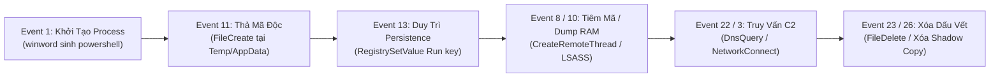

# Sổ Tay Tra Cứu Sysmon EventID Thực Chiến Cho SOC

Tài liệu được biên soạn dạng thẻ tra cứu cô đọng (Quick-Reference Cards) phục vụ chuyên viên SOC phân tích nhanh hành vi hệ thống từ nhật ký Microsoft Sysmon (System Monitor). Kênh lưu trữ nhật ký mặc định: `Applications and Services Logs/Microsoft/Windows/Sysmon/Operational`.

Trục liên kết sự kiện cốt tử trong Sysmon là cặp khóa `ProcessGuid` và `Computer`. Toàn bộ hành vi khởi tạo tiến trình, tải thư viện động, kết nối mạng, đọc ghi tập tin và thao tác khóa hệ thống đều có thể xâu chuỗi thông qua mã định danh duy nhất này.

---

## Chuỗi Tương Quan Hành Vi Tấn Công Điển Hình

Mô hình tấn công xuyên suốt từ giai đoạn thả mã độc, leo thang, duy trì đến liên lạc máy chủ điều khiển được xâu chuỗi qua các sự kiện Sysmon:



---

## Phân Nhóm 1: Giám Sát Tiến Trình Hệ Thống (Process Activity)

### EventID 1: Process Creation (Khởi Tạo Tiến Trình)
* **Ý nghĩa:** Ghi nhận mọi tiến trình mới được sinh ra trong hệ điều hành kèm thông tin cha, dòng lệnh, hàm băm và mức toàn vẹn.
* **Trường dữ liệu cốt lõi:** `UtcTime`, `ProcessGuid`, `ProcessId`, `Image`, `CommandLine`, `CurrentDirectory`, `User`, `LogonId`, `IntegrityLevel`, `Hashes`, `ParentProcessGuid`, `ParentProcessId`, `ParentImage`, `ParentCommandLine`.
* **Dấu hiệu đáng ngờ:**
  * Quan hệ cha con bất thường: `winword.exe`, `excel.exe`, `outlook.exe`, `w3wp.exe` sinh trực tiếp `cmd.exe`, `powershell.exe`, `mshta.exe`, `rundll32.exe`.
  * Lạm dụng công cụ nội tại (LOLBins): `certutil.exe -urlcache -split -f http...`, `bitsadmin.exe /transfer...`, `mshta.exe vbscript:...`, `regsvr32.exe /s /u /i:http...`.
  * Dòng lệnh obfuscation: Tham số mã hóa Base64 (`-enc`, `-EncodedCommand`), gọi tắt (`-w hidden`, `IEX`, `Invoke-Expression`).
* **Truy vấn Splunk kiểm tra:**
```bash
index=windows sourcetype="XmlWinEventLog:Microsoft-Windows-Sysmon/Operational" EventCode=1
| eval is_suspicious=case(
    match(ParentImage, "(?i)(winword|excel|powerpnt|outlook|w3wp)\.exe") AND match(Image, "(?i)(cmd|powershell|mshta|rundll32|wscript)\.exe"), "Malicious_Parent_Child",
    match(CommandLine, "(?i)(-enc|-encodedcommand|-w\s+hidden|certutil\s+-urlcache|bitsadmin\s+/transfer)"), "Suspicious_CommandLine",
    1=1, "Normal"
  )
| where is_suspicious!="Normal"
| table _time host User ParentImage Image CommandLine is_suspicious
```

### EventID 5: Process Terminate (Kết Thúc Tiến Trình)
* **Ý nghĩa:** Tiến trình kết thúc hoạt động hoặc bị cưỡng chế đóng bởi tiến trình khác.
* **Trường dữ liệu cốt lõi:** `UtcTime`, `ProcessGuid`, `ProcessId`, `Image`.
* **Ứng dụng điều tra:** Không cấu hình cảnh báo đơn lẻ. Sử dụng để đo lường thời gian tồn tại (Dwell Time) của mã độc hoặc đối soát thời điểm phần mềm diệt virus/tiến trình bảo mật bị kẻ tấn công tắt đột ngột trước khi thực hiện bước tiếp theo.

---

## Phân Nhóm 2: Mạng và Phân Giải Tên Miền (Network và DNS)

### EventID 3: Network Connection (Kết Nối Mạng Đi/Đến)
* **Ý nghĩa:** Ghi nhận các kết nối giao thức TCP/UDP được khởi tạo bởi tiến trình cục bộ ra máy chủ bên ngoài hoặc nhận từ mạng ngoài.
* **Trường dữ liệu cốt lõi:** `Image`, `User`, `Protocol`, `Initiated`, `SourceIp`, `SourcePort`, `DestinationIp`, `DestinationPort`, `DestinationHostname`.
* **Dấu hiệu đáng ngờ:**
  * Tiến trình hệ thống không bao giờ cần ra Internet lại khởi tạo kết nối: `spoolsv.exe`, `lsass.exe`, `svchost.exe` (không qua dịch vụ hệ thống chuẩn), `wordpad.exe`.
  * Cổng đích bất thường: Kết nối ra cổng lạ `4444`, `8080`, `8443`, `1337`, `6667` hoặc kết nối ra ngoài qua cổng DNS `53/TCP`.
* **Truy vấn Splunk kiểm tra:**
```bash
index=windows sourcetype="XmlWinEventLog:Microsoft-Windows-Sysmon/Operational" EventCode=3 Initiated=true
| search Image IN ("*\\powershell.exe", "*\\cmd.exe", "*\\rundll32.exe", "*\\lsass.exe", "*\\spoolsv.exe")
| stats count earliest(_time) as first_seen latest(_time) as last_seen by host User Image DestinationIp DestinationPort
| where NOT cidrmatch("10.0.0.0/8", DestinationIp) AND NOT cidrmatch("192.168.0.0/16", DestinationIp) AND NOT cidrmatch("172.16.0.0/12", DestinationIp)
| sort - count
```

### EventID 22: DNS Query (Phân Giải Tên Miền)
* **Ý nghĩa:** Tiến trình thực hiện truy vấn tên miền DNS bất kể thành công hay thất bại.
* **Trường dữ liệu cốt lõi:** `ProcessGuid`, `Image`, `QueryName`, `QueryStatus`, `QueryResults`.
* **Dấu hiệu đáng ngờ:**
  * Thuật toán sinh tên miền tự động (DGA): Tên miền độ dài lớn, chuỗi ký tự ngẫu nhiên entropy cao (`x8a9b2c3d4f.top`).
  * Kênh ngầm DNS (DNS Tunneling): Truy vấn liên tục các subdomain dạng dữ liệu mã hóa Base64/Hex gửi kèm bản ghi TXT/CNAME.
  * Tiến trình shell thực hiện phân giải: `powershell.exe`, `cmd.exe`, `certutil.exe` gọi trực tiếp DNS Query.

---

## Phân Nhóm 3: Bộ Nhớ, Tiêm Mã và Trích Xuất Thông Tin Xác Thực (Memory, Injection và Credentials)

### EventID 7: Image Loaded (Nạp Thư Viện Động DLL)
* **Ý nghĩa:** Ghi nhận module/DLL được nạp vào không gian bộ nhớ của tiến trình, đi kèm trạng thái chữ ký số.
* **Trường dữ liệu cốt lõi:** `Image`, `ImageLoaded`, `Hashes`, `Signed`, `Signature`, `SignatureStatus`.
* **Dấu hiệu đáng ngờ:**
  * Kỹ thuật DLL Sideloading: Tiến trình hợp lệ nạp DLL giả mạo đặt cùng thư mục người dùng (`C:\Users\...\AppData`).
  * DLL không có chữ ký số hợp lệ (`Signed=false` hoặc `SignatureStatus!=Valid`) được nạp vào các tiến trình nhạy cảm như `lsass.exe`, `winlogon.exe`.

### EventID 8: CreateRemoteThread (Tiêm Tiểu Trình Từ Xa)
* **Ý nghĩa:** Một tiến trình (`SourceImage`) tạo một tiểu trình mới bên trong không gian bộ nhớ của tiến trình mục tiêu (`TargetImage`).
* **Trường dữ liệu cốt lõi:** `SourceProcessGuid`, `SourceImage`, `TargetProcessGuid`, `TargetImage`, `StartAddress`, `StartModule`, `StartFunction`, `NewThreadId`.
* **Dấu hiệu đáng ngờ:**
  * Kỹ thuật Process Injection (MITRE ATT&CK T1055): Tiến trình lạ tiêm vào các tiến trình hệ thống cốt lõi (`explorer.exe`, `svchost.exe`, `lsass.exe`, `spoolsv.exe`).
  * `StartModule` hoặc `StartFunction` để trống hoặc trỏ vào vùng nhớ không thuộc module hệ thống nào (Unbacked Memory Region).

### EventID 10: ProcessAccess (Mở Quyền Truy Cập Bộ Nhớ Tiến Trình)
* **Ý nghĩa:** Tiến trình mở handle truy cập tiến trình khác với các cờ đặc quyền cụ thể (`GrantedAccess`).
* **Trường dữ liệu cốt lõi:** `SourceImage`, `TargetImage`, `GrantedAccess`, `CallTrace`.
* **Dấu hiệu đáng ngờ:**
  * Trích xuất thông tin xác thực bộ nhớ (LSASS Credential Dumping): `TargetImage` kết thúc bằng `lsass.exe` với mã quyền hạn nguy hiểm:
    * `0x1010`: `PROCESS_QUERY_LIMITED_INFORMATION` kết hợp `PROCESS_VM_READ`.
    * `0x1410`: Quyền đọc dữ liệu bộ nhớ ảo và thông tin luồng.
    * `0x1438`: Quyền đọc bộ nhớ kèm nhân bản handle (`PROCESS_DUP_HANDLE`).
    * `0x1FFFFF`: Toàn quyền kiểm soát tiến trình (`PROCESS_ALL_ACCESS`).
* **Truy vấn Splunk kiểm tra:**
```bash
index=windows sourcetype="XmlWinEventLog:Microsoft-Windows-Sysmon/Operational" EventCode=10 TargetImage="*\\lsass.exe"
| search GrantedAccess IN ("0x1010", "0x1410", "0x1438", "0x1FFFFF")
| search NOT SourceImage IN ("*\\MsMpEng.exe", "*\\csfalconservice.exe", "*\\EDR_Agent.exe")
| stats count min(_time) as first_seen max(_time) as last_seen by host SourceImage TargetImage GrantedAccess CallTrace
| sort - count
```

### EventID 25: Process Tampering (Làm Xáo Trộn Tiến Trình)
* **Ý nghĩa:** Phát hiện kỹ thuật can thiệp cấu trúc tiến trình như Process Hollowing, Process Herpaderping, Process Doppelganging.
* **Trường dữ liệu cốt lõi:** `UtcTime`, `ProcessGuid`, `Image`, `Type`.
* **Hành động xử lý:** Tỷ lệ cảnh báo giả rất thấp. Khi xuất hiện Event 25, SOC cần coi đây là sự cố nghiêm trọng cấp độ cao, tiến hành cô lập máy trạm và trích xuất bộ nhớ tiến trình ngay lập tức.

---

## Phân Nhóm 4: Hệ Thống Tập Tin và Xóa Dấu Vết (File System và Anti-Forensics)

### EventID 2: File Creation Time Changed (Timestomping)
* **Ý nghĩa:** Thời gian khởi tạo của tập tin (`CreationUtcTime`) bị chỉnh sửa can thiệp thủ công.
* **Trường dữ liệu cốt lõi:** `Image`, `TargetFilename`, `CreationUtcTime`, `PreviousCreationUtcTime`.
* **Dấu hiệu đáng ngờ:** Kẻ tấn công sao chép mốc thời gian từ các tệp tin hệ thống như `kernel32.dll` gán cho mã độc vừa tải về nhằm đánh lừa điều tra viên sử dụng phương pháp đối soát thời gian (T1070.006).

### EventID 11: FileCreate (Tạo Tập Tin Mới)
* **Ý nghĩa:** Tập tin mới được tạo hoặc bị ghi đè lên đĩa cứng.
* **Trường dữ liệu cốt lõi:** `ProcessGuid`, `Image`, `TargetFilename`, `CreationUtcTime`.
* **Dấu hiệu đáng ngờ:**
  * Tập tin thực thi (`.exe`, `.dll`, `.ps1`, `.bat`, `.vbs`, `.hta`, `.cpl`) được sinh ra trong các thư mục ghi tự do của người dùng: `C:\Users\*\AppData\Local\Temp`, `C:\ProgramData`, `C:\Users\Public`, `C:\Windows\Temp`.
  * Tệp tin được sinh trực tiếp vào thư mục tự khởi động (Startup Folder).

### EventID 15: FileCreateStreamHash (Alternate Data Streams - ADS)
* **Ý nghĩa:** Dữ liệu được ghi vào luồng dữ liệu thay thế NTFS (`filename:streamname`).
* **Trường dữ liệu cốt lõi:** `TargetFilename`, `Hashes`, `Contents`.
* **Dấu hiệu đáng ngờ:** Kẻ tấn công ẩn giấu mã độc hoặc script thực thi phía sau một tệp văn bản hợp lệ (`report.txt:payload.exe`), ngoài luồng định danh nguồn tải xuống hợp lệ `Zone.Identifier`.

### EventID 23 và 26: File Delete (Xóa Tập Tin)
* **EventID 23 (FileDeleteArchived):** Sysmon ghi nhận sự kiện xóa tập tin và đồng thời lưu một bản sao an toàn vào thư mục lưu trữ `C:\Sysmon` phục vụ giải mã, trích xuất mã độc.
* **EventID 26 (FileDeleteDetected):** Chỉ ghi nhận sự kiện xóa mà không lưu lại bản sao (giảm tải dung lượng đĩa).
* **Dấu hiệu đáng ngờ:** Ransomware tiến hành xóa hàng loạt tệp tin dữ liệu gốc sau khi mã hóa, hoặc xóa bản sao lưu phục hồi hệ thống Shadow Copies (`vssadmin delete shadows`).

### EventID 27, 28 và 29: Kiểm Soát Tập Tin Thực Thi Nâng Cao
* **EventID 27 (FileBlockExecutable):** Sysmon ngăn chặn không cho phép ghi tập tin thực thi theo chính sách cấu hình bảo vệ.
* **EventID 28 (FileBlockShredding):** Sysmon phát hiện và ngăn chặn hành vi băm nát tệp tin (Anti-Forensics File Shredding) của mã độc phá hủy dữ liệu (Wiper).
* **EventID 29 (FileExecutableDetected):** Phát hiện tệp tin cấu trúc thực thi PE được tạo mới ngay cả khi tệp tin bị đổi phần mở rộng sang `.txt`, `.jpg`, `.pdf` nhằm qua mặt bộ lọc.

---

## Phân Nhóm 5: Duy Trì Sự Hiện Diện Bằng Registry (Registry Persistence)

| EventID | Tên Sự Kiện | Ý Nghĩa Kỹ Thuật | Điểm Nóng Cần Giám Sát |
| :--- | :--- | :--- | :--- |
| **Event 12** | RegistryCreate / Delete | Tạo hoặc xóa một Key/Value trong Registry. | Xóa khóa cấu hình phòng thủ, xóa dịch vụ hệ thống. |
| **Event 13** | RegistrySetValue | Thiết lập giá trị dữ liệu cho một tham số Registry. | Ghi đường dẫn mã độc vào Run, RunOnce, IFEO, Winlogon Shell. |
| **Event 14** | RegistryRename | Đổi tên Key/Value nhằm trốn tránh các luật giám sát theo chuỗi ký tự cứng. | Đổi tên khóa Run sang tên ngẫu nhiên để che giấu. |

### Các nhánh Registry nhạy cảm thường bị khai thác (Điểm nóng Event 13):
* `HKLM\Software\Microsoft\Windows\CurrentVersion\Run` và `RunOnce`
* `HKCU\Software\Microsoft\Windows\CurrentVersion\Run` và `RunOnce`
* `HKLM\Software\Microsoft\Windows NT\CurrentVersion\Image File Execution Options` (IFEO - Debugger hijack)
* `HKLM\System\CurrentControlSet\Services\*\ImagePath` (Cài đặt dịch vụ độc hại)
* `HKLM\Software\Microsoft\Windows NT\CurrentVersion\Winlogon\Userinit` và `Shell`

---

## Phân Nhóm 6: Cơ Chế Duy Trì Bằng WMI (WMI Persistence)

Kỹ thuật WMI Persistence (T1546.003) yêu cầu sự phối hợp chặt chẽ của bộ ba sự kiện:

* **EventID 19 (WmiEventFilter activity detected):** Đăng ký điều kiện lọc WQL (Ví dụ: kích hoạt khi hệ thống khởi động hoặc người dùng đăng nhập).
* **EventID 20 (WmiEventConsumer activity detected):** Đăng ký hành động thực thi (CommandLineEventConsumer gọi PowerShell hoặc Script).
* **EventID 21 (WmiEventConsumerToFilter activity detected):** Gắn kết Filter với Consumer tạo thành cơ chế kích hoạt hoàn chỉnh.

> Khi xuất hiện đồng thời Event 19, 20 và 21 trong thời gian ngắn mà Consumer trỏ vào `powershell.exe`, `cmd.exe` hoặc script ẩn, đây là dấu hiệu mã độc APT duy trì hiện diện không dùng tệp (Fileless Persistence).

---

## Phân Nhóm 7: Đường Ống Giao Tiếp và Thao Tác Đĩa (Pipes và Raw Access)

### EventID 9: RawAccessRead (Đọc Trực Tiếp Thiết Bị Lưu Trữ)
* **Ý nghĩa:** Tiến trình vượt qua tầng điều khiển hệ thống tập tin (File System API) để đọc trực tiếp bề mặt đĩa cứng (`\\.\PhysicalDrive0` hoặc `\\.\C:`).
* **Dấu hiệu đáng ngờ:** Ngoại trừ phần mềm sao lưu hoặc diệt virus, nếu tiến trình người dùng thực hiện đọc đĩa thô, mục đích thường là sao chép bảng MFT, đọc lậu tệp cơ sở dữ liệu xác thực `NTDS.dit`, SAM Registry hoặc mã độc Wiper chuẩn bị phá hủy cấu trúc bảng phân vùng.

### EventID 17 và 18: Named Pipe (Tạo và Kết Nối Đường Ống Giao Tiếp)
* **EventID 17 (PipeCreated):** Tạo Named Pipe phục vụ giao tiếp nội bộ giữa các tiến trình.
* **EventID 18 (PipeConnected):** Tiến trình kết nối vào Named Pipe đã tạo.
* **Dấu hiệu nhận diện công cụ tấn công:**
  * PsExec: Khởi tạo named pipe dạng `\PSEXESVC`.
  * Cobalt Strike: Thường sử dụng mẫu pipe mặc định như `\MSSE-*-server`, `\status_*`, `\msagent_*`.
  * SMBExec: Đường ống ngẫu nhiên phục vụ điều khiển phiên lệnh qua cổng 445/SMB.

---

## Phân Nhóm 8: Cấu Hình và Nhật Ký Vận Hành (Configuration và Health)

* **EventID 4 (Sysmon service state changed):** Trạng thái dịch vụ Sysmon thay đổi (`Started` hoặc `Stopped`). Sự kiện `Stopped` cần kích hoạt cảnh báo an ninh P1 ngay lập tức vì đây là dấu hiệu kẻ tấn công gỡ dịch vụ hoặc làm tê liệt hệ thống giám sát.
* **EventID 6 (Driver loaded):** Trình điều khiển kernel (`.sys`) được nạp. Giám sát các driver không có chữ ký số hoặc driver bị khai thác lỗ hổng nhằm leo thang đặc quyền kernel (BYOVD - Bring Your Own Vulnerable Driver).
* **EventID 16 (Sysmon config state changed):** Tệp tin cấu hình Sysmon bị thay đổi, hiển thị hàm băm cấu hình mới. Báo hiệu cấu hình bị quản trị viên cập nhật hoặc kẻ tấn công nới lỏng bộ lọc nhằm che giấu hành vi.
* **EventID 24 (ClipboardChange):** Dữ liệu khay nhớ tạm hệ thống bị thay đổi. Hữu ích trong truy vết mã độc đánh cắp mật khẩu (Stealer) hoặc mã độc thay đổi địa chỉ ví tiền điện tử (Clipper).
* **EventID 255 (Error):** Lỗi vận hành nội bộ của Sysmon (hết bộ nhớ đệm, lỗi phân tích cú pháp cấu hình, lỗi giao tiếp kernel minifilter).

---

## Bảng Ma Trận Tóm Tắt Quy Chuẩn Thu Thập Sysmon Cho SOC

| Mức Độ Ưu Tiên | Danh Sách EventID | Chiến Lược Cấu Hình Lọc | Rủi Ro Về Lưu Lượng |
| :--- | :--- | :--- | :--- |
| **Bắt buộc (Must-Have)** | **1, 3, 8, 10, 11, 13, 22** | Thu thập toàn diện tiến trình, mạng, bộ nhớ LSASS, Registry Run, phân giải DNS. | Trung bình (cần loại trừ tiến trình nền sạch). |
| **Quan trọng (High-Value)** | **17, 18, 19, 20, 21, 25** | Giám sát Named Pipe tấn công, cơ chế duy trì WMI, phát hiện làm xáo trộn tiến trình. | Thấp (ít phát sinh sự kiện giả). |
| **Điều tra sâu (Forensic-Only)** | **2, 7, 9, 12, 14, 15, 23, 26, 29** | Chỉ bật nạp DLL cho tiến trình nhạy cảm; giám sát xóa tệp tin và ADS chọn lọc. | Cao (nếu không cấu hình whitelist sẽ gây tràn log). |
| **Quản trị sensor (Health)** | **4, 6, 16, 255** | Bắt buộc thu thập 100% để phát hiện hành vi vô hiệu hóa sensor và lỗi phân tích. | Rất thấp. |

