# Tuần 3: Kiến Trúc Splunk Phân Tán và Ngôn Ngữ SPL
> **Tài liệu chuẩn hóa chuyên sâu về giải pháp quản trị log tập trung, kiến trúc phân tán Splunk Enterprise (Universal Forwarder, Indexer Cluster, Search Head Cluster, Deployment Server), cơ chế xử lý dữ liệu qua bộ ba `inputs.conf` - `props.conf` - `transforms.conf`, Knowledge Objects (CIM), Vòng đời Bucket, Hướng dẫn triển khai Lab 5 Nodes thực tế và Cẩm nang ngôn ngữ truy vấn SPL.**

---

## 1. Tổng Quan Về Log Management và Hệ Thống SIEM

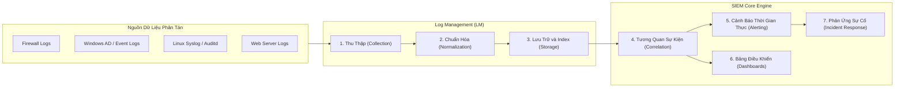

### 1.1 Bài Toán Trong Vận Hành Bảo Mật

Mọi thành phần trong hạ tầng CNTT (máy trạm, máy chủ, thiết bị mạng, ứng dụng, cơ sở dữ liệu) đều liên tục sinh ra nhật ký hoạt động (log). Tuy nhiên, các log này thường tồn tại ở trạng thái:
* **Phân tán cục bộ**: Nằm rải rác trên hàng trăm máy chủ độc lập.
* **Không đồng nhất về định dạng**: Syslog, JSON, XML (EVTX), Text thô, CEF.
* **Thiếu khả năng giám sát tập trung**: Kẻ tấn công thực hiện chuỗi hành vi xâm nhập qua nhiều bước (*Reconnaissance $\rightarrow$ Phishing $\rightarrow$ Lateral Movement $\rightarrow$ Data Exfiltration*), mỗi bước để lại một dấu vết trên các thiết bị khác nhau. Nếu không tập trung dữ liệu, SOC Analyst hoàn toàn "mù" trước bức tranh toàn cảnh của cuộc tấn công.

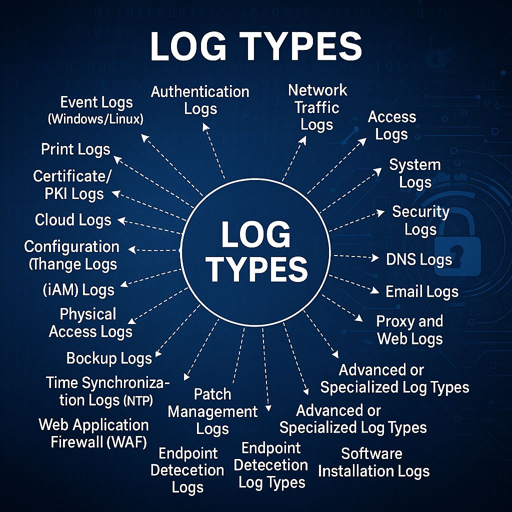

---

### 1.2 Tại Sao Tổ Chức Bắt Buộc Cần Hệ Thống SIEM?

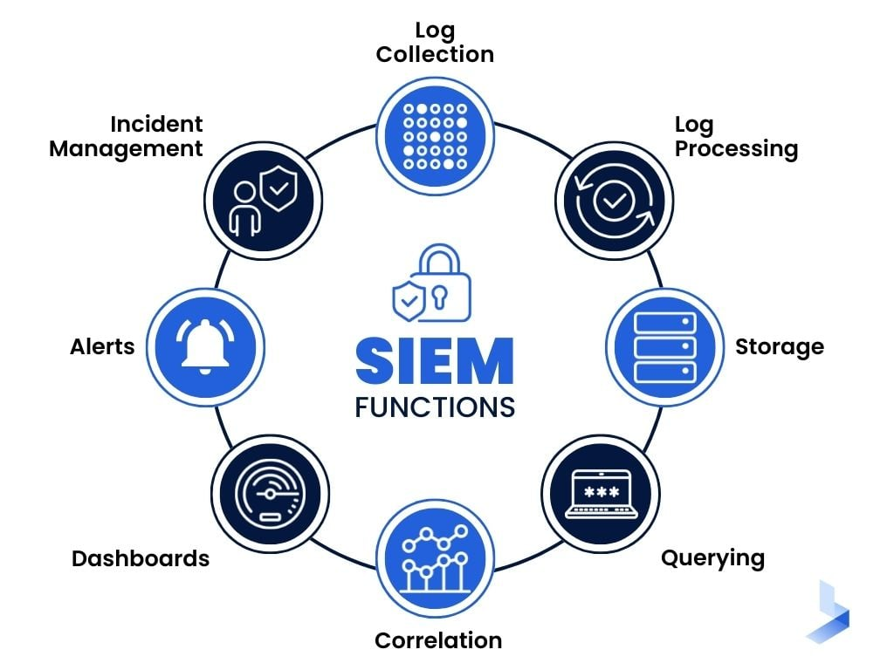

1. **Correlation (Tương quan sự kiện đa nguồn)**:
 - Một sự kiện đăng nhập thất bại đơn lẻ là bình thường.
 - Nhưng **50 lượt đăng nhập thất bại trong 2 phút** trên Active Directory, ngay sau đó là **1 lượt đăng nhập thành công**, tiếp theo là **kết nối mạng ra địa chỉ IP C2 độc hại** $\rightarrow$ Đây là một cuộc tấn công có chủ đích (**True Positive Attack**). Khả năng ghép nối các mảnh ghép riêng lẻ này chỉ có thể thực hiện được trên SIEM.
2. **Compliance (Tuân thủ tiêu chuẩn an ninh quốc tế)**:
 - Các chuẩn mực như **PCI DSS** (bảo vệ dữ liệu thẻ ngân hàng), **HIPAA** (y tế), **ISO 27001**, **SOX**, **GDPR** bắt buộc tổ chức phải thu thập, lưu trữ toàn vẹn nhật ký tối thiểu từ 90 ngày đến 1 năm và có khả năng xuất báo cáo kiểm toán (Audit Trail).
3. **Visibility (Tầm nhìn an ninh tổng thể)**:
 - Cung cấp một bảng điều khiển duy nhất (Single Pane of Glass) giúp SOC Analyst nắm bắt trạng thái an ninh của toàn bộ tổ chức theo thời gian thực.
4. **Giảm Chỉ Số MTTD và MTTR**:
 - Theo báo cáo *IBM Cost of a Data Breach Report*, chi phí trung bình của một vụ rò rỉ dữ liệu đã lên tới **4.88 triệu USD**. Việc triển khai SIEM giúp rút ngắn thời gian phát hiện (MTTD) từ hàng tháng xuống còn vài phút, giảm thiểu tối đa thiệt hại tài chính.

---

## 2. Tổng Quan Nền Tảng Splunk Enterprise và Các Thành Phần Kiến Trúc

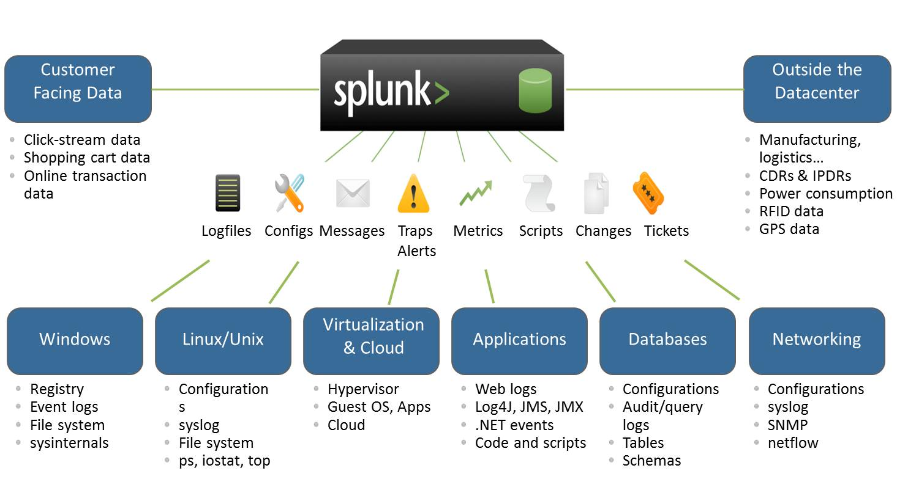

**Splunk Enterprise** là nền tảng xử lý dữ liệu máy (Machine Data) và SIEM phân tán hàng đầu thế giới, hoạt động dựa trên nguyên lý: **Thu thập dữ liệu thô $\rightarrow$ Phân tích cú pháp thời gian thực $\rightarrow$ Lưu trữ dưới dạng Index $\rightarrow$ Truy vấn song song với ngôn ngữ SPL**.

---

### 2.1 Các Thành Phần Cốt Lõi (Splunk Architecture Components)

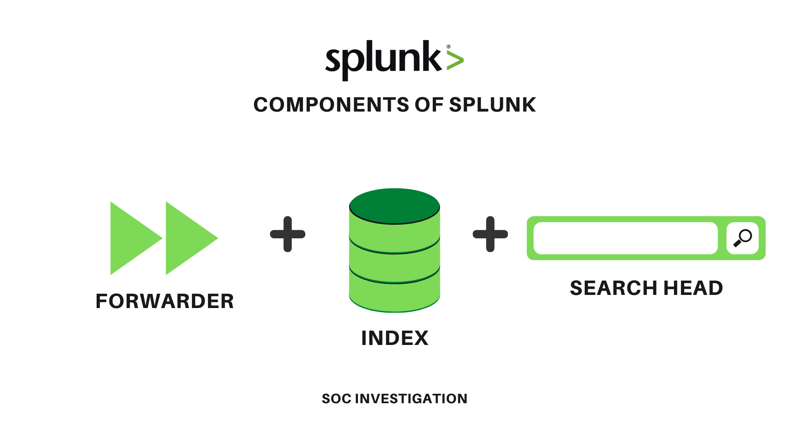
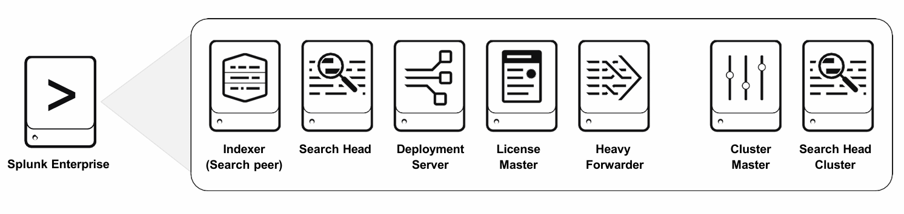

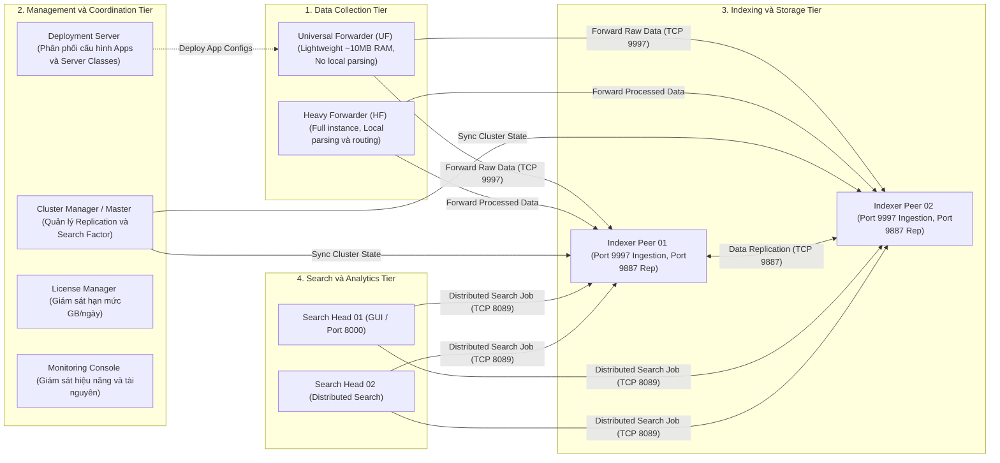

#### 1. Forwarder (Thu Thập Dữ Liệu Tại Nguồn)


* **Universal Forwarder (UF)**: Agent siêu nhẹ (~10MB RAM, <1% CPU), chỉ thu thập log thô và gửi trực tiếp qua cổng TCP `9997`. Không có giao diện web, không phân tích cú pháp tại chỗ. Thích hợp cài đặt hàng loạt trên hàng nghìn Endpoint.
* **Heavy Forwarder (HF)**: Một instance Splunk Enterprise hoàn chỉnh, thực hiện phân tích cú pháp (Parsing), lọc bỏ log rác (Filtering) và định tuyến dữ liệu (Routing) sang các hệ thống khác trước khi chuyển về Indexer.

#### 2. Indexer (Xử Lý, Đánh Chỉ Mục và Lưu Trữ)
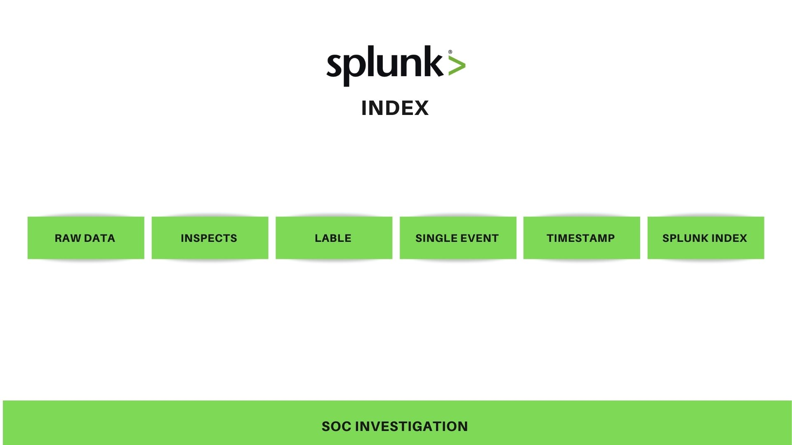

* **Nhiệm vụ**: Tiếp nhận luồng dữ liệu từ Forwarder, thực hiện chia dòng (*Line-breaking*), nhận diện Timestamp, bóc tách các trường siêu dữ liệu (*host, source, sourcetype*) và nén lưu trữ vào các Bucket trên đĩa.
* **Indexer Cluster**: Mô hình nhóm nhiều Indexer để phân tải và dự phòng dữ liệu (*High Availability*). Được quản lý bởi **Cluster Manager (Master Node)**.

#### 3. Search Head (Giao Diện Người Dùng và Phân Tích)
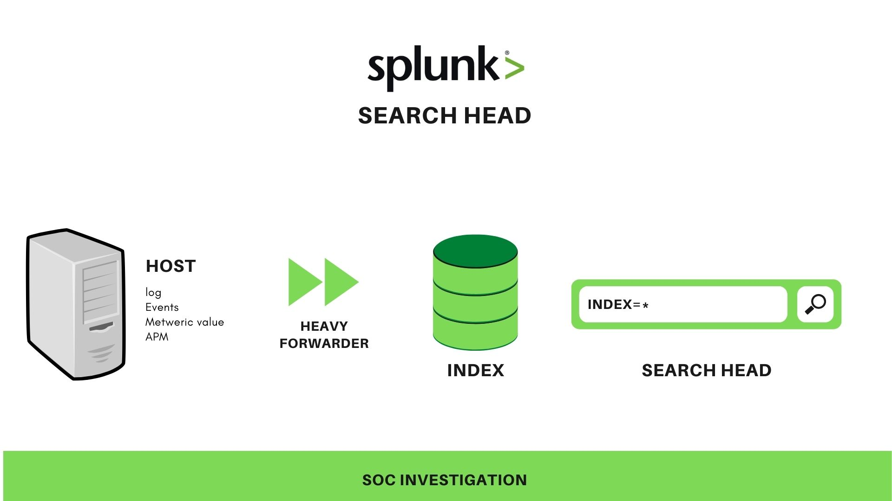

* **Nhiệm vụ**: Cung cấp giao diện Web GUI (Port `8000`), tiếp nhận câu truy vấn SPL từ người dùng, phân phối Search Job xuống tất cả các Indexer (Distributed Search), thu thập và gộp kết quả trả về. Search Head chỉ lưu trữ Knowledge Objects (Reports, Dashboards, Alerts), **không lưu trữ log thô**.
* **Search Head Cluster (SHC)**: Nhóm từ 3 Search Head trở lên, được điều phối bởi **Captain Node** để cân bằng tải truy vấn cho hàng trăm Analyst đồng thời.

#### 4. Deployment Server (Quản Lý Cấu Hình Tập Trung)
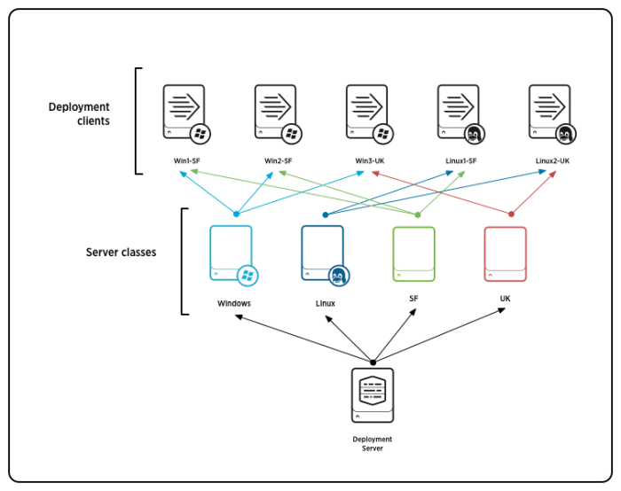

* Quản lý và phân phối tự động các gói cấu hình (**Deployment Apps**) đến hàng nghìn Forwarder dựa trên nhóm máy (**Server Classes**) mà không cần thao tác thủ công trên từng Endpoint.

#### 5. License Master và Monitoring Console (MC)
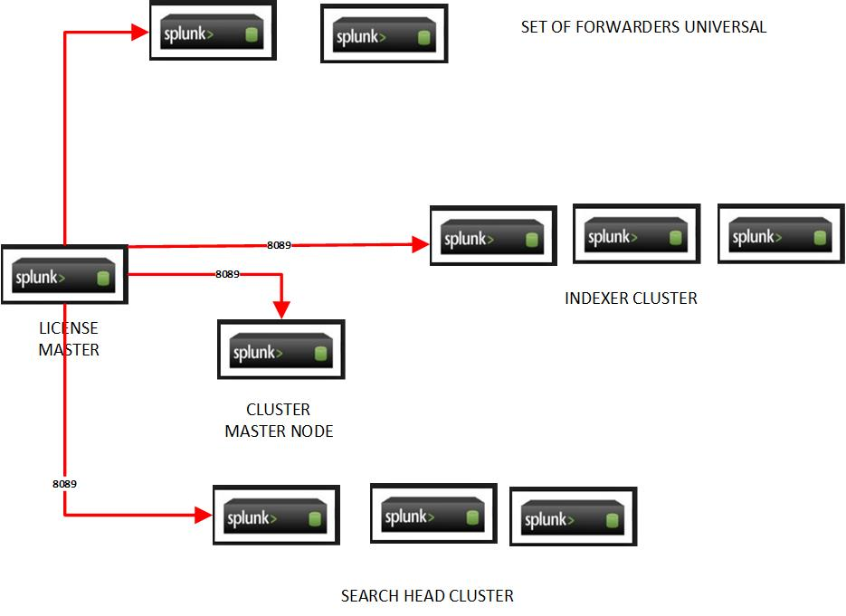

* **License Master**: Quản lý và giám sát dung lượng log được index hàng ngày (GB/day) theo hạn ngạch bản quyền.
* **Monitoring Console (MC)**: Trung tâm giám sát sức khỏe toàn diện của hệ thống Splunk (CPU, RAM, Disk I/O, Search Concurrency, Forwarder Connection).

---

### 2.2 Các Mô Hình Triển Khai Splunk (Deployment Models)

| Mô hình Triển khai | Cấu trúc Hạ tầng | Ưu điểm | Nhược điểm và Khi nào dùng |
| :--- | :--- | :--- | :--- |
| **Single-Instance** | Tất cả thành phần (Search Head, Indexer, Forwarder receiver) chạy chung trên 1 máy chủ duy nhất. | Cài đặt cực nhanh, chi phí thấp, cấu hình đơn giản. | Không có tính dự phòng, không scale được. Dùng cho **Lab, Dev, PoC, < 20 GB/ngày**. |
| **Distributed (Non-clustered)** | Tách riêng Search Head và các Indexer trên các máy chủ độc lập. | Scale ngang năng lực tính toán và lưu trữ. | Nếu 1 Indexer chết, một phần dữ liệu không search được. Dùng cho **Doanh nghiệp vừa**. |
| **Clustered Enterprise** | **Indexer Cluster** (với Cluster Manager, `RF=2, SF=2`) kết hợp **Search Head Cluster (SHC)**. | **Độ sẵn sàng cao tuyệt đối (HA)**, không mất dữ liệu, tự động cân bằng tải. | Chi phí hạ tầng cao, cấu hình phức tạp. Dùng cho **SOC Doanh nghiệp lớn, MSSP, Ngân hàng**. |

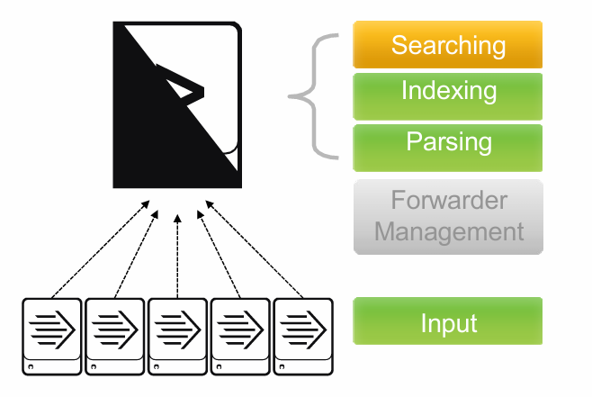
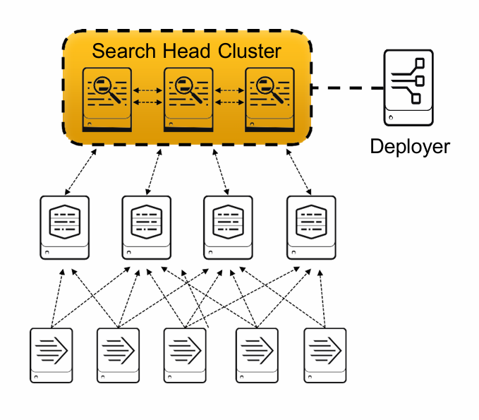
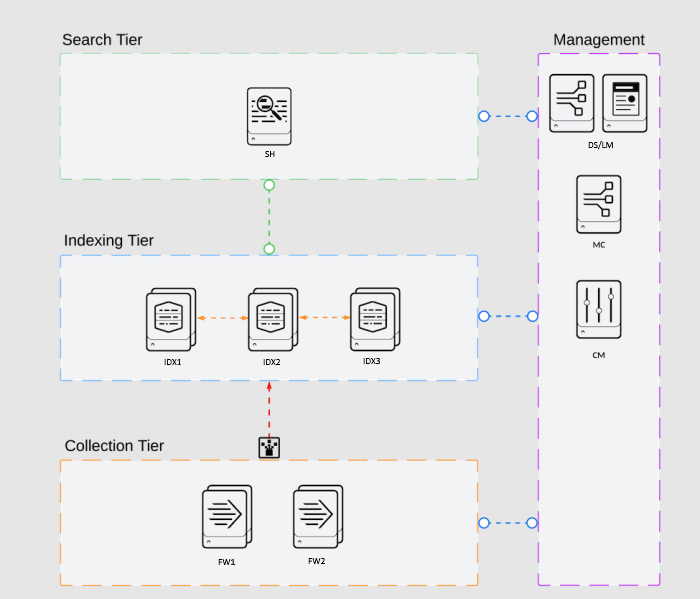

---

## 3. Pipeline Thu Thập, Xử Lý Dữ Liệu và Vòng Đời Bucket

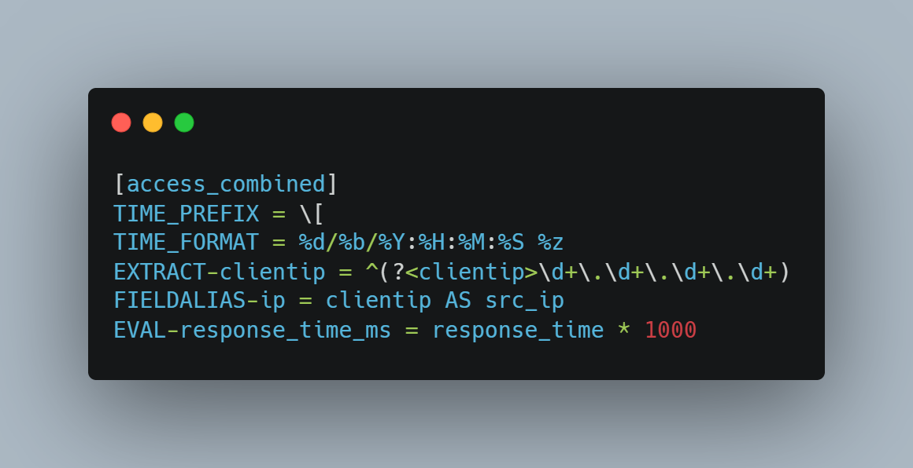

---

### 3.1 Bộ Ba Tệp Tin Cấu Hình Xử Lý Log: `inputs.conf` - `props.conf` - `transforms.conf`

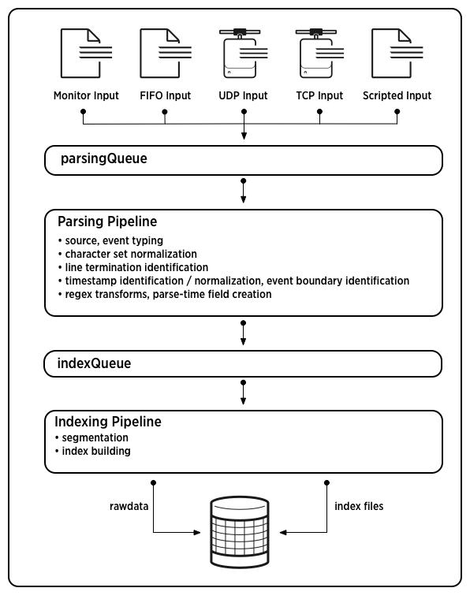

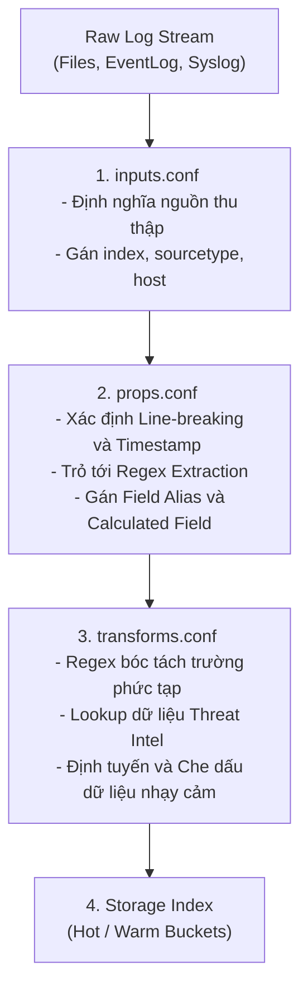

1. **`inputs.conf` (Nơi lấy dữ liệu)**:
   ```ini
   [monitor:///var/log/apache2/access.log]
   index = web_logs
   sourcetype = access_combined
   crcSalt = <SOURCE>
   ```
2. **`props.conf` (Cách thức tiền xử lý)**:
   ```ini
   [access_combined]
   TIME_PREFIX = \[
   TIME_FORMAT = %d/%b/%Y:%H:%M:%S %z
   MAX_TIMESTAMP_LOOKAHEAD = 30
   EXTRACT-clientip = ^(?<clientip>\d+\.\d+\.\d+\.\d+)
   FIELDALIAS-cim_ip = clientip AS src_ip
   EVAL-response_time_ms = response_time * 1000
   ```
3. **`transforms.conf` (Bóc tách nâng cao và Tra cứu)**:
   ```ini
   [extract_url_params]
   REGEX = \?(?<param_name>[^=]+)=(?<param_value>[^&]+)
   MV_ADD = true

   [threat_intel_lookup]
   filename = malicious_ips.csv
   default_match = false
   ```

---

### 3.2 Khái Niệm Knowledge Objects và Mô Hình Dữ Liệu Chung (CIM)

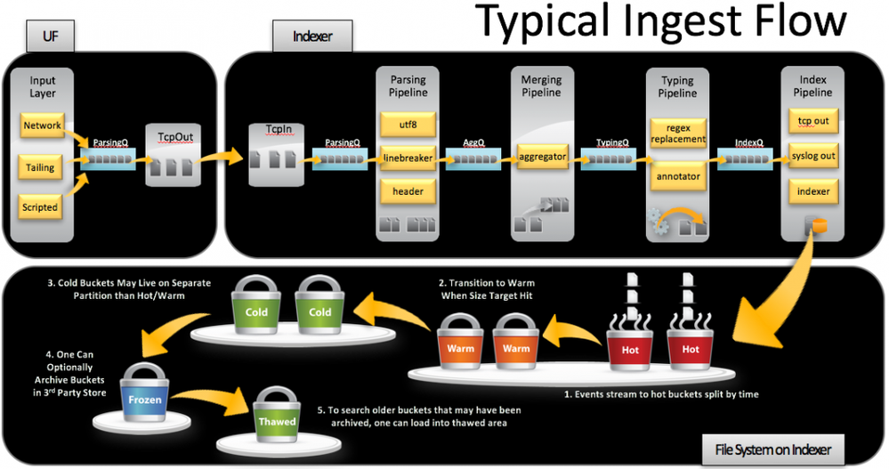
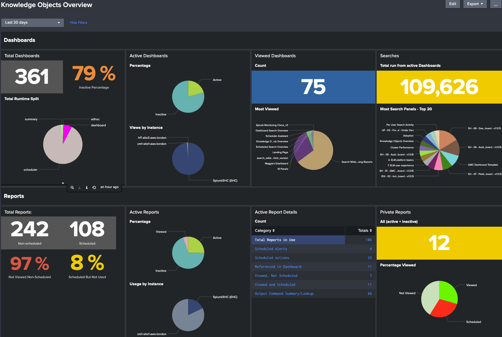

> [!important] Phân biệt các loại Knowledge Objects
> * **Extract Fields**: Bóc tách các trường dữ liệu có cấu trúc từ chuỗi text thô tại thời điểm tìm kiếm (*Search-time*).
> * **Field Alias**: Đổi tên hoặc gán thêm tên mới cho trường dữ liệu đã có để tương thích chuẩn CIM (ví dụ: `clientip AS src_ip`).
> * **Calculated Fields (`EVAL`)**: Tạo ra trường dữ liệu mới dựa trên phép tính toán logic hoặc hàm toán học (ví dụ: đổi bytes sang MB).
> * **Lookups**: Kết hợp dữ liệu log thời gian thực với bảng tra cứu ngoài (CSV hoặc KV Store) để làm giàu thông tin (*Threat Intel IP, GeoLocation, User Identity*).
> * **CIM (Common Information Model)**: Chuẩn hóa tên trường của hàng chục hãng công nghệ khác nhau về một định dạng thống nhất (ví dụ: `src`, `dest`, `user`, `action`).

#### Phân Biệt Splunk App vs Splunk Add-on (Technology Add-on - TA):
* **Technology Add-on (TA)**: Được cài trên Forwarder/Indexer/Search Head nhằm mục đích **Ingest và Parse dữ liệu**, chuẩn hóa tên trường về đúng chuẩn CIM (ví dụ: `Splunk_TA_windows`, `Splunk_TA_nix`).
* **Splunk App**: Cung cấp giao diện trực quan, Dashboards, Báo cáo và Luồng công việc chuyên sâu phục vụ nghiệp vụ (ví dụ: `Splunk Enterprise Security - ES`).

---

### 3.3 Cơ Chế Lưu Trữ và Vòng Đời Bucket (Bucket Lifecycle)

Dữ liệu trong mỗi Index được chia nhỏ thành các thư mục gọi là **Buckets**. Splunk không quản lý thời gian sống theo từng event mà quản lý theo từng Bucket:

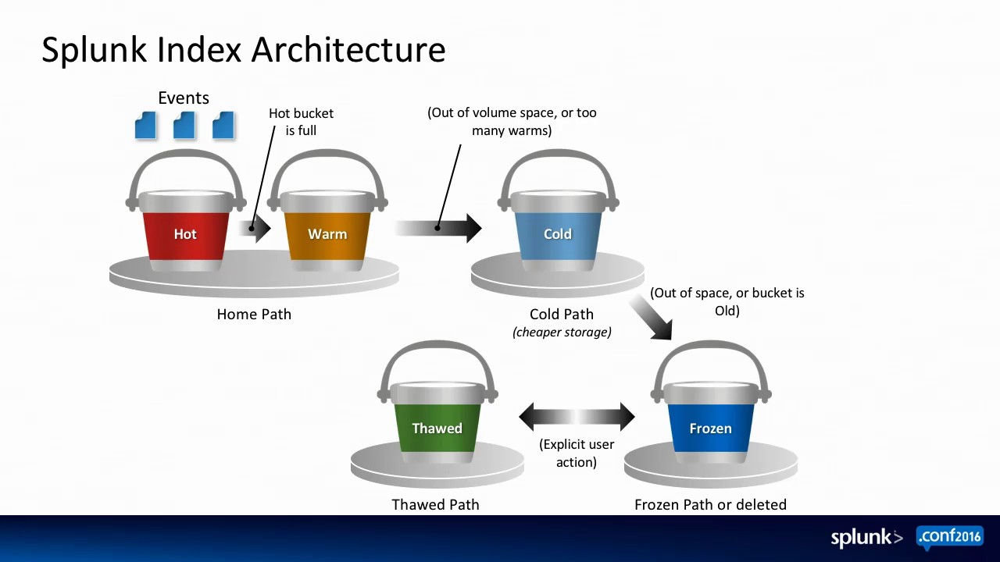

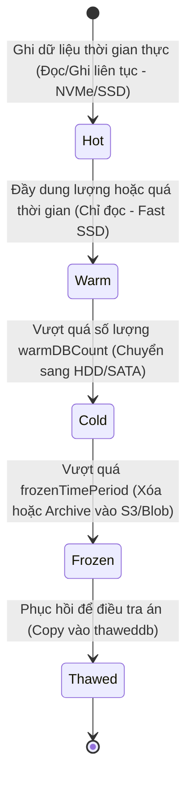

* **Hot Bucket**: Đang mở để ghi dữ liệu mới. Nằm trên ổ cứng nhanh nhất.
* **Warm Bucket**: Đã đóng, chuyển sang chế độ chỉ đọc nhưng vẫn nằm trên ổ cứng nhanh để tìm kiếm thường xuyên.
* **Cold Bucket**: Dữ liệu cũ chuyển sang ổ cứng lưu trữ dung lượng lớn, giá rẻ (HDD).
* **Frozen Bucket**: Hết hạn lưu trữ (ví dụ sau 90 ngày), tự động bị xóa vĩnh viễn hoặc đẩy vào kho lưu trữ lạnh (AWS S3 Glacier).
* **Thawed Bucket**: Dữ liệu Frozen được giải nén phục hồi vào thư mục `thaweddb` để phục vụ điều tra án số (*Forensics*).

---

## 4. Thực Hành Triển Khai Lab Multi-Node Splunk Cluster Thực Tế (5 Máy)

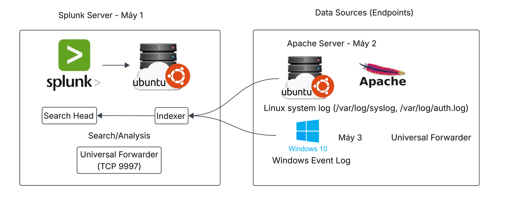

### 4.1 Bảng Phân Bổ Địa Chỉ IP và Vai Trò Node Trong Lab

| Máy | Địa Chỉ IP | Hệ Điều Hành | Vai Trò Splunk | User Quản Trị | Cổng Dịch Vụ Mở |
| :--- | :---: | :---: | :--- | :--- | :--- |
| **Máy 1** | `10.0.0.10` | Ubuntu 22.04 LTS | **Search Head + Cluster Manager + Deployment Server** | `splunk` / `hope` | Web (8000), REST API (8089) |
| **Máy 2** | `10.0.0.20` | Ubuntu 22.04 LTS | **Indexer Peer 01** (Cluster Member) | `id1` | Ingest (9997), Replication (9887) |
| **Máy 3** | `10.0.0.30` | Ubuntu 22.04 LTS | **Indexer Peer 02** (Cluster Member) | `id2` | Ingest (9997), Replication (9887) |
| **Máy 4** | `10.0.0.40` | Ubuntu 22.04 LTS | **Endpoint (Universal Forwarder)** + Apache2 | `splunkf` | Forward Logs $\rightarrow$ 9997 |
| **Máy 5** | `10.0.0.50` | Windows Server 2022 | **Domain Controller (Universal Forwarder)** | `hope` | Forward AD và Sysmon $\rightarrow$ 9997 |

---

### 4.2 Minh Chứng Các Bước Triển Khai Thực Tế Trong Lab (10 Bước)

````carousel
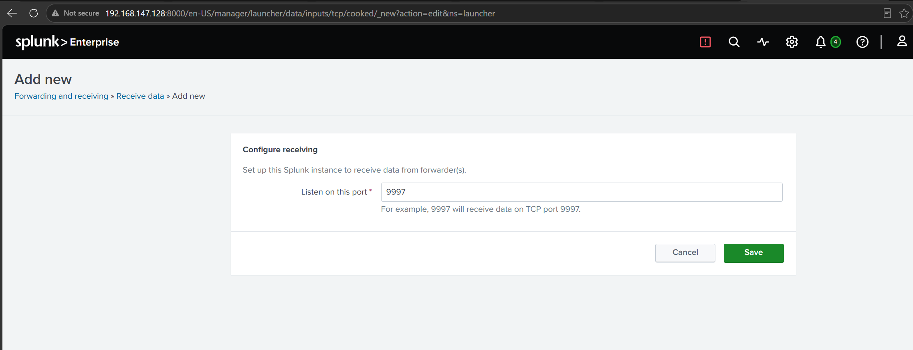
<!-- slide -->
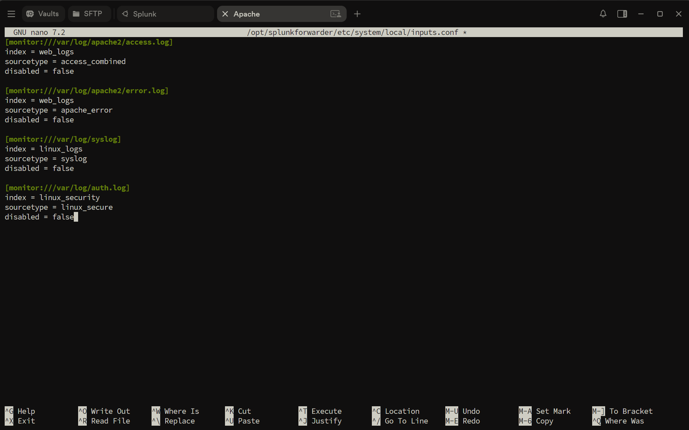
<!-- slide -->
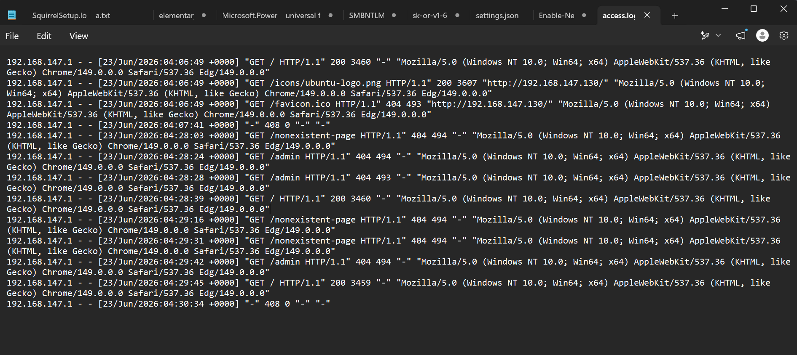
<!-- slide -->
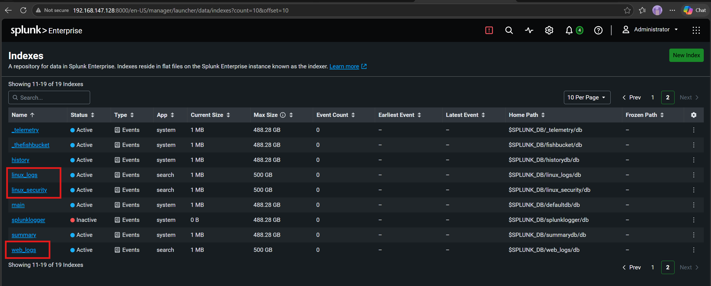
<!-- slide -->
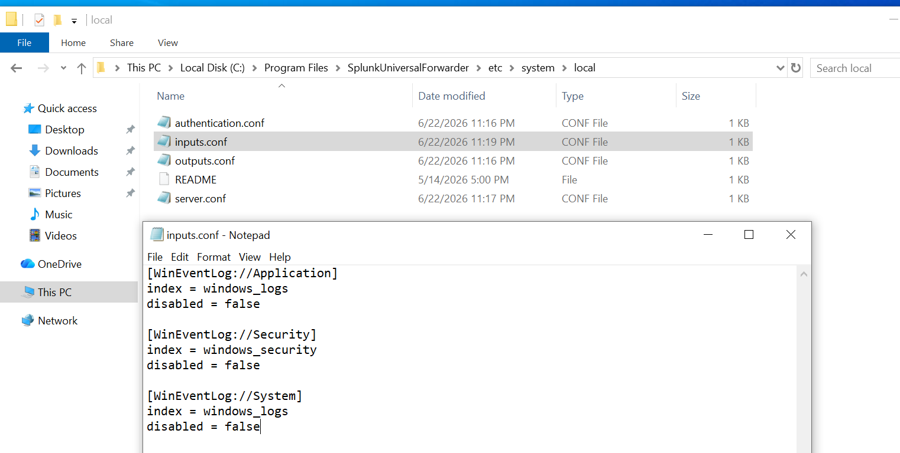
<!-- slide -->
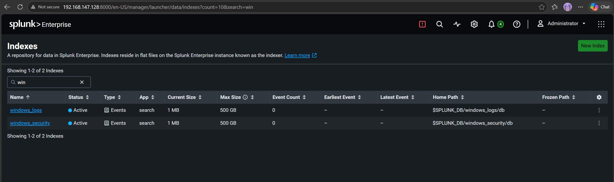
<!-- slide -->
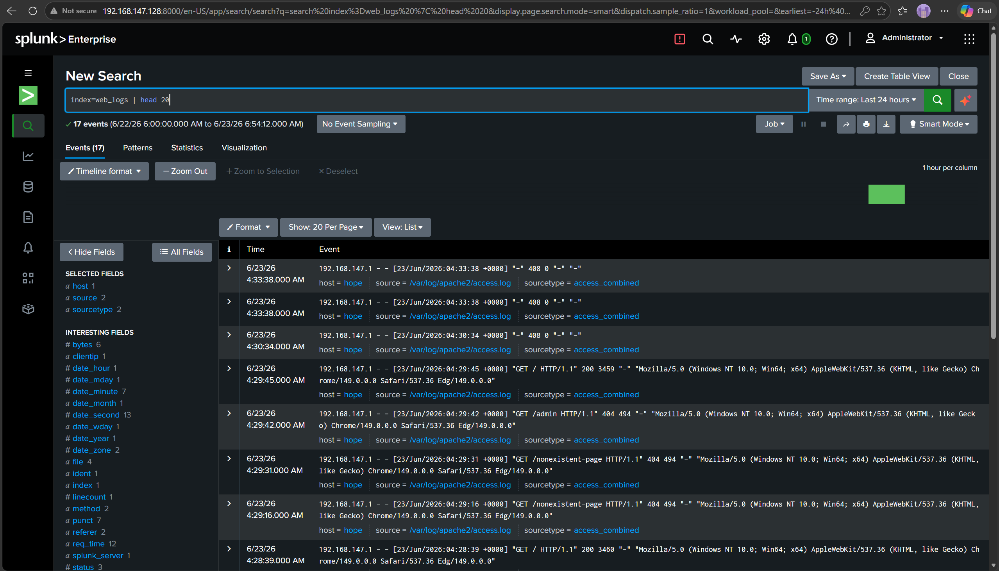
<!-- slide -->
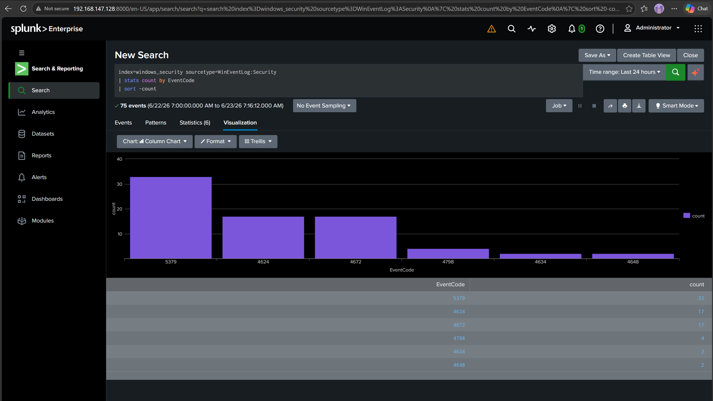
<!-- slide -->
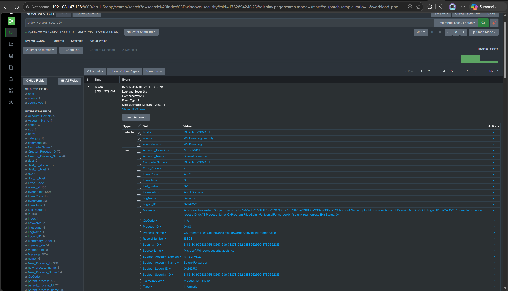
<!-- slide -->
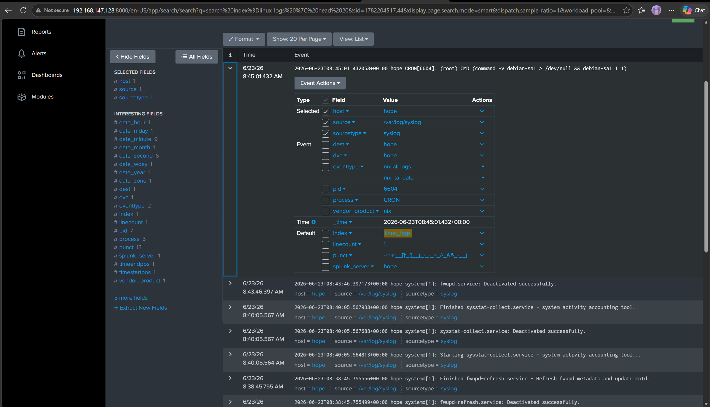
````

---

## 5. Cẩm Nang Ngôn Ngữ Truy Vấn SPL và Splunk Training Fundamentals (Modules 5 → 9)

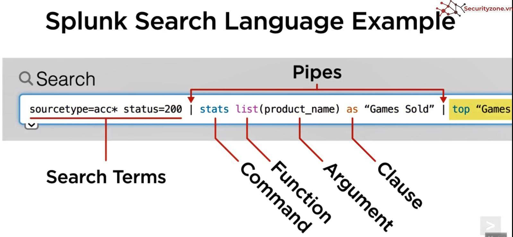

Cú pháp pipeline chuẩn: `<search terms> | command1 | command2 | ...`

---

### 5.1 Bảng Tra Cứu 15 Lệnh SPL Cốt Lõi Trong SOC

| Lệnh SPL | Loại Lệnh | Mục Đích và Cú Pháp | Ví Dụ Thực Tế Trong SOC |
| :--- | :---: | :--- | :--- |
| **`stats`** | Transforming | Thống kê, gom nhóm theo trường (`count`, `dc`, `sum`, `avg`, `values`, `list`). | `... \| stats count as fails by Account_Name, src_ip` |
| **`eval`** | Streaming | Tạo hoặc biến đổi trường dữ liệu bằng biểu thức logic (`if`, `case`, `match`, `round`). | `... \| eval risk=if(status==404, "LOW", "HIGH")` |
| **`rex`** | Streaming | Bóc tách trường trực tiếp bằng biểu thức chính quy (Regex) hoặc thay thế (`mode=sed`). | `... \| rex "(?<user>\S+) from (?<src_ip>\d+\.\d+\.\d+\.\d+)"` |
| **`timechart`** | Transforming | Thống kê số lượng sự kiện theo trục thời gian (`span=1h`, `span=5m`). | `... \| timechart span=1h count by EventCode` |
| **`chart`** | Transforming | Tạo bảng 2 chiều giữa 2 trường bất kỳ phục vụ trực quan hóa biểu đồ cột/tròn. | `... \| chart count over user by status` |
| **`table`** | Non-streaming | Chọn các trường cần hiển thị và định dạng dạng bảng. | `... \| table _time, host, user, action, src_ip` |
| **`fields`** | Streaming | Giữ lại (`+`) hoặc loại bỏ (`-`) các trường dữ liệu để tăng tốc xử lý. | `... \| fields + _time, host, CommandLine` |
| **`where`** | Streaming | Lọc kết quả sau các lệnh biến đổi dữ liệu (hỗ trợ so sánh giữa 2 trường). | `... \| stats count by src_ip \| where count > 50` |
| **`lookup`** | Streaming | Tra cứu và làm giàu dữ liệu từ tệp CSV hoặc KV Store (Threat Intel). | `... \| lookup threat_ips.csv ip as src_ip OUTPUT is_malicious` |
| **`dedup`** | Streaming | Loại bỏ các sự kiện trùng lặp, chỉ giữ lại bản ghi mới nhất. | `... \| dedup host, User` |
| **`sort`** | Non-streaming | Sắp xếp kết quả tăng dần (`+`) hoặc giảm dần (`-`). | `... \| sort -count` |
| **`transaction`** | Transforming | Nhóm các sự kiện liên quan thành một phiên giao dịch dựa trên session/user. | `... \| transaction session_id maxspan=30m` |
| **`head` / `tail`** | Streaming | Lấy N kết quả đầu tiên (`head 10`) hoặc N kết quả cuối cùng (`tail 10`). | `... \| head 10` |
| **`top` / `rare`** | Transforming | Tìm các giá trị xuất hiện nhiều nhất (`top`) hoặc ít nhất (`rare`). | `... \| top limit=10 Image` |
| **`streamstats`** | Streaming | Tính toán thống kê luồng tích lũy thời gian thực trên từng dòng sự kiện. | `... \| streamstats count by src_ip` |

---

### 5.2 Module 5: Sử Dụng Các Lệnh Transforming Cho Trực Quan Hóa (Transforming Commands for Visualizations)

Các lệnh Transforming gom nhóm dữ liệu thô thành các bảng thống kê hai chiều hoặc chuỗi thời gian, sẵn sàng chuyển đổi thành biểu đồ (Chart/Graph):

#### 1. Lệnh `chart` (Bảng Thống Kê 2 Chiều)
* Cú pháp: `chart <function> OVER <row_field> BY <column_field>`
* Các tham số tối ưu:
 - `limit=N`: Giới hạn số lượng cột hiển thị (mặc định 10).
 - `useother=t/f`: Gom các giá trị còn lại vào nhóm `OTHER`.
 - `usenull=f`: Loại bỏ các dòng/cột có giá trị `NULL`.

```bash
/* Thống kê HTTP Status theo từng Web Server */
index=web_logs sourcetype=access_combined
| chart count over host by status limit=5 useother=f
```

#### 2. Lệnh `timechart` (Biểu Đồ Theo Trục Thời Gian)
* Tự động lấy trường `_time` làm trục hoành (X-axis).
* Cú pháp: `timechart span=<interval> <function> [BY <split_field>]`
* Các tham số: `span=1m`, `span=5m`, `span=1h`, `span=1d`.

```bash
/* Theo dõi số lượng đăng nhập thất bại theo giờ của từng User */
index=windows_security EventCode=4625
| timechart span=1h count by TargetUserName limit=10
```

#### 3. Lệnh `top` và `rare`
* `top`: Trả về các giá trị xuất hiện nhiều nhất kèm theo phần trăm (`percent`).
* `rare`: Trả về các giá trị hiếm gặp nhất (rất hữu ích để tìm tiến trình lạ hoặc user bất thường).

```bash
/* Tìm 5 tiến trình hiếm gặp nhất trên hệ thống máy chủ */
index=windows_sysmon EventCode=1
| rare limit=5 Image by host
```

---

### 5.3 Module 6: Tương Quan Sự Kiện (Correlating Events: Transactions vs Stats)

#### 1. Lệnh `transaction`
Gom nhiều sự kiện rời rạc lại thành 1 sự kiện duy nhất (Transaction Event) dựa trên trường chung hoặc khoảng cách thời gian:
* `maxspan=X`: Tổng thời gian tối đa từ sự kiện đầu đến sự kiện cuối của transaction.
* `maxpause=Y`: Khoảng thời gian tạm dừng tối đa giữa 2 sự kiện liên tiếp.
* `startswith="<pattern>"`: Điều kiện bắt đầu giao dịch.
* `endswith="<pattern>"`: Điều kiện kết thúc giao dịch.

```bash
/* Tái hiện phiên làm việc người dùng từ lúc Login đến lúc Logout */
index=windows_security (EventCode=4624 OR EventCode=4634)
| transaction TargetUserName LogonId startswith=(EventCode=4624) endswith=(EventCode=4634) maxspan=8h
| table _time TargetUserName duration eventcount
```

#### 2. Bảng Đối Chiếu: Khi Nào Dùng `stats` vs `transaction`?

| Tiêu Chí | Lệnh `stats` | Lệnh `transaction` |
| :--- | :--- | :--- |
| **Hiệu năng và Tài nguyên** | **Cực nhanh, tốn rất ít RAM/CPU** (Chạy phân tán trên Indexer). | **Chậm hơn, tốn nhiều RAM/CPU** (Phải gom hết về Search Head). |
| **Bảo toàn Raw Text** | Không giữ lại chuỗi `_raw` từng event. | Giữ toàn bộ chuỗi `_raw` của tất cả event trong transaction. |
| **Tính toán thời gian** | Chỉ tính min/max time qua `earliest(_time)`. | Tự động sinh trường `duration` và `eventcount`. |
| **Khuyến nghị SOC** | **Ưu tiên 90% trường hợp** để tối ưu hóa SIEM. | Chỉ dùng khi cần tính toán `duration` phức tạp hoặc xem log thô liên hoàn. |

---

### 5.4 Module 7: Làm Giàu Dữ Liệu Với Lookups (Enriching Data with Lookups)

Lookups cho phép ghép dữ liệu từ bảng ngoài (File `.csv` hoặc KV Store) vào log thời gian thực mà không cần thay đổi dữ liệu đã index:

1. **`lookup` Command**: Tra cứu bảng CSV Threat Intelligence.
   ```bash
   /* Đối chiếu IP nguồn với danh sách IP Blacklist */
   index=firewall action=ALLOW
   | lookup threat_intel_ip.csv ip AS src_ip OUTPUT threat_level, actor_group
   | where isnotnull(threat_level)
   | table _time src_ip dest_ip threat_level actor_group
   ```
2. **`inputlookup` Command**: Xem hoặc tìm kiếm trực tiếp nội dung file lookup như một search thông thường:
   ```bash
   | inputlookup threat_intel_ip.csv | where threat_level="HIGH"
   ```
3. **`outputlookup` Command**: Lưu kết quả tìm kiếm vào file lookup để tái sử dụng:
   ```bash
   index=windows_security EventCode=4720
   | table _time TargetUserName SubjectUserName
   | outputlookup newly_created_users.csv
   ```
4. **Automatic Lookup**: Cấu hình trong GUI (*Settings $\rightarrow$ Lookups $\rightarrow$ Automatic Lookups*) hoặc `props.conf`/`transforms.conf` để Splunk tự động enrich trường cho mọi search mà không cần gõ lệnh `| lookup`.

---

### 5.5 Module 8: Tạo và Quản Lý Cảnh Báo An Ninh (Creating and Managing Alerts)

Alert trong Splunk là các Saved Search được lên lịch chạy tự động để phát hiện vi phạm và kích hoạt hành động phản ứng:

#### 1. Loại Alert (Alert Types):
* **Scheduled Alert**: Chạy định kỳ (ví dụ: mỗi 5 phút quét log 5 phút trước). Tiết kiệm tài nguyên, phù hợp cho 95% rule phát hiện trong SOC.
* **Real-time Alert**: Chạy liên tục trong nền trên luồng log thời gian thực. Tốn CPU/RAM của Indexer, chỉ dùng cho các sự kiện khẩn cấp đặc biệt nguy hiểm.

#### 2. Điều Kiện Kích Hoạt (Trigger Conditions):
* `Per-Result`: Kích hoạt cảnh báo cho từng dòng kết quả trả về.
* `Number of Results`: Kích hoạt khi số lượng kết quả vượt ngưỡng (VD: `count > 10` trong 5 phút).
* `Number of Hosts / Sources`: Kích hoạt khi có hơn N máy bị ảnh hưởng.

#### 3. Cơ Chế Throttling (Chống Ngập Cảnh Báo - Alert Fatigue):
* Thiết lập **Suppress triggering** cho cùng một giá trị trường (ví dụ cùng `src_ip` hoặc cùng `user`) trong vòng **30 phút - 1 giờ** để tránh gửi hàng trăm email rác khi đang bị tấn công dồn dập.

#### 4. Hành Động Cảnh Báo (Alert Actions):
* Gửi Email thông báo kèm bảng kết quả dạng PDF/CSV.
* Gửi Webhook tới hệ thống SOAR / Telegram / Microsoft Teams.
* Chạy Script phản ứng tự động trên máy chủ.
* Tạo Notable Event trong **Splunk Enterprise Security (ES)**.

---

### 5.6 Module 9: Xây Dựng Dashboard và Trực Quan Hóa (Dashboards và Visualizations)

Splunk cung cấp hai môi trường xây dựng Dashboard: **Classic XML** và **Dashboard Studio**:

1. **Thành phần của một Dashboard SOC**:
 * **Single Value Panels**: Hiển thị các chỉ số KPI trọng yếu (Tổng số Attack, Tỷ lệ Success/Fail, Số máy bị nhiễm).
 * **Time-series Line Charts**: Biểu đồ diễn tiến sự cố theo thời gian (`timechart`).
 * **Pie / Bar Charts**: Biểu đồ phân bổ loại tấn công hoặc danh sách Top 10 Attacker IPs.
 * **Geographic Maps (`geom` / `iplocation`)**: Bản đồ nhiệt thể hiện vị trí địa lý của các nguồn tấn công trên thế giới.
2. **Thêm Bộ Lọc Tương Tác (Inputs / Form Search)**:
 * **Time Picker**: Cho phép Analyst đổi khung thời gian xem dữ liệu mà không cần sửa câu lệnh SPL.
 * **Dropdown / Text Box**: Lọc theo từng `Host`, `User`, hoặc `IP Address`.
3. **Cơ Chế Drilldown**:
 * Nhấp chuột vào một cột trong biểu đồ để tự động mở ra câu truy vấn SPL chi tiết về sự kiện đó (*Interactive Investigation*).

---

### 5.7 Các Truy Vấn SPL Mẫu Thực Tế Trong SOC

```bash
/* 1. Phát hiện tấn công Brute-Force SSH trên Linux */
index=linux_security source="/var/log/auth.log" "Failed password"
| rex field=_raw "Failed password for (?:invalid user )?(?<user>\S+) from (?<src_ip>\d+\.\d+\.\d+\.\d+)"
| stats count as failed_attempts by user, src_ip
| where failed_attempts >= 10
| sort -failed_attempts

/* 2. Phát hiện PowerShell Obfuscation và Download Payload lạ */
index=windows_sysmon EventCode=1 (Image="*\\powershell.exe" OR Image="*\\pwsh.exe")
| where match(CommandLine, "(?i)(-enc|-encodedcommand|downloadstring|iex\s*\(|invoke-webrequest)")
| table _time host User ParentImage Image CommandLine

/* 3. Phát hiện quét Web Server tìm kiếm file ẩn (.env, config, admin) */
index=web_logs status=404
| bin _time span=2m
| stats count as total_404, dc(uri_path) as unique_paths by clientip, _time
| where total_404 >= 30
| sort -total_404
```

---

### 5.8 Nguyên Tắc Tối Ưu Hóa Hiệu Năng Truy Vấn SPL (Search Optimization)

1. **Luôn chỉ định `index=` và `sourcetype=` ở đầu câu lệnh**: Tránh quét toàn bộ dữ liệu (*Full Scan*) gây nghẽn Indexer.
2. **Thu hẹp khung thời gian tìm kiếm (Time Picker / `earliest`, `latest`)**: Giới hạn số lượng Buckets cần mở trên đĩa.
3. **Lọc dữ liệu trước dấu Pipe đầu tiên**: Đặt các điều kiện lọc càng sớm càng tốt để giảm số lượng event chuyển qua các lệnh tiếp theo.
4. **Ưu tiên các lệnh Streaming đặt trước Non-Streaming**: Các lệnh streaming (`eval`, `rex`, `fields`) được thực thi phân tán song song trên từng Indexer, giúp giảm tải cho Search Head.
5. **Ưu tiên sử dụng `stats` thay cho `transaction`**: `stats` tiêu tốn ít RAM và CPU hơn `transaction` gấp nhiều lần.

---

## 6. Bảng Hỏi - Đáp Chuyên Sâu Khi Bảo Vệ / Trình Bày (Q&A Defense Guide)

> [!faq]- Q1: Tại sao trong môi trường Enterprise bắt buộc phải phân tách Universal Forwarder và Heavy Forwarder?
> - **Trả lời**: Universal Forwarder được thiết kế siêu nhẹ (<10MB RAM) để cài đặt đại trà trên hàng chục nghìn Endpoint mà không ảnh hưởng hiệu năng máy trạm. Heavy Forwarder đóng vai trò như một bộ thu gom trung gian (Aggregator) tại vùng biên DMZ để phân tích cú pháp, lọc bỏ dữ liệu rác và mã hóa dữ liệu nhạy cảm trước khi gửi về Indexer Core.

> [!faq]- Q2: Sự khác nhau bản chất giữa Indexer Cluster và Search Head Cluster là gì?
> - **Trả lời**:
> - **Indexer Cluster**: Tập trung vào **Độ sẵn sàng của Dữ liệu (Data Availability và Storage Redundancy)**. Sử dụng Cluster Manager để nhân bản các bản sao dữ liệu thô (`RF`) và tệp chỉ mục tìm kiếm (`SF`) giữa các Indexer Peers.
> - **Search Head Cluster (SHC)**: Tập trung vào **Độ sẵn sàng của Dịch vụ Tìm kiếm và Cân bằng tải người dùng (Search Scalability và High Concurrency)**. Sử dụng Captain Node để đồng bộ Knowledge Objects và phân phối search jobs cho nhiều Analyst.

> [!faq]- Q3: Tại sao việc sử dụng chuẩn CIM (Common Information Model) lại mang tính sống còn đối với SOC Enterprise?
> - **Trả lời**: Trong doanh nghiệp, log đến từ hàng chục hãng khác nhau (Windows gọi là `TargetUserName`, Linux gọi là `user`, Cisco gọi là `USER_ID`). Nếu không có CIM, SOC Engineer phải viết hàng chục luật cảnh báo riêng biệt cho từng hãng. Nhờ CIM, toàn bộ được ánh xạ về trường chuẩn `user`, giúp một Detection Rule duy nhất có thể bắt được vi phạm trên toàn bộ các nền tảng.

> [!faq]- Q4: Tại sao các lệnh Streaming trong SPL lại chạy nhanh hơn các lệnh Non-Streaming?
> - **Trả lời**: Lệnh Streaming (`eval`, `rex`, `rename`) có thể thực thi phân tán song song độc lập trên từng Indexer ngay tại thời điểm đọc dữ liệu từ đĩa. Ngược lại, lệnh Non-Streaming (`sort`, `dedup`) bắt buộc phải chuyển toàn bộ dữ liệu về Search Head để gộp và sắp xếp tập trung, gây thắt cổ chai đường truyền và bộ nhớ.

---

## 7. Tài Liệu Tham Khảo (References)

- **Splunk Enterprise Architecture và Admin Manual**: [https://docs.splunk.com/Documentation/Splunk/latest/Admin/AboutadministeringSplunk](https://docs.splunk.com/Documentation/Splunk/latest/Admin/AboutadministeringSplunk)
- **Splunk Common Information Model (CIM) Standards**: [https://docs.splunk.com/Documentation/CIM/latest/User/Overview](https://docs.splunk.com/Documentation/CIM/latest/User/Overview)
- **Splunk Search Processing Language (SPL) Quick Reference**: [https://docs.splunk.com/Documentation/Splunk/latest/SearchReference/](https://docs.splunk.com/Documentation/Splunk/latest/SearchReference/)
- **IBM Security Cost of a Data Breach Report 2024**: [https://www.ibm.com/reports/data-breach](https://www.ibm.com/reports/data-breach)

