# Tuần 4: Splunk CIM, Data Models và Cảnh Báo Tự Động
> **Tài liệu chuẩn hóa chuyên sâu về các khái niệm nâng cao trong Splunk: Common Information Model (CIM), Data Models, Tags và Eventtypes, Pivot và Datasets, Macros, Xây dựng hệ thống cảnh báo tự động qua Email (Gmail SMTP) và Telegram Bot, Kiến trúc triển khai Multi-Node Indexer Cluster kết hợp Deployment Server, và Tóm tắt các Module 10 - 12 trong chương trình Splunk Training Fundamentals.**

---

## 1. Các Khái Niệm Nâng Cao Trong Splunk (Advanced Knowledge Objects)

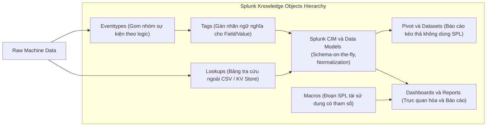

---

### 1.1 Splunk CIM (Common Information Model) và Data Models


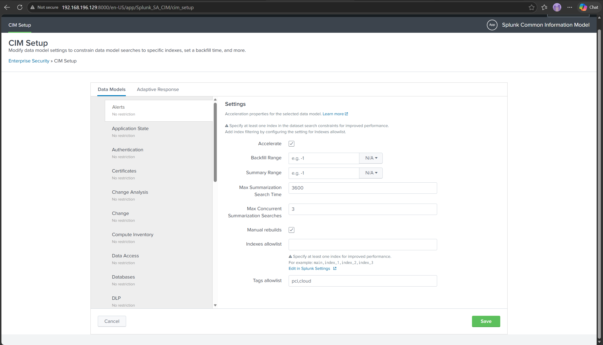
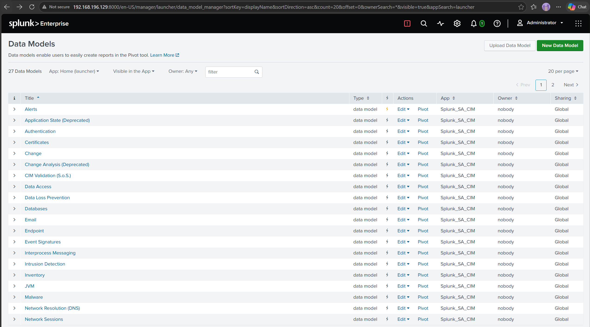

#### 1.1.1 CIM Là Gì và Tại Sao Bắt Buộc Trong SOC Enterprise?
Khi vận hành SOC thực tế, dữ liệu đổ về từ hàng chục hãng công nghệ khác nhau:
* Địa chỉ IP nguồn: Cisco ASA gọi là `src`, Palo Alto gọi là `sourceAddress`, Apache gọi là `clientip`, Checkpoint gọi là `orig_ip`.
* Nếu không có CIM, Detection Engineer muốn viết một luật tương quan phát hiện tấn công sẽ phải viết câu lệnh SPL dài hàng trang chứa đầy các mệnh đề `OR` để bao quát mọi tên trường.

> [!important] Nguyên lý Schema-on-the-fly của CIM
> CIM không làm thay đổi dữ liệu thô (`_raw`) trên đĩa. Nó hoạt động như một **Schema động tại thời điểm tìm kiếm (Search-time)**, sử dụng **Field Aliases** và **Event Tags** để chuẩn hóa mọi tên trường về một chuẩn duy nhất (`src_ip`, `dest_ip`, `user`, `action`).

#### 1.1.2 Danh Sách Các Data Models Trọng Yếu Trong Splunk CIM:

| Tên Data Model | Miền Nghiệp Vụ Giám Sát | Các Sourcetype Điển Hình | Tên Trường Chuẩn Hóa (CIM Fields) |
| :--- | :--- | :--- | :--- |
| **Authentication** | Xác thực đăng nhập, leo quyền, phiên SSO | Windows Security (`4624/4625`), Linux `auth.log`, Cisco VPN | `src`, `dest`, `user`, `action` (`success`/`failure`), `app` |
| **Network Traffic** | Lưu lượng mạng, Packet Filter, Firewall | Cisco ASA, Palo Alto, Fortigate, pfSense, Bro/Zeek | `src_ip`, `dest_ip`, `src_port`, `dest_port`, `bytes_in`, `bytes_out`, `action` |
| **Web** | Máy chủ Web, Reverse Proxy, WAF | Apache, Nginx, Microsoft IIS, Cloudflare WAF | `http_method`, `uri_path`, `uri_query`, `status`, `bytes`, `http_user_agent` |
| **Change Analysis** | Thay đổi tài khoản, GPO, Cấu hình | Windows `4720/4726`, Auditd `identity_changes`, Reg | `object_category`, `command`, `change_type`, `user` |
| **Malware** | Cảnh báo phần mềm độc hại từ Antivirus/EDR | Windows Defender, CrowdStrike Falcon, SentinelOne | `signature`, `file_name`, `file_path`, `file_hash`, `action` |
| **Endpoint** | Hoạt động tiến trình, dịch vụ, registry | Sysmon (`Event 1, 7, 8, 10, 11`), Linux Auditd | `process`, `parent_process`, `process_id`, `process_path` |
| **Alerts** | Cảnh báo từ các hệ thống IDS/IPS/SIEM | Snort, Suricata, Splunk Notable Events | `severity`, `category`, `description`, `signature` |
| **Email** | Thư điện tử, Lọc mã độc, Chống Phishing | Microsoft Exchange, Cisco IronPort, Proofpoint | `src_user`, `recipient`, `subject`, `file_name`, `status` |

---

### 1.2 Tag và Eventtype

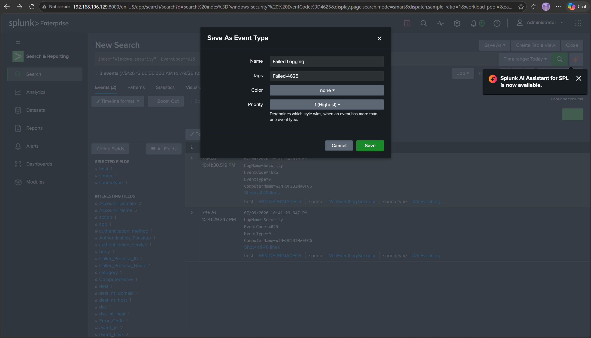
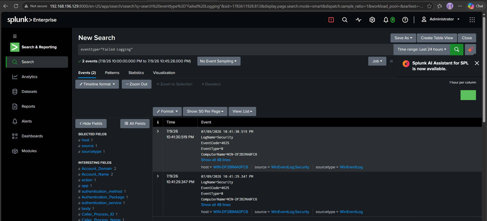

#### 1.2.1 Phân Biệt Eventtype vs Tag

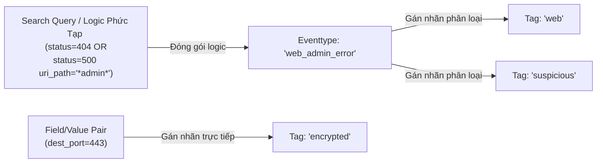

* **Eventtype (Loại sự kiện)**: Là việc **đặt tên cho một câu truy vấn tìm kiếm**. Thay vì gõ lại câu query dài, bạn gán nó vào một Eventtype.
 * Cấu hình trong `eventtypes.conf`:
    ```ini
    [failed_logon_events]
    search = index=windows_security (EventCode=4625 OR EventCode=4771)
    ```
* **Tag (Nhãn dữ liệu)**: Là việc **gán nhãn ngữ nghĩa cho một trường cụ thể hoặc một Eventtype**.
 * Cấu hình trong `tags.conf`:
    ```ini
    [eventtype=failed_logon_events]
    authentication = enabled
    insecure = enabled
    ```
* **Ứng dụng truy vấn trong SPL**:
  ```bash
  /* Tìm kiếm tất cả các sự kiện xác thực thất bại trên toàn hệ thống mà không cần quan tâm Windows hay Linux */
  tag=authentication tag=insecure
  ```

---

### 1.3 Dashboard và Report

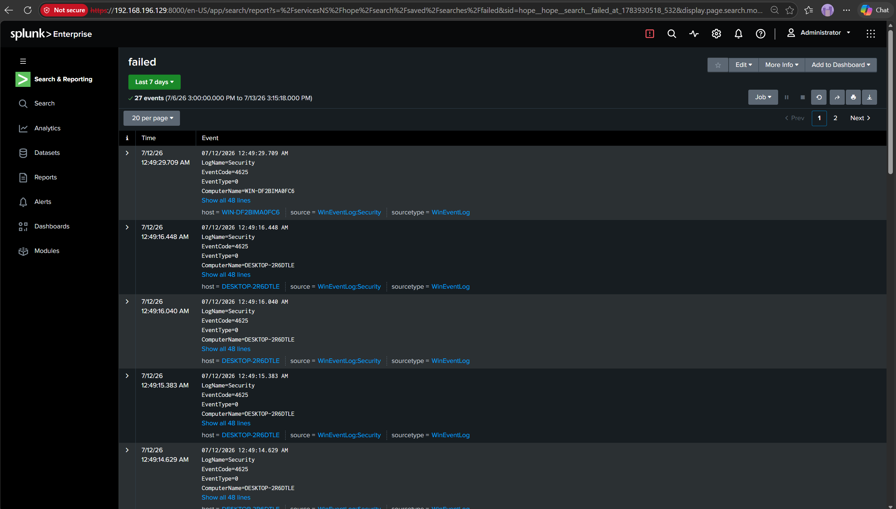

* **Report (Báo cáo)**: Là một câu truy vấn SPL được lưu lại kèm theo định dạng trực quan hóa (Bảng, Biểu đồ). Report có thể được lên lịch chạy định kỳ (*Scheduled Report*) để gửi tệp PDF qua Email cho Ban Giám đốc.
* **Dashboard (Bảng điều khiển)**: Gom nhiều Reports và Panels lại trên cùng một giao diện duy nhất.
 * **Dashboard Studio**: Trình soạn thảo Dashboard hiện đại hỗ trợ kéo thả pixel-perfect, giao diện Dark mode cao cấp và kết nối trực tiếp JSON layout.
 * **Tokens (`$token_name$`)**: Biến động cho phép truyền tham số từ bộ lọc người dùng (*Dropdown, Time Picker*) vào các câu truy vấn của từng Panel.

---

### 1.4 Pivot, Dataset và Lookups

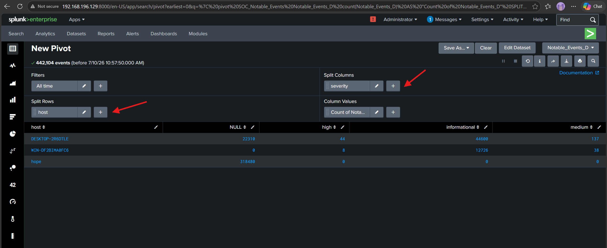
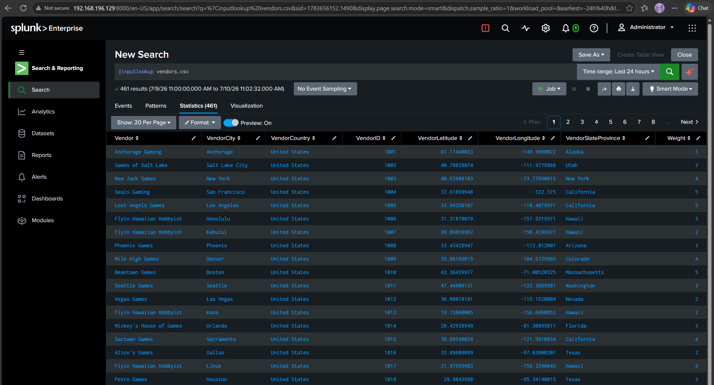

* **Pivot**: Công cụ kéo thả trực quan trên Web GUI, cho phép người dùng nghiệp vụ (Business Analyst) hoặc L1 Analyst tạo biểu đồ phân tích nhanh từ **Data Model** mà không cần biết viết câu lệnh SPL.
* **Dataset**: Đại diện cho một tập dữ liệu có cấu trúc (bảng dữ liệu) được sinh ra từ Index, Data Model hoặc Lookup Table.
* **Lookups**: Ghép nối dữ liệu bên ngoài (CSV hoặc KV Store) vào dòng dữ liệu log:
 * **CIDR Matching**: Tự động nhận diện dải mạng IP nội bộ (`10.0.0.0/8`, `192.168.0.0/16`).
 * **Time-based Lookups**: Ánh xạ thông tin thay đổi theo thời gian (ví dụ: máy tính `PC-01` thuộc về user `A` vào tuần trước nhưng chuyển cho user `B` tuần này).

---

### 1.5 Macro và Wildcard

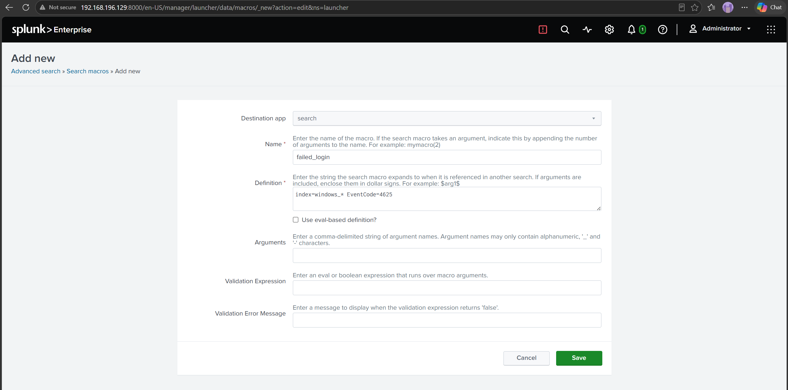
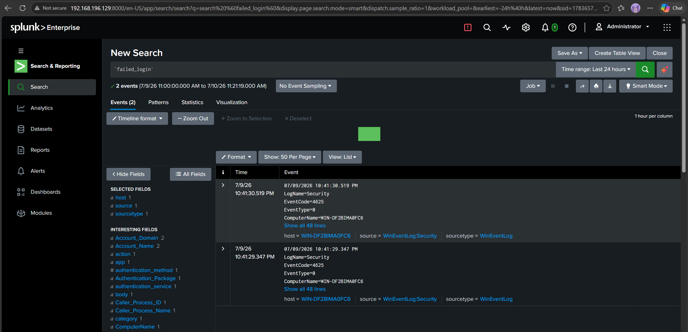

* **Search Macro**: Định nghĩa các đoạn SPL có thể tái sử dụng và truyền tham số (`$param$`), lưu trong `macros.conf`:
  ```ini
  [detect_bruteforce(2)]
  args = threshold, timespan
  definition = stats count by src_ip | where count > $threshold$
  ```
 * Cách gọi trong SPL: `` `detect_bruteforce(10, 5m)` ``
* **Wildcard (`*`) và Cảnh Báo Hiệu Năng**:
 * Dùng `*` ở đầu chuỗi (ví dụ: `Image="*powershell.exe"`) buộc Splunk phải quét toàn bộ từ khóa, làm giảm 90% tốc độ tìm kiếm.
 * Khuyến nghị: Sử dụng `Image="C:\\Windows\\System32\\WindowsPowerShell\\v1.0\\powershell.exe"` hoặc dùng `TERM()` / `PREFIX()` để tối ưu hóa chỉ mục.

---

## 2. Xây Dựng Hệ Thống Cảnh Báo An Ninh Tự Động (Alerting)

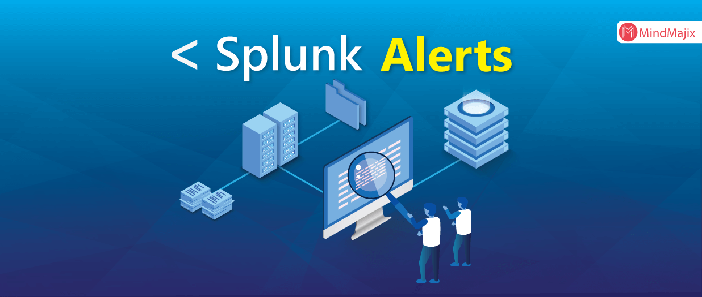

---

### 2.1 Hướng Dẫn Cấu Hình Cảnh Báo Qua Email (Gmail SMTP)

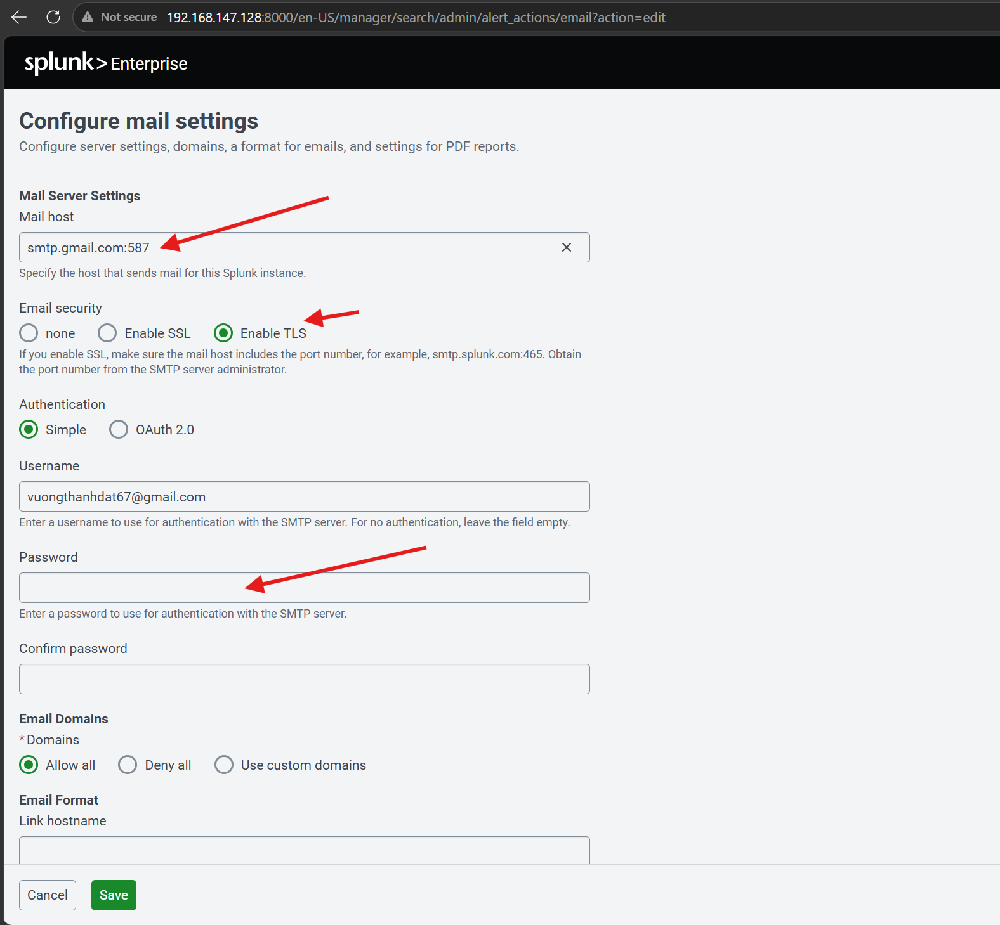
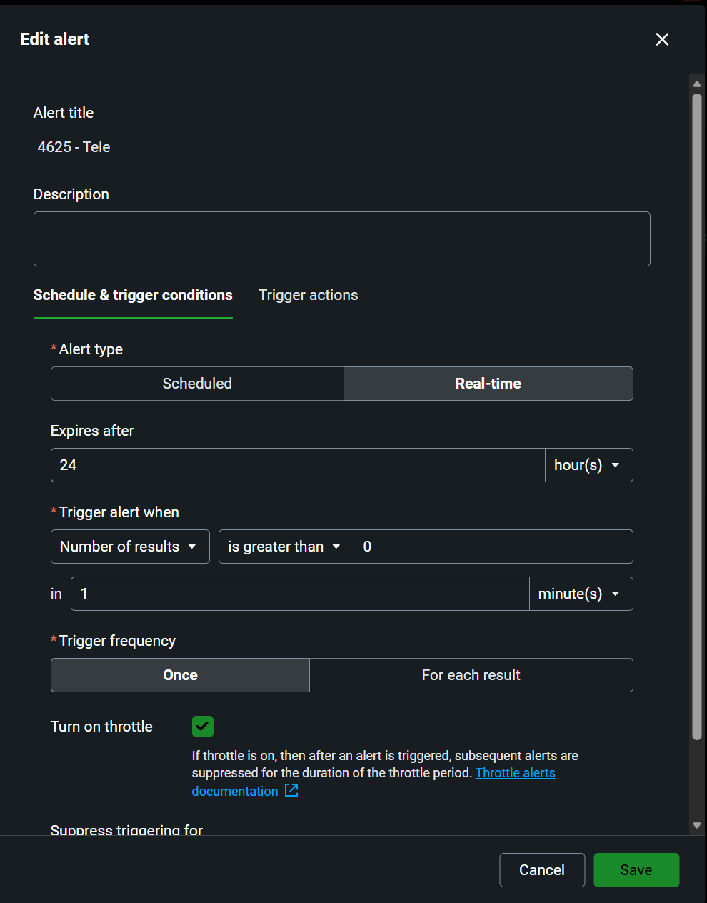
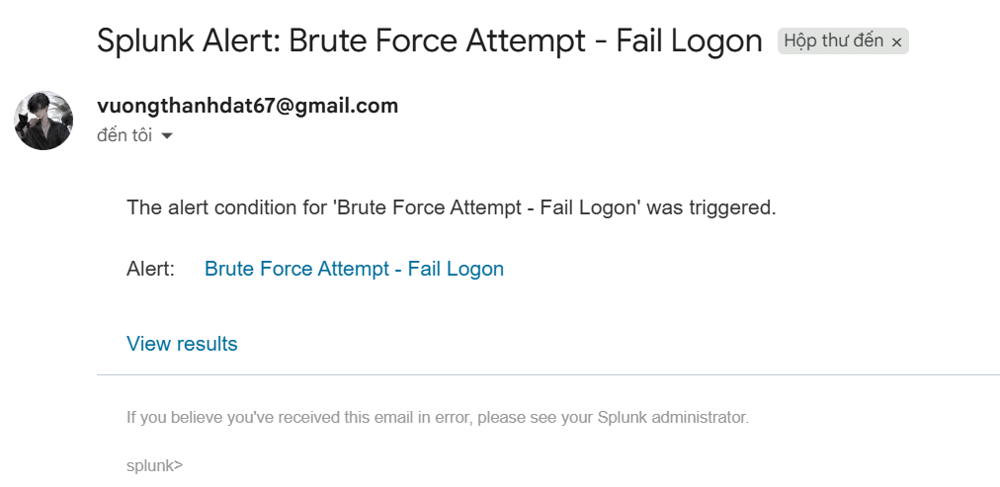

#### Bước 1: Tạo Mật Khẩu Ứng Dụng (Google App Password)
1. Truy cập `https://myaccount.google.com/security`.
2. Bật **Xác minh 2 bước (2-Step Verification)**.
3. Tìm kiếm **"Mật khẩu ứng dụng" (App Passwords)** $\rightarrow$ Tạo mới với tên `Splunk Alert`.
4. Google cấp chuỗi 16 ký tự (ví dụ: `abcd efgh ijkl mnop`).

#### Bước 2: Cấu Hình Email Server Trên Splunk
Vào **Settings $\rightarrow$ Server settings $\rightarrow$ Email settings**:
* **Mail host**: `smtp.gmail.com:587` (chọn STARTTLS) hoặc `smtp.gmail.com:465` (chọn SSL/TLS).
* **Email security**: `STARTTLS` / `SSL/TLS`.
* **Username**: `your_email@gmail.com`.
* **Password**: Nhập chuỗi 16 ký tự App Password (không có khoảng trắng).

#### Bước 3: Tạo Cảnh Báo và Custom Nội Dung Email
1. Chạy câu truy vấn phát hiện Brute Force:
   ```bash
   index=windows_security EventCode=4625
   | stats count by TargetUserName, Source_Network_Address
   | where count >= 5
   ```
2. Chọn **Save As $\rightarrow$ Alert**:
 * **Trigger Condition**: `Number of Results > 0`.
 * **Throttle**: Suppress triggering for `TargetUserName` trong 30 phút.
 * **Trigger Actions**: Chọn **Send Email**.
 * **Subject**: `[SOC CRITICAL ALERT] Phát hiện tấn công Brute-Force trên máy $result.host$`
 * **Message**:
     ```text
     Kính gửi Đội ngũ SOC,
     Hệ thống SIEM ghi nhận hành vi dò mật khẩu bất thường:
     - Tài khoản bị tấn công: $result.TargetUserName$
     - Địa chỉ IP nguồn: $result.Source_Network_Address$
     - Số lần thất bại: $result.count$
     - Thời gian ghi nhận: $result._time$
     ```

---

### 2.2 Hướng Dẫn Cấu Hình Cảnh Báo Qua Telegram Bot

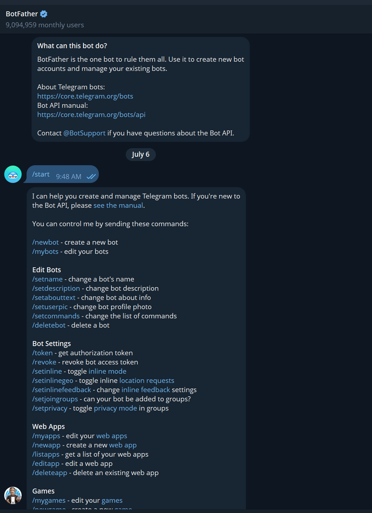
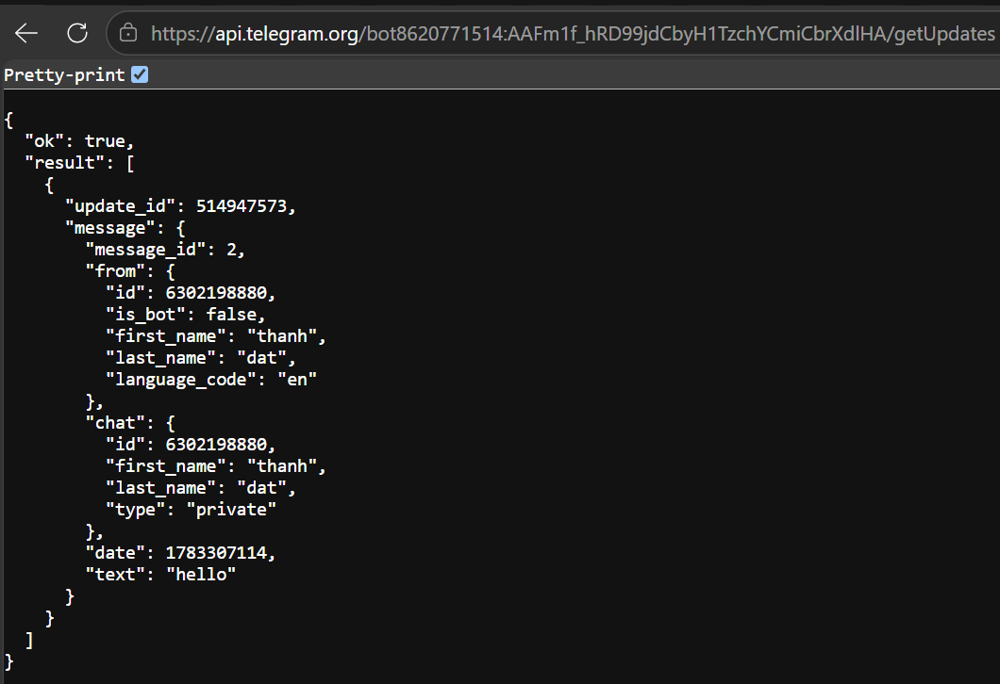
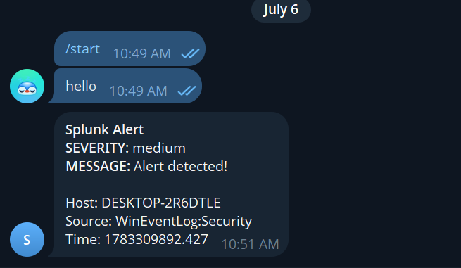

#### Bước 1: Tạo Bot Telegram Qua `@BotFather`
1. Mở Telegram, tìm bot `@BotFather`.
2. Gửi lệnh `/newbot` $\rightarrow$ Đặt tên cho bot (`VNCS SOC Alert Bot`) $\rightarrow$ Đặt username (`vncs_soc_alert_bot`).
3. BotFather trả về **HTTP API Token** dạng: `7123456789:ABCdefGHIjklMNOpqrSTUvwXYZ`.

#### Bước 2: Lấy `chat_id` Của Nhóm Nhận Cảnh Báo
1. Tạo Group Telegram mới và add Bot vừa tạo vào Group.
2. Gửi một tin nhắn bất kỳ vào Group (ví dụ: `/start` hoặc `hello`).
3. Mở trình duyệt web truy cập URL:
   ```text
   https://api.telegram.org/bot<YOUR_BOT_TOKEN>/getUpdates
   ```
4. Tìm trường `chat: {"id": -1001234567890}` trong JSON response $\rightarrow$ Lưu lại giá trị `chat_id` (với group luôn có dấu trừ `-` ở đầu).

#### Bước 3: Cài Đặt Splunk Telegram Alert Add-on và Gửi Cảnh Báo
1. Cài đặt App **"Telegram Alert Action"** từ Splunkbase hoặc sử dụng Webhook Alert Action:
 * **URL**: `https://api.telegram.org/bot<YOUR_BOT_TOKEN>/sendMessage`
 * **Method**: `POST`
 * **Payload Format**: `application/json`
 * **JSON Body**:
     ```json
     {
       "chat_id": "-1001234567890",
       "text": " *[SOC ALERT - PHÁT HIỆN TẤN CÔNG]* \n\n*Hành vi:* Brute-Force Đăng Nhập\n*Tài khoản:* `$result.TargetUserName$`\n*IP Tấn Công:* `$result.Source_Network_Address$`\n*Số lượt thử:* `$result.count$`\n*Mức độ:* CRITICAL",
       "parse_mode": "Markdown"
     }
     ```

---

## 3. Triển Khai Deployment Server và Indexer Cluster Thực Tế (5 Máy)

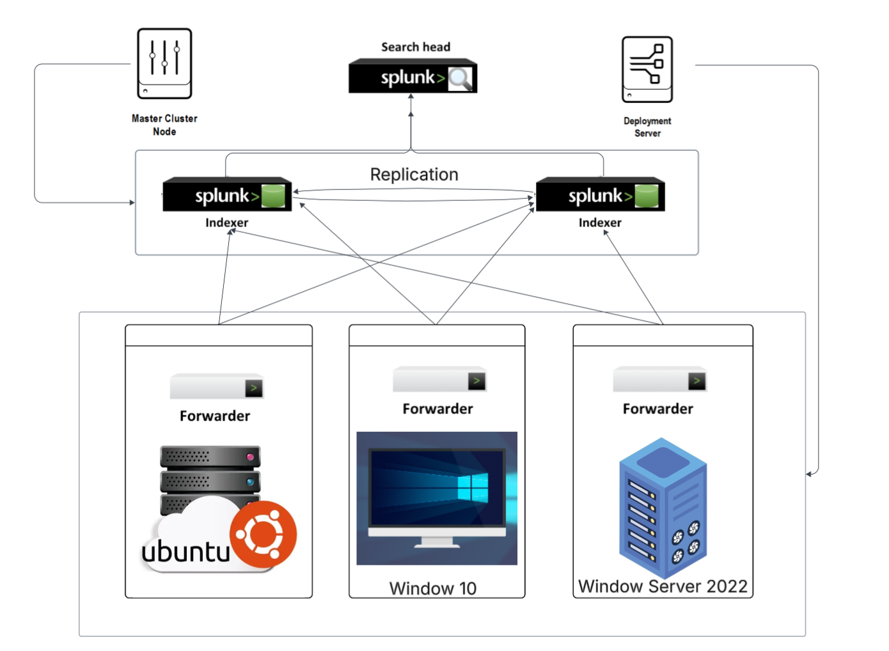
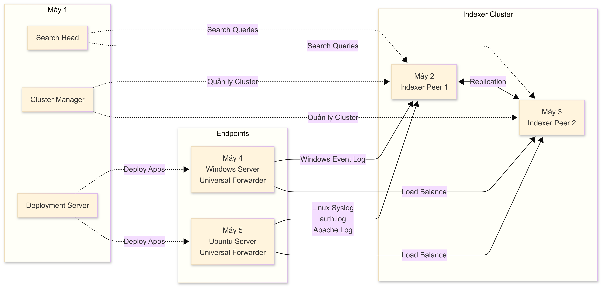

---

### 3.1 Bảng Phân Bổ Địa Chỉ IP và Vai Trò Node Trong Lab

| Node | Địa Chỉ IP | Hệ Điều Hành | Vai Trò Splunk | User | Cổng Dịch Vụ Mở |
| :--- | :---: | :---: | :--- | :--- | :--- |
| **Máy 1** | `10.0.0.10` | Ubuntu 22.04 | **Search Head + Cluster Manager + Deployment Server** | `splunk` | `8000`, `8089`, `9997` |
| **Máy 2** | `10.0.0.20` | Ubuntu 22.04 | **Indexer Peer 01** (Cluster Member) | `id1` | `8089`, `9997`, `9887` |
| **Máy 3** | `10.0.0.30` | Ubuntu 22.04 | **Indexer Peer 02** (Cluster Member) | `id2` | `8089`, `9997`, `9887` |
| **Máy 4** | `10.0.0.40` | Ubuntu 22.04 | **Endpoint (Universal Forwarder)** + Apache2 | `splunkf` | `80` (HTTP) |
| **Máy 5** | `10.0.0.50` | Windows Server 2022 | **Domain Controller (Universal Forwarder)** + Sysmon | `hope` | `53`, `88`, `389`, `445` |

---

### 3.2 Cấu Hình Từng Bước Chi Tiết

#### Bước 1: Thiết Lập Cluster Manager (Máy 1 - `10.0.0.10`)
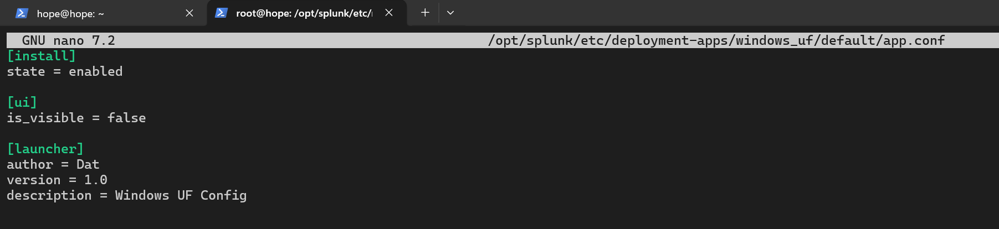
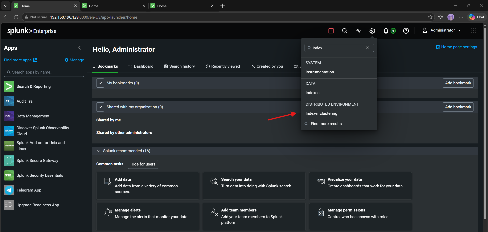

```bash
sudo -u splunk /home/splunk/splunk/bin/splunk edit cluster-config \
  -mode manager \
  -replication_factor 2 \
  -search_factor 2 \
  -secret '078a6b5e4974c5ad58f5b3656838023b' \
  -cluster_label idxc1 \
  -auth splunk:Admin123@

sudo -u splunk /home/splunk/splunk/bin/splunk restart
```

#### Bước 2: Cấu Hình Indexer Peer 01 (Máy 2 - `10.0.0.20`)
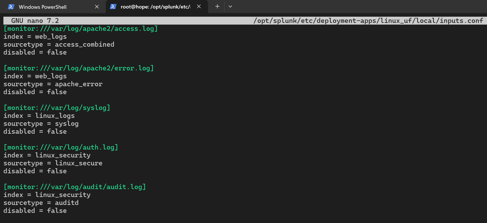
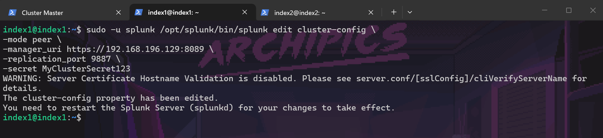

```bash
sudo -u id1 /home/id1/splunk/bin/splunk edit cluster-config \
  -mode peer \
  -manager_uri https://10.0.0.10:8089 \
  -replication_port 9887 \
  -secret '078a6b5e4974c5ad58f5b3656838023b' \
  -auth id1:Admin123@

# Tắt Web Server để tối ưu hiệu năng
sudo -u id1 /home/id1/splunk/bin/splunk disable webserver -auth id1:Admin123@
sudo -u id1 /home/id1/splunk/bin/splunk restart
```

#### Bước 3: Cấu Hình Indexer Peer 02 (Máy 3 - `10.0.0.30`)
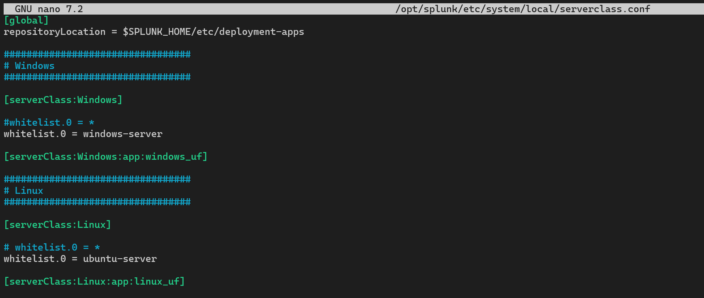
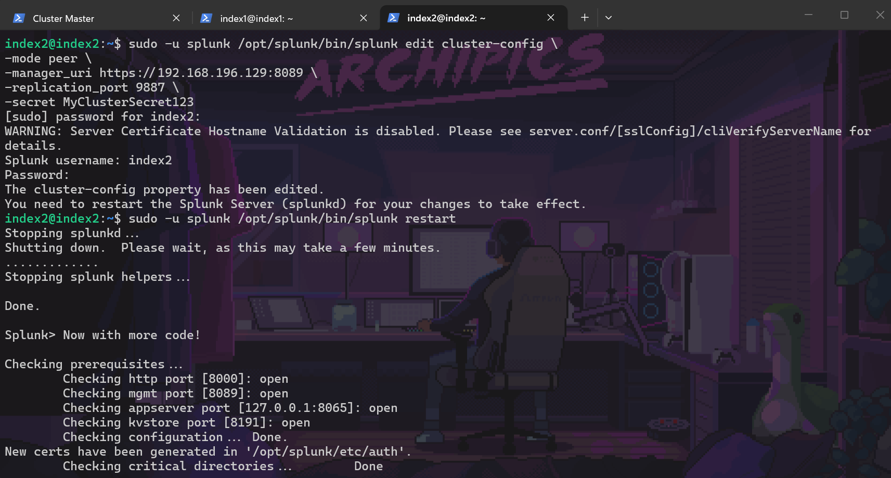

```bash
sudo -u id2 /home/id2/splunk/bin/splunk edit cluster-config \
  -mode peer \
  -manager_uri https://10.0.0.10:8089 \
  -replication_port 9887 \
  -secret '078a6b5e4974c5ad58f5b3656838023b' \
  -auth id2:Admin123@

sudo -u id2 /home/id2/splunk/bin/splunk disable webserver -auth id2:Admin123@
sudo -u id2 /home/id2/splunk/bin/splunk restart
```

---

### 3.3 Xác Nhận Hoạt Động Của Cluster và Trạng Thái Sức Khỏe

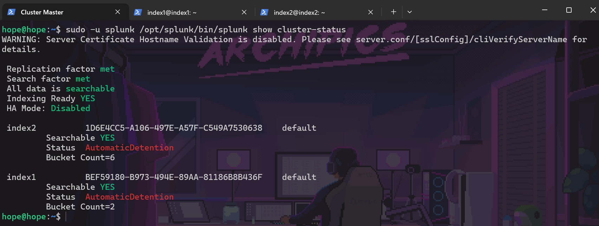
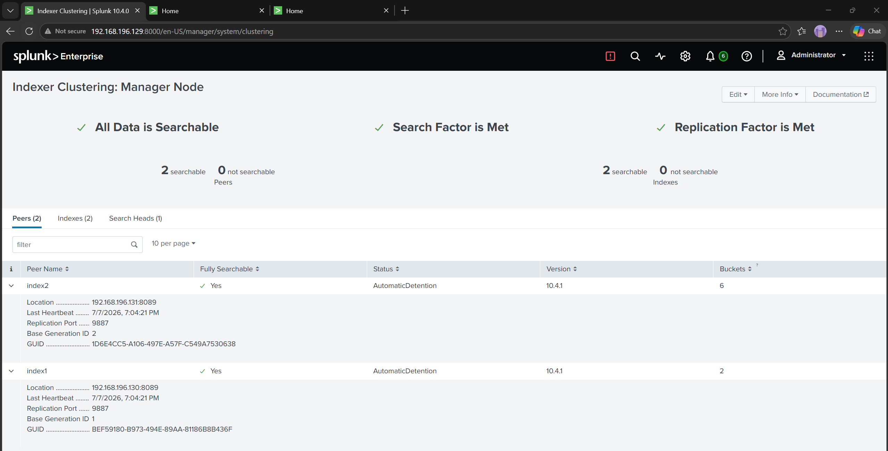
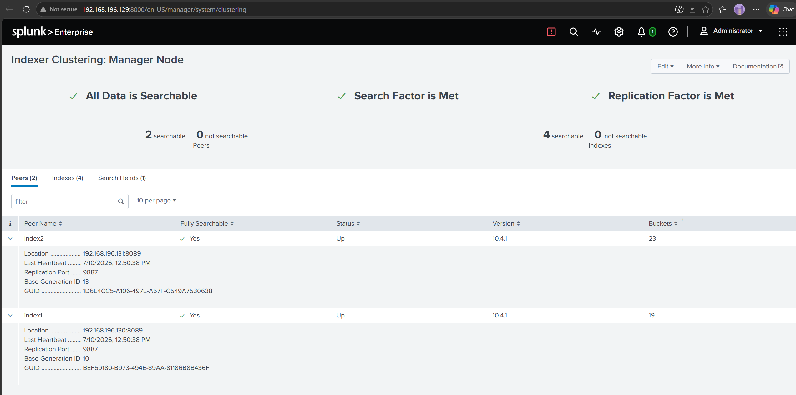

Chạy lệnh kiểm tra trên Máy 1 (`10.0.0.10`):
```bash
/home/splunk/splunk/bin/splunk show cluster-status -auth splunk:Admin123@
```

---

### 3.4 Phân Phối Cấu Hình Tự Động Qua Deployment Server

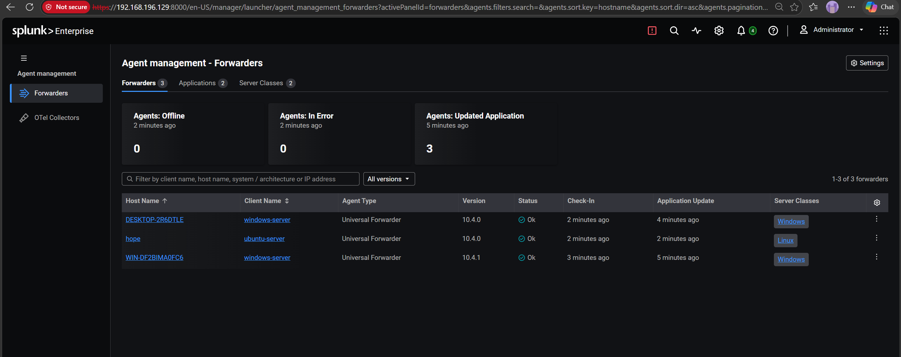
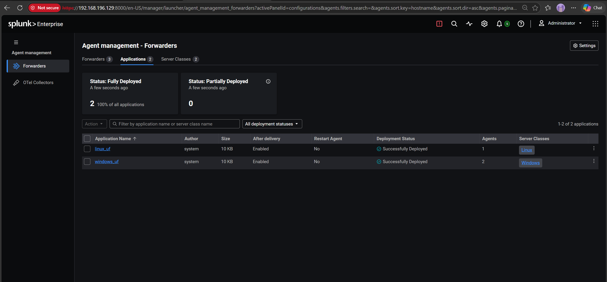
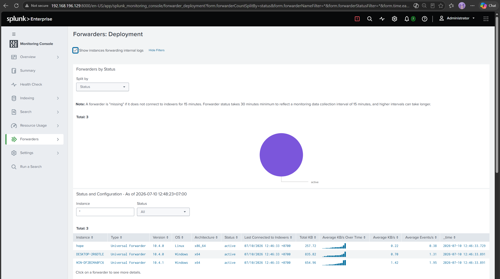

1. **Tạo Deployment App `TA_linux_logs`** trên Máy 1 tại `/home/splunk/splunk/etc/deployment-apps/TA_linux_logs/local/inputs.conf`.
2. **Cấu hình `serverclass.conf`**:
   ```ini
   [serverClass:Linux_Endpoints]
   whitelist.0 = ubuntu-endpoint
   [serverClass:Linux_Endpoints:app:TA_linux_logs]
   restartSplunkd = true
   ```
3. **Tải lại Deployment Server**:
   ```bash
   /home/splunk/splunk/bin/splunk reload deploy-server -auth splunk:Admin123@
   ```

---

## 4. Task Phụ: Nội Dung Modules 10 - 12 (Training Fundamentals)

---

### 4.1 Module 10: Reports và Dashboards Nâng Cao (Advanced Visualizations)
* **Scheduled Reports và Delivery**: Thiết lập lịch tự động xuất báo cáo định kỳ dưới dạng tệp đính kèm PDF hoặc CSV gửi tới các bên liên quan.
* **Dashboard Studio Features**:
 * Cấu trúc JSON Layout độc lập.
 * Hỗ trợ Dynamic Theming (Dark/Light Mode).
 * Hỗ trợ các biểu đồ hiện đại: Sankey Diagram, Chord Diagram, Markdown Panels.
* **Data Acceleration**: Bật Summary Indexing hoặc Report Acceleration để tăng tốc độ load Dashboard từ vài phút xuống vài mili-giây.

---

### 4.2 Module 11: Làm Việc Với Fields và Trích Xuất Nâng Cao (Working with Fields)
* **Regex Inline Extraction (`EXTRACT`)** trong `props.conf`:
  ```ini
  [custom_firewall]
  EXTRACT-fields = ^(?<timestamp>\S+)\s+(?<action>ALLOW|DENY)\s+src=(?<src_ip>\S+)
  ```
* **Transforms Extraction (`REPORT`)** kết hợp `transforms.conf`:
 * Dùng khi cần chia sẻ cùng 1 biểu thức Regex cho nhiều Sourcetypes khác nhau hoặc khi bóc tách chuỗi phức tạp có Delimiters (`KV_MODE`).
* **Delimiter Field Extraction**:
 * Tự động trích xuất các trường phân cách bằng dấu phẩy (CSV), dấu tab (TSV) hoặc dấu `|` (Pipe).

---

### 4.3 Module 12: Quản Trị Hệ Thống Splunk Nâng Cao (Splunk Administration)
* **User Roles và Access Control (RBAC)**:
 * Phân quyền chi tiết (`admin`, `power`, `user`) kết hợp Custom Roles.
 * Hạn chế quyền tìm kiếm (*Search Restrictions*): Giới hạn L1 Analyst chỉ được tìm kiếm trong `index=firewall` và `index=windows_security`, cấm truy cập `index=hr_payroll`.
* **Quản Trị Vòng Đời Index và Lưu Trữ (`indexes.conf`)**:
 * `maxTotalDataSizeMB`: Giới hạn dung lượng tối đa của một Index.
 * `frozenTimePeriodInSecs`: Thời gian lưu trữ trước khi chuyển sang Frozen (ví dụ: `7776000` = 90 ngày).
* **Giám Sát và Khắc Phục Sự Cố Qua Index Nội Bộ**:
 * `index=_internal`: Ghi nhận nhật ký hoạt động của bản thân Splunk (lỗi kết nối forwarder, lỗi phân tích cú pháp, đứt gãy pipeline).
 * `index=_audit`: Ghi nhận nhật ký ai đã đăng nhập vào Splunk và thực hiện câu truy vấn SPL nào (*Audit Trail*).

---

## 5. Bảng Thuật Ngữ và Q&A Defense Guide

> [!faq]- Q1: Tại sao nên sử dụng Data Model và CIM thay vì tìm kiếm trực tiếp trên Index thô?
> - **Trả lời**: Data Model đã được tối ưu hóa cấu trúc cây phân cấp và có thể kích hoạt **Data Model Acceleration** (sử dụng các tệp `.tsidx` nén sẵn). Truy vấn qua câu lệnh `| tstats` trên Data Model có tốc độ phản hồi nhanh hơn gấp 50 đến 100 lần so với câu truy vấn `search index=...` quét toàn bộ dữ liệu thô trên đĩa.

> [!faq]- Q2: Sự khác nhau bản chất giữa Eventtype và Tag là gì?
> - **Trả lời**: Eventtype là **tên đại diện cho một câu truy vấn tìm kiếm (Search String)**; còn Tag là **nhãn ngữ nghĩa được gắn lên một giá trị của Field hoặc một Eventtype**. Eventtype tạo ra nhóm dữ liệu, còn Tag giúp nhóm các Eventtype hoặc Field khác nhau về cùng một danh mục logic.

> [!faq]- Q3: Tại sao cần cấu hình Alert Throttling khi gửi cảnh báo qua Email/Telegram?
> - **Trả lời**: Khi hệ thống bị tấn công mạng (ví dụ DDoS hoặc Password Spraying với hàng chục nghìn lượt thử mỗi phút), nếu không có Throttling, Splunk sẽ gửi hàng nghìn email/tin nhắn liên tục gây ngập hòm thư (**Alert Fatigue**) và làm nghẽn máy chủ thông báo. Throttling giúp gộp và chỉ gửi cảnh báo 1 lần duy nhất cho mỗi đối tượng vi phạm trong khoảng thời gian định trước (ví dụ 30 phút).

> [!faq]- Q4: Cluster Manager phân phối cấu hình cho các Indexer Peers bằng cách nào?
> - **Trả lời**: Cluster Manager sử dụng cơ chế **Cluster Bundle**. Admin đặt các file cấu hình tại `/opt/splunk/etc/master-apps/`, sau đó chạy lệnh `splunk apply cluster-bundle`. Cluster Manager sẽ nén bundle và đẩy xuống thư mục `/opt/splunk/etc/slave-apps/` của tất cả các Indexer Peers đồng thời mà không cần cấu hình thủ công trên từng máy.

---

## 6. Tài Liệu Tham Khảo (References)

- **Splunk Common Information Model (CIM) 8.5 Documentation**: [https://help.splunk.com/en/splunk-enterprise/common-information-model/8.5/introduction/overview-of-the-splunk-common-information-model](https://help.splunk.com/en/splunk-enterprise/common-information-model/8.5/introduction/overview-of-the-splunk-common-information-model)
- **Splunk Indexer Cluster Architecture Guide**: [https://docs.splunk.com/Documentation/Splunk/latest/Indexer/Aboutclusters](https://docs.splunk.com/Documentation/Splunk/latest/Indexer/Aboutclusters)
- **Splunk Deployment Server và Client Management**: [https://docs.splunk.com/Documentation/Splunk/latest/Updating/Aboutdeploymentserver](https://docs.splunk.com/Documentation/Splunk/latest/Updating/Aboutdeploymentserver)
- **SecurityZone Vietnam: Cấu hình Splunk Cluster Thực Chiến**: [https://securityzone.vn/t/cau-hinh-splunk-cluster.11839/](https://securityzone.vn/t/cau-hinh-splunk-cluster.11839/)
