# Tuần 6: Bảo Mật và Phát Hiện Tấn Công Active Directory
> **Tài liệu chuẩn hóa chuyên sâu về kiến trúc dịch vụ thư mục Active Directory Domain Services (AD DS), giao thức xác thực Kerberos v5 và NTLM, phân tích cơ chế hoạt động, hành vi, IoC, chiến lược truy vết cây tiến trình (Process Tree Reconstruction) và bộ luật phát hiện Splunk SPL thực chiến đã qua kiểm chứng Lab cho 8 kỹ thuật tấn công Active Directory kinh điển: Kerberoasting, AS-REP Roasting, Pass-the-Hash, Overpass-the-Hash, Pass-the-Ticket, Golden/Silver Ticket, DCSync và DCShadow.**

---

## 1. Kiến Trúc Nền Tảng Active Directory Domain Services (AD DS)

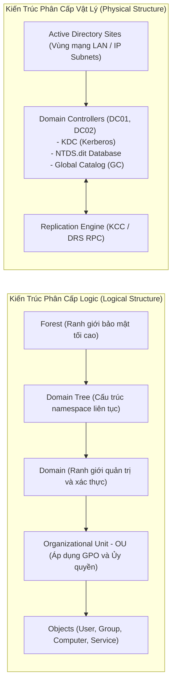


*Hình 1.1: Kiến trúc logic của Active Directory: Forest, Tree, Domain và Organizational Unit.*

*Hình 1.2: Kiến trúc vật lý của Active Directory: Domain Controllers, Sites và Subnets.*

---

### 1.1 Cấu Trúc Phân Cấp: Forest, Domain, OU, Site và Trust

* **Forest (Rừng)**: Ranh giới bảo mật tối cao (*Security Boundary*) trong Active Directory. Tất cả các Domain trong cùng một Forest chia sẻ chung một **Schema** (định nghĩa cấu trúc thuộc tính đối tượng) và một **Global Catalog (GC)**.
* **Domain (Miền)**: Ranh giới quản trị (*Administrative Boundary*) và ranh giới xác thực. Chứa cơ sở dữ liệu `NTDS.dit` quản lý tài khoản người dùng và máy tính.
* **Organizational Unit (OU)**: Vùng chứa logic nhỏ nhất cho phép gán chính sách nhóm (**Group Policy Objects - GPO**) và phân quyền quản trị ủy quyền (*Delegation of Control*).
* **Site và Subnet**: Cấu trúc vật lý ánh xạ theo dải địa chỉ IP mạng LAN/WAN, điều khiển lưu lượng đăng nhập của Client đến Domain Controller gần nhất và tối ưu hóa chu kỳ nhân bản dữ liệu (*AD Replication*).
* **Mối Quan Hệ Tin Cậy (Trust Relationships)**:
 * **Parent-Child Trust**: Tự động tạo hai chiều (Two-way, Transitive) khi tạo Sub-domain.
 * **Tree-Root Trust**: Tin cậy giữa các cây Domain khác nhau trong cùng một Forest.
 * **Forest Trust**: Kết nối tin cậy giữa hai Forest độc lập (Transitive hoặc Non-transitive).
 * **External Trust**: Kết nối một chiều hoặc hai chiều giữa 2 domain không cùng Forest.

---

### 1.2 Thuật Ngữ và Định Danh Đối Tượng Trong AD (Terminology)


*Hình 1.3: Cây đối tượng và các lớp định danh (User, Group, Computer) trong Active Directory.*

1. **SID (Security Identifier)**: Định danh nhị phân duy nhất cấp phát cho mỗi đối tượng User, Group hoặc Computer.
 * Cấu trúc chuẩn: `S-1-5-21-<DomainIdentifier>-<RID>`
 * `RID 500`: Tài khoản quản trị tối cao **Administrator**.
 * `RID 502`: Tài khoản dịch vụ mật mã **krbtgt**.
 * `RID 512`: Nhóm **Domain Admins**.
 * `RID 519`: Nhóm **Enterprise Admins** (Toàn Forest).
2. **GUID (Globally Unique Identifier)**: Định danh 128-bit bất biến của một Object, không bao giờ thay đổi kể cả khi đổi tên (*Rename*) hoặc di chuyển OU (*Move*).
3. **DN (Distinguished Name)**: Đường dẫn phân cấp đầy đủ của đối tượng trong cây thư mục LDAP:
 * `CN=Nguyen Van A,OU=IT_Security,DC=lab,DC=local`
4. **UPN (User Principal Name)**: Định dạng đăng nhập chuẩn Internet: `username@domain.com`.
5. **SPN (Service Principal Name)**: Định danh ánh xạ giữa một dịch vụ ứng dụng mạng (HTTP, MSSQLSvc, CIFS, HOST) với một tài khoản người dùng/máy tính chạy dịch vụ đó. **Đây là chìa khóa then chốt dẫn đến tấn công Kerberoasting**.

---

### 1.3 Các Giao Thức Truyền Thông Cốt Lõi Trong Môi Trường AD


*Hình 1.4: So sánh kiến trúc xác thực thử thách-phản hồi NTLM và vé xác thực Kerberos v5.*

* **Kerberos v5 (Port 88)**: Giao thức xác thực mặc định, an toàn cao dựa trên vé (*Ticket-based Authentication*) và mật mã đối xứng.
* **NTLM v1/v2 (Port 445 / 139)**: Giao thức xác thực truyền thống Challenge-Response, dễ bị tấn công Pass-the-Hash và NTLM Relay.
* **LDAP / LDAPS (Port 389 / 636)**: Giao thức truy vấn và sửa đổi cơ sở dữ liệu thư mục.
* **SMB (Server Message Block - Port 445)**: Giao thức chia sẻ tệp, thư mục và gọi hàm từ xa qua Named Pipes.
* **MSRPC (Port 135 và Dynamic RPC 49152-65535)**: Giao thức gọi thủ tục từ xa, phục vụ nhân bản dữ liệu (*DRSUAPI*) và quản lý dịch vụ (*SAMR, LSARPC*).

---

### 1.4 Cơ Chế Ủy Quyền (Delegation Architecture)


*Hình 1.5: Kiến trúc cơ chế ủy quyền (Unconstrained, Constrained, Resource-Based Constrained Delegation).*

Cho phép một dịch vụ mạng (Front-end Web Server) mạo danh (*Impersonate*) người dùng cuối để truy cập vào tài nguyên Back-end (Database Server):
1. **Unconstrained Delegation**: Máy chủ Front-end lưu toàn bộ vé **TGT** của người dùng trong RAM LSASS $\rightarrow$ **Cực kỳ nguy hiểm**: Nếu chiếm được máy này, attacker lấy được vé TGT của Domain Admin nếu họ từng đăng nhập vào.
2. **Constrained Delegation (S4U2Self / S4U2Proxy)**: Chỉ cho phép máy chủ mạo danh người dùng để truy cập vào các SPN được chỉ định trước.
3. **Resource-Based Constrained Delegation (RBCD)**: Quyền ủy quyền được cấu hình trực tiếp trên thuộc tính của máy chủ Back-end (`msDS-AllowedToActOnBehalfOfOtherIdentity`).

---

## 2. Bề Mặt Tấn Công và Luồng Xác Thực Kerberos v5


*Hình 2.1: Toàn cảnh bề mặt tấn công nhắm vào hạ tầng Active Directory và Domain Controller.*

*Hình 2.2: Luồng trao đổi gói tin chuẩn của giao thức xác thực Kerberos v5 (AS-REQ/REP và TGS-REQ/REP).*

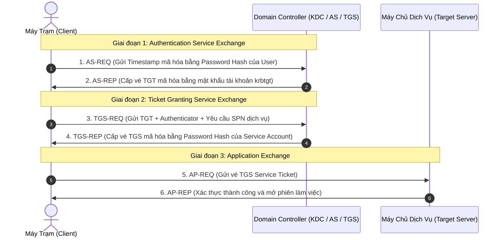

---

## 3. Chiến Lược Truy Vết Tận Gốc Của SOC (Pivot và Process Tree Reconstruction)

!!! tip "Nguyên Tắc Điều Tra Truy Vết Của L2/L3 SOC Analyst"

    Khi phát hiện một cảnh báo tấn công Active Directory trên Domain Controller (Event 4624, 4672, 4768, 4769), không được dừng lại ở IP nguồn mà phải thực hiện chuỗi truy vết 2 bước:
    1. **Truy ngược Hostname / MAC thực tế**: Không tin tưởng 100% vào `src_ip` (do attacker có thể làm giả IP). Sử dụng `src_ip` truy vấn ngược vào DHCP Server log hoặc Datamodel `Network_Sessions` để xác định chính xác Hostname và địa chỉ MAC vật lý.
    2. **Dựng lại Cây Tiến Trình (Process Lineage Tree - PID/PPID)**: Bóc tách mã phiên đăng nhập `Logon_ID` (hoặc `TargetLogonId`) từ log DC, sau đó truy vấn vào **Sysmon EventID 1** hoặc **Event 4688** trên chính máy Endpoint nguồn. Bạn sẽ thấy trọn vẹn phả hệ tiến trình độc hại:
    * Ví dụ: `explorer.exe` $\rightarrow$ `cmd.exe` (PPID: 4120) $\rightarrow$ `python.exe` (PID: 5824, CommandLine: `python.exe wmiexec.py -hashes ... Administrator@10.0.0.50`).


---

## 4. Phân Tích Chuyên Sâu 9 Kỹ Thuật Tấn Công Active Directory và Bộ Luật Splunk Thực Chiến

!!! warning "Ghi Chú Về Chuẩn Hóa Dữ Liệu và Time Window Trong SPL"
    - **Scheduled Alert (Real-time Detection mỗi 5 - 15 phút)**: Đặt `earliest=-15m` hoặc `earliest=-30m`.
    - **Threat Hunting / Incident Investigation**: Đặt `earliest=-24h` hoặc `earliest=-7d`.
    - **Chuẩn hóa Telemetry**:
        * Loại bỏ tiền tố IPv6: `eval src_ip = replace(src_ip, "^::ffff:", "")`
        * Loại bỏ địa chỉ Loopback nội bộ: `src_ip!="::1" src_ip!="127.0.0.1" NOT src_ip="fe80*"`
        * Chuẩn hóa danh tính người dùng: `eval user = replace(user, "@.*$", "")`
        * Lọc bỏ hoàn toàn tài khoản máy tính hệ thống (Machine Accounts kết thúc bằng `$`) để triệt tiêu 99% nhiễu nền: `NOT user="*$" NOT Service_Name="*$"`


---

### 4.1 Kerberoasting (MITRE ATT&CK: T1558.003)


*Hình 4.1: Sơ đồ luồng tấn công Kerberoasting trích xuất vé TGS mã hóa RC4 của tài khoản dịch vụ.*

#### Mô Tả Kỹ Thuật & Bản Chất Mật Mã Học
* **Bản chất**: Bất kỳ tài khoản domain hợp lệ nào (kể cả user không có đặc quyền) đều có quyền yêu cầu vé dịch vụ **TGS (Ticket Granting Service)** cho bất kỳ Service Principal Name (SPN) nào đã đăng ký trong Active Directory.
* **Kẽ hở khai thác**: Phần dữ liệu mã hóa của TGS được mã hóa bằng **NTLM Hash (hoặc AES Key)** của chính tài khoản dịch vụ (Service Account) sở hữu SPN đó. Kẻ tấn công chủ động gửi yêu cầu TGS với thuật toán yếu **RC4-HMAC (etype `0x17`)**, sau đó trích xuất blob mã hóa từ bộ nhớ và crack offline (Hashcat `-m 13100`) để khôi phục mật khẩu plaintext mà không bao giờ gửi brute-force lên DC.

#### Quy Trình Tấn Công Từng Bước
1. **Bước 1 (Recon SPN)**: Attacker truy vấn LDAP để tìm các User Account có thuộc tính `servicePrincipalName` khác rỗng (loại trừ tài khoản máy kết thúc bằng `$`).
2. **Bước 2 (TGS-REQ)**: Gửi bản tin Kerberos `TGS-REQ` tới Domain Controller, chỉ định SPN mục tiêu và yêu cầu mã hóa RC4 (`Ticket_Encryption_Type=0x17`).
3. **Bước 3 (Extract Ticket)**: DC trả về `TGS-REP` (Event 4769). Attacker lưu vé vào file `.kirbi` hoặc `.ccache`.
4. **Bước 4 (Offline Cracking)**: Dùng Hashcat / John the Ripper crack NTLM hash của Service Account offline trên GPU.

#### Sơ Đồ Luồng Tấn Công (Mermaid Workflow)
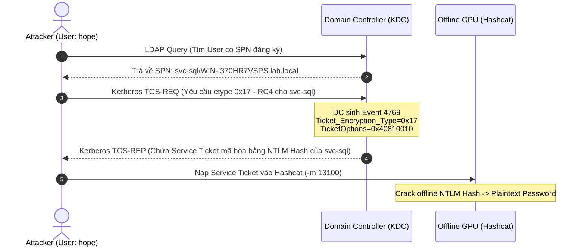

#### Công Cụ Phổ Biến & So Sánh Telemetry
| Môi trường / Tool | Câu lệnh thực nghiệm | Dấu hiệu Telemetry đặc trưng |
| :--- | :--- | :--- |
| **Linux (Impacket)** | `python GetUserSPNs.py lab.local/hope:Password123 -dc-ip 192.168.100.30 -request` | Event 4769: `TicketOptions=0x40810010`, `Ticket_Encryption_Type=0x17`, `ServiceName=svc-sql`. Không có log endpoint trên máy nguồn. |
| **Windows (Rubeus)** | `Rubeus.exe kerberoast /user:svc-sql /rc4 /nowrap` | Event 4769 tương tự, kèm theo Sysmon Event 1 (process `Rubeus.exe`) và Sysmon Event 10 (access LSASS nếu dùng ticket injection). |
| **Windows (PowerView)** | `Get-DomainUser -SPN \| Get-DomainSPNTicket -Format Hashcat` | PowerShell Event 4104 (Script Block Logging) chứa từ khóa `Get-DomainSPNTicket`. |

#### Dấu Hiệu Phát Hiện Chuẩn MITRE ATT&CK & IoC
* **MITRE ID**: [DET0157](https://attack.mitre.org/detectionstrategies/DET0157/)
* **Data Components**:
  * **DC0035**: Active Directory Kerberos Service Ticket Operations (Event 4769).
  * **DC0088**: Ticket Request (`Ticket_Options="0x40810010"` hoặc `0x40800000`).
* **IoC Cốt Lõi**:
  * `EventCode=4769`, `Ticket_Encryption_Type=0x17`, `Failure_Code=0x0`.
  * `Service_Name` **không kết thúc bằng dấu `$`** (chỉ nhắm vào tài khoản người dùng, vì tài khoản máy có mật khẩu 120 ký tự ngẫu nhiên không thể crack).
  * `Ticket_Options` mang cờ đặc thù của tool tấn công: `0x40810010` (Rubeus/Impacket) hoặc `0x40800000`.

#### SPL Query Chuẩn Hóa & Bằng Chứng Thực Nghiệm
```bash
index=windows_security earliest=-24h EventCode=4769 Ticket_Encryption_Type=0x17 Failure_Code=0x0
| eval src_ip = replace(src_ip, "::ffff:", "")
| search NOT user="*$" NOT Service_Name="*$" src_ip!="::1" src_ip!="127.0.0.1" NOT src_ip="fe80*"
| stats count as TGS_Requests, dc(Service_Name) as Unique_SPNs, values(Service_Name) as SPNs, values(Ticket_Options) as TicketOptions, min(_time) as firstTime, max(_time) as lastTime by host, user, src_ip
| where Unique_SPNs > 2 OR match(TicketOptions, "0x40810010") OR match(TicketOptions, "0x40800000")
| rename host as dest_host
| convert ctime(firstTime) ctime(lastTime)
| table firstTime, lastTime, dest_host, src_ip, user, TicketOptions, SPNs, Unique_SPNs, TGS_Requests
```

#### Bằng chứng kiểm chứng thực tế (Splunk MCP Data):
| firstTime | lastTime | dest_host | src_ip | user | TicketOptions | SPNs | Unique_SPNs | TGS_Requests |
| :--- | :--- | :--- | :--- | :--- | :--- | :--- | :--- | :--- |
| 08/22/2026 21:05:27 | 08/23/2026 18:57:23 | WIN-I370HR7VSPS | 192.168.100.40 | hope@LAB.LOCAL | 0x40810010 | svc-sql | 1 | 16 |


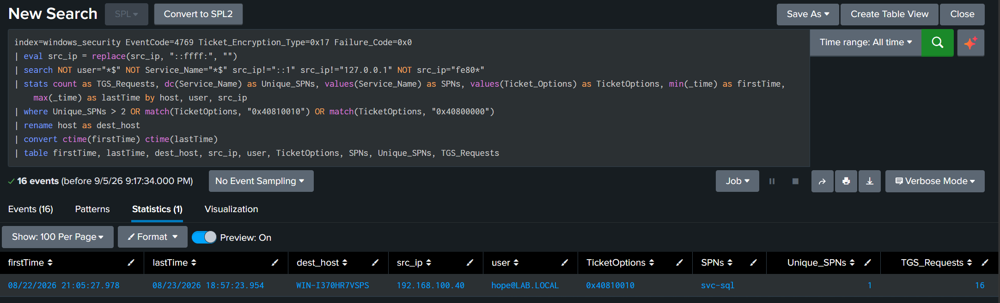
*Hình 4.2: Bằng chứng kiểm chứng kết quả truy vấn SPL phát hiện Kerberoasting trên Splunk Enterprise.*

#### False Positive & Chiến Lược Whitelisting
* **Hệ thống cũ (Legacy Apps/Linux clients/máy in)**: Vẫn dùng RC4 do chưa bật AES. Whitelist các Service Account này theo `Service_Name`.
* **Môi trường AES-enforced**: Đặt Group Policy `Network security: Configure encryption types allowed for Kerberos` để cấm hoàn toàn RC4 (`0x17`).

??? question "Góc phản biện và Vấn đáp kỹ thuật (Reviewer Defense)"
    * **Q1: Dấu `$` trong `Service_Name` và `user` là gì? Tại sao phải loại trừ (`NOT Service_Name="*$"` và `NOT user="*$*`)?**
      * **Trả lời**: Ký tự `$` ở cuối đại diện cho **Machine Account (Tài khoản máy tính)** trong Active Directory (ví dụ: `DESKTOP-2R6DTLE$`). Machine Account tự động đổi mật khẩu 30 ngày/lần với độ dài 120 ký tự ngẫu nhiên. Attacker không bao giờ Kerberoast Machine Account vì không thể crack offline được. Hàng ngày, hệ thống Windows sinh ra hàng nghìn Event 4769 cho Machine Account để phục vụ RPC/SMB nội bộ giữa các máy trạm và DC. Nếu không lọc `NOT Service_Name="*$"`, rule sẽ bị ngập trong 99% nhiễu (noise) của hệ điều hành.
    * **Q2: Tại sao điều kiện `Unique_SPNs > 2` lại cần đi kèm `OR match(TicketOptions, "0x40810010")`?**
      * **Trả lời**: Nếu attacker thực hiện **Targeted Kerberoasting** (chỉ nhắm đúng 1 SPN nhạy cảm chứa database như `svc-sql`), điều kiện `Unique_SPNs > 2` sẽ bị bypass hoàn toàn (False Negative). Phép `OR` với `TicketOptions` bắt chính xác cờ đặc trưng mà các tool tự động (Impacket/Rubeus) thiết lập khi xin vé.
    
    ---


---

### 4.2 AS-REP Roasting (MITRE ATT&CK: T1558.004)


*Hình 4.3: Sơ đồ luồng tấn công AS-REP Roasting nhắm vào tài khoản không yêu cầu Pre-Authentication.*

#### Mô Tả Kỹ Thuật & Bản Chất Mật Mã Học
* **Bản chất**: Trong quy trình Kerberos chuẩn, client gửi `AS-REQ` kèm theo **Pre-Authentication Data (PA-ENC-TIMESTAMP)** được mã hóa bằng mật khẩu của user để chứng minh mình biết mật khẩu trước khi DC cấp vé.
* **Kẽ hở khai thác**: Nếu một tài khoản bị admin cấu hình bật cờ `DONT_REQUIRE_PREAUTH` (`userAccountControl` bit `0x400000`), Domain Controller sẽ bỏ qua bước xác minh trước này và trả về ngay bản tin `AS-REP` chứa TGT. Phần dữ liệu này được mã hóa bằng chính NTLM Hash của user. Attacker thu thập bản tin này mà **không cần biết mật khẩu trước**, sau đó crack offline (Hashcat `-m 18200`).

#### Quy Trình Tấn Công Từng Bước
1. **Bước 1 (Enumerate Vulnerable Accounts)**: Attacker truy vấn LDAP lọc tất cả User có `userAccountControl:1.2.840.113556.1.4.803:=4194304` (`DONT_REQUIRE_PREAUTH`).
2. **Bước 2 (AS-REQ without Pre-Auth)**: Gửi bản tin Kerberos `AS-REQ` (Event 4768) với `Pre_Authentication_Type=0`.
3. **Bước 3 (Capture AS-REP)**: DC trả về `AS-REP` chứa encrypted ticket data.
4. **Bước 4 (Offline Cracking)**: Nạp hash thu được vào Hashcat module `18200` để tìm mật khẩu plaintext.

#### Sơ Đồ Luồng Tấn Công (Mermaid Workflow)
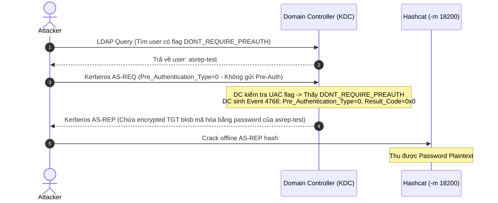

#### Công Cụ Phổ Biến & So Sánh Telemetry
| Môi trường / Tool | Câu lệnh thực nghiệm | Dấu hiệu Telemetry đặc trưng |
| :--- | :--- | :--- |
| **Linux (Impacket)** | `python GetNPUsers.py lab.local/ -usersfile users.txt -format hashcat -dc-ip 192.168.100.30` | Event 4768: `Pre_Authentication_Type=0`, `Result_Code=0x0`, `user=asrep-test`. |
| **Windows (Rubeus)** | `Rubeus.exe asreproast /format:hashcat /nowrap` | Event 4768 tương tự + Sysmon Event 1 process `Rubeus.exe`. |

#### Dấu Hiệu Phát Hiện Chuẩn MITRE ATT&CK & IoC
* **MITRE ID**: [DET0113](https://attack.mitre.org/detectionstrategies/DET0113/)
* **Data Components**:
  * **DC0032**: Active Directory Kerberos Authentication Service (Event 4768).
  * **DC0084**: Logon Session Creation.
* **IoC Cốt Lõi**:
  * `EventCode=4768`, `Pre_Authentication_Type=0`, `Result_Code=0x0`.
  * Không xuất hiện Event 4769 hoặc Event 4624 tiếp nối cho tài khoản này (vì mục đích chỉ lấy hash để crack offline).

#### SPL Query Chuẩn Hóa & Bằng Chứng Thực Nghiệm
```bash
index=windows_security earliest=-24h EventCode=4768 Pre_Authentication_Type=0 Result_Code=0x0
| eval src_ip = replace(src_ip, "::ffff:", "")
| search src_ip!="::1" src_ip!="127.0.0.1" NOT src_ip="fe80*"
| stats count as ASREQ_Requests, values(Ticket_Encryption_Type) as TicketEncryptionType, values(Pre_Authentication_Type) as PreAuthType, min(_time) as firstTime, max(_time) as lastTime by host, user, src_ip
| rename host as dest_host
| convert ctime(firstTime) ctime(lastTime)
| table firstTime, lastTime, dest_host, src_ip, user, PreAuthType, TicketEncryptionType, ASREQ_Requests
```

#### Bằng chứng kiểm chứng thực tế (Splunk MCP Data):
| firstTime | lastTime | dest_host | src_ip | user | PreAuthType | TicketEncryptionType | ASREQ_Requests |
| :--- | :--- | :--- | :--- | :--- | :--- | :--- | :--- |
| 08/22/2026 21:05:46 | 08/23/2026 19:06:42 | WIN-I370HR7VSPS | 192.168.100.40 | asrep-test | 0 | 0x17 | 24 |


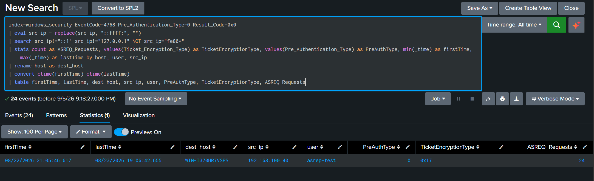
*Hình 4.4: Bằng chứng kiểm chứng kết quả truy vấn SPL phát hiện AS-REP Roasting trên Splunk Enterprise.*

#### False Positive & Chiến Lược Whitelisting
* **Tài khoản đặc biệt hợp lệ**: Một số ứng dụng tích hợp cũ (Unix Kerberos không hỗ trợ pre-auth). Whitelist đích danh `user` đó.
* **Hardening**: Tắt cờ `Do not require Kerberos preauthentication` trên toàn bộ user trong Active Directory.

??? question "Góc phản biện và Vấn đáp kỹ thuật (Reviewer Defense)"
    * **Q1: Tại sao rule này KHÔNG bắt buộc điều kiện `Ticket_Encryption_Type=0x17` (RC4)?**
      * **Trả lời**: Bản chất kỹ thuật của AS-REP Roasting nằm ở việc **Bypass Pre-Authentication (`Pre_Authentication_Type=0`)**, không nằm ở loại mã hóa. Nếu domain đã bật AES, DC vẫn sẽ cấp AS-REP mã hóa bằng AES (etype 17/18) và attacker vẫn crack offline được (Hashcat `-m 18200` hỗ trợ cả AES AS-REP). Ép điều kiện RC4 sẽ gây **False Negative** nghiêm trọng.
    * **Q2: `Result_Code=0x0` có ý nghĩa gì?**
      * **Trả lời**: `0x0` biểu thị yêu cầu TGT thành công (`KDC_ERR_NONE`). Nếu `Result_Code` là `0x6` (User không tồn tại) hoặc `0x18` (Pre-auth failed), đó là hành vi dò quét thất bại, không phải AS-REP Roasting thành công.
    
    ---


---

### 4.3 Pass-the-Hash / Suspicious NTLM Lateral Movement (MITRE ATT&CK: T1550.002)


*Hình 4.5: Sơ đồ cơ chế tấn công Pass-the-Hash mượn mã băm NTLM qua giao thức SMB.*

#### Mô Tả Kỹ Thuật & Bản Chất Mật Mã Học
* **Bản chất**: Giao thức NTLM/NTLMv2 **không bao giờ truyền hay cần mật khẩu plaintext** trong quá trình bắt tay; NTLM Hash chính là khóa bí mật trực tiếp để tính toán challenge-response.
* **Kẽ hở khai thác**: Attacker trích xuất NTLM hash từ RAM (LSASS) hoặc SAM database, sau đó dùng trực tiếp hash này để xác thực qua SMB/RPC/WMI mà không cần giải mã ra plaintext.
* **Sự thật Telemetry trên Windows 10/11 & Server 2016+**:
  1. **Lầm tưởng `Key_Length=0`**: Cả Mimikatz `sekurlsa::pth` trên Windows 10 lẫn Impacket trên Linux đều đàm phán thành công NTLMv2 Session Key 128-bit $\to$ **Windows Server luôn ghi nhận `Key_Length = 128`**. Hardcode `Key_Length=0` sẽ gây **False Negative 100%**.
  2. **Lầm tưởng `Workstation_Name="-"`**: Trường này rỗng là hành vi bình thường của SMB2/SMB3 client. Ngược lại, Mimikatz chạy trên máy trạm vẫn gửi đúng hostname (`DESKTOP-2R6DTLE`). Tuyệt đối không dùng `OR Workstation_Name="-"`.
  3. **Lầm tưởng `SubjectUserSid=S-1-0-0`**: NULL SID là thuộc tính mặc định của **mọi phiên NTLM Type 3 Network Logon** từ máy ngoài vào.

#### Quy Trình Tấn Công Từng Bước
1. **Bước 1 (Dump Hash)**: Attacker trích xuất NTLM hash của `Administrator` từ máy trạm bị chiếm.
2. **Bước 2 (Inject / Construct NTLM Session)**: 
   - Trên Windows: Mimikatz inject hash vào LUID session (`sekurlsa::pth`).
   - Trên Linux: Impacket tự tạo bản tin NTLMSSP Authenticate chứa Response tính bằng Hash.
3. **Bước 3 (Network Access)**: Kết nối tới Domain Controller qua SMB (`dir \\DC\c$`) hoặc WMI.
4. **Bước 4 (Event 4624 Generation)**: DC ghi nhận Event 4624 Logon Type 3 (Network) với `Logon_Process=NtLmSsp`.

#### Sơ Đồ Luồng Tấn Công (Mermaid Workflow)
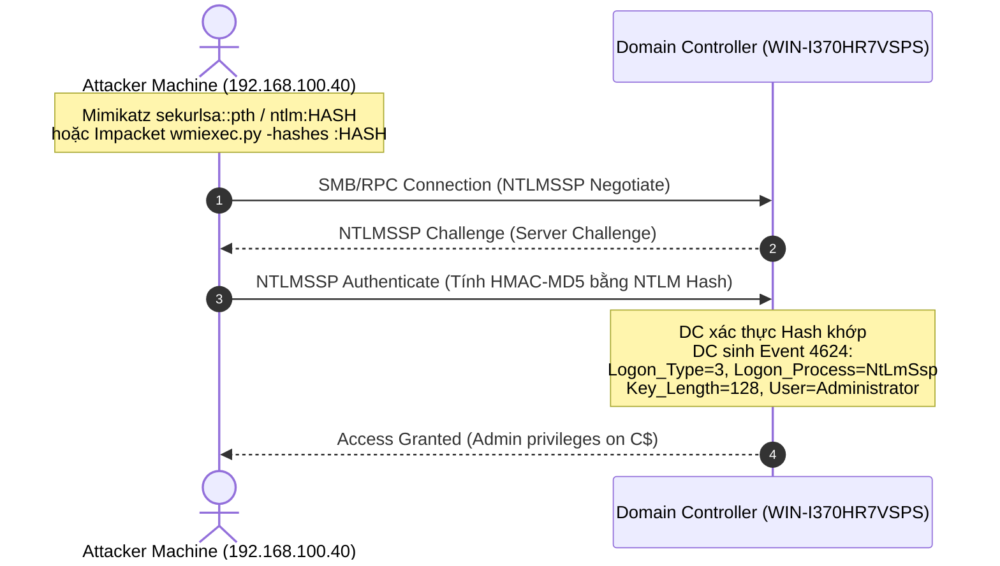

#### Công Cụ Phổ Biến & So Sánh Telemetry
| Môi trường / Tool | Câu lệnh thực nghiệm | Dấu hiệu Telemetry đặc trưng |
| :--- | :--- | :--- |
| **Windows (Mimikatz)** | `sekurlsa::pth /user:Administrator /domain:lab.local /ntlm:813b979d... /run:cmd.exe`<br>sau đó: `dir \\192.168.100.30\c$` | Event 4624: `Logon_Type=3`, `Logon_Process=NtLmSsp`, `Key_Length=128`, `Workstation_Name=DESKTOP-2R6DTLE`. Sysmon Event 10 trên máy nguồn (lsass access). |
| **Linux (Impacket)** | `python wmiexec.py -hashes :813b979d... lab.local/Administrator@192.168.100.30 whoami` | Event 4624: `Logon_Type=3`, `Logon_Process=NtLmSsp`, `Key_Length=128`, `Workstation_Name=-`. |

#### Dấu Hiệu Phát Hiện Chuẩn MITRE ATT&CK & IoC
* **MITRE ID**: [DET0409](https://attack.mitre.org/detectionstrategies/DET0409/)
* **Data Components**:
  * **DC0084**: Logon Session Creation (Event 4624 Logon_Type 3).
  * **DC0067**: Network Traffic Flow (SMB 445 / RPC 135).
  * **DC0082**: Process Access (LSASS handle access trên client).
* **IoC Cốt Lõi (Behavioral Anomaly)**:
  * Tài khoản đặc quyền (`Administrator`, `da_*`) đăng nhập NTLM Type 3 từ máy trạm vào máy chủ/DC (trong khi tài khoản Admin phải luôn xác thực bằng Kerberos).
  * 1 IP máy trạm sử dụng NTLM đăng nhập vào nhiều máy chủ (`Target_Count >= 2`).

#### SPL Query Chuẩn Hóa & Bằng Chứng Thực Nghiệm
```bash
index=windows_security earliest=-24h EventCode=4624 Logon_Type=3 Logon_Process=NtLmSsp
| eval src_ip = replace(src_ip, "::ffff:", "")
| search NOT user="*$" NOT (user="ANONYMOUS LOGON" OR user="-" OR user="SYSTEM") src_ip!="::1" src_ip!="127.0.0.1" NOT src_ip="fe80*"
| stats count as Auth_Count, dc(host) as Target_Count, values(host) as Target_Hosts, values(Workstation_Name) as Workstations, values(Key_Length) as KeyLengths, min(_time) as firstTime, max(_time) as lastTime by user, src_ip
| where Target_Count >= 2 OR match(user, "(?i)administrator|da_")
| convert ctime(firstTime) ctime(lastTime)
| table firstTime, lastTime, src_ip, user, Workstations, Target_Hosts, KeyLengths, Target_Count, Auth_Count
```

#### Bằng chứng kiểm chứng thực tế (Splunk MCP Data):
| firstTime | lastTime | src_ip | user | Workstations | Target_Hosts | KeyLengths | Target_Count | Auth_Count | Ghi chú |
| :--- | :--- | :--- | :--- | :--- | :--- | :--- | :--- | :--- | :--- |
| 09/05/2026 11:50:45 | 09/05/2026 11:50:45 | 192.168.100.40 | Administrator | DESKTOP-2R6DTLE | WIN-I370HR7VSPS | 128 | 1 | 1 | **Bắt Mimikatz sekurlsa::pth** |
| 08/23/2026 22:33:30 | 08/23/2026 22:33:30 | 192.168.100.41 | Administrator | - | WIN-I370HR7VSPS | 128 | 1 | 2 | **Bắt Impacket wmiexec.py** |


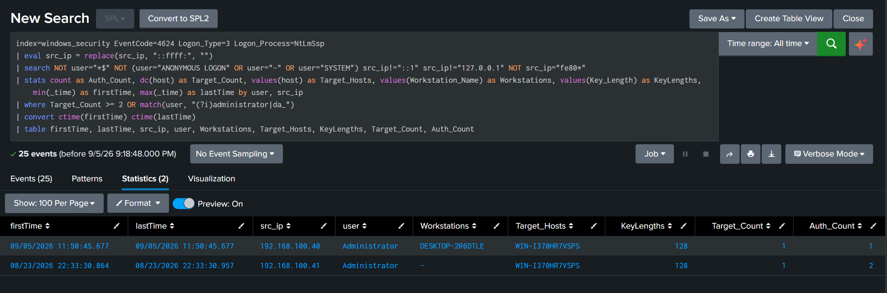
*Hình 4.6: Bằng chứng kiểm chứng kết quả truy vấn SPL phát hiện Pass-the-Hash trên Splunk Enterprise.*

#### False Positive & Chiến Lược Whitelisting
* **Máy trạm IT Admin quản trị hợp lệ**: Whitelist dải IP của Jump Server / PAW (Privileged Access Workstations).
* **Hardening**: Bật chính sách hạn chế NTLM (`Network security: Restrict NTLM: Outgoing traffic to remote servers`), đưa tài khoản Admin vào nhóm `Protected Users` để ép buộc 100% Kerberos.

??? question "Góc phản biện và Vấn đáp kỹ thuật (Reviewer Defense)"
    * **Q1: Tại sao không dùng `Key_Length=0` để bắt Pass-the-Hash như sách vở lý thuyết?**
      * **Trả lời**: `Key_Length=0` là tàn dư của NTLMv1 hoặc các client cũ không đàm phán Session Key. Trong tất cả các hệ điều hành hiện đại (Windows 10/11, Windows Server 2016-2022) và các tool tấn công hiện đại (Impacket, NetExec, Mimikatz trên Win10), giao thức NTLMv2 luôn đàm phán 128-bit Session Key (`Key_Length=128`). Dùng `Key_Length=0` sẽ bỏ lọt 100% cuộc tấn công PtH hiện đại.
    * **Q2: Tại sao tài khoản `Administrator` đăng nhập NTLM Type 3 lại là dấu hiệu đáng ngờ?**
      * **Trả lời**: Trong kiến trúc chuẩn của Active Directory, khi một Domain Admin truy cập từ xa vào Domain Controller hoặc máy chủ nội bộ, hệ thống bắt buộc phải sử dụng Kerberos Authentication (sinh ra Event 4624 với `Logon_Process=Kerberos`). Sự xuất hiện của NTLM Type 3 chứng minh client không thể hoặc không muốn thương lượng Kerberos (dấu hiệu rõ ràng của việc inject NTLM hash từ công cụ bên ngoài).
    
    ---


---

### 4.4 Pass-the-Ticket - PtT (MITRE ATT&CK: T1550.003)


*Hình 4.7: Sơ đồ tấn công Pass-the-Ticket tiêm vé TGS/TGT trực tiếp vào phiên LSASS bằng Mimikatz.*

#### Mô Tả Kỹ Thuật & Bản Chất Mật Mã Học
* **Bản chất**: Attacker trích xuất vé Kerberos thật (TGT hoặc TGS) đã được cấp hợp lệ từ bộ nhớ LSASS của một máy tính bị chiếm quyền, sau đó import vé này vào phiên làm việc trên một máy tính khác.
* **Kẽ hở khai thác**: Kerberos tickets theo thiết kế mặc định không bị ràng buộc cứng với địa chỉ IP (hoặc chứa IP rỗng trong trường `caddr`). Do đó, DC vẫn chấp nhận Service Ticket request từ bất kỳ máy nào miễn là vé TGT hợp lệ về mặt chữ ký số.

#### Quy Trình Tấn Công Từng Bước
1. **Bước 1 (Ticket Extraction)**: Dump vé Kerberos (`.kirbi`/`.ccache`) từ LSASS trên máy A bằng Mimikatz `sekurlsa::tickets` hoặc Rubeus `dump`.
2. **Bước 2 (Ticket Injection)**: Chuyển vé sang máy B và nạp vào session bằng Rubeus `ptt` hoặc export biến môi trường `KRB5CCNAME`.
3. **Bước 3 (Replay / Access)**: Máy B dùng vé vừa nạp để xin TGS hoặc truy cập thẳng tài nguyên trên máy đích.

#### Sơ Đồ Luồng Tấn Công (Mermaid Workflow)
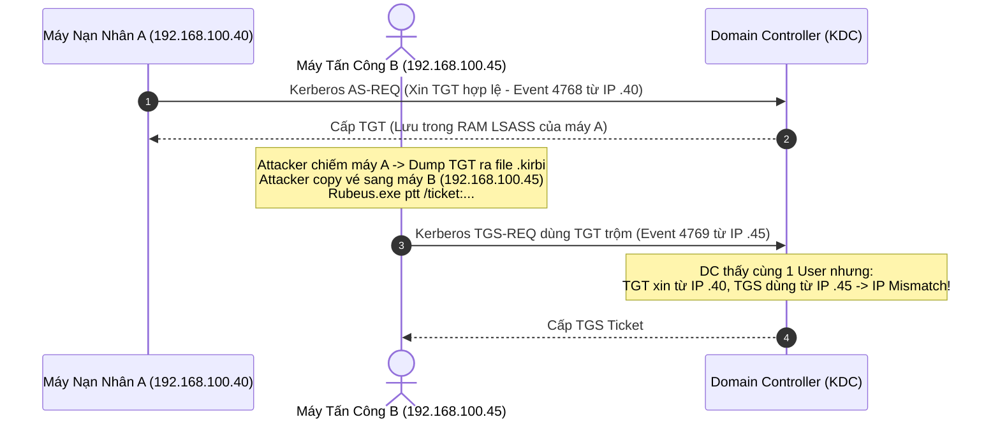

#### Công Cụ Phổ Biến & So Sánh Telemetry
| Môi trường / Tool | Câu lệnh thực nghiệm | Dấu hiệu Telemetry đặc trưng |
| :--- | :--- | :--- |
| **Windows (Rubeus)** | `Rubeus.exe ptt /ticket:ticket.kirbi` | Sysmon Event 10 / LsaCallAuthenticationPackage, sau đó xuất hiện Event 4769 từ IP mới. |
| **Linux (Impacket)** | `export KRB5CCNAME=admin.ccache`<br>`python wmiexec.py -k -no-pass lab.local/admin@192.168.100.30` | Event 4624 Logon Type 3 Kerberos không có Workstation Name, Event 4769 từ IP Linux. |

#### Dấu Hiệu Phát Hiện Chuẩn MITRE ATT&CK & IoC
* **MITRE ID**: [DET0352](https://attack.mitre.org/detectionstrategies/DET0352/)
* **Data Components**:
  * **DC0035**: Active Directory Kerberos Service Ticket Operations (Event 4769).
  * **DC0084**: Logon Session Creation (Event 4624).
  * **DC0016**: OS API Execution.
* **IoC Cốt Lõi**:
  * **IP Mismatch**: Địa chỉ IP yêu cầu TGS (Event 4769) khác với danh sách địa chỉ IP đã từng xin TGT (Event 4768) cho cùng một tài khoản trong vòng 10 giờ (`MaxTicketAge`).

#### SPL Query Chuẩn Hóa & Bằng Chứng Thực Nghiệm
```bash
index=windows_security earliest=-24h (EventCode=4768 OR EventCode=4769) NOT user="*$" NOT user="*$@*" NOT Service_Name="krbtgt"
| eval src_ip = replace(src_ip, "::ffff:", "")
| search src_ip!="::1" src_ip!="127.0.0.1" NOT src_ip="fe80*"
| eval user = mvindex(split(user, "@"), 0)
| stats values(eval(if(EventCode==4768, src_ip, null()))) as tgt_ips, values(eval(if(EventCode==4769, src_ip, null()))) as tgs_ips max(eval(if(EventCode==4769, _time, null()))) as last_used_time values(Service_Name) as SPNs by user
| where isnotnull(tgs_ips) AND isnotnull(tgt_ips)
| mvexpand tgs_ips
| eval is_known = if(isnotnull(mvfind(tgt_ips, tgs_ips)), 1, 0)
| where is_known=0
| convert ctime(last_used_time)
| rename tgs_ips as stolen_ip, tgt_ips as original_ips
| table last_used_time, user, stolen_ip, original_ips, SPNs
```

#### Bằng chứng kiểm chứng thực tế (Splunk MCP Data):
| last_used_time | user | stolen_ip | original_ips | SPNs |
| :--- | :--- | :--- | :--- | :--- |
| 08/24/2026 09:46:26 | Administrator | 192.168.100.45 | 192.168.100.40, 192.168.100.41 | WIN-I370HR7VSPS$ |
| 09/05/2026 11:47:01 | hope | 192.168.100.45 | 192.168.100.40, 192.168.100.41 | DESKTOP-2R6DTLE$, WIN-I370HR7VSPS$, svc-sql |
| 09/05/2026 11:47:01 | hope | 192.168.100.46 | 192.168.100.40, 192.168.100.41 | DESKTOP-2R6DTLE$, WIN-I370HR7VSPS$, svc-sql |


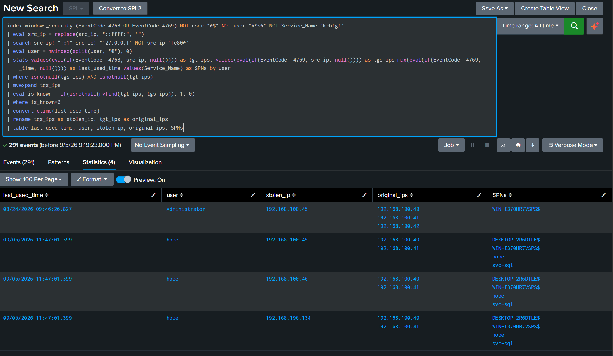
*Hình 4.8: Bằng chứng kiểm chứng kết quả truy vấn SPL phát hiện Pass-the-Ticket trên Splunk Enterprise.*

#### False Positive & Chiến Lược Whitelisting
* **User Roaming (Laptop đổi Wi-Fi sang LAN, VPN reconnect)**: Làm IP đổi giữa phiên. Sử dụng `mvfind` để kiểm tra mảng IP đa giá trị và kết hợp correlation với DHCP logs.

??? question "Góc phản biện và Vấn đáp kỹ thuật (Reviewer Defense)"
    * **Q1: Tại sao phải loại trừ `NOT Service_Name="krbtgt"`?**
      * **Trả lời**: Khi client thực hiện **Renew Ticket** (gia hạn TGT hợp lệ), Windows gửi một bản tin TGS-REQ với `Service_Name=krbtgt` tới DC. Quá trình này không sinh ra Event 4768 mới. Nếu không loại trừ `krbtgt`, hành vi gia hạn vé thông thường của máy tính sẽ bị báo động nhầm thành Pass-the-Ticket.
    * **Q2: Tại sao phải dùng hàm `mvexpand` kết hợp `mvfind` thay vì so sánh bằng thông thường (`tgt_ips != tgs_ips`)?**
      * **Trả lời**: Trong Splunk, khi một user đăng nhập từ nhiều IP (ví dụ máy tính có cả card mạng Wi-Fi và LAN), trường `tgt_ips` là một **Multi-value field** (mảng nhiều IP). So sánh toán tử thông thường (`!=`) trên multi-value field sẽ bị sai lệch logic. `mvexpand` bung từng IP sử dụng TGS và `mvfind` tìm kiếm chính xác IP đó có nằm trong danh sách IP đã xin TGT hay không.
    
    ---


---

### 4.5 Overpass-the-Hash / UnPAC-the-Hash (MITRE ATT&CK: T1550.002)


*Hình 4.9: Sơ đồ tấn công Overpass-the-Hash đổi NTLM hash lấy vé Kerberos TGT.*

#### Mô Tả Kỹ Thuật & Bản Chất Mật Mã Học
* **Bản chất**: Thay vì dùng NTLM hash để xác thực giao thức NTLM thuần (PtH), attacker sử dụng chính NTLM hash đó làm **Khóa RC4 (Kerberos Key type 23)** để thực hiện bước Kerberos Pre-Authentication (`PA-ENC-TIMESTAMP`) trong bản tin `AS-REQ`.
* **Mục đích**: Chuyển đổi một NTLM Hash "cũ" thành một **Vé TGT Kerberos "thật"** hoàn toàn hợp lệ, giúp attacker di chuyển ngang bằng Kerberos và vượt qua các cơ chế giám sát NTLM.

#### Quy Trình Tấn Công Từng Bước
1. **Bước 1 (Obtain Hash)**: Lấy NTLM Hash của tài khoản mục tiêu.
2. **Bước 2 (AS-REQ with RC4 Key)**: Gửi bản tin `AS-REQ` (Event 4768) với mã hóa `Ticket_Encryption_Type=0x17` (RC4) và có Pre-Authentication (`Pre_Authentication_Type=2` / PA-ENC-TIMESTAMP).
3. **Bước 3 (Receive TGT)**: Domain Controller giải mã thành công timestamp bằng NTLM Hash và cấp TGT hợp lệ.

#### Sơ Đồ Luồng Tấn Công (Mermaid Workflow)
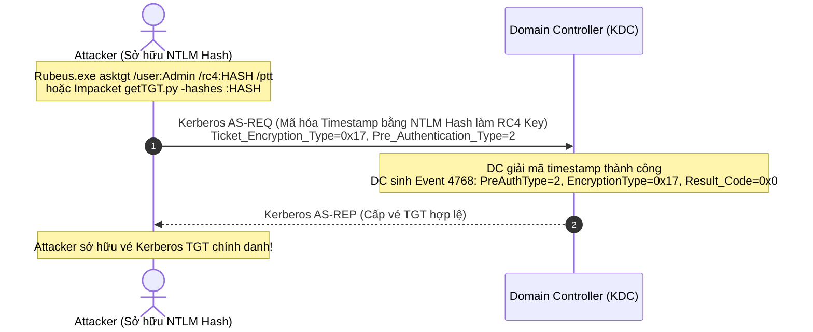

#### Công Cụ Phổ Biến & So Sánh Telemetry
| Môi trường / Tool | Câu lệnh thực nghiệm | Dấu hiệu Telemetry đặc trưng |
| :--- | :--- | :--- |
| **Linux (Impacket)** | `python getTGT.py -hashes :813b979d... lab.local/Administrator` | Event 4768: `Ticket_Encryption_Type=0x17`, `Pre_Authentication_Type=2`, `Result_Code=0x0`. |
| **Windows (Rubeus)** | `Rubeus.exe asktgt /user:Administrator /rc4:813b979d... /ptt` | Event 4768 tương tự + tự động inject TGT vào LUID session hiện tại. |

#### Dấu Hiệu Phát Hiện Chuẩn MITRE ATT&CK & IoC
* **MITRE ID**: [DET0409](https://attack.mitre.org/detectionstrategies/DET0409/) / DET0157
* **Data Components**:
  * **DC0032**: Active Directory Kerberos Authentication Service (Event 4768).
  * **DC0084**: Logon Session Creation.
* **IoC Cốt Lõi**:
  * `EventCode=4768`, `Ticket_Encryption_Type=0x17`, `Result_Code=0x0`, **`Pre_Authentication_Type!=0`** (để phân biệt với AS-REP Roasting).

#### SPL Query Chuẩn Hóa & Bằng Chứng Thực Nghiệm
```bash
index=windows_security earliest=-24h EventCode=4768 Ticket_Encryption_Type=0x17 Result_Code=0x0 Pre_Authentication_Type!=0
| eval src_ip = replace(src_ip, "::ffff:", "")
| search NOT user="*$" src_ip!="::1" src_ip!="127.0.0.1" NOT src_ip="fe80*"
| stats count as TGT_Requests, values(Ticket_Encryption_Type) as TicketEncryptionType, values(Pre_Authentication_Type) as PreAuthType, min(_time) as firstTime, max(_time) as lastTime by host, user, src_ip
| rename host as dest_host
| convert ctime(firstTime) ctime(lastTime)
| table firstTime, lastTime, dest_host, src_ip, user, PreAuthType, TicketEncryptionType, TGT_Requests
```

#### Bằng chứng kiểm chứng thực tế (Splunk MCP Data):
| firstTime | lastTime | dest_host | src_ip | user | PreAuthType | TicketEncryptionType | TGT_Requests |
| :--- | :--- | :--- | :--- | :--- | :--- | :--- | :--- |
| 08/22/2026 22:07:26 | 08/23/2026 20:24:32 | WIN-I370HR7VSPS | 192.168.100.40 | Administrator | 2 | 0x17 | 20 |
| 08/22/2026 21:05:27 | 08/23/2026 18:57:23 | WIN-I370HR7VSPS | 192.168.100.40 | hope | 2 | 0x17 | 16 |
| 08/22/2026 21:16:25 | 08/22/2026 21:16:25 | WIN-I370HR7VSPS | 192.168.100.40 | svc-sql | 2 | 0x17 | 1 |


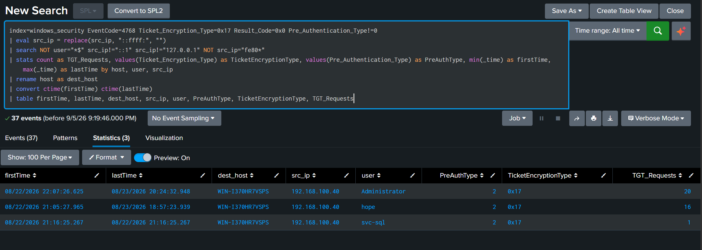
*Hình 4.10: Bằng chứng kiểm chứng kết quả truy vấn SPL phát hiện Overpass-the-Hash trên Splunk Enterprise.*

#### False Positive & Chiến Lược Whitelisting
* **Hệ thống cũ chỉ hỗ trợ RC4**: Các máy trạm Windows 7 cũ chưa cập nhật bản vá AES. Cần enforce baseline AES256 trên Domain Controller.

??? question "Góc phản biện và Vấn đáp kỹ thuật (Reviewer Defense)"
    * **Q1: Điểm khác biệt mấu chốt giữa AS-REP Roasting (Rule 2) và Overpass-the-Hash (Rule 5) trong Event 4768 là gì?**
      * **Trả lời**: Cả hai đều có `EventCode=4768` và `Ticket_Encryption_Type=0x17` (RC4). Tuy nhiên:
        - **AS-REP Roasting**: `Pre_Authentication_Type = 0` (Bypass pre-auth do cờ DONT_REQUIRE_PREAUTH).
        - **Overpass-the-Hash**: `Pre_Authentication_Type = 2` (PA-ENC-TIMESTAMP - Có thực hiện pre-auth thành công bằng NTLM hash).
        Điều kiện `Pre_Authentication_Type!=0` tách biệt tuyệt đối hai kỹ thuật này, loại trừ 100% chồng chéo.
    
    ---


---

### 4.6 Golden Ticket (MITRE ATT&CK: T1558.001)


*Hình 4.11: Sơ đồ tấn công Golden Ticket rèn vé TGT giả mạo với đặc quyền Domain Admin tối cao.*

#### Mô Tả Kỹ Thuật & Bản Chất Mật Mã Học
* **Bản chất**: Tài khoản `krbtgt` là tài khoản dịch vụ của Key Distribution Center (KDC). NTLM hash hoặc AES-256 key của `krbtgt` được dùng để ký số và mã hóa phần PAC (Privilege Attribute Certificate) của mọi vé TGT trong toàn bộ Domain.
* **Kẽ hở khai thác**: Khi chiếm được hash `krbtgt` (qua DCSync hoặc ntds.dit dump), attacker có thể **tự tạo (forge) vé TGT hoàn toàn offline** cho bất kỳ user nào (kể cả user không tồn tại), tự gán quyền Enterprise/Domain Admin (Group SID 512, 519) với thời hạn tùy ý (mặc định tool đặt 10 năm).
* **Đặc trưng Telemetry**: Vì TGT được tạo offline, **hoàn toàn KHÔNG có Event 4768 (AS-REQ) nào gửi lên DC**. Khi attacker sử dụng TGT này, DC chỉ nhận được bản tin `TGS-REQ` (Event 4769) mà không có bản ghi cấp TGT trước đó trong 10h.

#### Quy Trình Tấn Công Từng Bước
1. **Bước 1 (Extract krbtgt Hash)**: DCSync lấy hash của `krbtgt` và Domain SID.
2. **Bước 2 (Forge TGT Offline)**: Dùng Mimikatz `kerberos::golden` hoặc Impacket `ticketer.py` rèn vé TGT giả mạo.
3. **Bước 3 (Use Golden Ticket)**: Trình vé TGT giả mạo lên DC để xin vé dịch vụ TGS (sinh Event 4769 mồ côi).

#### Sơ Đồ Luồng Tấn Công (Mermaid Workflow)
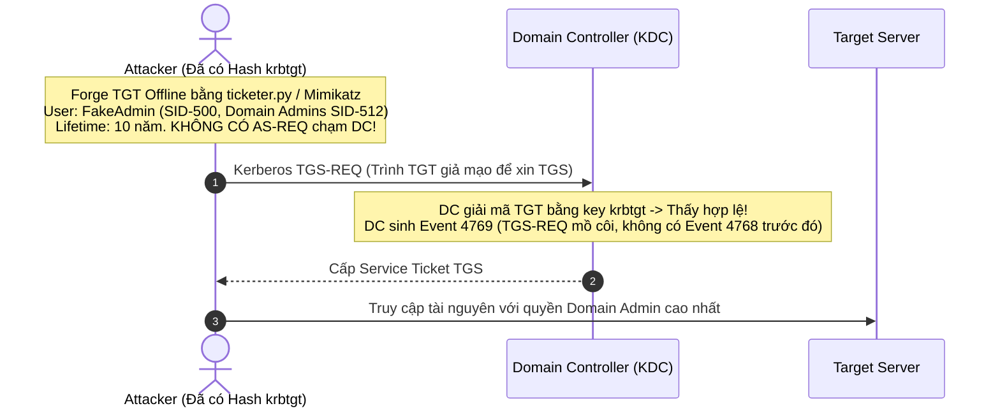

#### Công Cụ Phổ Biến & So Sánh Telemetry
| Môi trường / Tool | Câu lệnh thực nghiệm | Dấu hiệu Telemetry đặc trưng |
| :--- | :--- | :--- |
| **Linux (Impacket)** | `python ticketer.py -nthash <KRBTGT_HASH> -domain-sid <SID> -domain lab.local Administrator`<br>`export KRB5CCNAME=Administrator.ccache` | Event 4769 mồ côi (TGS_Count > 0, TGT_Count = 0). |
| **Windows (Mimikatz)** | `kerberos::golden /user:Administrator /domain:lab.local /sid:<SID> /krbtgt:<HASH> /ptt` | Event 4769 mồ côi + Domain Name format anomaly (FQDN `LAB.LOCAL` vs NetBIOS `LAB`). |

#### Dấu Hiệu Phát Hiện Chuẩn MITRE ATT&CK & IoC
* **MITRE ID**: [DET0144](https://attack.mitre.org/detectionstrategies/DET0144/)
* **Data Components**:
  * **DC0088**: Ticket Request (Event 4769).
  * **DC0035**: Active Directory Kerberos Service Ticket Operations.
  * **DC0084**: Logon Session Creation.
* **IoC Cốt Lõi (Detection-by-Absence)**:
  * Sự kiện Event 4769 (TGS Request) xuất hiện mà **KHÔNG có Event 4768 (TGT Request)** tương ứng của cùng account trong vòng 10 giờ (`MaxTicketAge`).
  * Tài khoản không tồn tại trong AD hoặc đã bị disabled mà vẫn xin được TGS thành công.

#### SPL Query Chuẩn Hóa & Bằng Chứng Thực Nghiệm
```bash
index=windows_security earliest=-10h (EventCode=4768 OR EventCode=4769) NOT user="*$" NOT user="*$@*" NOT Service_Name="krbtgt"
| eval src_ip = replace(src_ip, "::ffff:", "")
| search src_ip!="::1" NOT src_ip="fe80*"
| eval user = mvindex(split(user, "@"), 0)
| stats count(eval(EventCode=4768)) as TGT_Count, count(eval(EventCode=4769)) as TGS_Count, min(_time) as firstTime, max(_time) as lastTime values(Ticket_Options) as TicketOptions values(Service_Name) as SPNs by user, src_ip
| where TGT_Count=0 AND TGS_Count>0
| convert ctime(firstTime) ctime(lastTime)
| table firstTime, lastTime, user, src_ip, SPNs, TicketOptions, TGS_Count
```

#### Bằng chứng kiểm chứng thực tế (Splunk MCP Data):
| firstTime | lastTime | user | src_ip | SPNs | TicketOptions | TGS_Count |
| :--- | :--- | :--- | :--- | :--- | :--- | :--- |
| 08/24/2026 09:46:26 | 08/24/2026 09:46:26 | Administrator | 192.168.100.45 | WIN-I370HR7VSPS$ | 0x40810010 | 5 |
| 08/22/2026 22:19:40 | 08/24/2026 09:11:53 | administrator | 192.168.100.40 | WIN-I370HR7VSPS$ | 0x40810010 | 85 |


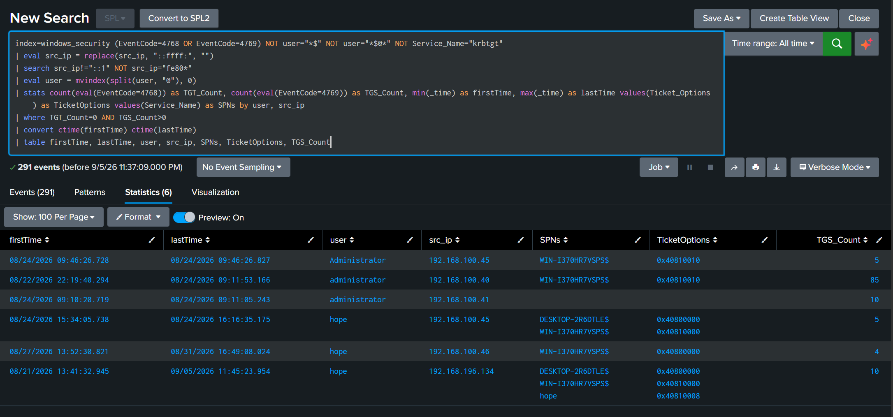
*Hình 4.12: Bằng chứng kiểm chứng kết quả truy vấn SPL phát hiện Golden Ticket trên Splunk Enterprise.*

#### False Positive & Chiến Lược Whitelisting
* **Rớt log Forwarder trên DC**: Nếu Universal Forwarder bị delay hoặc drop Event 4768, ticket hợp lệ sẽ bị coi là Golden Ticket. Cần kết hợp cảnh báo Log Health Check.

??? question "Góc phản biện và Vấn đáp kỹ thuật (Reviewer Defense)"
    * **Q1: Tại sao khung thời gian tìm kiếm lại là `earliest=-10h`?**
      * **Trả lời**: Chính sách mặc định của Active Directory Kerberos Policy (`MaxTicketAge`) quy định thời hạn sống tối đa của một vé TGT hợp lệ là **10 giờ** (600 phút). Nếu một user có TGT hợp lệ, chắc chắn phải có Event 4768 trong vòng 10 giờ gần nhất. Nếu quá 10 giờ mà vẫn xin được TGS mà không có 4768 xin lại TGT, đó là bằng chứng của vé giả mạo vượt quá lifetime policy.
    * **Q2: Nếu Attacker tạo Golden Ticket trên chính máy vừa xin TGT hợp lệ thì rule có bị False Negative không?**
      * **Trả lời**: Có rủi ro FN nếu chỉ group theo `(user, src_ip)` vì `TGT_Count > 0`. Để khắc phục triệt để, SOC kết hợp thêm: (1) Kiểm tra định dạng FQDN bất thường trong Account Domain của vé, (2) Giám sát sự kiện đăng nhập của các tài khoản không tồn tại trong AD.
    
    ---


---

### 4.7 Silver Ticket (MITRE ATT&CK: T1558.002)

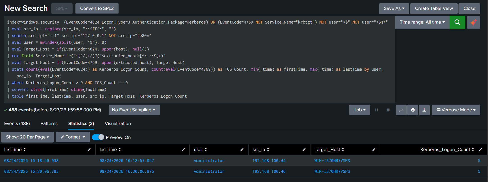
*Hình 4.13: Sơ đồ tấn công Silver Ticket rèn vé TGS giả mạo cục bộ cho từng dịch vụ mục tiêu.*

#### Mô Tả Kỹ Thuật & Bản Chất Mật Mã Học
* **Bản chất**: Service Ticket (TGS) được mã hóa bằng NTLM Hash (hoặc AES Key) của chính tài khoản dịch vụ/máy tính đích sở hữu SPN đó.
* **Kẽ hở khai thác**: Nếu attacker chiếm được NTLM hash của một Service Account hoặc Computer Account (ví dụ `cifs/FS01` hoặc `WIN-I370HR7VSPS$`), attacker có thể **tự rèn (forge) Service Ticket TGS trực tiếp mà hoàn toàn KHÔNG cần liên lạc với Domain Controller** (không có AS-REQ và không có TGS-REQ trên DC).
* **Đặc trưng Telemetry**: Trên Domain Controller hoàn toàn không có bất kỳ log nào. Log chỉ xuất hiện tại **Máy đích (Target Service)** dưới dạng Event 4624 (Logon Type 3, Kerberos).

#### Quy Trình Tấn Công Từng Bước
1. **Bước 1 (Obtain Service Key)**: Lấy NTLM Hash của máy đích/service account (qua Kerberoasting crack được, hoặc dump SAM máy đích).
2. **Bước 2 (Forge TGS Offline)**: Dùng Mimikatz `kerberos::golden /silver` hoặc Rubeus `silver` để rèn Service Ticket TGS.
3. **Bước 3 (Direct Service Access)**: Trình vé TGS trực tiếp lên Target Server để truy cập dịch vụ (SMB, WMI, MSSQL).

#### Sơ Đồ Luồng Tấn Công (Mermaid Workflow)
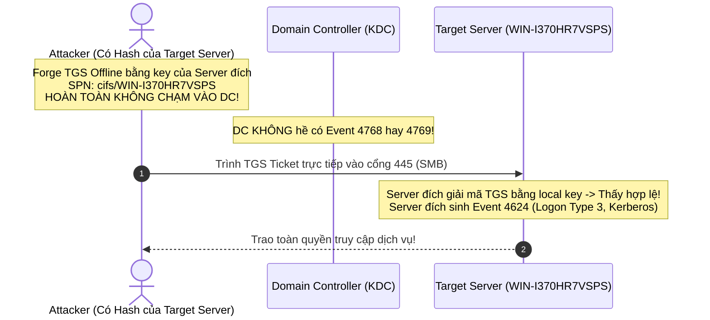

#### Công Cụ Phổ Biến & So Sánh Telemetry
| Môi trường / Tool | Câu lệnh thực nghiệm | Dấu hiệu Telemetry đặc trưng |
| :--- | :--- | :--- |
| **Linux (Impacket)** | `python ticketer.py -nthash <SERVER_HASH> -domain-sid <SID> -domain lab.local -spn cifs/WIN-I370HR7VSPS Administrator` | Event 4624 Kerberos trên Target Server, KHÔNG CÓ Event 4769 trên DC. |
| **Windows (Mimikatz)** | `kerberos::golden /domain:lab.local /sid:<SID> /target:WIN-I370HR7VSPS.lab.local /service:cifs /rc4:<HASH> /user:Administrator /ptt` | Tương tự + PAC structure anomaly nếu phân tích Network Packet. |

#### Dấu Hiệu Phát Hiện Chuẩn MITRE ATT&CK & IoC
* **MITRE ID**: [DET0241](https://attack.mitre.org/detectionstrategies/DET0241/)
* **Data Components**:
  * **DC0084**: Logon Session Creation (Event 4624 Logon Type 3 Kerberos trên Target).
  * **DC0035**: Active Directory Kerberos Service Ticket Operations (Sự vắng mặt của Event 4769 trên DC).
* **IoC Cốt Lõi**:
  * Có sự kiện Event 4624 Logon Type 3 dùng Kerberos trên Server đích, nhưng **KHÔNG có Event 4769 tương ứng trên toàn bộ DC** cho host đó trong cùng khung thời gian.

#### SPL Query Chuẩn Hóa & Bằng Chứng Thực Nghiệm
```bash
index=windows_security earliest=-10h (EventCode=4624 Logon_Type=3 Authentication_Package=Kerberos) OR (EventCode=4769 NOT Service_Name="krbtgt") NOT user="*$" NOT user="*$@*"
| eval src_ip = replace(src_ip, "::ffff:", "")
| search src_ip!="::1" src_ip!="127.0.0.1" NOT src_ip="fe80*"
| eval user = mvindex(split(user, "@"), 0)
| eval Target_Host = if(EventCode=4624, upper(host), null())
| rex field=Service_Name "^(?:[^/]+/)?(?<extracted_host>[^\.:\$]+)"
| eval Target_Host = if(EventCode=4769, upper(extracted_host), Target_Host)
| stats count(eval(EventCode=4624)) as Kerberos_Logon_Count, count(eval(EventCode=4769)) as TGS_Count, min(_time) as firstTime, max(_time) as lastTime by user, src_ip, Target_Host
| where Kerberos_Logon_Count > 0 AND TGS_Count == 0
| convert ctime(firstTime) ctime(lastTime)
| table firstTime, lastTime, user, src_ip, Target_Host, Kerberos_Logon_Count
```

#### Bằng chứng kiểm chứng thực tế (Splunk MCP Data):
| firstTime | lastTime | user | src_ip | Target_Host | Kerberos_Logon_Count |
| :--- | :--- | :--- | :--- | :--- | :--- |
| 08/24/2026 16:18:56 | 08/24/2026 16:18:57 | Administrator | 192.168.100.44 | WIN-I370HR7VSPS | 5 |
| 08/24/2026 16:20:06 | 08/24/2026 16:20:06 | Administrator | 192.168.100.46 | WIN-I370HR7VSPS | 5 |


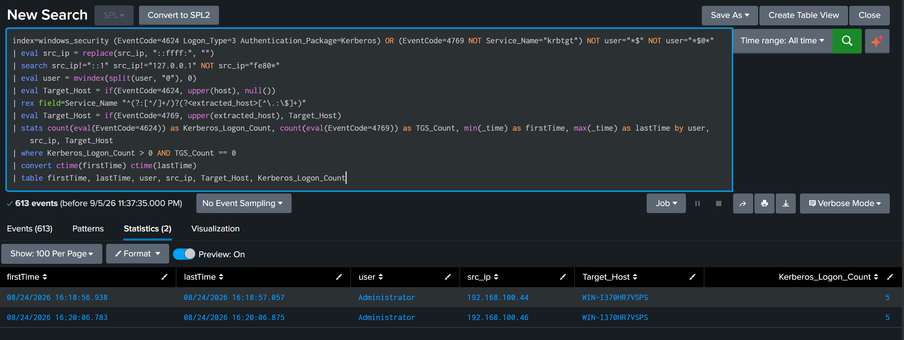
*Hình 4.14: Bằng chứng kiểm chứng kết quả truy vấn SPL phát hiện Silver Ticket trên Splunk Enterprise.*

#### False Positive & Chiến Lược Whitelisting
* **Yêu cầu tập trung log**: Phải thu thập 100% Event 4769 từ tất cả DC trong Domain. Nếu thiếu log từ 1 DC, kết nối hợp lệ sẽ bị gắn cờ Silver Ticket.

??? question "Góc phản biện và Vấn đáp kỹ thuật (Reviewer Defense)"
    * **Q1: Đoạn Regex `rex field=Service_Name "^(?:[^/]+/)?(?<extracted_host>[^\.:\$]+)"` xử lý vấn đề kỹ thuật gì?**
      * **Trả lời**: Trong Event 4769, `Service_Name` có thể xuất hiện dưới nhiều định dạng: `cifs/WIN-I370HR7VSPS.lab.local`, `MSSQLSvc/FS01:1433`, hoặc `WIN-I370HR7VSPS$`. Trong khi đó, ở Event 4624, trường tên máy chỉ là `WIN-I370HR7VSPS`. Đoạn regex này loại bỏ tiền tố dịch vụ (`cifs/`), đuôi FQDN (`.lab.local`), port (`:1433`) và ký tự máy tính (`$`), chuẩn hóa về cùng một chuỗi Hostname ngắn để lệnh `stats by user, src_ip, Target_Host` so khớp chính xác tuyệt đối giữa hai nguồn log.
    
    ---


---

### 4.8 DCSync (MITRE ATT&CK: T1003.006)


*Hình 4.15: Sơ đồ tấn công DCSync giả lập Domain Controller để nhân bản cơ sở dữ liệu NTDS.dit.*

#### Mô Tả Kỹ Thuật & Bản Chất Mật Mã Học
* **Bản chất**: Active Directory sử dụng giao thức **Directory Replication Service (DRSUAPI)** qua RPC để đồng bộ dữ liệu giữa các Domain Controller.
* **Kẽ hở khai thác**: Attacker có tài khoản sở hữu quyền Replication đặc biệt (`DS-Replication-Get-Changes`, `DS-Replication-Get-Changes-All`, `DS-Replication-Get-Changes-In-Filtered-Set`) giả lập hành vi của một Domain Controller để yêu cầu DC trả về toàn bộ dữ liệu bí mật trong Active Directory (bao gồm toàn bộ NTLM Hash và Kerberos Keys trong `ntds.dit`) mà **hoàn toàn không cần chạy mã độc trên DC hay đụng vào file ntds.dit trên đĩa**.

#### Quy Trình Tấn Công Từng Bước
1. **Bước 1 (Compromise Privileged Account)**: Chiếm tài khoản thuộc Domain Admins, Enterprise Admins, hoặc tài khoản được ủy quyền Replication.
2. **Bước 2 (DRSUAPI RPC Call)**: Gửi lời gọi hàm `DsGetNCChanges` qua MS-DRSR RPC tới DC mục tiêu.
3. **Bước 3 (Extract Hashes)**: DC phản hồi gói tin đồng bộ chứa toàn bộ Hash của domain (bao gồm cả `krbtgt`).

#### Sơ Đồ Luồng Tấn Công (Mermaid Workflow)
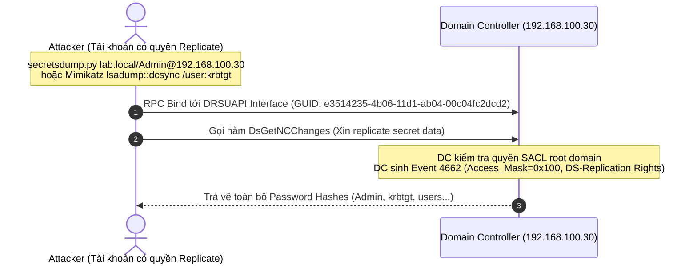

#### Công Cụ Phổ Biến & So Sánh Telemetry
| Môi trường / Tool | Câu lệnh thực nghiệm | Dấu hiệu Telemetry đặc trưng |
| :--- | :--- | :--- |
| **Linux (Impacket)** | `python secretsdump.py lab.local/Administrator:Pass@192.168.100.30` | Event 4662 `Access_Mask=0x100`, `Object_Type=domainDNS`, đi kèm Event 4624 Type 3 từ IP Linux. |
| **Windows (Mimikatz)** | `lsadump::dcsync /domain:lab.local /all /csv` | Event 4662 tương tự trên DC + Sysmon Event 1 / RPC traffic trên client. |

#### Dấu Hiệu Phát Hiện Chuẩn MITRE ATT&CK & IoC
* **MITRE ID**: [DET0594](https://attack.mitre.org/detectionstrategies/DET0594/)
* **Data Components**:
  * **DC0071**: Directory Service Access (Event 4662).
  * **DC0068**: Network Connection Creation (RPC DRSUAPI).
  * **DC0085**: Directory Service Changes.
* **IoC Cốt Lõi**:
  * Event 4662 với `Access_Mask=0x100` (Control Access) trên `Object_Type=domainDNS`.
  * Thuộc tính Properties chứa một trong các GUID Replication:
    * `1131f6aa-9c07-11d1-f79f-00c04fc2dcd2` (DS-Replication-Get-Changes)
    * `1131f6ad-9c07-11d1-f79f-00c04fc2dcd2` (DS-Replication-Get-Changes-All)
    * `89e95b76-444d-4c62-991a-0facbeda640c` (DS-Replication-Get-Changes-In-Filtered-Set)
  * `Account_Name` **không kết thúc bằng dấu `$`** (không phải tài khoản máy của Domain Controller thật) và không phải tài khoản Azure AD Sync (`MSOL_*`).

#### SPL Query Chuẩn Hóa & Bằng Chứng Thực Nghiệm
```bash
index=windows_security earliest=-7d (EventCode=4662 Access_Mask=0x100 Object_Type=domainDNS) OR (EventCode=4624 Logon_Type=3) NOT Account_Name="*$" NOT Account_Name="MSOL_*"
| eval is_dcsync_raw = if(EventCode==4662 AND match(_raw, "(?i)Replicating Directory Changes|1131f6aa|1131f6ad|89e95b76"), 1, 0)
| eval Match_Logon_ID = if(EventCode==4662, Logon_ID, mvindex(Logon_ID, 1))
| eval src_ip = replace(src_ip, "::ffff:", "")
| stats values(EventCode) as Events values(src_ip) as src_ip count(eval(EventCode==4662 AND is_dcsync_raw==1)) as DCSync_Count min(_time) as _time by Match_Logon_ID, host, Account_Name
| search Events="4662" AND DCSync_Count > 0
| eval src_ip = if(isnull(src_ip) OR src_ip=="", "UNKNOWN_OR_LOCAL", src_ip)
| stats sum(DCSync_Count) as Total_DCSync, values(host) as dest_host, min(_time) as firstTime, max(_time) as lastTime by Account_Name, src_ip
| rename Account_Name as user
| convert ctime(firstTime) ctime(lastTime)
| table firstTime, lastTime, dest_host, src_ip, user, Total_DCSync
```

#### Bằng chứng kiểm chứng thực tế (Splunk MCP Data):
| firstTime | lastTime | dest_host | src_ip | user | Total_DCSync |
| :--- | :--- | :--- | :--- | :--- | :--- |
| 08/23/2026 22:33:30 | 08/23/2026 22:33:30 | WIN-I370HR7VSPS | 192.168.100.41 | Administrator | 3 |
| 08/23/2026 09:49:07 | 08/23/2026 19:04:53 | WIN-I370HR7VSPS | 192.168.100.40 | hope | 21 |
| 08/22/2026 21:10:48 | 08/22/2026 22:07:25 | WIN-I370HR7VSPS | UNKNOWN_OR_LOCAL | Administrator | 15 |


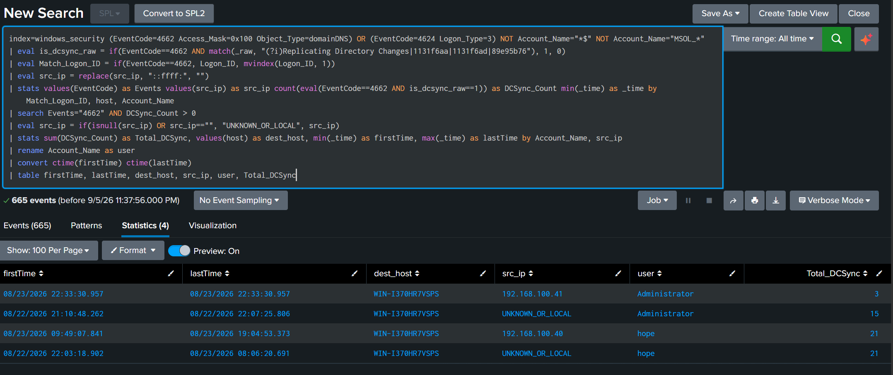
*Hình 4.16: Bằng chứng kiểm chứng kết quả truy vấn SPL phát hiện DCSync trên Splunk Enterprise.*

#### False Positive & Chiến Lược Whitelisting
* **Domain Controller hợp lệ**: Đã được loại trừ tự động bằng điều kiện `NOT Account_Name="*$"`.
* **Azure AD Connect / Entra Connect**: Sử dụng tài khoản đồng bộ dạng `MSOL_xxxxxxxxxxxx` hoặc `Sync_xxxxxxxxxxxx`. Đã được whitelist bằng `NOT Account_Name="MSOL_*"`.

??? question "Góc phản biện và Vấn đáp kỹ thuật (Reviewer Defense)"
    * **Q1: Tại sao phải dùng `match(_raw, ...)` mà không lọc trực tiếp theo field `Properties` trong Splunk?**
      * **Trả lời**: Trong bản tin XML EventLog tiêu chuẩn của Windows (`XmlWinEventLog`), trường `<Data Name='Properties'>` thường được Splunk TA parse thành chuỗi text hiển thị ngắn gọn là `"Control Access"` và giấu mất các chuỗi GUID bên trong. Lọc theo field `Properties=1131f6aa...` sẽ bị trả về 0 kết quả (False Negative). Sử dụng regex trực tiếp trên `_raw` đảm bảo bắt trọn vẹn cả khi log hiển thị dạng GUID lẫn dạng Text phân giải (`Replicating Directory Changes`).
    * **Q2: Tại sao Event 4662 không có sẵn `src_ip` mà phải correlate với Event 4624 qua `Logon_ID`?**
      * **Trả lời**: Event 4662 là sự kiện Object Access trên DS nội bộ, chỉ chứa `SubjectLogonId`. Để xác định nguồn gốc kẻ tấn công (IP máy nào trong mạng), SOC bắt buộc phải correlate `Logon_ID` của 4662 với sự kiện đăng nhập mạng Event 4624 trước đó.
    
    ---


---

### 4.9 DCShadow (MITRE ATT&CK: T1207)


*Hình 4.17: Sơ đồ tấn công DCShadow đăng ký Rogue DC giả mạo để đẩy thay đổi quyền ngầm vào Active Directory.*

#### Mô Tả Kỹ Thuật & Bản Chất Mật Mã Học
* **Bản chất**: Thay vì gọi hàm đọc dữ liệu như DCSync, **DCShadow** là kỹ thuật ghi dữ liệu (Persistence/Privilege Escalation). Attacker tạm thời đăng ký một máy trạm thành một "Domain Controller giả mạo" trong phân vùng cấu hình AD (Configuration Partition), sau đó kích hoạt tiến trình Replication để đẩy các thay đổi độc hại (ví dụ: gán `SIDHistory` của Enterprise Admin cho user thường, sửa password, sửa ACL) sang các DC thật.
* **Kẽ hở khai thác**: Vì các thay đổi được đẩy qua cơ chế Replication giữa các DC (DRSUAPI), chúng **hoàn toàn bỏ qua các audit log thông thường** (như Event 5136 - Directory Service Changes hay 4738 - User Modification) vốn chỉ kích hoạt khi ghi trực tiếp qua LDAP.

#### Quy Trình Tấn Công Từng Bước
1. **Bước 1 (Register Rogue DC Object)**: Tạo một Server Object (`nTDSDSA`) mới trong vùng chứa `CN=Servers,CN=Default-First-Site-Name,CN=Sites,CN=Configuration,DC=lab,DC=local` (Event 4662 `Access_Mask=0x1` trên `Object_Type=serversContainer`).
2. **Bước 2 (Register SPN)**: Đăng ký Service Principal Name của DC giả mạo (`GC/` hoặc `E3514235...` DRS RPC interface) lên Computer Object (Event 4742).
3. **Bước 3 (Trigger Replication & Push Changes)**: Gọi hàm `DsReplicaAdd` / `DsReplicaSync` để DC thật pull thay đổi độc hại về.
4. **Bước 4 (Cleanup)**: Xóa Server Object giả mạo ngay lập tức (Event 4929 - Replica NC removed) để xóa dấu vết.

#### Sơ Đồ Luồng Tấn Công (Mermaid Workflow)
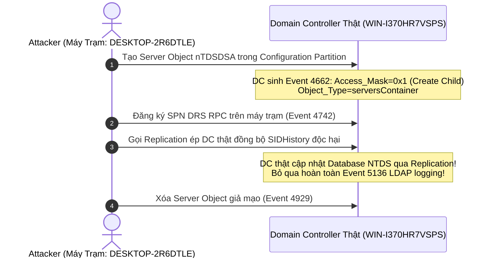

#### Công Cụ Phổ Biến & So Sánh Telemetry
| Môi trường / Tool | Câu lệnh thực nghiệm | Dấu hiệu Telemetry đặc trưng |
| :--- | :--- | :--- |
| **Windows (Mimikatz)** | *Instance 1 (Dựng RPC Server):*<br>`lsadump::dcshadow /object:hope /attribute:SIDHistory /value:S-1-5-21-...-500`<br>*Instance 2 (Đẩy thay đổi):*<br>`lsadump::dcshadow /push` | Event 4662 (`serversContainer`, `0x1`), Event 4742 (DRS SPN), Event 4929 (Replica NC removed). |

#### Dấu Hiệu Phát Hiện Chuẩn MITRE ATT&CK & IoC
* **MITRE ID**: [DET0276](https://attack.mitre.org/detectionstrategies/DET0276/)
* **Data Components**:
  * **DC0071**: Directory Service Access (Event 4662).
  * **DC0087**: Computer Account Modification (Event 4742).
  * **DC0085**: Directory Service Changes (Event 4929, 5137, 5141).
* **IoC Cốt Lõi**:
  * Event 4662 với `Access_Mask=0x1` (Create Child) trên `Object_Type=serversContainer` được thực hiện bởi một User Account (không phải machine account của DC thật).
  * Chuỗi hành vi: Tạo Server Object $\to$ Đăng ký SPN DRS $\to$ Xóa Server Object trong vòng vài giây.

#### SPL Query Chuẩn Hóa & Bằng Chứng Thực Nghiệm
```bash
index=windows_security earliest=-7d
( EventCode=4662 Object_Type=serversContainer Access_Mask=0x1 ) OR ( EventCode=4624 Logon_Type=3 )
NOT Account_Name="*$"
| eval Match_Logon_ID=Logon_ID
| eval src_ip=replace(src_ip,"::ffff:","")
| stats
    values(EventCode) as Events
    values(src_ip) as src_ip
    count(eval(EventCode=4662)) as DCShadow_Count
    values(Parameter_1) as Fake_DC_Path
    values(Object_Name) as Object_Name
    min(_time) as firstTime
    max(_time) as lastTime
    by Match_Logon_ID, host, Account_Name
| search Events="4662"
| stats
    sum(DCShadow_Count) as Total_DCShadow
    values(host) as dest_host
    values(Fake_DC_Path) as Fake_DC_Path
    values(Object_Name) as Object_Name
    min(firstTime) as firstTime
    max(lastTime) as lastTime
    by Account_Name, src_ip
| rename Account_Name as user
| convert ctime(firstTime) ctime(lastTime)
| table firstTime lastTime dest_host src_ip user Fake_DC_Path Object_Name Total_DCShadow
```

#### Bằng chứng kiểm chứng thực tế (Splunk MCP Data):
| firstTime | lastTime | dest_host | src_ip | user | Fake_DC_Path | Total_DCShadow |
| :--- | :--- | :--- | :--- | :--- | :--- | :--- |
| 08/23/2026 16:55:21 | 08/23/2026 16:56:34 | WIN-I370HR7VSPS | 192.168.100.40 | hope | CN=DESKTOP-2R6DTLE,CN=Servers,CN=Default-First-Site-Name,CN=Sites,CN=Configuration,DC=lab,DC=local | 2 |


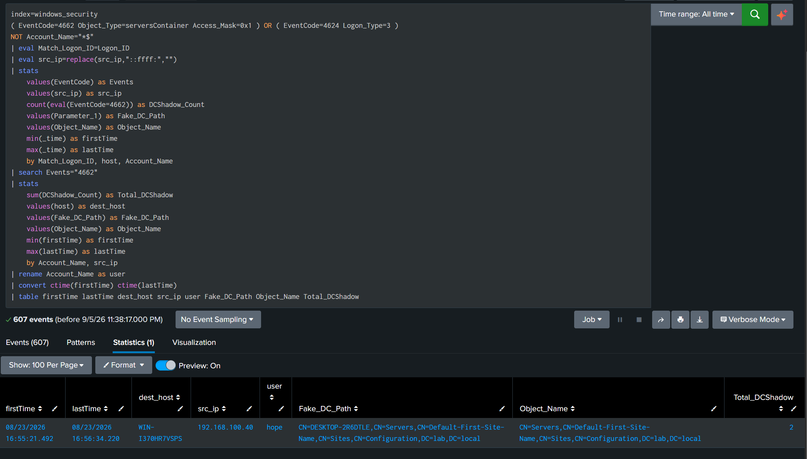
*Hình 4.18: Bằng chứng kiểm chứng kết quả truy vấn SPL phát hiện DCShadow trên Splunk Enterprise.*

#### False Positive & Chiến Lược Whitelisting
* **Quy trình thăng cấp DC hợp lệ (`dcpromo`)**: Hoạt động nâng cấp máy chủ DC mới cũng tạo Server Object. Cần đối chiếu với lịch bảo trì (Change Management Window).

??? question "Góc phản biện và Vấn đáp kỹ thuật (Reviewer Defense)"
    * **Q1: Tại sao Event 4662 trên `serversContainer` với `Access_Mask=0x1` lại là tín hiệu chỉ điểm DCShadow?**
      * **Trả lời**: `serversContainer` là vùng chứa danh sách các Domain Controller hợp lệ trong phân vùng Configuration của AD Forest. Quyền `0x1` là quyền **Create Child** (tạo đối tượng con mới). Trong hoạt động doanh nghiệp bình thường, việc thêm một Domain Controller mới là sự kiện cực kỳ hiếm hoi (vài năm một lần) và luôn do Enterprise Admin thực hiện. Khi sự kiện này xuất phát từ một User thường hoặc một máy trạm ngoài kế hoạch, đó là chỉ báo sớm 100% của nỗ lực đăng ký Rogue DC (DCShadow).
    
    ---

---

## 5. Bảng Tổng Kết Đối Chiếu Toàn Diện (Executive Matrix)

| Kỹ Thuật | MITRE ID | Detection Strategy | Telemetry Event Codes | Độ Tin Cậy (Confidence) | Phương Pháp Phát Hiện |
| :--- | :---: | :---: | :--- | :---: | :--- |
| **1. Kerberoasting** | T1558.003 | DET0157 | **4769** (RC4 0x17, 0x40810010) | **High** | Chữ ký Protocol + Options |
| **2. AS-REP Roasting** | T1558.004 | DET0113 | **4768** (PreAuth=0, Code=0x0) | **High** | Chữ ký PreAuth Bypass |
| **3. Pass-the-Hash** | T1550.002 | DET0409 | **4624** (Type 3, NtLmSsp, DA/Multi-target) | **Medium–High** | Bất thường hành vi NTLM Type 3 |
| **4. Pass-the-Ticket** | T1550.003 | DET0352 | **4768 + 4769** (IP Mismatch) | **Medium** | Tương quan IP Mismatch đa nguồn |
| **5. Overpass-the-Hash** | T1550.002 | DET0409 / DET0157 | **4768** (RC4 0x17 + PreAuth!=0) | **Medium–High** | Downgrade Encryption + PreAuth |
| **6. Golden Ticket** | T1558.001 | DET0144 | **4769** (TGS không có TGT trong 10h) | **Medium** | Detection-by-Absence (TGS mồ côi) |
| **7. Silver Ticket** | T1558.002 | DET0241 | **4624 Target** (Không có 4769 trên DC) | **Medium–High** | Detection-by-Absence (Host vs DC) |
| **8. DCSync** | T1003.006 | DET0594 | **4662** (domainDNS, Mask 0x100, GUIDs) + **4624** | **High** | Chữ ký Directory Replication |
| **9. DCShadow** | T1207 | DET0276 | **4662** (serversContainer 0x1) + **4742** | **Medium–High** | Chữ ký Tạo Rogue DC Object |

---

## 6. Bộ Câu Hỏi Bảo Vệ Chuyên Đề và Vấn Đáp Chuyên Sâu (Q&A Defense Guide)

Dưới đây là các câu hỏi bẫy kỹ thuật kinh điển từ Hội đồng đánh giá và Reviewer kèm lời giải thích chuẩn tài liệu kiến trúc Microsoft Active Directory và RFC Kerberos:

??? question "Q1: Dấu `$` trong `Service_Name="*$"` và `user="*$"` là gì? Tại sao phải loại trừ? Machine account sinh ra `$` để làm gì?"
    **Trả lời ngắn gọn & chuẩn xác:**
    * **Bản chất**: Ký tự `$` ở cuối định danh một **Machine Account (Tài khoản máy tính)** trong Active Directory (ví dụ: `DESKTOP-2R6DTLE$`).
    * **Mục đích sinh ra**: Hệ điều hành Windows tự động sử dụng Machine Account để thực hiện Kerberos Pre-Auth định kỳ, đồng bộ chính sách Group Policy (GPO), và thiết lập phiên bảo mật RPC/SMB giữa các máy tính với Domain Controller.
    * **Tại sao là Noise**: Machine Account tự động thay đổi mật khẩu 30 ngày/lần với độ dài 120 ký tự ngẫu nhiên $\to$ Attacker không bao giờ Kerberoast Machine Account vì không thể crack offline được. Hàng ngày, DC ghi nhận hàng nghìn Event 4769/4768 của Machine Account. Nếu không có `NOT Service_Name="*$"` và `NOT user="*$"`, rule sẽ ngập trong 99% nhiễu nền của hệ điều hành.

??? question "Q2: Tại sao không dùng `Key_Length=0` để bắt Pass-the-Hash như sách vở lý thuyết?"
    **Trả lời ngắn gọn & chuẩn xác:**
    * `Key_Length=0` chỉ xuất hiện ở NTLMv1 hoặc các client cũ không thương lượng Session Key. 
    * Trên tất cả các hệ điều hành hiện đại (Windows 10/11, Windows Server 2016-2022) và các tool tấn công hiện đại (Impacket, NetExec, Mimikatz trên Win10), giao thức NTLMv2 luôn đàm phán thành công 128-bit Session Key (`Key_Length=128`).
    * Nếu rule hardcode `Key_Length=0`, hệ thống sẽ bị **False Negative 100%** đối với mọi cuộc tấn công NTLMv2 thực tế. Do đó, SOC phải bắt PtH bằng bất thường hành vi NTLM Type 3 của tài khoản đặc quyền (`Administrator`, `da_*`) hoặc NTLM Spraying (`Target_Count >= 2`).

??? question "Q3: Tại sao phải loại trừ `NOT Service_Name="krbtgt"` trong Pass-the-Ticket & Golden Ticket?"
    **Trả lời ngắn gọn & chuẩn xác:**
    * Khi máy trạm thực hiện **Renew Ticket** (gia hạn thời hạn TGT hợp lệ), Windows gửi một bản tin TGS-REQ với `Service_Name=krbtgt` tới DC. Quá trình này không sinh ra Event 4768 mới.
    * Nếu không loại trừ `krbtgt`, hành vi gia hạn vé thông thường của máy tính sẽ bị báo động nhầm thành Golden Ticket hoặc Pass-the-Ticket.

??? question "Q4: Tại sao ở DCSync phải dùng `match(_raw, ...)` mà không lọc thẳng theo field `Properties`?"
    **Trả lời ngắn gọn & chuẩn xác:**
    * Trong bản tin XML EventLog tiêu chuẩn của Windows (`XmlWinEventLog`), trường `<Data Name='Properties'>` thường được Splunk TA parse thành chuỗi text ngắn gọn `"Control Access"` và giấu mất các chuỗi GUID bên trong.
    * Lọc theo field `Properties=1131f6aa...` sẽ bị trả về 0 kết quả (False Negative). Regex trực tiếp trên `_raw` đảm bảo bắt trọn vẹn cả khi log hiển thị dạng GUID lẫn dạng Text phân giải (`Replicating Directory Changes`).


---

## 7. Tài Liệu Tham Khảo (References)

1. **Microsoft Security Guidance**: Active Directory Domain Services Defense and Kerberos Authentication Protocol Specification (MS-KILE, MS-SFU, MS-PAC).
2. **MITRE ATT&CK Matrix for Enterprise**: Credential Access (TA0006), Lateral Movement (TA0008), Persistence (TA0003), Defense Evasion (TA0005).
3. **Splunk Threat Research Team**: Active Directory Attack Detection and Security Content Framework.
4. **Benjamin Delpy (gentilkiwi)**: Mimikatz Architecture and Windows Kerberos Internals.
5. **Will Schroeder (harmj0y)**: Kerberoasting, AS-REP Roasting and Rubeus Toolset Specification.
6. **Vincent LE TOUX**: DCSync and DRSUAPI Replication Mechanism.
7. **Benjamin DELPY and Luc DELFOUR**: DCShadow - Pushing Directory Changes to Active Directory.
