# Tuần 6: Bảo Mật và Phát Hiện Tấn Công Active Directory
> **Tài liệu chuẩn hóa chuyên sâu về kiến trúc dịch vụ thư mục Active Directory Domain Services (AD DS), giao thức xác thực Kerberos v5 và NTLM, phân tích cơ chế hoạt động, hành vi, IoC, chiến lược truy vết cây tiến trình (Process Tree Reconstruction) và bộ luật phát hiện Splunk SPL thực chiến đã qua kiểm chứng Lab cho 8 kỹ thuật tấn công Active Directory kinh điển: Kerberoasting, AS-REP Roasting, Pass-the-Hash, Overpass-the-Hash, Pass-the-Ticket, Golden/Silver Ticket, DCSync và DCShadow.**

---

## 1. Kiến Trúc Nền Tảng Active Directory Domain Services (AD DS)

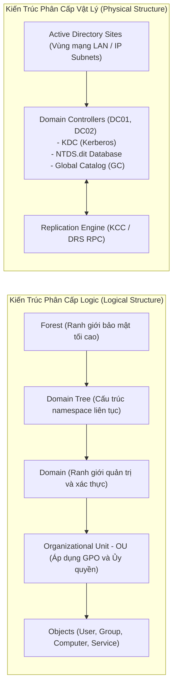

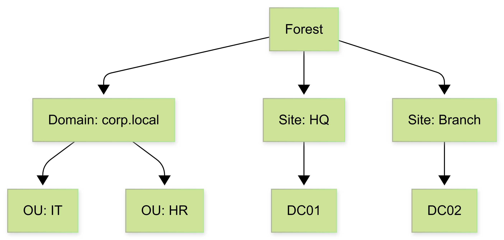
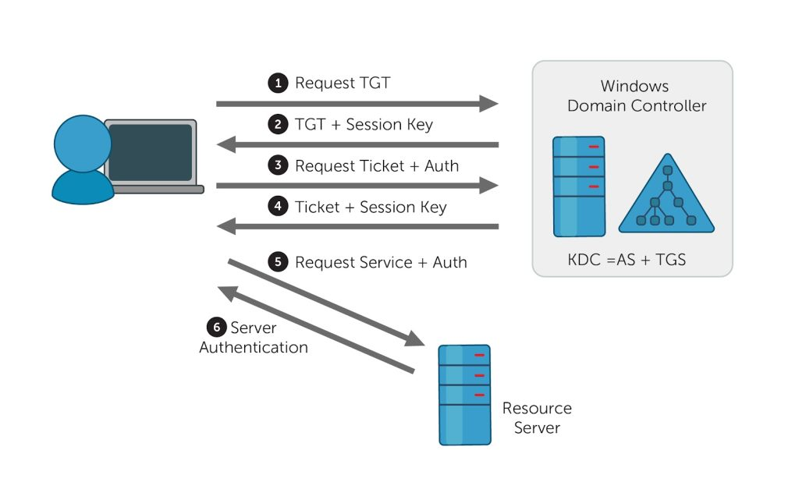

---

### 1.1 Cấu Trúc Phân Cấp: Forest, Domain, OU, Site và Trust

* **Forest (Rừng)**: Ranh giới bảo mật tối cao (*Security Boundary*) trong Active Directory. Tất cả các Domain trong cùng một Forest chia sẻ chung một **Schema** (định nghĩa cấu trúc thuộc tính đối tượng) và một **Global Catalog (GC)**.
* **Domain (Miền)**: Ranh giới quản trị (*Administrative Boundary*) và ranh giới xác thực. Chứa cơ sở dữ liệu `NTDS.dit` quản lý tài khoản người dùng và máy tính.
* **Organizational Unit (OU)**: Vùng chứa logic nhỏ nhất cho phép gán chính sách nhóm (**Group Policy Objects - GPO**) và phân quyền quản trị ủy quyền (*Delegation of Control*).
* **Site và Subnet**: Cấu trúc vật lý ánh xạ theo dải địa chỉ IP mạng LAN/WAN, điều khiển lưu lượng đăng nhập của Client đến Domain Controller gần nhất và tối ưu hóa chu kỳ nhân bản dữ liệu (*AD Replication*).
* **Mối Quan Hệ Tin Cậy (Trust Relationships)**:
 * **Parent-Child Trust**: Tự động tạo hai chiều (Two-way, Transitive) khi tạo Sub-domain.
 * **Tree-Root Trust**: Tin cậy giữa các cây Domain khác nhau trong cùng một Forest.
 * **Forest Trust**: Kết nối tin cậy giữa hai Forest độc lập (Transitive hoặc Non-transitive).
 * **External Trust**: Kết nối một chiều hoặc hai chiều giữa 2 domain không cùng Forest.

---

### 1.2 Thuật Ngữ và Định Danh Đối Tượng Trong AD (Terminology)

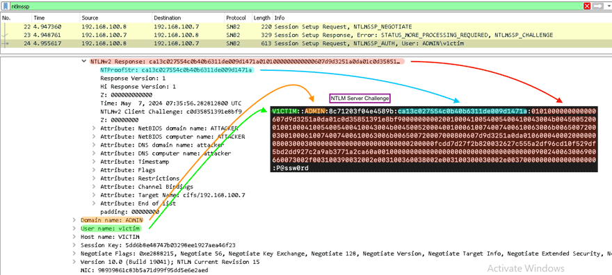

1. **SID (Security Identifier)**: Định danh nhị phân duy nhất cấp phát cho mỗi đối tượng User, Group hoặc Computer.
 * Cấu trúc chuẩn: `S-1-5-21-<DomainIdentifier>-<RID>`
 * `RID 500`: Tài khoản quản trị tối cao **Administrator**.
 * `RID 502`: Tài khoản dịch vụ mật mã **krbtgt**.
 * `RID 512`: Nhóm **Domain Admins**.
 * `RID 519`: Nhóm **Enterprise Admins** (Toàn Forest).
2. **GUID (Globally Unique Identifier)**: Định danh 128-bit bất biến của một Object, không bao giờ thay đổi kể cả khi đổi tên (*Rename*) hoặc di chuyển OU (*Move*).
3. **DN (Distinguished Name)**: Đường dẫn phân cấp đầy đủ của đối tượng trong cây thư mục LDAP:
 * `CN=Nguyen Van A,OU=IT_Security,DC=lab,DC=local`
4. **UPN (User Principal Name)**: Định dạng đăng nhập chuẩn Internet: `username@domain.com`.
5. **SPN (Service Principal Name)**: Định danh ánh xạ giữa một dịch vụ ứng dụng mạng (HTTP, MSSQLSvc, CIFS, HOST) với một tài khoản người dùng/máy tính chạy dịch vụ đó. **Đây là chìa khóa then chốt dẫn đến tấn công Kerberoasting**.

---

### 1.3 Các Giao Thức Truyền Thông Cốt Lõi Trong Môi Trường AD

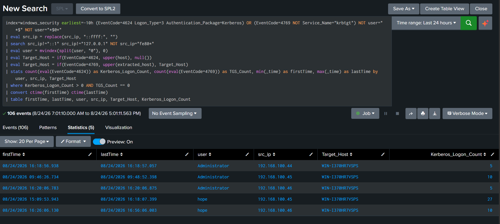

* **Kerberos v5 (Port 88)**: Giao thức xác thực mặc định, an toàn cao dựa trên vé (*Ticket-based Authentication*) và mật mã đối xứng.
* **NTLM v1/v2 (Port 445 / 139)**: Giao thức xác thực truyền thống Challenge-Response, dễ bị tấn công Pass-the-Hash và NTLM Relay.
* **LDAP / LDAPS (Port 389 / 636)**: Giao thức truy vấn và sửa đổi cơ sở dữ liệu thư mục.
* **SMB (Server Message Block - Port 445)**: Giao thức chia sẻ tệp, thư mục và gọi hàm từ xa qua Named Pipes.
* **MSRPC (Port 135 và Dynamic RPC 49152-65535)**: Giao thức gọi thủ tục từ xa, phục vụ nhân bản dữ liệu (*DRSUAPI*) và quản lý dịch vụ (*SAMR, LSARPC*).

---

### 1.4 Cơ Chế Ủy Quyền (Delegation Architecture)

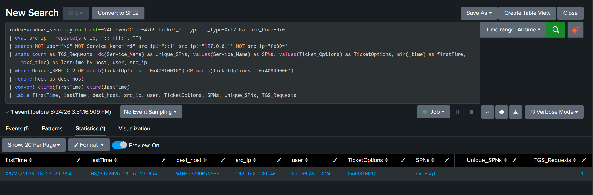

Cho phép một dịch vụ mạng (Front-end Web Server) mạo danh (*Impersonate*) người dùng cuối để truy cập vào tài nguyên Back-end (Database Server):
1. **Unconstrained Delegation**: Máy chủ Front-end lưu toàn bộ vé **TGT** của người dùng trong RAM LSASS $\rightarrow$ **Cực kỳ nguy hiểm**: Nếu chiếm được máy này, attacker lấy được vé TGT của Domain Admin nếu họ từng đăng nhập vào.
2. **Constrained Delegation (S4U2Self / S4U2Proxy)**: Chỉ cho phép máy chủ mạo danh người dùng để truy cập vào các SPN được chỉ định trước.
3. **Resource-Based Constrained Delegation (RBCD)**: Quyền ủy quyền được cấu hình trực tiếp trên thuộc tính của máy chủ Back-end (`msDS-AllowedToActOnBehalfOfOtherIdentity`).

---

## 2. Bề Mặt Tấn Công và Luồng Xác Thực Kerberos v5

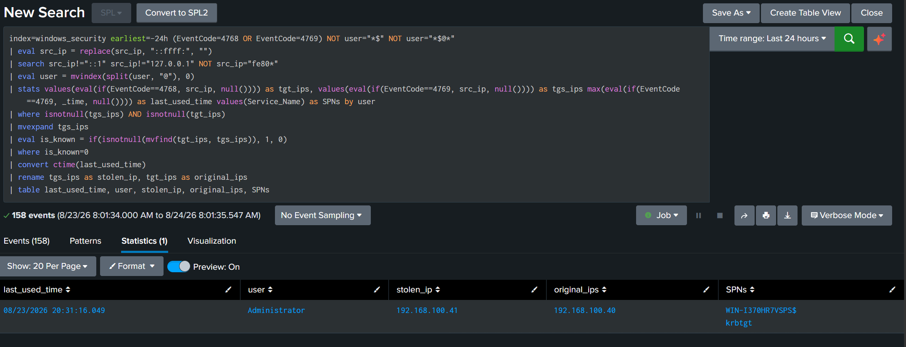
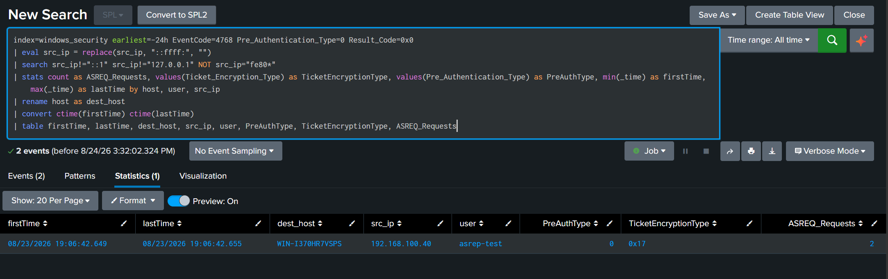

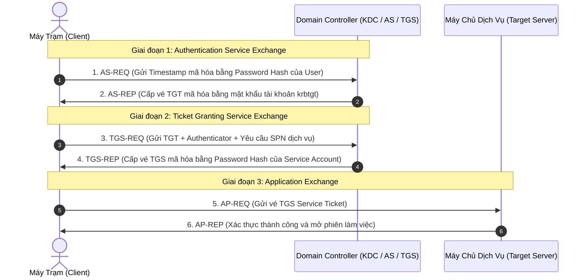

---

## 3. Chiến Lược Truy Vết Tận Gốc Của SOC (Pivot và Process Tree Reconstruction)

!!! tip "Nguyên Tắc Điều Tra Truy Vết Của L2/L3 SOC Analyst"

    Khi phát hiện một cảnh báo tấn công Active Directory trên Domain Controller (Event 4624, 4672, 4768, 4769), không được dừng lại ở IP nguồn mà phải thực hiện chuỗi truy vết 2 bước:
    1. **Truy ngược Hostname / MAC thực tế**: Không tin tưởng 100% vào `src_ip` (do attacker có thể làm giả IP). Sử dụng `src_ip` truy vấn ngược vào DHCP Server log hoặc Datamodel `Network_Sessions` để xác định chính xác Hostname và địa chỉ MAC vật lý.
    2. **Dựng lại Cây Tiến Trình (Process Lineage Tree - PID/PPID)**: Bóc tách mã phiên đăng nhập `Logon_ID` (hoặc `TargetLogonId`) từ log DC, sau đó truy vấn vào **Sysmon EventID 1** hoặc **Event 4688** trên chính máy Endpoint nguồn. Bạn sẽ thấy trọn vẹn phả hệ tiến trình độc hại:
    * Ví dụ: `explorer.exe` $\rightarrow$ `cmd.exe` (PPID: 4120) $\rightarrow$ `python.exe` (PID: 5824, CommandLine: `python.exe wmiexec.py -hashes ... Administrator@10.0.0.50`).


---

## 4. Phân Tích Chuyên Sâu 8 Kỹ Thuật Tấn Công Active Directory và Bộ Luật Splunk Thực Chiến

!!! warning "Ghi Chú Về Chuẩn Hóa Dữ Liệu Trong SPL"

    Tất cả các luật SPL dưới đây đều được chuẩn hóa nâng cao:
    * Tự động xóa bỏ tiền tố IPv6 (`::ffff:`) qua `eval src_ip = replace(src_ip, "^::ffff:", "")`.
    * Loại bỏ nhiễu Localhost (`::1`, `127.0.0.1`, `fe80*`).
    * Chuẩn hóa tên User bằng cách cắt bỏ domain suffix (`eval user = replace(user, "@.*$", "")`) để tránh lỗi khi join giữa các EventID.
    * Lọc bỏ tài khoản máy tính (`NOT user="*$"` và `NOT user="*$@*"`).


---

### 4.1 Kerberoasting (MITRE ATT&CK: T1558.003)


#### 1. Mô Tả Cơ Chế Tấn Công (Mechanism)
Bất kỳ tài khoản người dùng domain hợp lệ nào (không cần đặc quyền) đều có quyền gửi yêu cầu `TGS-REQ` tới Domain Controller để xin vé dịch vụ (`TGS-REP`) cho bất kỳ dịch vụ nào có đăng ký **SPN** (ví dụ: `MSSQLSvc/sql01.lab.local:1433`). 
* DC sẽ cấp vé TGS được **mã hóa bằng mật mã băm (NTLM Hash) của tài khoản chạy dịch vụ đó**.
* Kẻ tấn công trích xuất phần vé TGS đã mã hóa ra khỏi bộ nhớ máy trạm, mang về máy cá nhân và tiến hành bẻ khóa mật khẩu ngoại tuyến (**Offline Password Cracking**) bằng Hashcat (`-m 13100`) mà không hề gửi thêm bất kỳ gói tin nào tới DC (tránh bị khóa tài khoản).

#### 2. Công Cụ Tấn Công Phổ Biến
* **Rubeus**: `Rubeus.exe kerberoast /format:hashcat /outfile:hashes.txt`
* **Impacket**: `python3 GetUserSPNs.py lab.local/user:password -dc-ip 10.0.0.50 -request`
* **Crack tool**: `hashcat -m 13100 hashes.txt /usr/share/wordlists/rockyou.txt -r rules/best64.rule`

#### 3. Dấu Hiệu Hành Vi và Nguồn Log Thu Thập
* **Log Channel**: `WinEventLog://Security` trên Domain Controller.
* **EventID 4769 (A Kerberos service ticket was requested)**:
 * **Ticket Options**: `0x40810000` hoặc `0x40810010`
 * **Ticket Encryption Type**: `0x17` (RC4-HMAC-MD5)
 * **Service Name**: Không phải là `krbtgt` và không kết thúc bằng dấu `$`.
 * **Failure Code**: `0x0` (Success).

#### 4. Rule Phát Hiện Cụ Thể Trên Splunk (SPL - Lab Verified)

```bash
/* Splunk Rule: Phát hiện Kerberoasting qua Event 4769 mã hóa RC4 */
index=windows_security earliest=-24h EventCode=4769 Ticket_Encryption_Type=0x17 Failure_Code=0x0
| eval src_ip = replace(src_ip, "^::ffff:", "")
| search NOT user="*$" NOT Service_Name="*$" src_ip!="::1" src_ip!="127.0.0.1" NOT src_ip="fe80*"
| bin _time span=5m
| stats count as TGS_Requests, dc(Service_Name) as Unique_SPNs, values(Service_Name) as SPNs, values(Ticket_Options) as TicketOptions by _time, host, user, src_ip
| where Unique_SPNs >= 2 OR match(TicketOptions, "0x40810010") OR match(TicketOptions, "0x40800000")
| rename host as dest_host
| table _time, dest_host, src_ip, user, TicketOptions, SPNs, Unique_SPNs, TGS_Requests
```

---

### 4.2 AS-REP Roasting (MITRE ATT&CK: T1558.004)


#### 1. Mô Tả Cơ Chế Tấn Công (Mechanism)
Mặc định khi người dùng gửi yêu cầu `AS-REQ`, Kerberos yêu cầu **Pre-Authentication** (Người dùng phải dùng mật khẩu của mình mã hóa Timestamp hiện tại gửi lên để DC xác nhận).
* Nếu một tài khoản bị bật cờ: *"Do not require Kerberos preauthentication"* (`DONT_REQUIRE_PREAUTH` - bit UAC `0x400000`), bất kỳ ai cũng có thể gửi `AS-REQ` giả mạo danh nghĩa tài khoản đó.
* DC sẽ trả về ngay lập tức gói tin `AS-REP` chứa vé TGT được **mã hóa bằng mật mã của tài khoản đó**. Kẻ tấn công lấy phần mã hóa này và bẻ khóa offline (Hashcat mode `18200`).

#### 2. Công Cụ Tấn Công Phổ Biến
* **Rubeus**: `Rubeus.exe asreproast /format:hashcat /outfile:asrep.txt`
* **Impacket**: `python3 GetNPUsers.py lab.local/ -usersfile users.txt -no-pass -dc-ip 10.0.0.50`
* **Crack tool**: `hashcat -m 18200 asrep.txt rockyou.txt`

#### 3. Dấu Hiệu Hành Vi và Nguồn Log Thu Thập
* **EventID 4768 (TGT Request)**:
 * **Pre-Authentication Type**: `0` (Logon without Pre-Authentication).
 * **Ticket Encryption Type**: `0x17` (RC4).
 * **Result Code**: `0x0` (Success).

#### 4. Rule Phát Hiện Cụ Thể Trên Splunk (SPL - Lab Verified)

```bash
/* Splunk Rule: Phát hiện AS-REP Roasting qua Event 4768 không có Pre-Auth */
index=windows_security earliest=-24h EventCode=4768 Pre_Authentication_Type=0 Ticket_Encryption_Type=0x17 Result_Code=0x0
| eval src_ip = replace(src_ip, "^::ffff:", "")
| search src_ip!="::1" src_ip!="127.0.0.1" NOT src_ip="fe80*"
| bin _time span=5m
| stats count as ASREQ_Requests, values(Ticket_Encryption_Type) as TicketEncryptionType, values(Pre_Authentication_Type) as PreAuthType by _time, host, user, src_ip
| rename host as dest_host
| table _time, dest_host, src_ip, user, PreAuthType, TicketEncryptionType, ASREQ_Requests
```

---

### 4.3 Pass-the-Hash: PtH (MITRE ATT&CK: T1550.002)

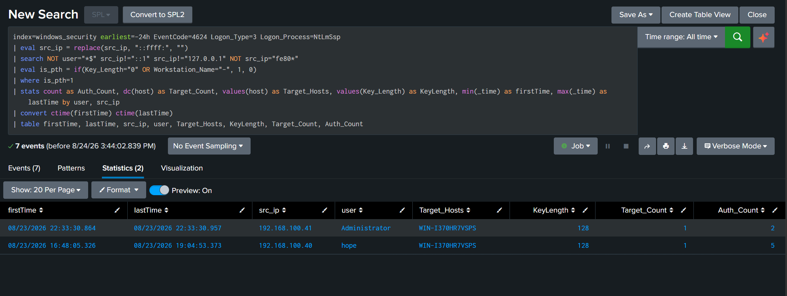

#### 1. Mô Tả Cơ Chế Tấn Công (Mechanism)
Giao thức NTLM không truyền mật khẩu văn bản thô mà sử dụng chính **NTLM Hash** để Challenge-Response.
* Kẻ tấn công tái sử dụng trực tiếp NTLM Hash từ RAM `lsass.exe` để xác thực sang máy chủ khác qua SMB/RPC/WinRM mà không cần bẻ khóa ra mật khẩu gốc.

#### 2. Công Cụ Tấn Công Phổ Biến
* **Mimikatz**: `sekurlsa::pth /user:Administrator /domain:lab.local /ntlm:<hash>`
* **Impacket**: `psexec.py`, `wmiexec.py`, `smbexec.py`
* **CrackMapExec**: `crackmapexec smb 10.0.0.0/24 -u Administrator -H <hash>`

#### 3. Bắt Đúng Chuẩn 2 Biến Thể Tấn Công NTLM

##### A. Bắt Biến Thể Mimikatz PtH (Logon Type 9 và Logon Type 3 KeyLength=0):
```bash
/* Splunk Rule: Phát hiện Mimikatz Pass-the-Hash tiêm vào LSASS */
index=windows_security earliest=-24h EventCode=4624 (Logon_Type=9 OR (Logon_Type=3 Logon_Process=NtLmSsp KeyLength=0))
| eval src_ip = replace(src_ip, "^::ffff:", "")
| search NOT user="*$" src_ip!="::1" src_ip!="127.0.0.1" NOT src_ip="fe80*"
| bin _time span=5m
| stats count as PtH_Events, values(Logon_Process) as Logon_Process, values(Logon_Type) as LogonType by _time, host, user, src_ip
| rename host as dest_host
| table _time, dest_host, src_ip, user, Logon_Process, LogonType, PtH_Events
```

##### B. Bắt Biến Thể Impacket / WMIExec (Giấu Workstation Name):
```bash
/* Splunk Rule: Phát hiện Impacket WMIExec/PSExec qua NTLM giấu tên máy trạm */
index=windows_security earliest=-24h EventCode=4624 Logon_Type=3 Authentication_Package=NTLM
| eval src_ip = replace(src_ip, "^::ffff:", "")
| search NOT user="*$" src_ip!="::1" src_ip!="127.0.0.1" NOT src_ip="fe80*"
| where isnull(Workstation_Name) OR Workstation_Name="-" OR Workstation_Name=""
| bin _time span=5m
| stats count as Auth_Count, values(Logon_Process) as Logon_Process, values(Workstation_Name) as WorkstationName by _time, host, user, src_ip
| rename host as dest_host
| table _time, dest_host, src_ip, user, Logon_Process, WorkstationName, Auth_Count
```

---

### 4.4 Overpass-the-Hash / Pass-the-Key (MITRE ATT&CK: T1550.002 / T1558)

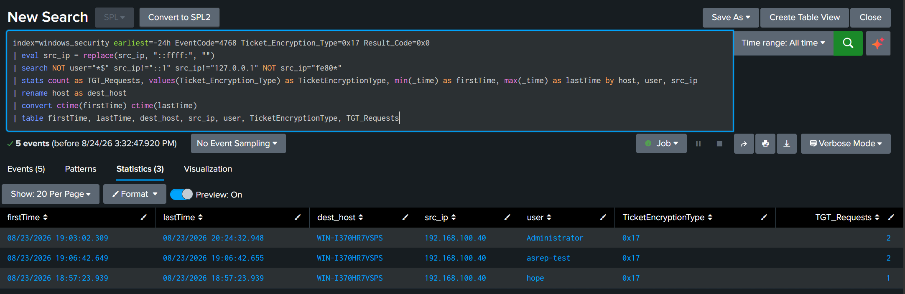

#### 1. Mô Tả Cơ Chế Tấn Công (Mechanism)
Kẻ tấn công sử dụng mã băm NTLM (hoặc AES Key) làm khóa bí mật để mã hóa Timestamp gửi yêu cầu `AS-REQ` tới KDC $\rightarrow$ KDC cấp một vé **Kerberos TGT hoàn toàn hợp lệ**. Kẻ tấn công biến một mã băm NTLM "cũ" thành một chiếc vé Kerberos "xịn" để di chuyển ngang trong toàn mạng.

#### 2. Rule Phát Hiện Cụ Thể Trên Splunk (SPL - Lab Verified)

```bash
/* Splunk Rule: Phát hiện Overpass-the-Hash xin TGT bằng mã hóa RC4 */
index=windows_security earliest=-24h EventCode=4768 Ticket_Encryption_Type=0x17
| eval src_ip = replace(src_ip, "^::ffff:", "")
| search NOT user="*$" src_ip!="::1" src_ip!="127.0.0.1" NOT src_ip="fe80*"
| bin _time span=1h
| stats count as TGT_Requests, values(Ticket_Encryption_Type) as TicketEncryptionType by _time, host, user, src_ip
| rename host as dest_host
| table _time, dest_host, src_ip, user, TicketEncryptionType, TGT_Requests
```

---

### 4.5 Pass-the-Ticket: PtT (MITRE ATT&CK: T1550.003)

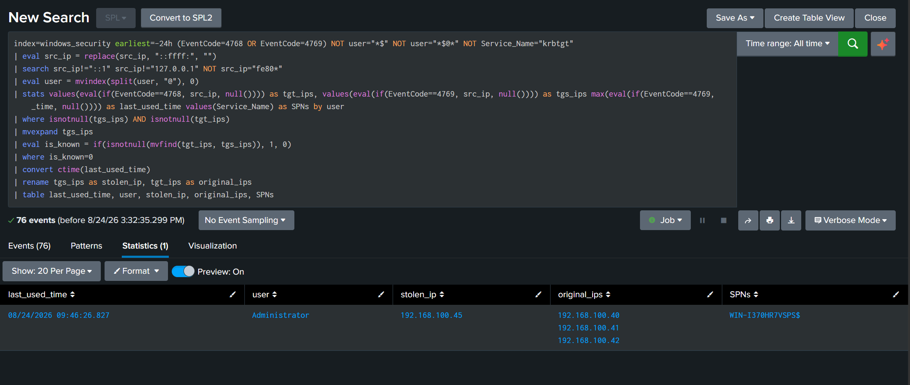

#### 1. Mô Tả Cơ Chế Tấn Công (Mechanism)
Kẻ tấn công trích xuất trực tiếp vé Kerberos (**TGT hoặc TGS**) từ bộ nhớ LSASS của một máy tính bị chiếm quyền (`.kirbi` format), sau đó nạp (*Inject/Replay*) chiếc vé này vào phiên làm việc trên một máy tính khác mà không cần biết mật khẩu hay hash của người dùng.

#### 2. Rule Phát Hiện Cụ Thể Trên Splunk (SPL - Lab Verified)

```bash
/* Splunk Rule: Phát hiện Pass-the-Ticket qua sự bất đối xứng IP giữa AS-REQ và TGS-REQ */
index=windows_security earliest=-24h EventCode=4768
| eval src_ip = replace(src_ip, "^::ffff:", "")
| rename src_ip as tgt_ip
| join user [
    search index=windows_security earliest=-24h EventCode=4769
    | eval src_ip = replace(src_ip, "^::ffff:", "")
    | rename src_ip as tgs_ip
]
| where tgt_ip != tgs_ip AND tgt_ip!="::1" AND tgs_ip!="::1"
| table _time, user, tgt_ip, tgs_ip, Service_Name
```

---

### 4.6 Golden Ticket (MITRE ATT&CK: T1558.001)

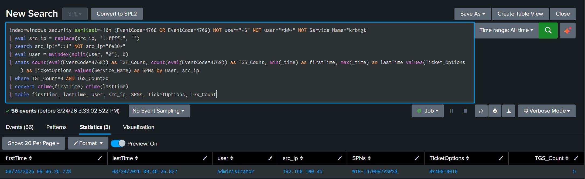

#### 1. Mô Tả Cơ Chế Tấn Công (Mechanism)
Kẻ tấn công chiếm được mật mã băm của tài khoản **`krbtgt`**, tự tạo một vé TGT offline có thời hạn **10 năm**, tự gán quyền **Enterprise Admins (SID 519)** và mạo danh bất kỳ user nào trong Forest. Kẻ tấn công có quyền sinh sát vĩnh viễn dù quản trị viên có đổi mật khẩu của toàn bộ user trong domain.

#### 2. Rule Phát Hiện Cụ Thể Trên Splunk (SPL - Lab Verified)
*Rule bắt các yêu cầu TGS (4769) mồ côi: không hề có bản ghi cấp TGT (4768) tương ứng trong vòng 34 giờ trước đó trên DC*:

```bash
/* Splunk Rule: Phát hiện Golden Ticket - TGS Request không có tiền lệ TGT Request */
index=windows_security earliest=-34h (EventCode=4768 OR EventCode=4769) NOT user="*$" NOT user="*$@*"
| eval src_ip = replace(src_ip, "^::ffff:", "")
| search src_ip!="::1" NOT src_ip="fe80*"
| eval user = replace(user, "@.*$", "")
| stats count(eval(EventCode=4768)) as TGT_Count, count(eval(EventCode=4769)) as TGS_Count, values(Ticket_Options) as TicketOptions, values(Service_Name) as SPNs by user, src_ip
| where TGT_Count=0 AND TGS_Count>0
| table user, src_ip, SPNs, TicketOptions, TGS_Count
```

---

### 4.7 DCSync (MITRE ATT&CK: T1003.006)

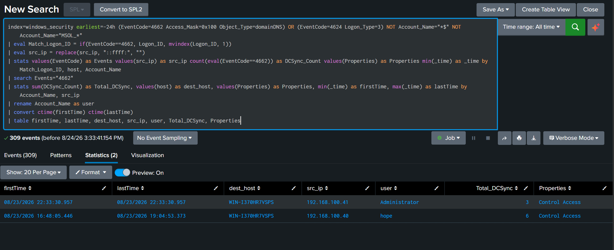

#### 1. Mô Tả Cơ Chế Tấn Công (Mechanism)
DCSync lợi dụng tính năng nhân bản dữ liệu hợp pháp của Active Directory (**MS-DRSR Protocol**). Kẻ tấn công mạo danh là một Domain Controller hợp lệ và gửi lệnh `DSGetNCChanges` qua RPC tới DC chính để yêu cầu nhân bản và trích xuất toàn bộ mật mã băm trong tệp `NTDS.dit` (bao gồm `Administrator` và `krbtgt`) mà **không cần chạy bất kỳ mã độc nào trên máy chủ DC**.

#### 2. Rule Phát Hiện Cụ Thể Trên Splunk (SPL - Lab Verified)

```bash
/* Splunk Rule: Phát hiện DCSync qua Event 4662 trên domainDNS từ tài khoản không phải DC */
index=windows_security earliest=-24h EventCode=4662 Access_Mask=0x100 Object_Type=domainDNS NOT Account_Name="*$" NOT Account_Name="MSOL_*"
| bin _time span=5m
| stats count as Replication_Requests, values(Properties) as Properties by _time, host, Account_Name, Object_Name
| rename host as dest_host, Account_Name as user
| table _time, dest_host, user, Properties, Object_Name, Replication_Requests
```

---

### 4.8 DCShadow (MITRE ATT&CK: T1207)

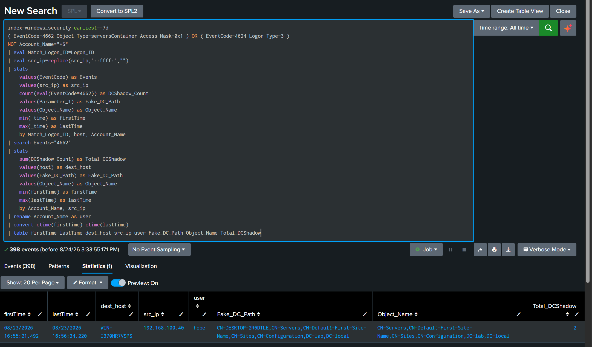

#### 1. Mô Tả Cơ Chế Tấn Công (Mechanism)
Kẻ tấn công tạm thời đăng ký máy trạm bị chiếm thành một **Rogue Domain Controller** hợp pháp trong phân vùng cấu hình (`CN=Configuration`) của AD qua RPC $\rightarrow$ Đẩy các thay đổi độc hại (ví dụ gán `SIDHistory` để leo quyền Admin) qua giao thức nhân bản DRS $\rightarrow$ Tự hủy đăng ký để xóa dấu vết (**Bypass hoàn toàn Event 4662 truyền thống**).

#### 2. Rule Phát Hiện Cụ Thể Trên Splunk (SPL - Lab Verified)
*Rule bắt hành vi Mimikatz DCShadow tạo máy chủ giả mạo trong container `serversContainer`*:

```bash
/* Splunk Rule: Phát hiện DCShadow tạo Fake DC trong serversContainer */
index=windows_security earliest=-7d EventCode=4662 Object_Type=serversContainer Access_Mask=0x1 NOT Account_Name="*$"
| bin _time span=5m
| stats count as Fake_DC_Creates, values(Object_Name) as Object_Name by _time, host, Account_Name
| rename host as dest_host, Account_Name as user
| table _time, dest_host, user, Object_Name, Fake_DC_Creates
```

---

## 5. Ma Trận Bảng Tổng Hợp 8 Kỹ Thuật Tấn Công và Đối Sách SOC

| Kỹ Thuật Tấn Công | Tactic / Technique ID | Nguồn Log Cốt Lõi | EventID Trọng Tâm | Dấu Hiệu Hành Vi (IoC / Key Artifacts) |
| :--- | :--- | :--- | :---: | :--- |
| **Kerberoasting** | Credential Access (`T1558.003`) | Windows Security | `4769` | Yêu cầu vé TGS với mã hóa RC4 (`0x17`) cho Service Account với tần suất cao. |
| **AS-REP Roasting** | Credential Access (`T1558.004`) | Windows Security | `4768` | Yêu cầu vé TGT không có Pre-Authentication (`PreAuthType=0`, `0x17`). |
| **Pass-the-Hash** | Lateral Movement (`T1550.002`) | Windows Security, Sysmon | `4624, 4776, Sysmon 10` | Network Logon (Type 3) dùng NTLM với `KeyLength=0` hoặc Type 9, mở Handle tới LSASS. |
| **Overpass-the-Hash**| Privilege Escalation (`T1550.002`)| Windows Security, Sysmon | `4768, 4769, Sysmon 10` | Dùng NTLM Hash xin vé TGT Kerberos hợp lệ từ KDC bằng mã hóa RC4 `0x17`. |
| **Pass-the-Ticket** | Lateral Movement (`T1550.003`) | Windows Security | `4769` | Gửi vé TGS từ IP khác với IP đã xin vé TGT ban đầu. |
| **Golden Ticket** | Persistence (`T1558.001`) | Windows Security | `4769` | Sử dụng vé TGS mồ côi (không có Event 4768 tương ứng trong 34h trước đó). |
| **Silver Ticket** | Defense Evasion (`T1558.002`) | Endpoint Security | `4624` | Đăng nhập dịch vụ Kerberos thành công trên máy đích nhưng DC không có Event 4769. |
| **DCSync** | Credential Access (`T1003.006`) | Windows Security | `4662` | Quyền `Access_Mask=0x100` trên `Object_Type=domainDNS` từ tài khoản không phải DC. |
| **DCShadow** | Defense Evasion (`T1207`) | Windows Security | `4662, 4742, 5136` | Tạo Fake DC (`Access_Mask=0x1`) trong `serversContainer` và đẩy thay đổi qua DRS RPC. |

---

## 6. Bộ Câu Hỏi Bảo Vệ Chuyên Đề và Vấn Đáp Chuyên Sâu (Q&A Defense Guide)

??? question "Q1: Tại sao Kerberoasting chỉ nhắm vào tài khoản User gắn SPN mà không nhắm vào tài khoản Computer?"

    **Trả lời**: Tài khoản máy tính (`ComputerName$`) trong Active Directory có mật khẩu ngẫu nhiên 120 ký tự được hệ thống tự động đổi mỗi 30 ngày, khiến việc bẻ khóa offline bất khả thi. Ngược lại, tài khoản User chạy dịch vụ (Service Account) thường do con người đặt mật khẩu, độ phức tạp thấp và ít khi đổi mật khẩu, nên dễ dàng bị crack bằng Wordlist.


??? question "Q2: Sự khác nhau bản chất giữa Golden Ticket và Silver Ticket là gì?"

    **Trả lời**:
    - **Golden Ticket**: Giả mạo vé **TGT** bằng mã băm của tài khoản **`krbtgt`**. Cần tương tác với KDC để xin vé dịch vụ, cho phép truy cập toàn bộ tài nguyên trong toàn Forest.
    - **Silver Ticket**: Giả mạo vé **TGS** bằng mã băm của chính **Service Account** đích. Không tương tác với KDC (tàng hình trước KDC log), chỉ truy cập được duy nhất dịch vụ của tài khoản đó.


??? question "Q3: Tại sao DCSync lại nguy hiểm hơn việc trực tiếp sao chép tệp `NTDS.dit`?"

    **Trả lời**: Để copy tệp `NTDS.dit`, kẻ tấn công phải có quyền Local Admin trên Domain Controller và sử dụng VSS (Volume Shadow Copy) để vượt qua khóa file của hệ điều hành $\rightarrow$ Rất dễ bị EDR và Antivirus phát hiện. DCSync sử dụng giao thức mạng hợp pháp MS-DRSR từ xa, không cần thực thi mã độc trên DC và không cần chạm vào đĩa cứng của DC.


??? question "Q4: Biện pháp phòng thủ gốc rễ (Root Cause Mitigation) cho tấn công Kerberoasting là gì?"

    **Trả lời**:
    1. Chuyển đổi toàn bộ Service Accounts sang **Group Managed Service Accounts (gMSA)**: Mật khẩu 128 ký tự phức tạp tự động đổi định kỳ bởi Active Directory.
    2. Ép buộc chỉ sử dụng thuật toán mã hóa **AES-128/256** và vô hiệu hóa hoàn toàn RC4 trên Kerberos.
    3. Đặt mật khẩu cho Service Accounts tối thiểu từ 25 ký tự trở lên.


---

## 7. Tài Liệu Tham Khảo (References)

- **MITRE ATT&CK Enterprise Matrix for Active Directory**: [https://attack.mitre.org/matrices/enterprise/](https://attack.mitre.org/matrices/enterprise/)
- **Ired.team: Active Directory Attack và Defense Tradecraft**: [https://www.ired.team/](https://www.ired.team/)
- **Microsoft Security Guidance for Kerberos và NTLM Logging**: [https://learn.microsoft.com/en-us/windows-server/identity/ad-ds/manage/how-to-configure-active-directory-auditing](https://learn.microsoft.com/en-us/windows-server/identity/ad-ds/manage/how-to-configure-active-directory-auditing)
- **HarmJ0y / SpecterOps: Kerberoasting và Delegation In-Depth**: [https://posts.specterops.io/](https://posts.specterops.io/)
