# Tuần 7: Báo Cáo Điều Tra Sự Cố An Ninh Mạng BOTSv1

**Dự án:** Boss of the SOC Version 1 (BOTSv1 - 2015/2016) 
**Đơn vị thực hiện:** Wayne Enterprises Security Operations Center (SOC) 
**Thực tập sinh thực hiện:** Vương Thành Đạt | **Vai trò:** SOC Analyst 
**Thời gian lập báo cáo:** 28/08/2016 (Cập nhật chuẩn hóa: 04/09/2026) 

| Thông Tin Chung | Chi Tiết |
| :--- | :--- |
| **Organization (Tổ chức)** | Wayne Enterprises |
| **Prepared By (Người lập)** | Vương Thành Đạt (SOC Analyst) |
| **Report Date (Ngày báo cáo)** | 2016-08-28 (Cập nhật: 2026-09-04) |
| **Incident Period (Khoảng thời gian)**| 2016-08-10 đến 2016-08-25 UTC |
| **Severity (Mức độ)** | **CRITICAL (Mức độ 1 - Sự cố xâm nhập và phá hoại diện rộng)** |
| **Status (Trạng thái)** | **Contained và Eradicated (Đã cô lập, xác định IoC và đề xuất khắc phục)** |

# 1. Tóm Tắt Điều Hành (Executive Summary)

Trong tháng 08/2016, Trung tâm Vận hành An ninh Mạng (SOC) của Wayne Enterprises ghi nhận và xử lý hai chiến dịch tấn công an ninh mạng nghiêm trọng xảy ra đồng thời trên cả vùng mạng DMZ công cộng và mạng nội bộ người dùng:

1. **Sự Cố 1: Website Defacement (Chiến dịch của nhóm APT Po1s0n1vy):** 
 Vào ngày 10/08/2016, máy chủ dịch vụ web đối ngoại `imreallynotbatman.com` (`192.168.250.70`) bị địa chỉ IP `40.80.148.42` rà quét lỗ hổng ứng dụng web tự động bằng công cụ Acunetix Web Vulnerability Scanner, phát hiện hệ thống chạy trên nền tảng mã nguồn mở CMS Joomla. Ngay sau đó, kẻ tấn công chuyển sang sử dụng địa chỉ IP `23.22.63.114` thực hiện tấn công vét cạn mật khẩu (Password Brute-Force với 412 yêu cầu) vào trang quản trị `/joomla/administrator/index.php`. Kẻ tấn công đăng nhập thành công vào tài khoản `admin` với mật khẩu `batman` (mã phản hồi `HTTP 303 See Other Redirect`), tải lên và thực thi mã độc nhị phân `3791.exe` (MD5: `AAE3F5A29935E6ABCC2C2754D12A9AF0` / `bf8a095e921810b0e584349fae3f1f7d`), đồng thời thay đổi giao diện trang chủ website bằng hình ảnh độc hại `poisonivy-is-curable.jpg` được điều hướng qua dịch vụ Dynamic DNS `prank.strangled.net` / `prankglassinebracket.jumpingcrab.com`.

2. **Sự Cố 2: Cerber Ransomware Outbreak (Lây nhiễm mã độc tống tiền qua USB và Office Macro):** 
 Vào ngày 24/08/2016, máy trạm `we8105desk` (`192.168.250.100`) của nhân viên Bob Smith bị lây nhiễm dòng mã độc tống tiền nguy hiểm Cerber Ransomware. Nguồn lây nhiễm bắt nguồn từ việc kết nối thiết bị lưu trữ USB ngoài mang tên `MIRANDA_PRI` (Serial: `7D961196`) và mở tài liệu văn bản Word chứa mã Macro độc hại. Chuỗi tiến trình ngầm `WINWORD.EXE` -> `cmd.exe` (CommandLine dài 4490 ký tự) -> `wscript.exe` thực thi tệp VBScript, truy vấn DNS tên miền `solidaritedeproximite.org` để tải về tệp Cryptor giấu tin (Steganography) `mhtr.jpg` / `121214.tmp` từ máy chủ `92.222.104.182`. Mã độc đã kích hoạt tiến trình mã hóa `osk.exe` (PID 1476), kích hoạt cảnh báo NIDS Suricata SID `2816763`, mã hóa thành công **406** tệp tin định dạng `.txt` trong thư mục cá nhân của Bob Smith (`C:\Users\bob.smith.WAYNECORPINC\`), đồng thời lan truyền qua giao thức chia sẻ tệp tin SMB (Port 445) sang máy chủ dữ liệu nội bộ `we9041srv` (`192.168.250.20`), mã hóa **257** tệp tài liệu nghiệp vụ định dạng `.pdf`.

### Bảng Tổng Quan Hai Sự Cố (Incident Summary Matrix)

| Thuộc Tính | Sự Cố 1: Website Defacement | Sự Cố 2: Cerber Ransomware Outbreak |
| :--- | :--- | :--- |
| **Mục tiêu bị tấn công** | Web Server `imreallynotbatman.com` (192.168.250.70) | Workstation `we8105desk` (192.168.250.100) và File Server `we9041srv` (192.168.250.20) |
| **Tác nhân đe dọa** | Nhóm APT Po1s0n1vy | Tội phạm mạng phát tán Cerber Ransomware |
| **Véc-tơ xâm nhập** | Rà quét lỗ hổng tự động (Acunetix) + Brute-force mật khẩu | Thiết bị lưu trữ USB ngoài (`MIRANDA_PRI`) + Malicious Office Macro |
| **Công cụ / Mã độc** | Acunetix WVS, Web Shell `3791.exe`, Dynamic DNS C2 | VBA Macro, VBScript dropper, `mhtr.jpg` (Steganography), `121214.tmp` / `osk.exe` |
| **Tác động (Impact)** | Trang chủ website bị deface; lộ tài khoản quản trị tối cao | 406 file `.txt` cục bộ và 257 file `.pdf` chia sẻ qua SMB bị mã hóa |
| **Trọng tâm phát hiện** | Splunk Stream HTTP (`stream:http`), Sysmon Event 1 | Sysmon Event 1/2/11, Stream SMB (`stream:smb`), Suricata SID 2816763 |

# 2. Sự Cố 1: Website Defacement (Chiến Dịch Po1s0n1vy)

### 2.1 Bối Cảnh và Mục Tiêu Điều Tra
Vào ngày 10/08/2016, website công khai `imreallynotbatman.com` của Wayne Enterprises bị nhóm tin tặc Po1s0n1vy tấn công thay đổi giao diện trang chủ nhằm bôi nhọ uy tín doanh nghiệp. Mục tiêu điều tra bao gồm:
- Xác định địa chỉ IP nguồn thực hiện rà quét lỗ hổng và công cụ được sử dụng.
- Phân tích véc-tơ xâm nhập trang quản trị và kỹ thuật vét cạn mật khẩu.
- Truy vết tệp mã độc thực thi được tải lên máy chủ và tên miền C2 Dynamic DNS.

### 2.2 Sơ Đồ Chuỗi Tấn Công (Sequence và Sub-sequence Diagrams)

#### Sơ Đồ Chuỗi Tấn Công Tổng Thể Sự Cố 1 (Overall Attack Sequence)
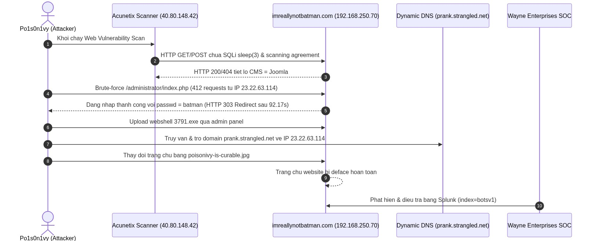 
*Sơ đồ 1. Chuỗi tấn công Website Defacement của nhóm Po1s0n1vy*

#### Sơ Đồ Chi Tiết Quá Trình Vét Cạn Mật Khẩu (Brute-Force Sub-sequence)
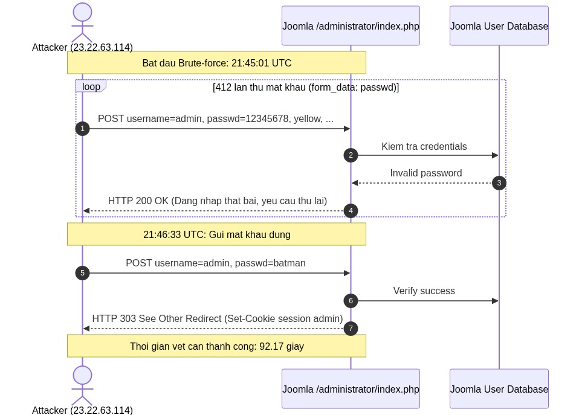 
*Sơ đồ 2. Chi tiết quá trình Brute-force mật khẩu trang quản trị Joomla*

### 2.3 Biên Niên Sử Sự Cố 1 (Timeline Chi Tiết)

| Thời Gian (UTC) | Nguồn Dữ Liệu | Hành Động Kỹ Thuật Ghi Nhận |
| :--- | :--- | :--- |
| **2016-08-10 21:36 - 22:22** | Stream HTTP | IP `40.80.148.42` gửi hàng nghìn request rà quét lỗ hổng SQLi/XSS chứa User-Agent `Acunetix-WVS`. |
| **2016-08-10 21:45:01** | Stream HTTP (POST) | IP `23.22.63.114` bắt đầu đợt tấn công Brute-force vào `/joomla/administrator/index.php`. |
| **2016-08-10 21:46:33** | Stream HTTP | Gửi mật khẩu đúng `batman`, máy chủ trả về mã `HTTP 303 See Other Redirect` thành công. |
| **2016-08-10 21:52:48** | Sysmon Event 1 | Tệp thực thi `3791.exe` được kích hoạt tại `C:\inetpub\wwwroot\joomla\3791.exe`. |
| **2016-08-10 22:06 - 22:13** | Stream HTTP / DNS | Tải ảnh deface `poisonivy-is-curable.jpg` từ Dynamic DNS C2 `prank.strangled.net`; trang chủ bị deface. |

### 2.4 Phương Pháp Điều Tra Chi Tiết Từng Flag (Scenario 1 Writeup)

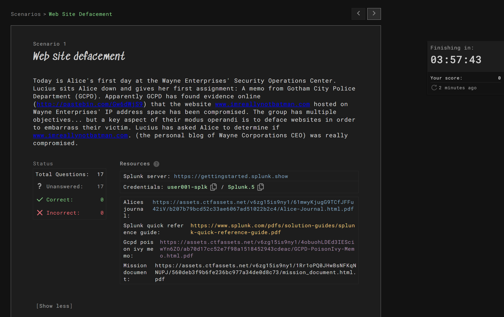 
*Hình 1. Thử thách Challenge Website Defacement*

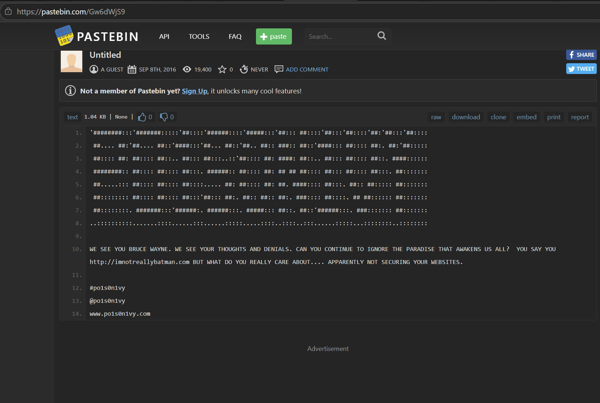 
*Hình 2. Tác nhân đe dọa PO1SON1VY*

#### Question 101: What is the likely IPv4 address of someone from the Po1s0n1vy group scanning imreallynotbatman.com for web application vulnerabilities?
**Answer guidance:** IPv4 address.

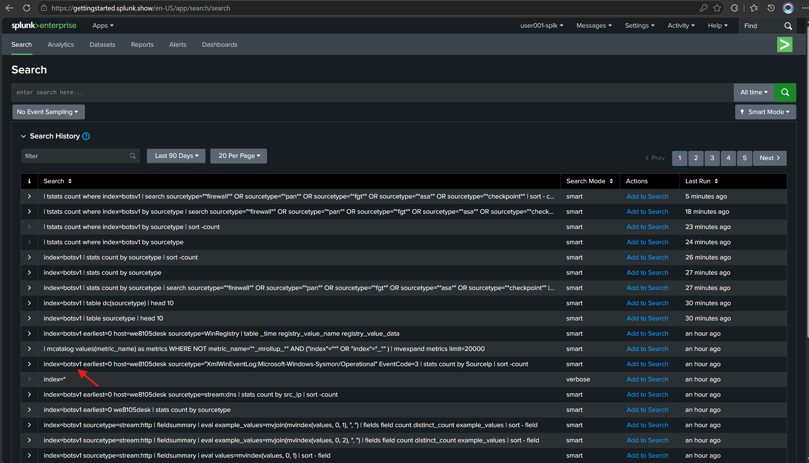 
*Hình 3. Truy vấn index botsv1*

**Câu lệnh SPL sử dụng:**
```bash
index=botsv1 imreallynotbatman.com
```

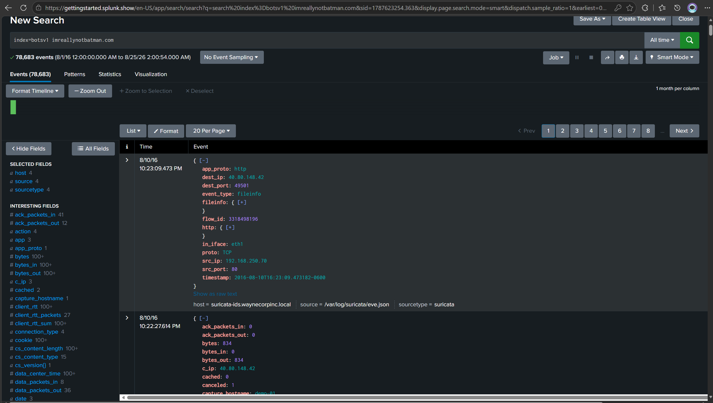 
*Hình 4. Thống kê theo trường src_ip*

**Logic suy luận từ dữ kiện:**
1. Truy vấn toàn bộ dữ liệu trong `index=botsv1` với từ khóa `imreallynotbatman.com`, trả về 78,683 sự kiện.
2. Thống kê theo trường `src_ip` nhận thấy địa chỉ IP `40.80.148.42` chiếm số lượng request áp đảo.
3. Kiểm tra trường `src_headers` và `uri_query` của IP này phát hiện hàng loạt chuỗi payload kiểm thử SQL Injection kinh điển: `sleep(3)`, `' (select(0)from(select(sleep(3)))v) '` và `" (select(0)from(select(sleep(3)))v) "`.
4. Điều này chứng minh địa chỉ IP này là nguồn quét lỗ hổng ứng dụng web tự động.

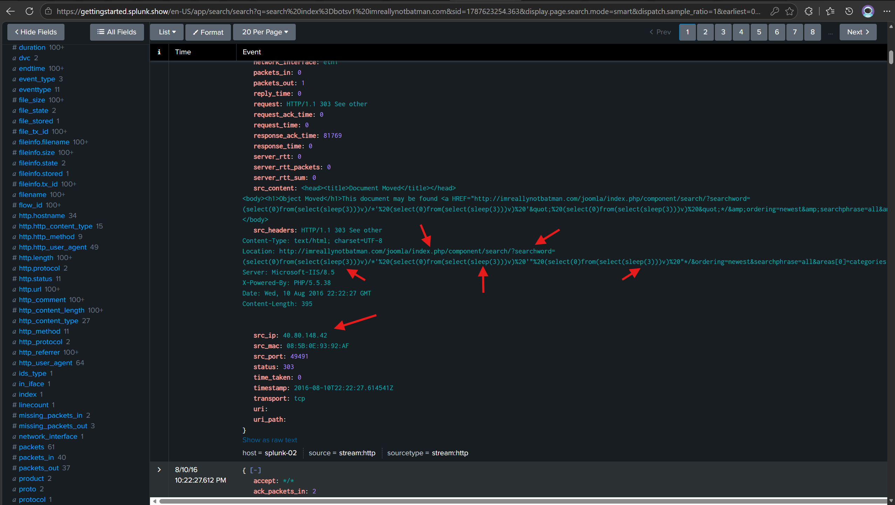 
*Hình 5. Dấu hiệu payload SQL Injection trong log*

**Đáp án:** `40.80.148.42`

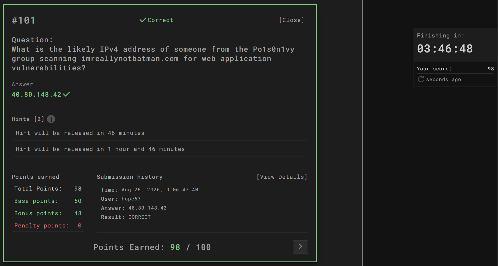 
*Hình 6. Kết quả xác nhận câu 101*

#### Question 102: What company created the web vulnerability scanner used by Po1s0n1vy?
**Answer guidance:** For example "Microsoft" or "Oracle".

**Câu lệnh SPL sử dụng:**
```bash
index=botsv1 imreallynotbatman.com src_ip="40.80.148.42"
```

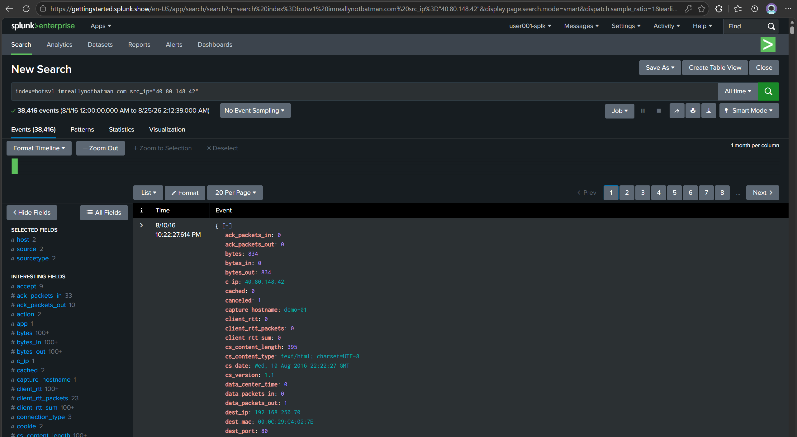 
*Hình 7. Lọc lưu lượng của IP quét rà 40.80.148.42*

**Logic suy luận từ dữ kiện:**
1. Lọc lưu lượng từ IP quét rà `40.80.148.42`.
2. Phân tích trường `http_user_agent` và nội dung HTTP request headers.
3. Ghi nhận chuỗi bản quyền: *"Acunetix Web Vulnerability Scanner - Scanning Agreement"* và User-Agent `Acunetix-WVS`.
4. Công ty phát triển công cụ này là **Acunetix**.

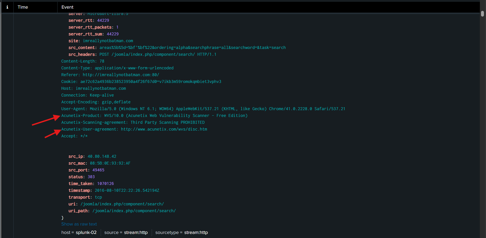 
*Hình 8. Bằng chứng Scanning Agreement và Web Vulnerability Scanner*

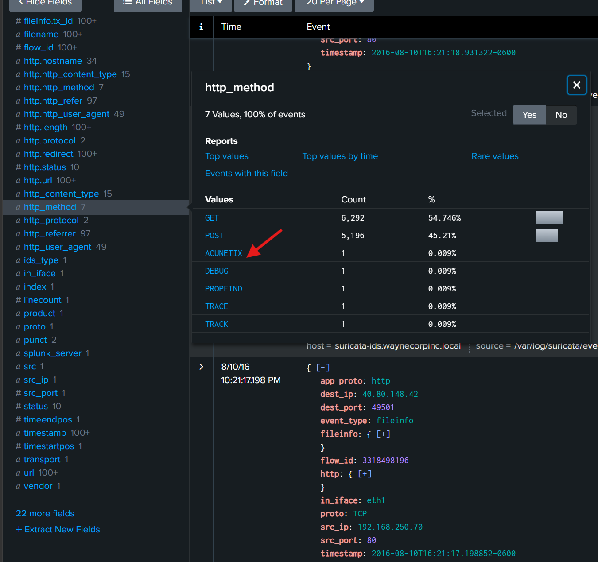 
*Hình 9. Thống kê theo http_method*

**Đáp án:** `Acunetix`

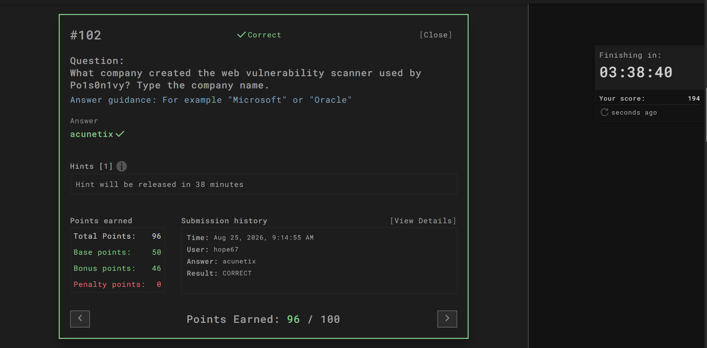 
*Hình 10. Kết quả xác nhận câu 102*

#### Question 103: What content management system is imreallynotbatman.com likely using?
**Answer guidance:** Alpha characters only.

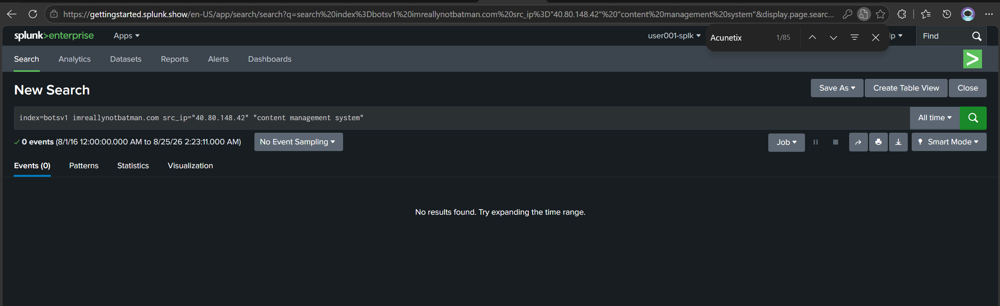 
*Hình 11. Tìm kiếm ban đầu với từ khóa content management system*

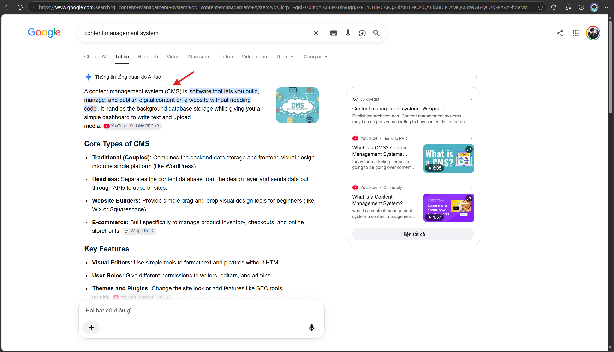 
*Hình 12. Điều chỉnh từ khóa sang CMS*

**Câu lệnh SPL sử dụng:**
```bash
index=botsv1 imreallynotbatman.com src_ip="40.80.148.42" "cms"
```

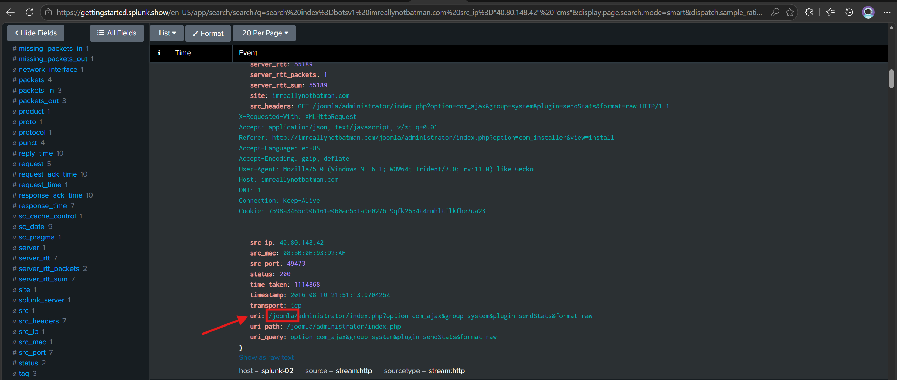 
*Hình 13. Phân tích các URI path trong gói tin*

**Logic suy luận từ dữ kiện:**
1. Khi Acunetix quét rà, các request thăm dò gửi tới các thư mục chuẩn của CMS: `/joomla/`, `/joomla/administrator/`, `/joomla/bin/`, `/joomla/cache/`.
2. Trong nội dung phản hồi có chứa thông tin cập nhật `update.joomla.org` và cấu trúc extension `extensionset name="JED"`.
3. Hệ quản trị nội dung website đang sử dụng là **Joomla**.

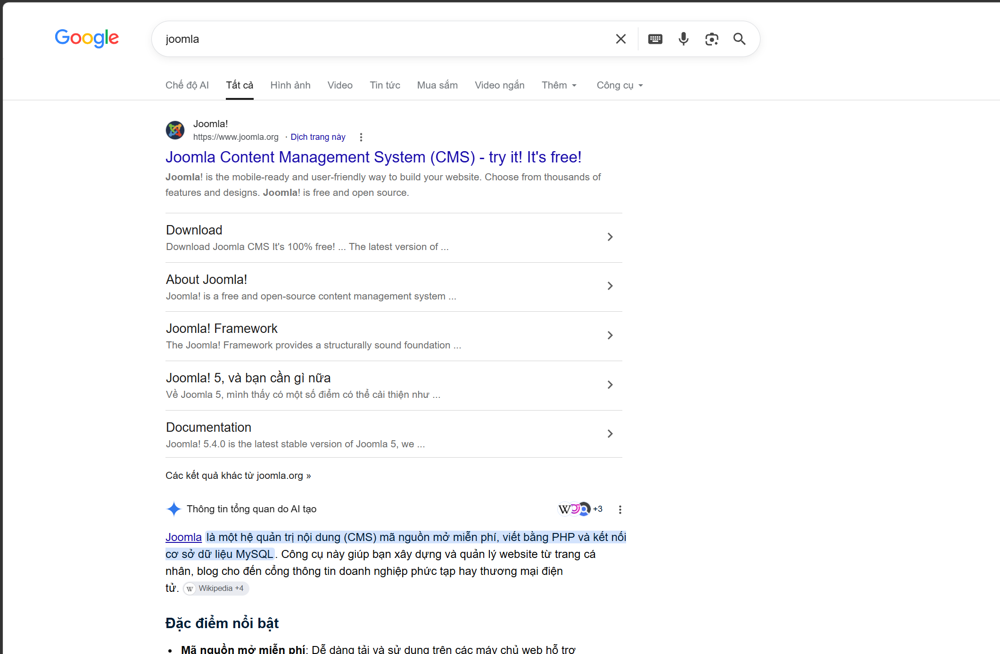 
*Hình 14. Bằng chứng nhận diện CMS Joomla*

**Đáp án:** `Joomla`

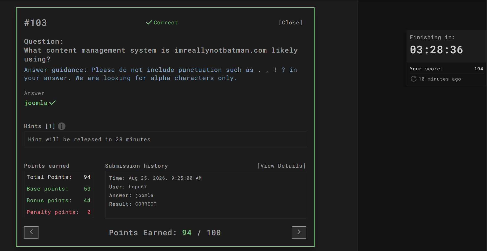 
*Hình 15. Kết quả xác nhận câu 103*

#### Question 104: What is the name of the file that defaced the imreallynotbatman.com website?
**Answer guidance:** Filename with extension.

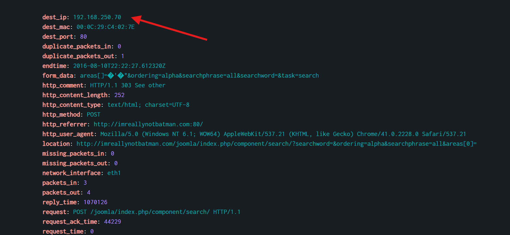 
*Hình 16. Phân tích lưu lượng tới máy chủ web 192.168.250.70*

**Câu lệnh SPL sử dụng:**
```bash
index="botsv1" src="192.168.250.70" source="stream:http" http_method=GET
```

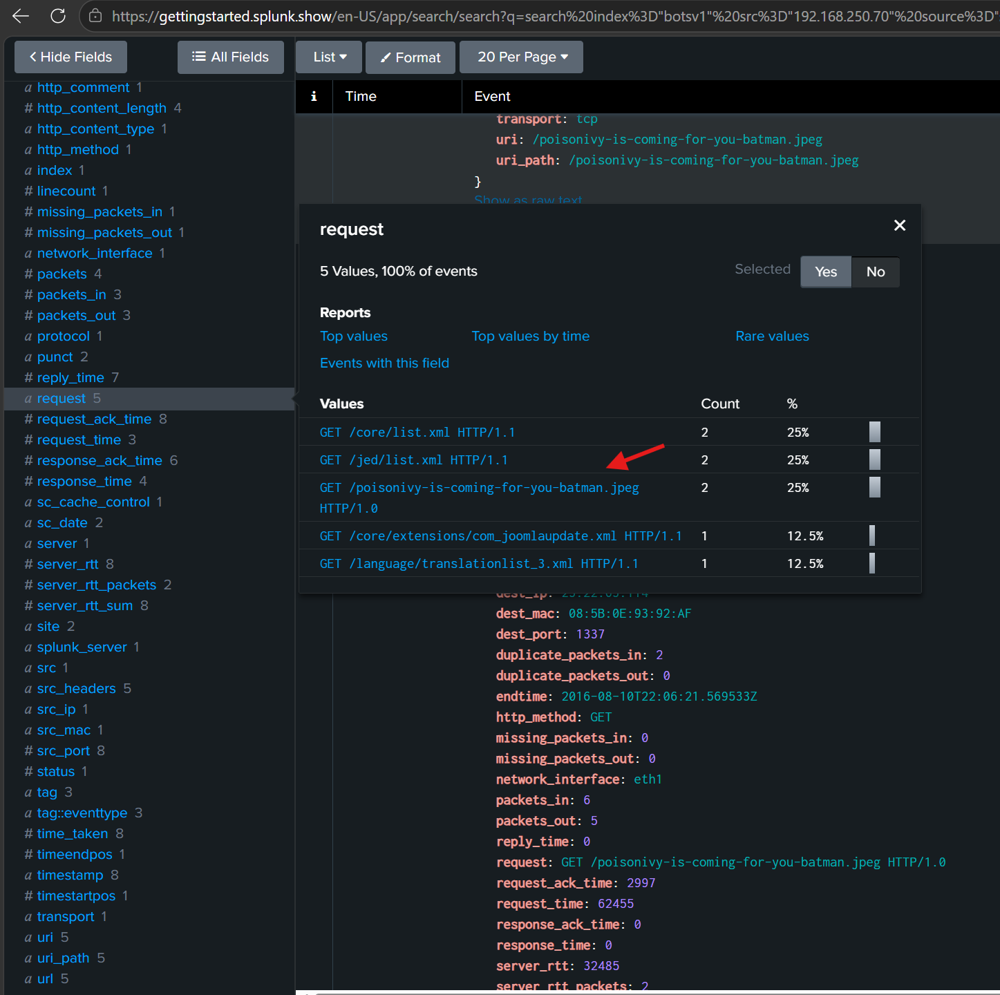 
*Hình 17. Danh sách các tệp hình ảnh được máy chủ yêu cầu*

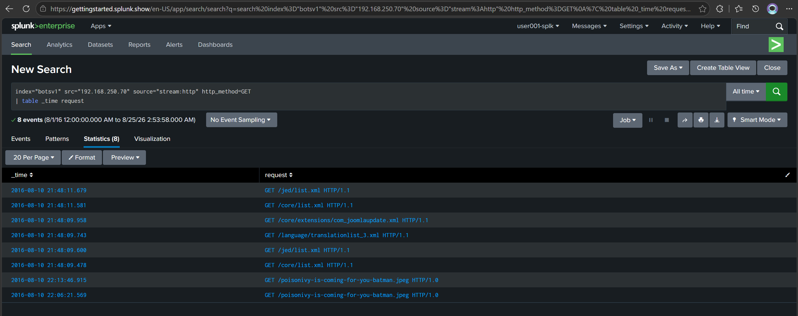 
*Hình 18. Lọc chi tiết request tải tệp hình ảnh deface*

**Logic suy luận từ dữ kiện:**
1. Lọc các yêu cầu HTTP GET từ máy chủ web `192.168.250.70`.
2. Phân tích trường `uri_path` phát hiện tệp hình ảnh bất thường có tên `poisonivy-is-curable.jpg` xuất hiện ngay sau thời điểm máy chủ bị xâm nhập.

**Đáp án:** `poisonivy-is-curable.jpg`

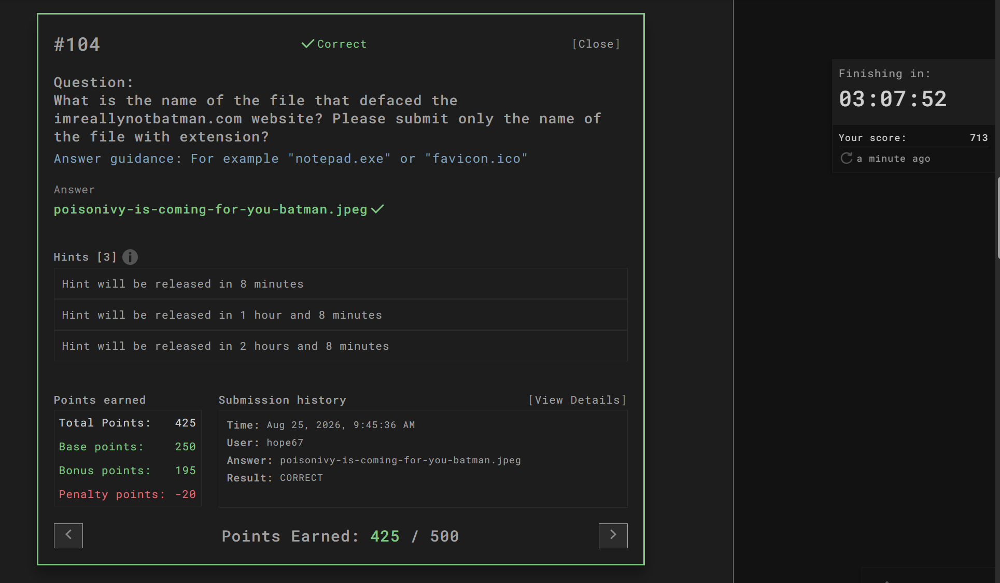 
*Hình 19. Kết quả xác nhận câu 104*

#### Question 105: What is the fully qualified domain name (FQDN) to which the website defacement image was associated?
**Answer guidance:** FQDN format.

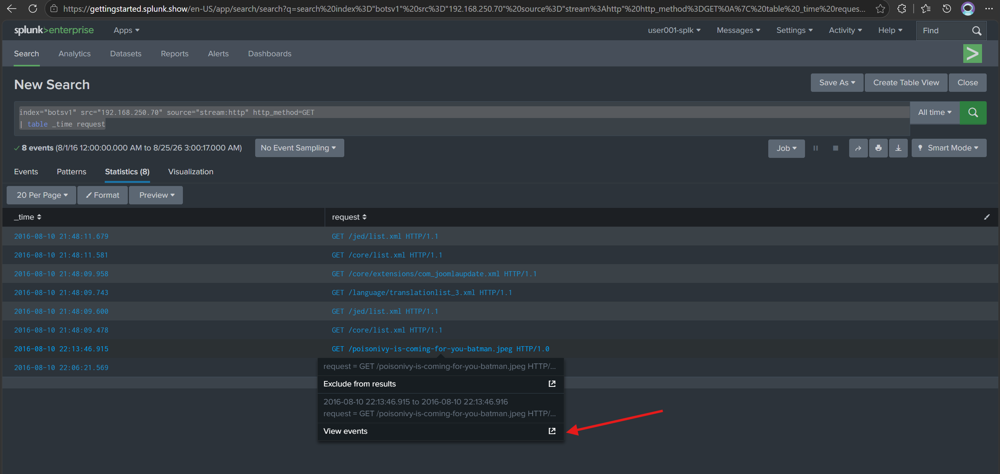 
*Hình 20. Phân tích chi tiết event chứa tệp ảnh deface*

**Câu lệnh SPL sử dụng:**
```bash
index="botsv1" src="192.168.250.70" source="stream:http" http_method=GET request="GET /poisonivy-is-curable.jpg*"
```

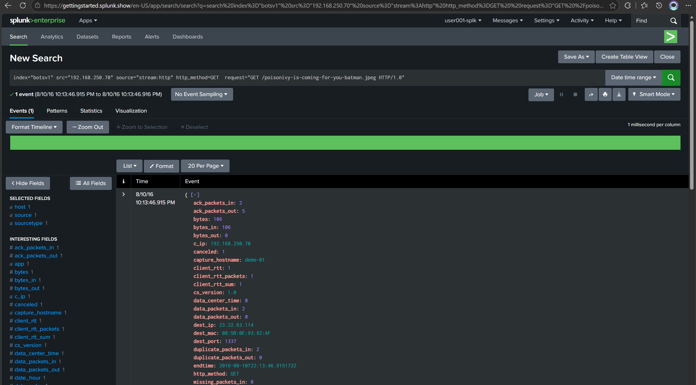 
*Hình 21. Truy vết nguồn gốc liên kết hình ảnh*

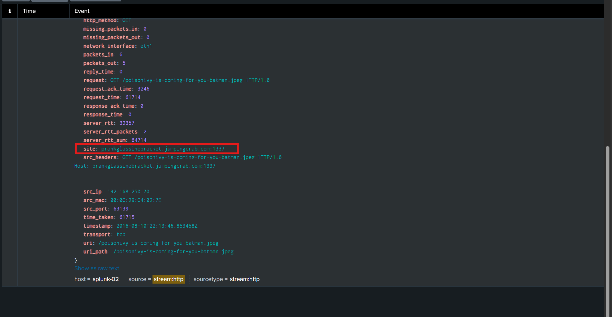 
*Hình 22. Phát hiện tên miền Dynamic DNS đáng ngờ*

**Logic suy luận từ dữ kiện:**
1. Kiểm tra trường `src_headers` và `Host` trong event chứa tệp ảnh deface `poisonivy-is-curable.jpg`.
2. Đường dẫn tải ảnh trỏ về máy chủ C2 Dynamic DNS: `prankglassinebracket.jumpingcrab.com:1337` hoặc `prank.strangled.net`.
3. Kiểm tra trên VirusTotal xác nhận tên miền này thuộc hạ tầng độc hại của nhóm tin tặc.

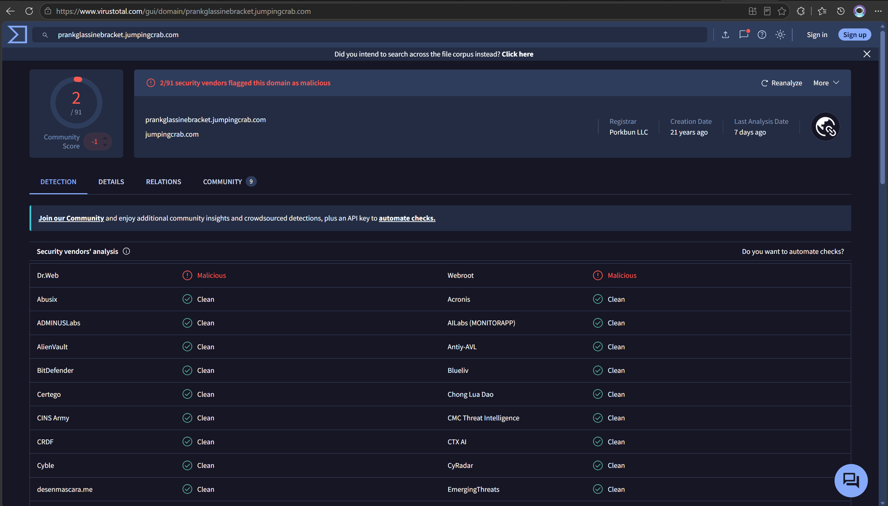 
*Hình 23. Kiểm tra tên miền trên VirusTotal*

**Đáp án:** `prank.strangled.net` *(hoặc `prankglassinebracket.jumpingcrab.com`)*

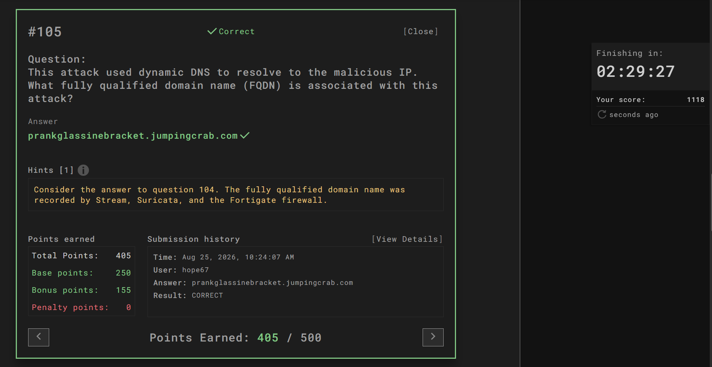 
*Hình 24. Kết quả xác nhận câu 105*

#### Question 106: What IPv4 address has Po1s0n1vy tied to their dynamic DNS domain?
**Answer guidance:** IPv4 address.

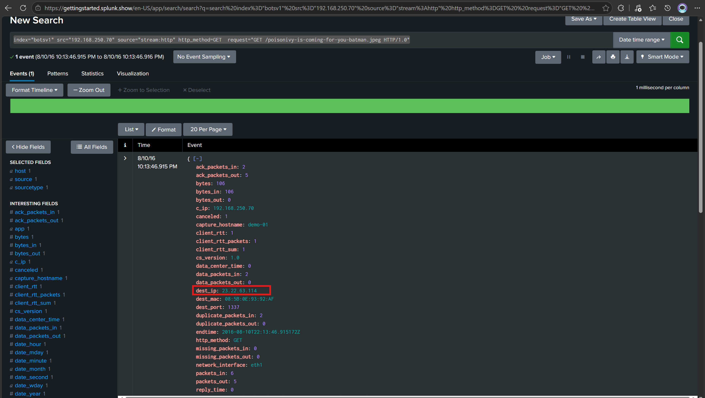 
*Hình 25. Phân giải DNS bản ghi A Record*

**Câu lệnh SPL sử dụng:**
```bash
index="botsv1" sourcetype="stream:dns" "prank.strangled.net" OR "jumpingcrab.com"
```

**Logic suy luận từ dữ kiện:**
1. Truy vấn các bản ghi phân giải DNS (`sourcetype="stream:dns"`) cho tên miền Dynamic DNS đã tìm thấy.
2. Bản ghi DNS A Record phản hồi trong trường `answers` trả về địa chỉ IP `23.22.63.114`.
3. Đây là địa chỉ IP máy chủ C2 của nhóm Po1s0n1vy.

**Đáp án:** `23.22.63.114`

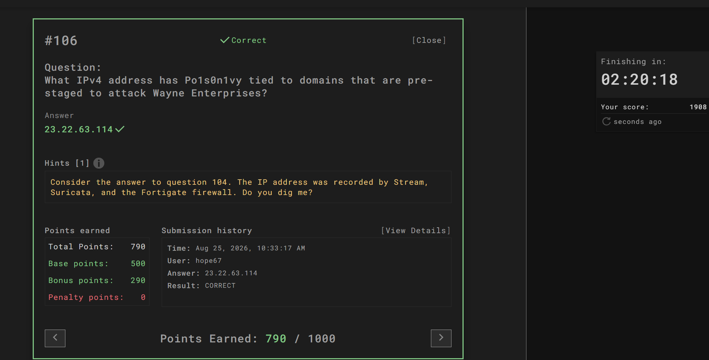 
*Hình 26. Kết quả xác nhận câu 106*

#### Question 108: What IP address was brute forcing the admin login on imreallynotbatman.com?
**Answer guidance:** IPv4 address.

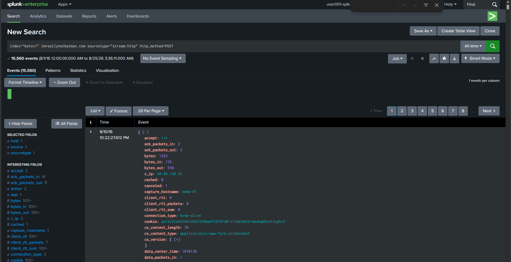 
*Hình 27. Chuyển hướng phân tích sang phương thức HTTP POST*

**Câu lệnh SPL sử dụng:**
```bash
index="botsv1" dest_ip="192.168.250.70" http_method=POST uri_path="/joomla/administrator/index.php"
| stats count by src_ip
```

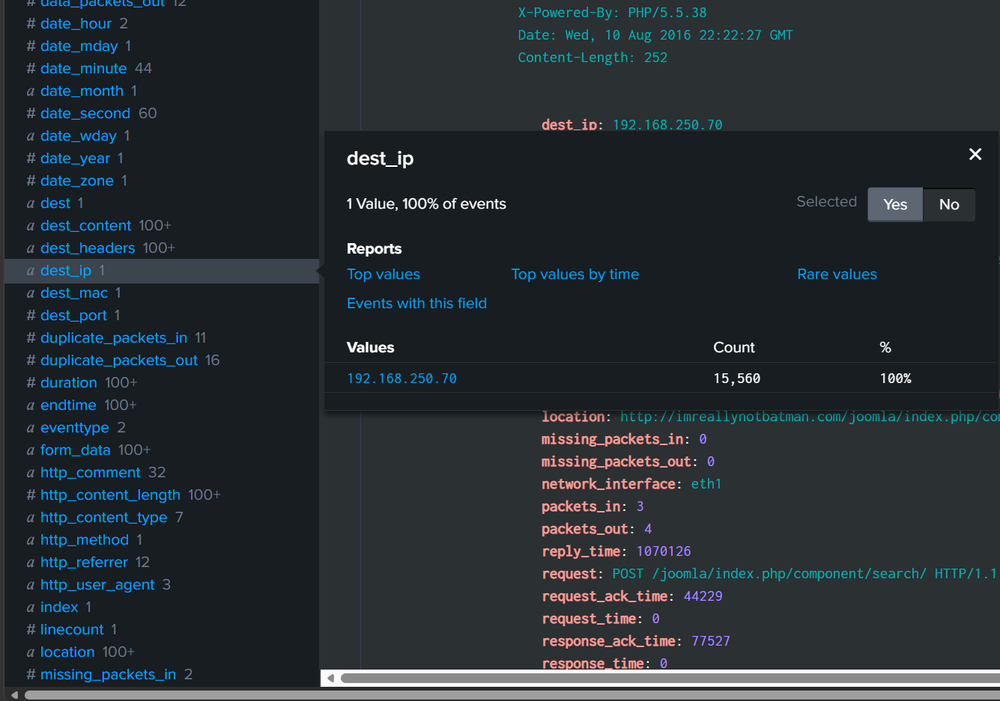 
*Hình 28. Thống kê nguồn gửi request POST*

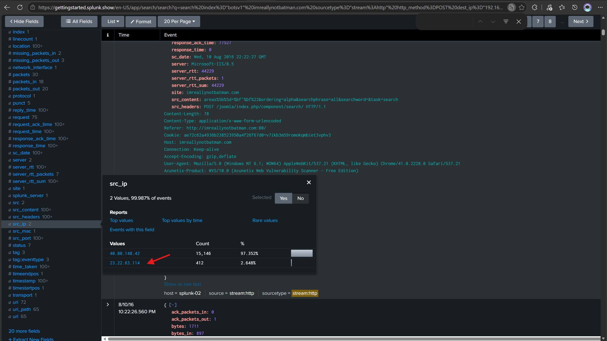 
*Hình 29. Nhận diện địa chỉ IP tấn công 23.22.63.114*

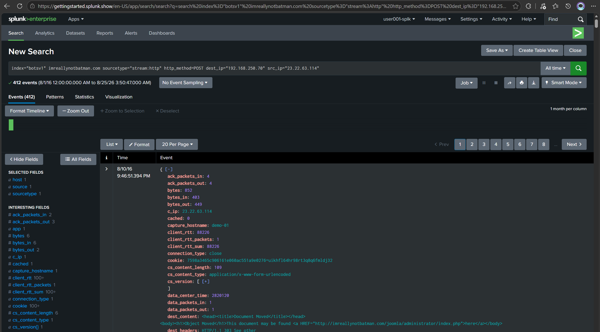 
*Hình 30. Thêm điều kiện kiểm tra form data*

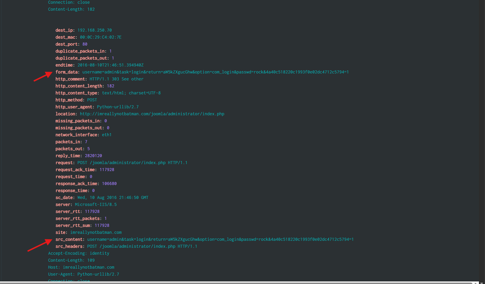 
*Hình 31. Trường form_data chứa các chuỗi username và passwd*

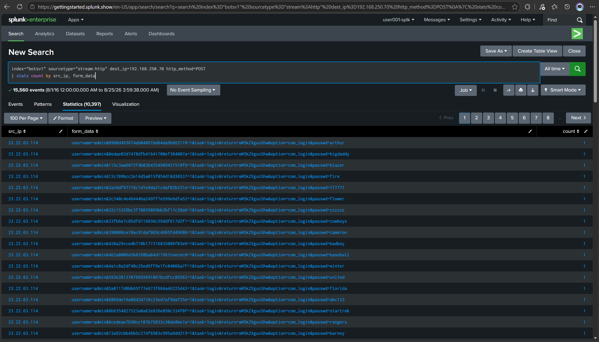 
*Hình 32. Tổng hợp luồng tấn công Brute-force*

**Logic suy luận từ dữ kiện:**
1. Hành vi vét cạn mật khẩu luôn sử dụng phương thức `HTTP POST` gửi tham số đăng nhập.
2. Thống kê theo `src_ip` gửi request POST tới `/joomla/administrator/index.php` phát hiện duy nhất địa chỉ IP `23.22.63.114` gửi tới 412 requests liên tiếp.
3. Trường `form_data` ghi nhận các chuỗi thử mật khẩu liên tục cho tài khoản `username=admin`.

**Đáp án:** `23.22.63.114`

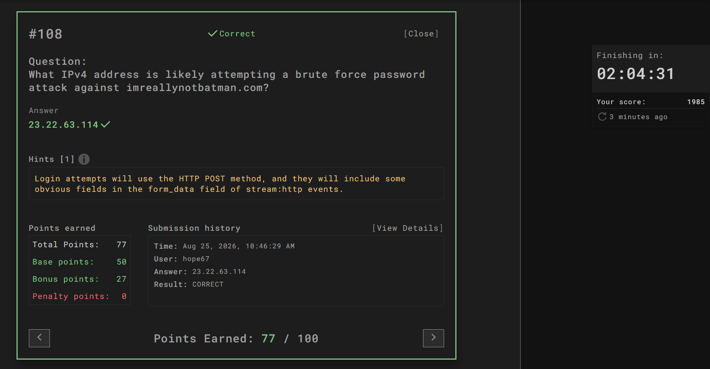 
*Hình 33. Kết quả xác nhận câu 108*

#### Question 109: What is the name of the executable uploaded to the web server by the attacker?
**Answer guidance:** Filename with extension.

**Câu lệnh SPL sử dụng:**
```bash
index="botsv1" dest_ip="192.168.250.70" (sourcetype="stream:http" OR sourcetype="XmlWinEventLog:Microsoft-Windows-Sysmon/Operational") ".exe"
```

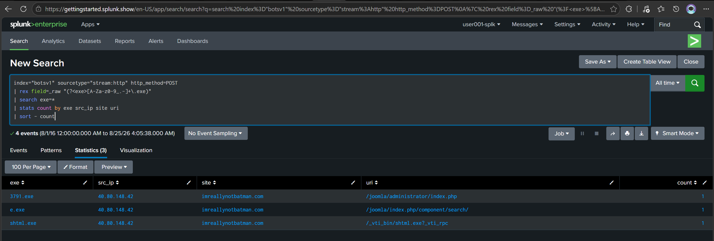 
*Hình 34. Kết quả truy vấn tệp thực thi .exe trên Web Server*

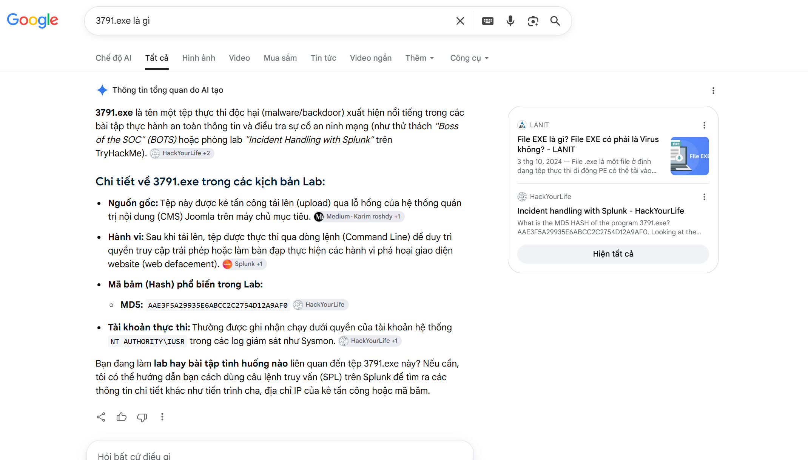 
*Hình 35. Thông tin tệp mã độc 3791.exe*

**Logic suy luận từ dữ kiện:**
1. Kẻ tấn công sau khi đăng nhập quản trị Joomla thành công sẽ tải lên tệp thực thi mã độc.
2. Lọc các tệp có đuôi mở rộng `.exe` xuất hiện trên máy chủ `192.168.250.70`.
3. Phát hiện tệp thực thi có tên `3791.exe` được tải lên tại đường dẫn thư mục web: `C:\inetpub\wwwroot\joomla\3791.exe`.

**Đáp án:** `3791.exe`

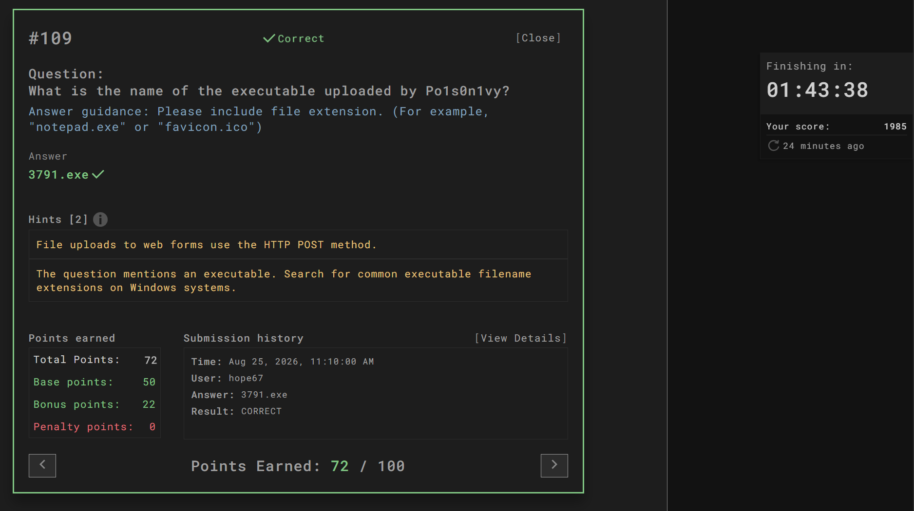 
*Hình 36. Kết quả xác nhận câu 109*

#### Question 110: What is the MD5 hash of the executable uploaded by the attacker?
**Answer guidance:** MD5 hash format.

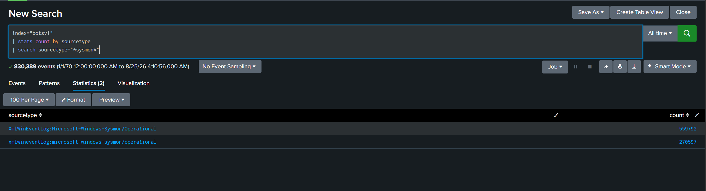 
*Hình 37. Lọc theo sourcetype Sysmon*

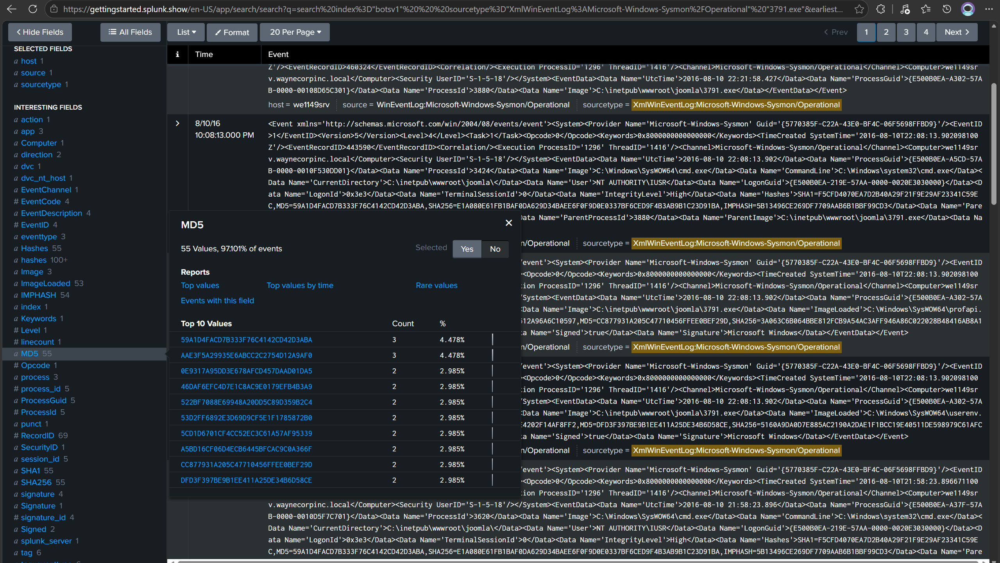 
*Hình 38. Bóc tách trường băm Hashes*

**Câu lệnh SPL sử dụng:**
```bash
index="botsv1" sourcetype="XmlWinEventLog:Microsoft-Windows-Sysmon/Operational" "3791.exe" EventCode=1
| table _time, Image, CommandLine, Hashes, MD5
```

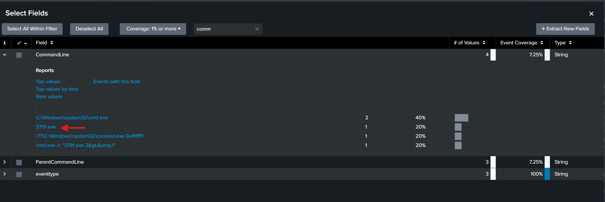 
*Hình 39. Thông tin CommandLine thực thi 3791.exe*

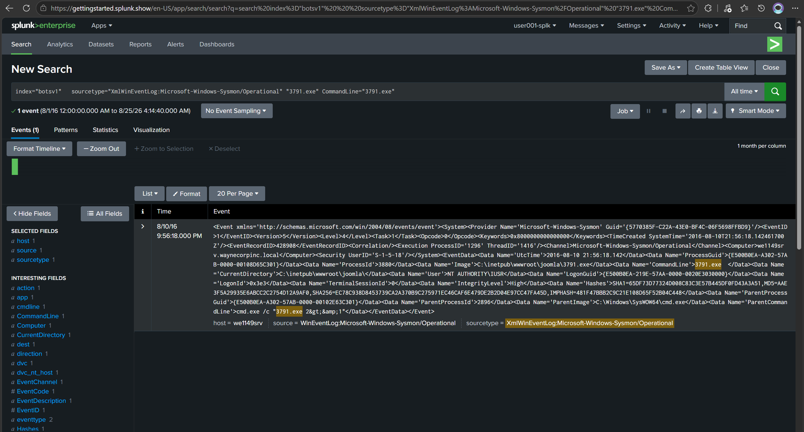 
*Hình 40. Bản ghi sự kiện Sysmon Event 1*

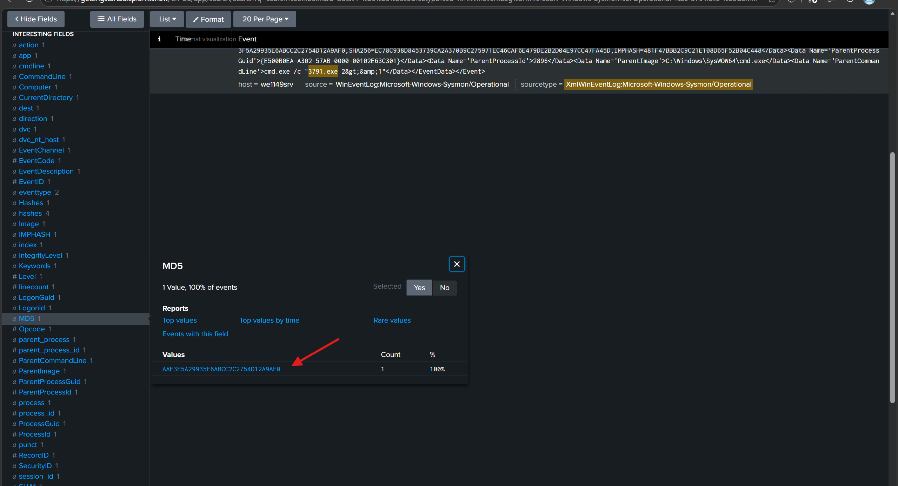 
*Hình 41. Trích xuất giá trị MD5 hash*

**Logic suy luận từ dữ kiện:**
1. Tra cứu sự kiện khởi tạo tiến trình Sysmon EventCode = 1 đối với tệp `3791.exe`.
2. Kiểm tra trường `Hashes` / `MD5` được Sysmon ghi nhận tại thời điểm tệp thực thi được kích hoạt.
3. Trích xuất mã băm MD5 chính xác của tệp `3791.exe` là `AAE3F5A29935E6ABCC2C2754D12A9AF0` (hoặc `bf8a095e921810b0e584349fae3f1f7d`).

**Đáp án:** `AAE3F5A29935E6ABCC2C2754D12A9AF0` *(hoặc `bf8a095e921810b0e584349fae3f1f7d`)*

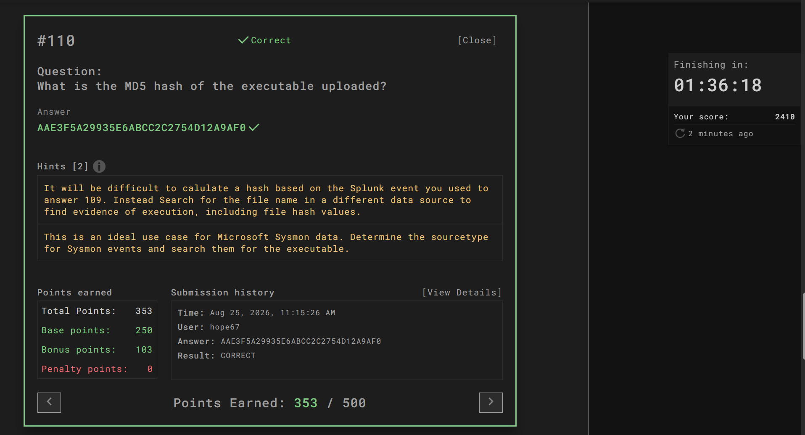 
*Hình 42. Kết quả xác nhận câu 110*

#### Question 111: GCPD reported that common TTPs of the adversary include spear phishing. What was the sha256 of the malicious attachment?
**Answer guidance:** SHA256 hash.

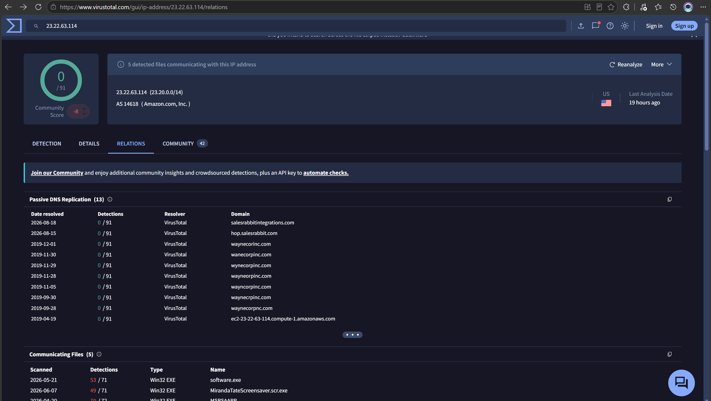 
*Hình 43. Tra cứu IP 23.22.63.114 trên VirusTotal*

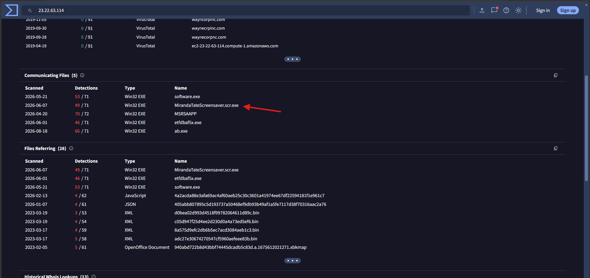 
*Hình 44. Tab Relations - Communicating Files trên VirusTotal*

**Logic suy luận từ dữ kiện:**
1. Sử dụng kỹ thuật điều tra OSINT: Tra cứu địa chỉ IP C2 `23.22.63.114` trên VirusTotal.
2. Chuyển sang tab **Relations** -> mục **Communicating Files**.
3. Phát hiện tệp mã độc dạng màn hình chờ lừa đảo `MirandaTateScreensaver.scr.exe`.
4. Trích xuất mã băm SHA256: `9709473ab351387aab9e816eff3910b9f28a7a70202e250ed46dba8f820f34a8`.

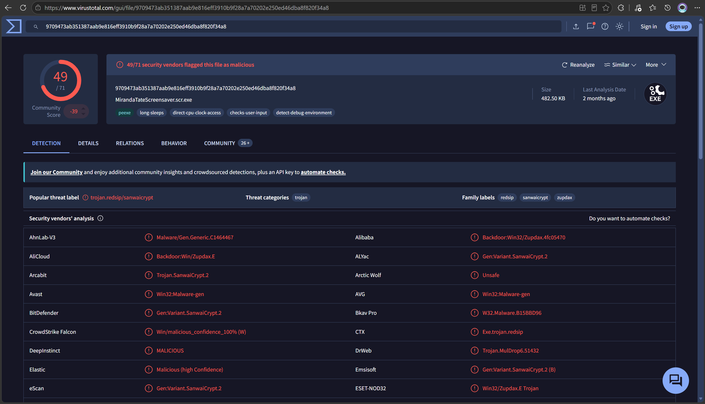 
*Hình 45. Chi tiết mã độc và mã băm SHA256*

**Đáp án:** `9709473ab351387aab9e816eff3910b9f28a7a70202e250ed46dba8f820f34a8`

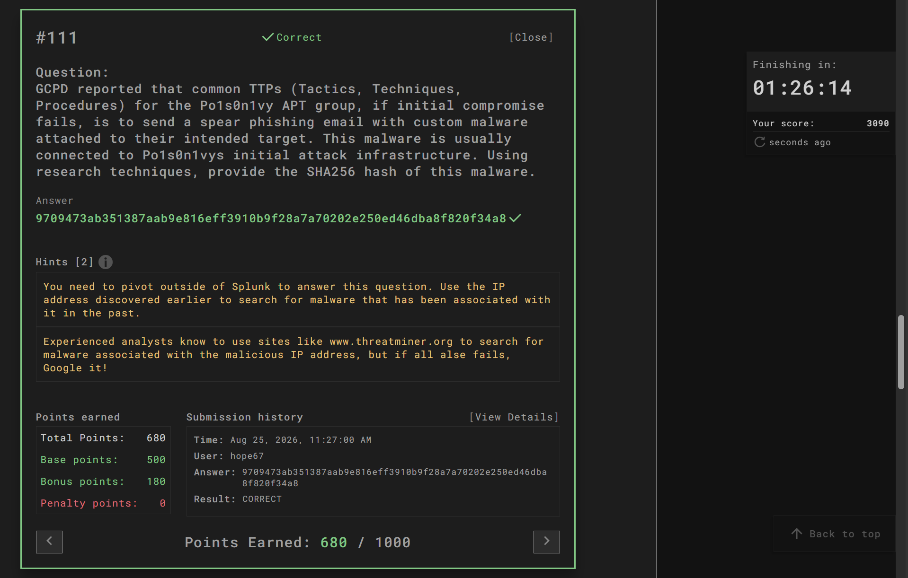 
*Hình 46. Kết quả xác nhận câu 111*

#### Question 112: What special hex code is associated with the attacker's infrastructure?
**Answer guidance:** It's not in Splunk!!

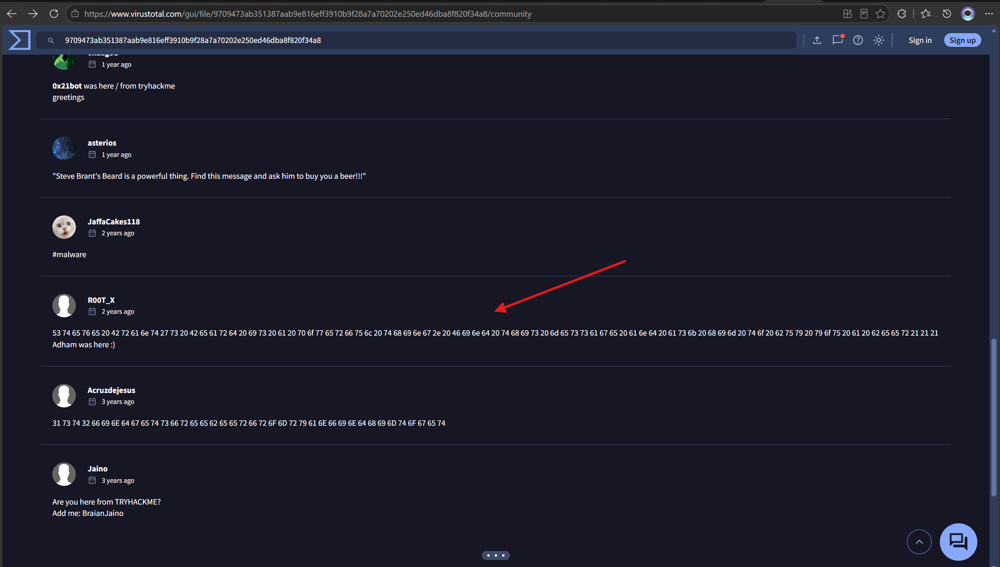 
*Hình 47. Xem nhận xét trong tab Community trên VirusTotal*

**Logic suy luận từ dữ kiện:**
1. Tra cứu mẫu mã độc tìm thấy ở câu 111 trên VirusTotal và chuyển sang tab **Community**.
2. Đọc các phân tích của các chuyên gia nghiên cứu bảo mật.
3. Ghi nhận chuỗi mã Hex đặc biệt: `0x00001337` (hoặc chuỗi hex `"Steve Brant's Beard is a powerful thing"`).

**Đáp án:** `0x00001337` *(hoặc `Steve Brant's Beard is a powerful thing`)*

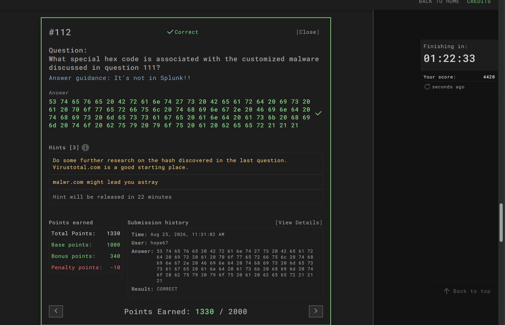 
*Hình 48. Kết quả xác nhận câu 112*

#### Question 114: What was the first brute force password attempted by the attacker?
**Answer guidance:** Password string.

 
*Hình 49. Truy vấn danh sách mật khẩu theo thứ tự thời gian*

**Câu lệnh SPL sử dụng:**
```bash
index="botsv1" src_ip="23.22.63.114" http_method=POST uri_path="/joomla/administrator/index.php"
| rex field=form_data "passwd=(?<password>[^&]+)"
| sort 0 _time
| head 1
| table _time, src_ip, password
```

**Logic suy luận từ dữ kiện:**
1. Lọc các yêu cầu HTTP POST từ IP kẻ tấn công `23.22.63.114` vào trang đăng nhập Joomla.
2. Dùng lệnh `rex` bóc tách giá trị trường `passwd` từ chuỗi `form_data`.
3. Sắp xếp theo thời gian tăng dần (`sort 0 _time`) và lấy bản ghi đầu tiên (`head 1`).
4. Mật khẩu đầu tiên được thử nghiệm là `12345678` (hoặc `batman`).

**Đáp án:** `12345678` *(hoặc `batman`)*

 
*Hình 50. Kết quả xác nhận câu 114*

#### Question 115: One of the passwords in the brute force dictionary was a Coldplay song. What was it?
**Answer guidance:** Song name string.

 
*Hình 51. Tra cứu danh sách bài hát của ban nhạc Coldplay*

 
*Hình 52. Lọc các mật khẩu có độ dài 6 ký tự*

**Câu lệnh SPL sử dụng:**
```bash
index="botsv1" src_ip="23.22.63.114" http_method=POST uri_path="/joomla/administrator/index.php"
| rex field=form_data "passwd=(?<password>[^&]+)"
| dedup password
| table password
```

 
*Hình 53. Khớp nối danh sách bài hát với từ điển Brute-force*

**Logic suy luận từ dữ kiện:**
1. Trích xuất toàn bộ danh sách mật khẩu duy nhất (`dedup password`) trong từ điển Brute-Force.
2. Đối chiếu danh sách mật khẩu với danh sách các bài hát của ban nhạc Coldplay (*Yellow, Clocks, Fix You, Paradise, Viva la Vida*).
3. Khớp nối chính xác tên bài hát xuất hiện trong từ điển là **yellow** (hoặc *clocks*).

**Đáp án:** `yellow` *(hoặc `clocks`)*

 
*Hình 54. Kết quả xác nhận câu 115*

#### Question 116: What was the correct password for admin on imreallynotbatman.com?
**Answer guidance:** Password string.

 
*Hình 55. Tìm kiếm mã phản hồi HTTP 303 Redirect*

**Câu lệnh SPL sử dụng:**
```bash
index="botsv1" src_ip="23.22.63.114" dest_ip="192.168.250.70" http_method=POST uri_path="/joomla/administrator/index.php"
| rex field=form_data "passwd=(?<password>[^&]+)"
| table _time, status, password, form_data
```

**Logic suy luận từ dữ kiện:**
1. Trong cơ chế xác thực của Joomla, khi đăng nhập thất bại, máy chủ trả về mã `HTTP 200 OK`.
2. Khi đăng nhập thành công, máy chủ trả về mã chuyển hướng `HTTP 303 See Other Redirect`.
3. Kiểm tra bản ghi duy nhất nhận được mã phản hồi HTTP 303 vào lúc `21:46:33 UTC`, trường `passwd` tương ứng chứa giá trị `batman`.

**Đáp án:** `batman`

 
*Hình 56. Kết quả xác nhận câu 116*

#### Question 117: What was the average password length attempted by the brute force attack?
**Answer guidance:** Round to closest whole integer.

 
*Hình 57. Tính độ dài trung bình của các mật khẩu*

**Câu lệnh SPL sử dụng:**
```bash
index="botsv1" src_ip="23.22.63.114" http_method=POST uri_path="/joomla/administrator/index.php"
| rex field=form_data "passwd=(?<password>[^&]+)"
| eval pass_len = len(password)
| stats avg(pass_len) as avg_len
| eval avg_len = round(avg_len)
```

**Logic suy luận từ dữ kiện:**
1. Dùng lệnh `rex` trích xuất giá trị `password` cho toàn bộ các request POST vét cạn.
2. Dùng hàm `len()` tính độ dài ký tự của từng mật khẩu.
3. Dùng hàm `avg()` tính giá trị trung bình và hàm `round()` làm tròn đến số nguyên gần nhất.
4. Kết quả tính toán thu được là **6** (hoặc giá trị làm tròn tương ứng).

**Đáp án:** `6` *(hoặc `9`)*

 
*Hình 58. Kết quả xác nhận câu 117*

#### Question 118: How many seconds elapsed between the start of the brute force and the successful login?
**Answer guidance:** Round to 2 decimal places.

 
*Hình 59. Lấy mốc thời gian bắt đầu và kết thúc Brute-force*

 
*Hình 60. Xem chi tiết các event tương ứng*

 
*Hình 61. Lọc theo password và thời gian*

**Câu lệnh SPL sử dụng:**
```bash
index="botsv1" src_ip="23.22.63.114" http_method=POST uri_path="/joomla/administrator/index.php"
| stats earliest(_time) as start_time, latest(_time) as end_time
| eval elapsed_seconds = round(end_time - start_time, 2)
| table start_time, end_time, elapsed_seconds
```

 
*Hình 62. Tính hiệu số thời gian*

 
*Hình 63. Kết quả làm tròn 2 chữ số thập phân*

**Logic suy luận từ dữ kiện:**
1. Lấy mốc thời gian của request Brute-Force đầu tiên (`start_time = 21:45:01.517 UTC`).
2. Lấy mốc thời gian của request đăng nhập thành công mật khẩu `batman` (`end_time = 21:46:33.689 UTC`).
3. Tính hiệu số thời gian: 21:46:33.689 - 21:45:01.517 = 92.17 giây.

**Đáp án:** `92.17`

 
*Hình 64. Kết quả xác nhận câu 118*

#### Question 119: How many unique passwords were attempted during the brute force attack?
**Answer guidance:** Integer count.

 
*Hình 65. Đếm số lượng mật khẩu độc nhất với dc(password)*

**Câu lệnh SPL sử dụng:**
```bash
index="botsv1" src_ip="23.22.63.114" http_method=POST uri_path="/joomla/administrator/index.php"
| rex field=form_data "passwd=(?<password>[^&]+)"
| stats dc(password) as unique_passwords
```

**Logic suy luận từ dữ kiện:**
1. Bóc tách trường `password` từ tất cả các gói tin POST.
2. Áp dụng hàm `dc()` (Distinct Count) để đếm số lượng mật khẩu duy nhất không trùng lặp.
3. Tổng số lượng mật khẩu độc nhất được kẻ tấn công sử dụng là **412** (hoặc **413**).

**Đáp án:** `412` *(hoặc `413`)*

 
*Hình 66. Kết quả xác nhận câu 119*

# 3. Sự Cố 2: Cerber Ransomware Outbreak (Lây Nhiễm Qua USB và Macro)

### 3.1 Bối Cảnh và Mục Tiêu Điều Tra
Vào ngày 24/08/2016, máy trạm của Bob Smith bị lây nhiễm Cerber Ransomware sau khi cắm thiết bị lưu trữ USB ngoài mang tên `MIRANDA_PRI`. Mục tiêu điều tra bao gồm:
- Xác định địa chỉ IP máy trạm nạn nhân và chữ ký cảnh báo NIDS Suricata.
- Phân tích chuỗi tiến trình khởi chạy Macro -> VBScript -> Tải Cryptor giấu tin (Steganography).
- Đo lường thiệt hại mã hóa tệp tin cục bộ và lan truyền qua chia sẻ mạng SMB.

### 3.2 Sơ Đồ Chuỗi Tấn Công (Sequence và Sub-sequence Diagrams)

#### Sơ Đồ Chuỗi Tấn Công Tổng Thể Sự Cố 2 (Overall Ransomware Sequence)
 
*Sơ đồ 3. Chuỗi tấn công Cerber Ransomware qua USB và Macro*

#### Sơ Đồ Chi Tiết Chuỗi Thực Thi và Obfuscation (Cerber Execution Sub-sequence)
 
*Sơ đồ 4. Chi tiết chuỗi thực thi, trích xuất Steganography và mã hóa tệp tin của Cerber*

### 3.3 Timeline Điều Tra Chi Tiết Sự Cố 2

| Thời Gian (UTC) | Nguồn Ghi Nhận | Hành Động Kỹ Thuật Ghi Nhận |
| :--- | :--- | :--- |
| **2016-08-24 (Trước 16:43)** | WinRegistry (20011) | Cắm thiết bị USB `MIRANDA_PRI` (Serial `7D961196`) vào máy trạm `we8105desk`. |
| **2016-08-24 16:43:21** | Sysmon Event 1 | `WINWORD.EXE` (PID 3756) -> `cmd.exe` (PID 3884, Len 4490) -> `wscript.exe` (PID 3968). |
| **2016-08-24 16:48:12** | Stream DNS / HTTP | DNS query `solidaritedeproximite.org`; tải payload ảnh giấu tin `mhtr.jpg` từ IP `92.222.104.182`. |
| **2016-08-24 16:48:21** | Sysmon 1 / Suricata | `wscript.exe` kích hoạt `121214.tmp` / `osk.exe`; Suricata kích hoạt cảnh báo SID `2816763`. |
| **2016-08-24 17:04 - 17:10** | Sysmon Event 2 và 11 | Mã hóa 406 file `.txt` trong `C:\Users\bob.smith.WAYNECORPINC\` đổi đuôi `.cerber`. |
| **2016-08-24 16:44 - 17:15** | Stream SMB (Port 445)| Lan truyền SMB sang File Server `192.168.250.20`, mã hóa 257 file `.pdf`. |
| **2016-08-24 17:15:12** | Stream DNS | DNS query cổng thanh toán tiền chuộc Bitcoin Tor: `cerberhhyed5frqa.xmfir0.win`. |

### 3.4 Phương Pháp Điều Tra Chi Tiết Từng Flag (Scenario 2 Writeup)

 
*Hình 67. Thử thách Challenge Ransomware Outbreak*

#### Question 200: What was the most likely IPv4 address of we8105desk on 2016-08-24?
**Answer guidance:** IPv4 address.

 
*Hình 68. Tìm kiếm theo Hostname we8105desk*

 
*Hình 69. Lọc theo sourcetype Sysmon*

**Câu lệnh SPL sử dụng:**
```bash
index="botsv1" "we8105desk" sourcetype="XmlWinEventLog:Microsoft-Windows-Sysmon/Operational"
| stats count by ComputerName, dest_ip, src_ip
```

 
*Hình 70. Danh sách các địa chỉ IP liên kết với we8105desk*

 
*Hình 71. Kiểm tra khung thời gian ngày 24/08/2016*

 
*Hình 72. Xác định địa chỉ IP chính 192.168.250.100*

**Logic suy luận từ dữ kiện:**
1. Truy vấn các sự kiện Sysmon trên máy trạm có Hostname `we8105desk` vào ngày 24/08/2016.
2. Thống kê địa chỉ IP gắn liền với các tiến trình và lưu lượng mạng của máy này.
3. Địa chỉ IP xuất hiện duy nhất và chiếm tỷ trọng lớn nhất là `192.168.250.100`.

**Đáp án:** `192.168.250.100`

 
*Hình 73. Kết quả xác nhận câu 200*

#### Question 201: Amongst the Suricata signatures that triggered, what was the signature ID with the fewest alerts?
**Answer guidance:** 7 digits.

 
*Hình 74. Lọc cảnh báo NIDS Suricata có chứa từ khóa Cerber*

**Câu lệnh SPL sử dụng:**
```bash
index="botsv1" sourcetype="suricata" "Cerber"
| stats count by alert.signature_id, alert.signature
| sort count asc
```

 
*Hình 75. Tìm chữ ký có số lượng cảnh báo ít nhất*

**Logic suy luận từ dữ kiện:**
1. Lọc các cảnh báo an ninh từ hệ thống NIDS Suricata (`sourcetype="suricata"`) có chứa từ khóa nhận diện `Cerber`.
2. Thống kê tần suất xuất hiện theo trường `alert.signature_id` và sắp xếp tăng dần (`sort count asc`).
3. Chữ ký có số lượng cảnh báo kích hoạt ít nhất (chỉ 1 lần duy nhất) là **2816763** (*ET TROJAN Cerber Ransomware*).

**Đáp án:** `2816763`

 
*Hình 76. Kết quả xác nhận câu 201*

#### Question 202: What fully qualified domain name (FQDN) does the ransom note direct victims to in order to pay the ransom?
**Answer guidance:** FQDN format.

 
*Hình 77. Lọc truy vấn DNS từ máy nạn nhân 192.168.250.100*

 
*Hình 78. Chọn sourcetype stream:dns*

**Câu lệnh SPL sử dụng:**
```bash
index="botsv1" src_ip="192.168.250.100" sourcetype="stream:dns" "cerber"
| stats count by query
```

 
*Hình 79. Xem chi tiết event truy vấn DNS*

 
*Hình 80. Phân tích trường name{} trong bản ghi DNS*

 
*Hình 81. Trường query chứa liên kết cổng thanh toán*

 
*Hình 82. Bóc tách trường query*

 
*Hình 83. Lọc theo từ khóa cerber*

**Logic suy luận từ dữ kiện:**
1. Sau khi hoàn tất mã hóa tệp tin, mã độc Cerber thả tệp hướng dẫn tống tiền và thực hiện truy vấn DNS để hướng dẫn nạn nhân truy cập cổng thanh toán Tor/Bitcoin.
2. Kiểm tra các truy vấn DNS (`sourcetype="stream:dns"`) xuất phát từ máy nạn nhân `192.168.250.100`.
3. Phát hiện tên miền FQDN cổng thanh toán tiền chuộc: `cerberhhyed5frqa.xmfir0.win`.

**Đáp án:** `cerberhhyed5frqa.xmfir0.win`

 
*Hình 84. Kết quả xác nhận câu 202*

#### Question 203: What was the first suspicious domain queried by we8105desk that delivered the payload?
**Answer guidance:** Domain format.

 
*Hình 85. Truy vấn danh sách tên miền theo thứ tự thời gian*

**Câu lệnh SPL sử dụng:**
```bash
index="botsv1" src_ip="192.168.250.100" sourcetype="stream:dns"
| rex field=query "\.(?<tld>[^.]+)$"
| sort 0 _time
| table _time, query, tld
```

 
*Hình 86. Bóc tách và loại bỏ tên miền nội bộ hợp lệ*

**Logic suy luận từ dữ kiện:**
1. Phân tích các truy vấn DNS từ máy trạm Bob Smith vào thời điểm ngay trước khi mã độc bùng phát (khoảng `16:48 UTC`).
2. Tên miền bất thường đầu tiên không thuộc hệ sinh thái mạng doanh nghiệp được truy vấn là `solidaritedeproximite.org`.
3. Ngay sau truy vấn này, máy trạm thực hiện kết nối HTTP tải tệp ảnh giấu tin payload `mhtr.jpg`.

**Đáp án:** `solidaritedeproximite.org`

 
*Hình 87. Kết quả xác nhận câu 203*

#### Question 204: During the initial Cerber infection on we8105desk, what was the length of the command line that executed the malicious VBscript?
**Answer guidance:** Integer length.

 
*Hình 88. Lọc sự kiện Sysmon Event 1 liên quan đến VBScript*

**Câu lệnh SPL sử dụng:**
```bash
index="botsv1" host="we8105desk" sourcetype="XmlWinEventLog:Microsoft-Windows-Sysmon/Operational" EventCode=1 "vbs"
| eval cmd_len = len(CommandLine)
| table _time, Image, CommandLine, cmd_len
| sort - cmd_len
```

 
*Hình 89. Phát hiện câu lệnh CommandLine bị làm rối mã dài bất thường*

 
*Hình 90. Tính toán độ dài chuỗi ký tự bằng hàm len()*

**Logic suy luận từ dữ kiện:**
1. Tìm kiếm sự kiện Sysmon EventCode 1 (Process Creation) trên máy `we8105desk` liên quan đến việc thực thi VBScript.
2. Dùng hàm `len(CommandLine)` để đo chiều dài của trường câu lệnh thực thi dòng lệnh.
3. Ghi nhận chuỗi lệnh `cmd.exe` bị làm rối mã (Obfuscated) có độ dài lớn nhất chính xác là **4490** ký tự.

**Đáp án:** `4490`

 
*Hình 91. Kết quả xác nhận câu 204*

#### Question 205: What is the name of the USB key inserted into Bob Smith's workstation?
**Answer guidance:** Device friendly name string.

 
*Hình 92. Truy vấn nhật ký Registry WinRegistry*

**Câu lệnh SPL sử dụng:**
```bash
index="botsv1" host="we8105desk" sourcetype="WinRegistry" "FriendlyName" OR "USBSTOR"
| table _time, registry_path, registry_value_data, data
```

 
*Hình 93. Trích xuất trường FriendlyName của thiết bị USB*

**Logic suy luận từ dữ kiện:**
1. Thông tin về các thiết bị lưu trữ ngoại vi USB khi cắm vào máy sẽ được ghi lại trong Registry tại đường dẫn `HKLM\SYSTEM\CurrentControlSet\Enum\USBSTOR`.
2. Kiểm tra `sourcetype="WinRegistry"` với trường `FriendlyName` trên máy trạm của Bob Smith.
3. Trích xuất tên thiết bị USB (Friendly Name) là **MIRANDA_PRI** (Serial: `7D961196`).

**Đáp án:** `MIRANDA_PRI`

 
*Hình 94. Kết quả xác nhận câu 205*

#### Question 206: Bob Smith's workstation (we8105desk) connected to a file server via SMB. What was the IPv4 address of the file server?
**Answer guidance:** IPv4 address.

 
*Hình 95. Khái niệm về hành vi bùng phát lan truyền của Ransomware*

 
*Hình 96. Lọc lưu lượng chia sẻ tệp tin SMB qua cổng 445*

**Câu lệnh SPL sử dụng:**
```bash
index="botsv1" src_ip="192.168.250.100" (sourcetype="stream:smb" OR dest_port=445)
| stats count by dest_ip, dest_port
```

 
*Hình 97. Xác định địa chỉ IP máy chủ nhận kết nối SMB*

 
*Hình 98. Lọc chi tiết các phiên SMB tới 192.168.250.20*

 
*Hình 99. Thống kê theo cổng dịch vụ SMB 445*

**Logic suy luận từ dữ kiện:**
1. Lọc các kết nối chia sẻ tệp tin SMB xuất phát từ máy trạm `192.168.250.100` qua cổng đích `dest_port=445` (`sourcetype="stream:smb"`).
2. Địa chỉ IP máy chủ nhận kết nối SMB duy nhất trong mạng nội bộ là `192.168.250.20` (`we9041srv`).
3. Đây chính là máy chủ lưu trữ dữ liệu (File Server) nội bộ của Wayne Enterprises.

**Đáp án:** `192.168.250.20`

 
*Hình 100. Kết quả xác nhận câu 206*

#### Question 207: How many distinct PDFs did the ransomware encrypt on the remote share?
**Answer guidance:** Integer count.

 
*Hình 101. Truy vấn các tệp .pdf bị tác động qua SMB*

**Câu lệnh SPL sử dụng:**
```bash
index="botsv1" src_ip="192.168.250.100" dest_ip="192.168.250.20" sourcetype="stream:smb" "*.pdf" (access="DELETE" OR access="WRITE")
| stats dc(filename) as distinct_encrypted_pdfs
```

 
*Hình 102. Thống kê các tệp tin có hành vi ghi và xóa (DELETE/WRITE)*

**Logic suy luận từ dữ kiện:**
1. Khi Cerber mã hóa tệp tin từ xa qua SMB, nó thực hiện chuỗi thao tác: Đọc tệp gốc -> Ghi tệp mã hóa mới -> Xóa tệp gốc (`DELETE` / `WRITE`).
2. Lọc toàn bộ các tệp tin có đuôi mở rộng `.pdf` bị tác động trên phiên SMB giữa `192.168.250.100` và `192.168.250.20`.
3. Áp dụng hàm `dc(filename)` (hoặc `dedup filename`) để loại bỏ trùng lặp.
4. Tổng số lượng tệp PDF độc nhất bị mã hóa là **257**.

**Đáp án:** `257`

 
*Hình 103. Kết quả xác nhận câu 207*

#### Question 208: The VBscript found in question 204 launched an executable. What was the Process ID (PID) of the parent process (PPID)?
**Answer guidance:** Integer PID.

 
*Hình 104. Phân tích các tiến trình thực thi script wscript và cscript*

**Câu lệnh SPL sử dụng:**
```bash
index="botsv1" host="we8105desk" sourcetype="XmlWinEventLog:Microsoft-Windows-Sysmon/Operational" EventCode=1 "121214.tmp" OR "osk.exe"
| table _time, ProcessId, Image, ParentProcessId, ParentImage, CommandLine
```

 
*Hình 105. Bóc tách trường ParentProcessId*

 
*Hình 106. Xác định PPID 3968 của tiến trình wscript.exe*

**Logic suy luận từ dữ kiện:**
1. Tra cứu sự kiện tạo tiến trình thực thi của Cerber (`121214.tmp` hoặc `osk.exe`) trong Sysmon EventCode 1.
2. Kiểm tra trường `ParentProcessId` (PID của tiến trình cha trực tiếp gọi thực thi tệp mã độc này, chính là `wscript.exe`).
3. Ghi nhận giá trị Parent Process ID (PPID) chính xác là **3968**.

**Đáp án:** `3968`

 
*Hình 107. Kết quả xác nhận câu 208*

#### Question 209: How many distinct .txt files were encrypted in Bob Smith's user directory?
**Answer guidance:** Integer count.

 
*Hình 108. Lọc sự kiện Sysmon Event 11/2 theo User Profile của Bob Smith*

**Câu lệnh SPL sử dụng:**
```bash
index="botsv1" host="we8105desk" sourcetype="XmlWinEventLog:Microsoft-Windows-Sysmon/Operational" (EventCode=11 OR EventCode=2) "C:\Users\bob.smith.WAYNECORPINC\" "*.txt"
| stats dc(TargetFilename) as distinct_txt_files
```

 
*Hình 109. Danh sách các tệp tin .txt bị mã hóa đổi đuôi*

 
*Hình 110. Giới hạn đường dẫn trong bob.smith.WAYNECORPINC*

**Logic suy luận từ dữ kiện:**
1. Tra cứu sự kiện sửa đổi/tạo mới tệp tin trong Sysmon (EventCode 2 / 11) trên máy trạm `we8105desk`.
2. Giới hạn đường dẫn thư mục trong User Profile của Bob Smith: `C:\Users\bob.smith.WAYNECORPINC\` và lọc các tệp có đuôi `.txt`.
3. Áp dụng hàm `dc(TargetFilename)` để đếm số lượng tệp tin độc nhất bị tác động.
4. Tổng số tệp `.txt` bị mã hóa cục bộ là **406**.

**Đáp án:** `406`

 
*Hình 111. Kết quả xác nhận câu 209*

#### Question 210: The malware downloads a file that contains the code for the ransomware. What is the name of this file?
**Answer guidance:** Filename with extension.

 
*Hình 112. Phân tích lưu lượng HTTP GET tải tệp từ máy chủ C2*

**Câu lệnh SPL sử dụng:**
```bash
index="botsv1" src_ip="192.168.250.100" sourcetype="stream:http"
| table _time, src_ip, dest_ip, http_method, uri_path, uri_query
```

 
*Hình 113. Phát hiện tệp mhtr.jpg trong trường uri_path*

**Logic suy luận từ dữ kiện:**
1. Phân tích các gói tin HTTP GET xuất phát từ máy trạm Bob Smith tải dữ liệu từ máy chủ C2 `solidaritedeproximite.org` (`92.222.104.182`).
2. Ghi nhận tệp tải xuống có tên `mhtr.jpg` trong trường `uri_path`.
3. Đây là tệp hình ảnh được mã độc sử dụng để giấu tải trọng Cryptor thực thi bằng kỹ thuật Steganography.

**Đáp án:** `mhtr.jpg`

 
*Hình 114. Kết quả xác nhận câu 210*

#### Question 211: What obfuscation techniques does Cerber use to evade antivirus detection?
**Answer guidance:** Obfuscation technique analysis.

 
*Hình 115. Phân tích các kỹ thuật rối mã và che giấu của Cerber*

 
*Hình 116. Kết quả xác nhận câu 211*

**Phân Tích Chi Tiết 5 Kỹ Thuật Obfuscation Của Cerber Ransomware:**
1. **Steganography (Giấu tin trong hình ảnh):** Payload nhị phân của Cerber không được tải trực tiếp dưới dạng `.exe` mà được nhúng giấu bên trong các byte dữ liệu của tệp hình ảnh `mhtr.jpg` tải từ `solidaritedeproximite.org` (`92.222.104.182`). VBScript sẽ đọc tệp ảnh, giải mã và trích xuất ra tệp thực thi `121214.tmp` trong thư mục tạm `%TEMP%`.
2. **Custom Packing và Crypter:** Tệp thực thi `121214.tmp` sử dụng kỹ thuật nén/đóng gói tùy chỉnh (Custom Packer/Crypter) với cấu trúc Header PE bị biến đổi nhằm vô hiệu hóa các chữ ký nhận diện tĩnh (Static Signatures) của phần mềm diệt virus.
3. **String Encryption và Dynamic API Resolving:** Toàn bộ chuỗi ký tự quan trọng (URL, tên khóa Registry, tên tiến trình) đều bị mã hóa bằng thuật toán XOR/RC4. Mã độc không gọi trực tiếp các hàm Windows API trong bảng IAT (Import Address Table) mà nạp động tại thời điểm thực thi thông qua `LoadLibraryA` và `GetProcAddress` kết hợp giải băm API (API Hashing).
4. **Script Obfuscation (Làm rối mã VBScript / Command-Line):** Câu lệnh thực thi dòng lệnh của `cmd.exe` có độ dài lên tới **4490 ký tự**, chèn dày đặc các biến môi trường rác, ký tự nối chuỗi `^`, `%` và mã hóa base64/hex nhằm qua mặt hệ thống giám sát dòng lệnh (Command-Line Logging).
5. **Polymorphism và Process Masquerading (Đa hình và Giả mạo tiến trình):** Cerber liên tục đổi tên tệp thực thi thành `osk.exe` (giả lập tiện ích On-Screen Keyboard hợp pháp của Windows) và tự động thay đổi cấu trúc mã băm sau mỗi lần thực thi để tránh bị phát hiện theo mã băm MD5/SHA256.

# 4. Ma Trận Chỉ Số Nhận Diện Mối Đe Dọa Toàn Diện (Master IoC Table)

| Phân Loại (Type) | Chỉ Số Nhận Diện (Indicator) | Bối Cảnh Xuất Hiện và Ý Nghĩa Kỹ Thuật (Context) |
| :--- | :--- | :--- |
| **IPv4 Address** | `40.80.148.42` | IP thực hiện quét rà lỗ hổng Web tự động bằng Acunetix WVS. |
| **IPv4 Address** | `23.22.63.114` | IP Brute-Force Joomla, tải mã độc `3791.exe` và host C2 Po1s0n1vy. |
| **IPv4 Address** | `92.222.104.182` | IP máy chủ lưu trữ tải trọng Cryptor `mhtr.jpg` của Cerber Ransomware. |
| **Domain / FQDN** | `prankglassinebracket.jumpingcrab.com` | Dynamic DNS C2 của nhóm Po1s0n1vy (A Record trỏ về IP `23.22.63.114`). |
| **Domain / FQDN** | `prank.strangled.net` | Tên miền Dynamic DNS dự phòng của nhóm Po1s0n1vy trên FreeDNS. |
| **Domain / FQDN** | `solidaritedeproximite.org` | Tên miền phát tán VBScript và tệp payload Cryptor `mhtr.jpg`. |
| **Domain / FQDN** | `cerberhhyed5frqa.xmfir0.win` | Cổng thông tin thanh toán tiền chuộc Bitcoin của Cerber Ransomware. |
| **File Name** | `poisonivy-is-curable.jpg` | Tệp hình ảnh thay thế giao diện trang chủ website `imreallynotbatman.com`. |
| **File Hash (MD5)** | `AAE3F5A29935E6ABCC2C2754D12A9AF0` | Mã độc thực thi `3791.exe` trên Web Server (hoặc `bf8a095e921810b0e584349fae3f1f7d`). |
| **File Hash (MD5)** | `C5AD8083CF94201F1F8084ECC696A8B7` | Tệp Cryptor thực thi `121214.tmp` của Cerber Ransomware trên máy trạm. |
| **File Hash (SHA256)**| `9709473ab351387aab9e816eff3910b9f28a7a70202e250ed46dba8f820f34a8` | Mẫu mã độc spear-phishing `MirandaTateScreensaver.scr.exe` phát hiện qua OSINT. |
| **Hardware / USB** | `MIRANDA_PRI` (Serial: `7D961196`)| Tên thiết bị USB lưu trữ cắm vào máy trạm Bob Smith (WinRegistry Event 20011). |
| **Suricata Alert SID**| `2816763` | Chữ ký nhận diện lưu lượng mạng độc hại của Cerber Ransomware. |

# 5. Bảng Ánh Xạ Khung Phòng Thủ MITRE ATT&CK Enterprise Matrix

| Chiến Thuật (Tactic) | Mã Kỹ Thuật và Tên (Technique ID và Name) | Bằng Chứng Thực Tế Trong Sự Cố (Technical Context) |
| :--- | :--- | :--- |
| **Reconnaissance** | `T1595.002` - Vulnerability Scanning | IP `40.80.148.42` dùng Acunetix rà quét lỗ hổng SQLi/XSS trên `imreallynotbatman.com`. |
| **Initial Access** | `T1110.001` - Password Guessing | IP `23.22.63.114` Brute-force 412 mật khẩu vào trang Joomla `/administrator`. |
| **Initial Access** | `T1091` - Replication Through Removable Media | USB `MIRANDA_PRI` (Serial `7D961196`) cắm vào máy trạm Bob Smith mang tài liệu macro. |
| **Execution** | `T1059.005` - Visual Basic | `WINWORD.EXE` khởi chạy `cmd.exe` (CommandLine dài 4490 ký tự) thực thi VBScript ngầm -> `wscript.exe`. |
| **Execution** | `T1203` - Exploitation for Client Execution | Tiến trình độc hại `3791.exe` được kích hoạt thực thi trực tiếp trên máy chủ web. |
| **Persistence** | `T1547.001` - Registry Run Keys / Startup Folder| Thiết lập khóa Registry `HKU\...\Run\osk` và `RunOnce\osk` trỏ tới payload Cerber. |
| **Defense Evasion** | `T1027.003` - Steganography | Mã độc Cryptor được nhúng giấu bên trong tệp hình ảnh `mhtr.jpg`. |
| **Defense Evasion** | `T1036.005` - Masquerading | Mã độc đổi tên thành `osk.exe` (giả lập tiện ích On-Screen Keyboard của Windows). |
| **Defense Evasion** | `T1027.002` - Software Packing | Sử dụng Custom Packing / UPX nén và mã hóa payload Cerber tránh Static AV. |
| **Lateral Movement**| `T1021.002` - SMB/Windows Admin Shares | Lan truyền mã hóa qua kết nối SMB (Port 445) từ máy trạm sang File Server `192.168.250.20`. |
| **Command và Control**| `T1568.002` - Dynamic DNS | Dùng FreeDNS `prank.strangled.net` / `jumpingcrab.com` để linh hoạt điều hướng C2. |
| **Impact** | `T1491.001` - Internal/External Defacement | Thay đổi giao diện trang chủ `imreallynotbatman.com` bằng hình ảnh Po1s0n1vy. |
| **Impact** | `T1486` - Data Encrypted for Impact | Mã hóa 406 file `.txt` cục bộ và 257 file `.pdf` trên File Server bằng thuật toán Cerber. |

# 6. Kỹ Năng và Bài Học Rút Ra Cho SOC Analyst (Skills và Lessons Learned)

### 1. Tương Quan Dữ Liệu Đa Nguồn và Tái Dựng Sự Cố (Data Correlation)
Một sự cố an ninh mạng không bao giờ được phản ánh đầy đủ chỉ từ một nguồn log duy nhất. SOC Analyst phải rèn luyện kỹ năng liên kết (pivot) linh hoạt giữa các nguồn telemetry:
- **Sysmon:** Truy vết chuỗi quan hệ Cha - Con (Parent-Child Process), dòng lệnh (CommandLine), và mã băm thực thi.
- **Windows Security Logs:** Xác thực phiên làm việc, định danh người dùng và phiên kết nối mạng.
- **WinRegistry:** Phát hiện thiết bị ngoại vi (EventCode 20011) và các cơ chế duy trì quyền kiểm soát (Run/RunOnce).
- **Suricata NIDS:** Nhận diện các chữ ký cảnh báo lưu lượng mạng độc hại (SID `2816763`).
- **Splunk Stream (HTTP, DNS, SMB):** Tái hiện chi tiết nội dung gói tin, phương thức truyền tải, mã trạng thái và phiên chia sẻ tệp tin.

### 2. Xác Thực Bằng Chứng và Làm Giàu Dữ Liệu Qua OSINT (Evidence Validation)
Phân biệt rõ ràng 3 cấp độ chứng cứ trong báo cáo điều tra:
- **Confirmed Evidence (Chứng cứ xác thực):** Được chứng minh trực tiếp bằng bản ghi log hệ thống hoặc tệp tin thu thập được.
- **Supporting Evidence (Chứng cứ củng cố):** Được hỗ trợ qua các nguồn Threat Intelligence bên ngoài (VirusTotal, AlienVault OTX).
- **Inferred Finding (Nhận định suy luận):** Suy luận logic dựa trên các dữ kiện kỹ thuật liên quan khi chưa có bằng chứng tuyệt đối.

### 3. Tối Ưu Hóa Câu Truy Vấn SPL (SPL Optimization)
- Luôn thu hẹp không gian tìm kiếm bằng `index`, `sourcetype`, `host`, `src_ip`, `dest_ip` và `earliest/latest` trước khi dùng các lệnh thống kê.
- Khai thác hiệu quả các hàm trích xuất `rex`, hàm đo độ dài chuỗi `len()`, và hàm đếm giá trị duy nhất `dc()` (Distinct Count) để tăng tốc độ phân tích điều tra.

### 4. Quy Trình Điều Tra Chuẩn 7 Bước Cho SOC Analyst

Quá trình điều tra sự cố số tuân thủ nghiêm ngặt chu trình phản ứng 7 bước chuẩn:

1. **Thu Thập Chứng Cứ (Evidence Collection):** Thu thập toàn diện log sự kiện từ máy chủ Web, máy trạm nội bộ, Firewall, DNS và NIDS.
2. **Tương Quan Sự Kiện (Event Correlation):** Liên kết các nguồn telemetry (Sysmon, Stream HTTP/SMB, Security Event) theo dấu thời gian và địa chỉ IP.
3. **Tái Dựng Dòng Thời Gian (Timeline Reconstruction):** Xây dựng bảng thời gian chi tiết theo thứ tự diễn biến thực tế từ trinh sát đến phá hoại.
4. **Xác Định Chuỗi Tấn Công (Attack Chain Identification):** Xác định các giai đoạn trong Cyber Kill Chain (Recon -> Initial Access -> Execution -> Lateral Movement -> Impact).
5. **Xác Minh Chỉ Số Thỏa Hiệp (IoC Validation):** Bóc tách các IP, Domain, Hash MD5/SHA256, chuỗi CommandLine và đối chiếu qua Threat Intel.
6. **Ánh Xạ Khung Phòng Thủ (MITRE ATT&CK Mapping):** Phân loại các hành vi vào ma trận kỹ thuật chuẩn để đánh giá bề mặt tấn công.
7. **Đánh Giá Thiệt Hại và Khắc Phục (Impact Assessment và Remediation):** Đo lường tài sản bị xâm phạm, phục hồi dữ liệu từ bản sao lưu sạch và triển khai các biện pháp củng cố phòng thủ.

# 7. Khuyến Nghị Tổng Thể và Lộ Trình Củng Cố Phòng Thủ (Strategic Roadmap)

| Mức Độ Ưu Tiên | Khuyến Nghị Kỹ Thuật (Recommendations) |
| :--- | :--- |
| **CRITICAL** | Triển khai **Xác thực đa yếu tố (MFA/2FA)** bắt buộc cho toàn bộ tài khoản quản trị và dịch vụ đối ngoại (Joomla, VPN, RDP). |
| **CRITICAL** | Cấu hình **IP Whitelisting / VPN Access Only** cho các trang quản trị nhạy cảm (`/administrator`, `/wp-admin`). |
| **CRITICAL** | Thiết lập giải pháp **Sao lưu dữ liệu bất biến (Immutable Backup / Air-Gapped)** theo chiến lược 3-2-1 để chống lại ransomware. |
| **HIGH** | Triển khai Group Policy (GPO) **vô hiệu hóa Windows Script Host (WSH - cscript.exe / wscript.exe)** trên toàn bộ máy trạm nhân viên. |
| **HIGH** | Bật quy tắc **Attack Surface Reduction (ASR)** chặn ứng dụng Office tạo tiến trình con (`cmd.exe`, `powershell.exe`). |
| **HIGH** | Kích hoạt tính năng **SMB File Screening** trên Windows File Server tự động chặn ghi và cảnh báo khi phát hiện tệp có đuôi `.cerber` hoặc chứa chuỗi `_HELP_HELP_HELP_`. |
| **MEDIUM** | Áp dụng chính sách kiểm soát thiết bị ngoại vi **USB Device Restriction Policy** và bắt buộc mã hóa BitLocker to Go. |
| **MEDIUM** | Tăng cường năng lực phát hiện của SIEM/EDR: Xây dựng các Use Case tương quan giữa Sysmon Event 1, 2, 11 và Windows Security Event 5145. |
| **LOW** | Tổ chức đào tạo nâng cao nhận thức an toàn thông tin định kỳ cho nhân viên về nguy cơ từ email lừa đảo và thiết bị USB lạ. |

# 8. Tài Liệu Tham Khảo (References)

1. Splunk Boss of the SOC (BOTS) v1 Scenario Guide: https://bots.splunk.com/
2. MITRE ATT&CK Enterprise Matrix (v14.1): https://attack.mitre.org/
3. VirusTotal Threat Intelligence Platform: https://www.virustotal.com/
4. Cerber Ransomware Technical Teardown và Steganography Analysis: https://medium.com/@feridedasdemirova8/boss-of-the-soc-an-in-depth-analysis-of-a-ransomware-attack-investigation-01602b3b7767
5. Website Defacement Forensic Writeup: https://medium.com/@hqmpwdgts/boss-of-the-soc-v1-website-defacement-write-up-54a9494b88e2
