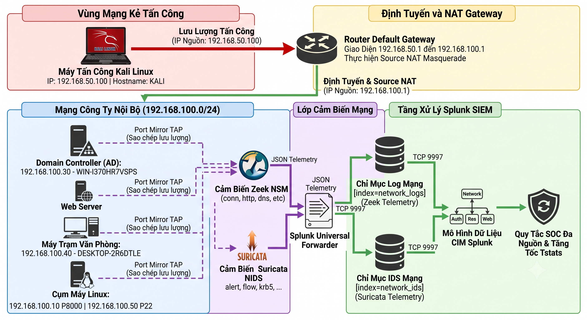
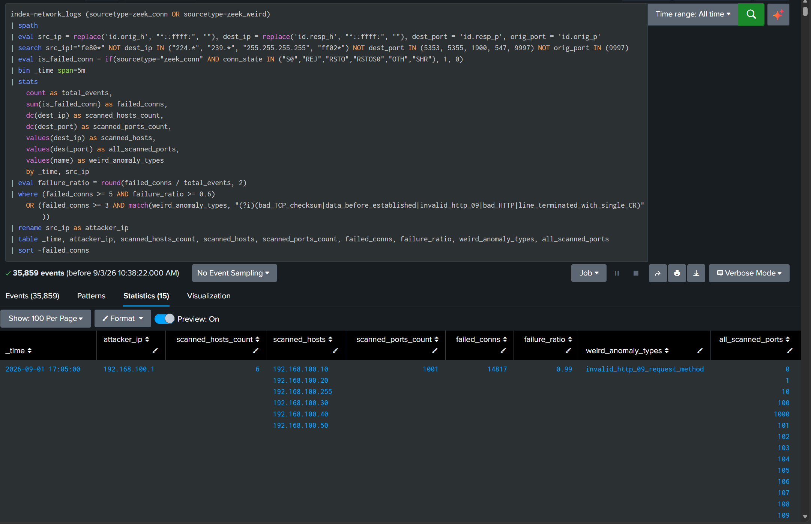
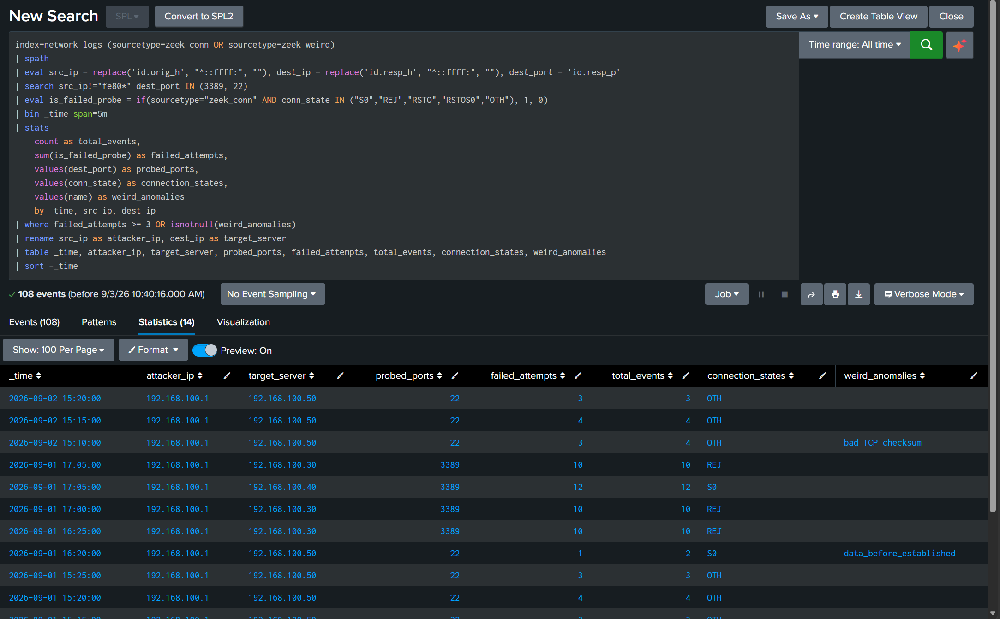
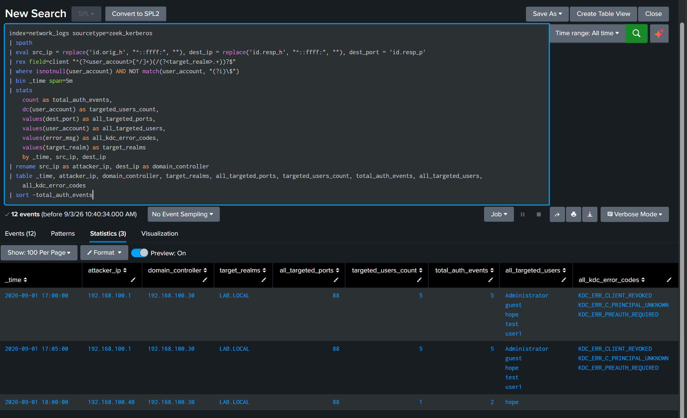
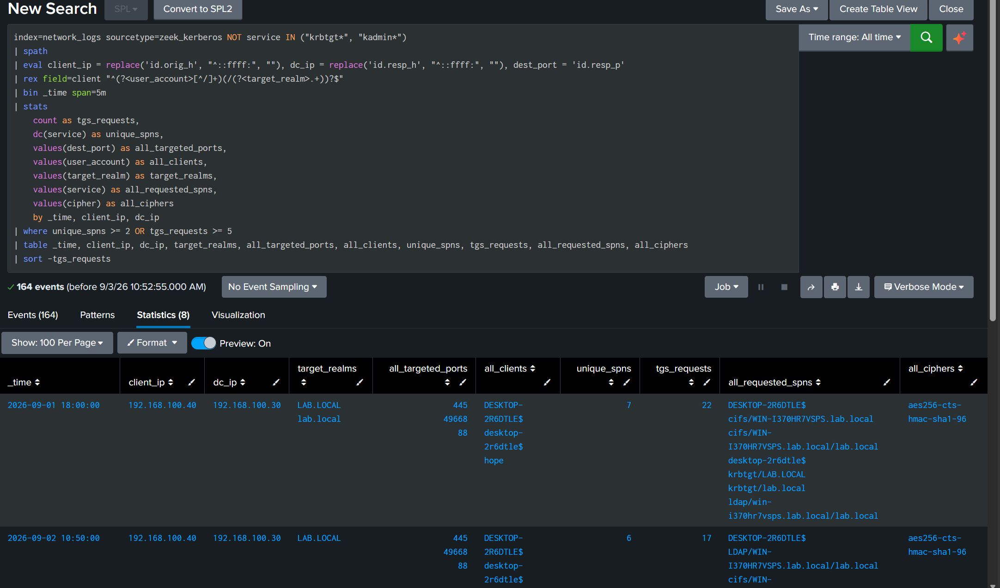
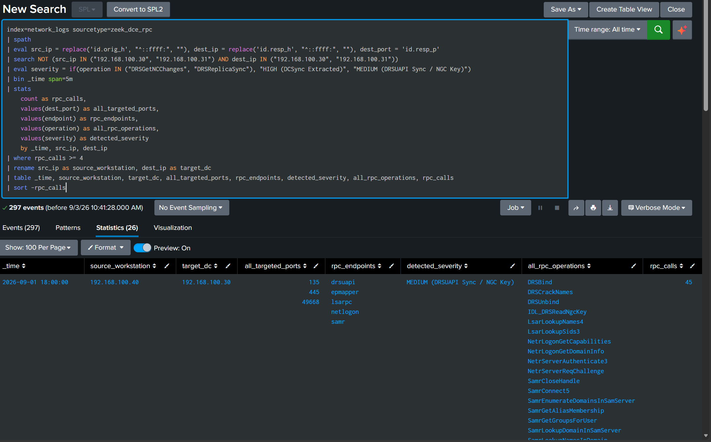
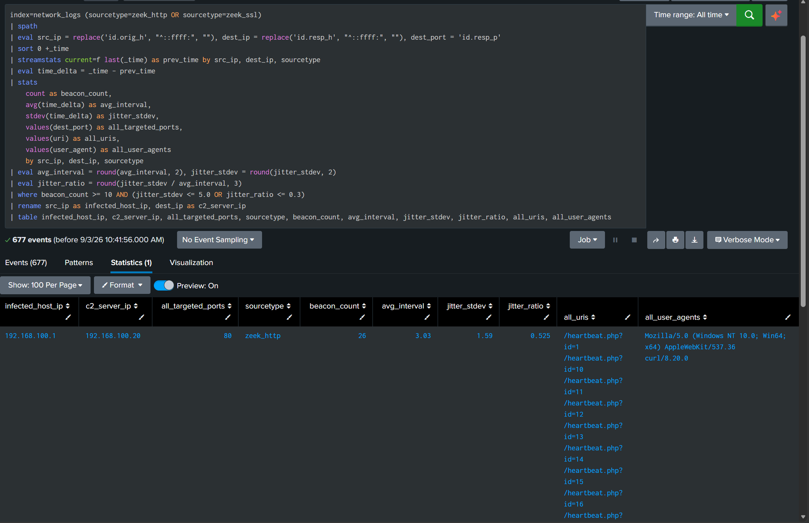
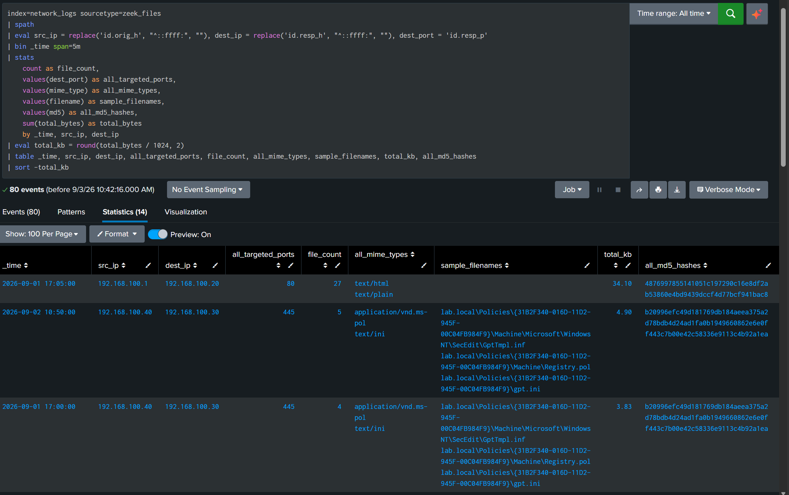
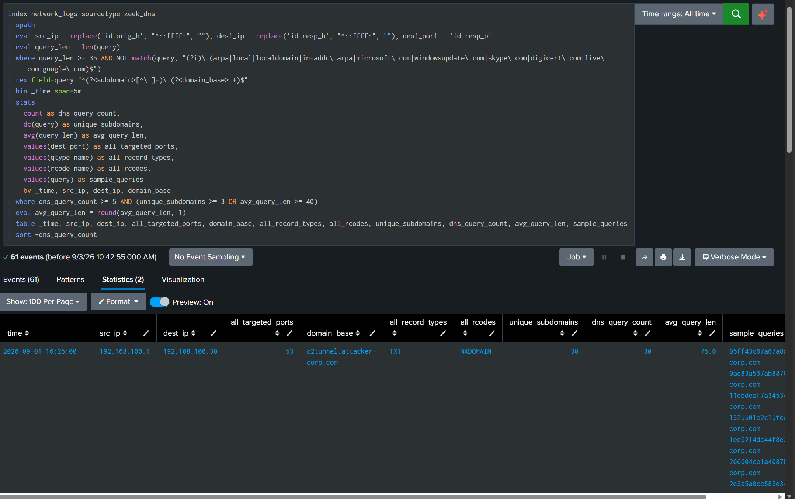
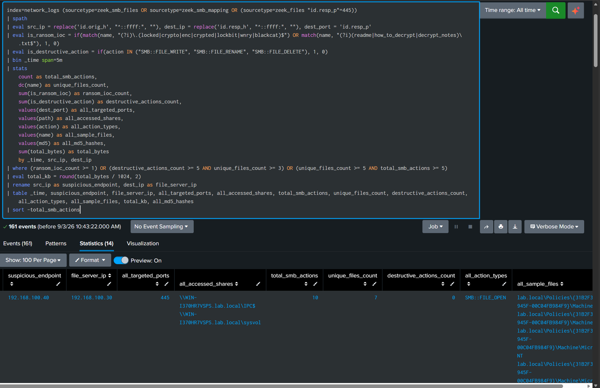

# Tuần 8: Kiến Trúc Giám Sát Mạng và Bộ Luật Phát Hiện SPL

Tài liệu kỹ thuật tổng hợp toàn bộ quá trình thiết kế, triển khai thực nghiệm và tối ưu hóa hệ thống giám sát an ninh mạng (Network Security Monitoring) tại Security Operations Center. Hệ thống kết hợp hai nền tảng cảm biến lưu lượng là Suricata NIDS và Zeek NSM, thu thập dữ liệu tập trung về Splunk Enterprise SIEM để xây dựng bộ luật phát hiện cho 9 kỹ thuật tấn công mạng trọng điểm.

Toàn bộ các quy tắc phát hiện được kiểm chứng trực tiếp trên dữ liệu mô phỏng từ Kali Linux, bóc tách chính xác các trường giao thức tầng ứng dụng, đồng thời xử lý triệt để các nguồn nhiễu mạng nội bộ phổ biến.

---

## 1. Kiến Trúc Giám Sát Mạng Tầng Cảm Biến: So Sánh Bản Chất Zeek và Suricata

Trong kiến trúc vận hành của một trung tâm SOC hiện đại, việc phối hợp song song hai giải pháp Suricata và Zeek mang lại khả năng bao quát toàn diện bề mặt tấn công mạng, giải quyết triệt để điểm yếu cố hữu của phương pháp giám sát đơn lẻ.

### 1.1 So Sánh Bản Chất Công Nghệ

| Tiêu chí | Suricata NIDS | Zeek NSM |
| :--- | :--- | :--- |
| **Bản chất công nghệ** | Công cụ so khớp mẫu gói tin dựa trên chữ ký luật (Signature Matching Engine). | Khung phân tích trạng thái giao thức và trích xuất siêu dữ liệu có cấu trúc (Stateful Protocol Metadata Engine). |
| **Cơ chế hoạt động** | So sánh nội dung payload và header gói tin với tập luật chữ ký đã biết (Emerging Threats, CVE rules). | Giải mã các giao thức mạng, theo dõi toàn bộ vòng đời phiên kết nối và xuất ra các bản ghi sự kiện có cấu trúc. |
| **Định dạng dữ liệu đầu ra** | File `eve.json` hợp nhất gồm các nhóm sự kiện alert, flow, http, dns. | Các file nhật ký JSON chuyên biệt theo từng giao thức: `conn.log`, `dns.log`, `http.log`, `ssl.log`, `kerberos.log`, `ntlm.log`, `rdp.log`, `smb_files.log`, `dce_rpc.log`, `files.log`. |
| **Điểm mạnh** | Bắt tức thời các cuộc tấn công đã có chữ ký định danh rõ ràng như mã khai thác CVE, chuỗi shellcode, tên miền độc hại trong danh sách đen. | Phù hợp điều tra chuyên sâu (L2, L3 SOC), săn lùng mối nguy (Threat Hunting), tính toán độ ngẫu nhiên Shannon Entropy, phát hiện C2 Beaconing và tự động trích xuất hash tệp tin. |
| **Hạn chế** | Dễ bị qua mặt bởi các kỹ thuật biến đổi payload, lưu lượng bị mã hóa, và dễ phát sinh cảnh báo giả nếu luật viết quá rộng. | Không có cơ chế tự động chặn luồng dữ liệu; đòi hỏi kỹ sư SOC phải làm chủ ngôn ngữ truy vấn SPL để phân tích hành vi. |
| **Vai trò trong SOC** | Kích hoạt cảnh báo tức thời phục vụ tiếp nhận bước đầu (SOC L1 Triage). | Cung cấp ngữ cảnh phong phú phục vụ điều tra sự cố, dựng lại chuỗi tấn công và săn lùng hiểm họa ẩn mình (SOC L2, L3 Hunting). |


*Hình 1.1: Sơ đồ luồng dữ liệu kiến trúc hệ thống: Phân luồng từ lưu lượng mạng thô qua Suricata NIDS và Zeek NSM tới Splunk Enterprise SIEM.*

### 1.2 Mô Hình Lab và Phân Bổ Mạng 2 Phân Đoạn

Hệ thống lab được thiết kế gồm 2 phân đoạn mạng tách biệt để mô phỏng chính xác kịch bản tấn công từ bên ngoài hoặc từ vùng mạng không tin cậy thâm nhập vào mạng nội bộ doanh nghiệp:

* **Phân đoạn tấn công (Subnet 192.168.50.0/24):** Máy chủ Kali Linux tại địa chỉ IP `192.168.50.100` (Hostname: `KALI`), cài đặt sẵn các bộ công cụ Nmap, Metasploit, Hydra, Impacket, Kerbrute, dnscat2.
* **Định tuyến và Source NAT Gateway:** Router Default Gateway kết nối giữa giao diện `192.168.50.1` và `192.168.100.1`, thực hiện cơ chế Source NAT Masquerade. Do đó, các lưu lượng tấn công đi từ Kali vào mạng nội bộ đều mang địa chỉ IP nguồn sau NAT là `192.168.100.1`.
* **Phân đoạn mạng doanh nghiệp (Subnet 192.168.100.0/24):**
  * Splunk Enterprise Server (`192.168.100.10`): Cổng Web UI 8000, cổng nhận log 9997, lập chỉ mục và điều hành tìm kiếm.
  * Windows Server 2022 Active Directory Domain Controller (`192.168.100.30`): Hostname `WIN-I370HR7VSPS`, quản lý miền `lab.local`, đóng vai trò KDC và cung cấp dịch vụ xác thực Kerberos, RPC, SMB.
  * Windows 10 Enterprise Client (`192.168.100.40`): Hostname `DESKTOP-2R6DTLE.lab.local`, máy trạm người dùng cài đặt Sysmon và Splunk Universal Forwarder.
  * Apache Web Server (`192.168.100.20` và `192.168.50.20`): Máy chủ web ứng dụng cung cấp bề mặt tấn công ban đầu.
* **Máy trạm cảm biến chuyên dụng (Dedicated Sensor Node):**
  * Card mạng ens38 gắn vào subnet 50 (`192.168.50.50`).
  * Card mạng ens37 gắn vào subnet 100 (`192.168.100.50`).
  * Kích hoạt chuyển tiếp gói tin `net.ipv4.ip_forward = 1` để toàn bộ luồng lưu lượng di chuyển qua lại giữa hai phân đoạn đều được chụp lại trọn vẹn bởi Zeek và Suricata.


---

## 2. Phân Tích Chuyên Sâu 9 Kỹ Thuật Tấn Công Tầng Mạng

Dưới đây là chi tiết phân tích cơ chế tấn công, dấu hiệu nhận diện, giải pháp loại bỏ cảnh báo giả, câu lệnh Splunk SPL chính thức và kết quả thực nghiệm thực tế trên cụm Splunk cho 9 kỹ thuật trọng điểm.

---

### Kỹ Thuật 01: Quét Cổng Mạng và Do Thám Hệ Thống (Nmap Port Scanning - T1046)

#### 1. Mô tả cách tấn công
Kẻ tấn công sử dụng công cụ Nmap thực hiện kỹ thuật quét cổng bí mật TCP SYN (`-sS`), TCP Connect (`-sT`) hoặc quét toàn bộ 65.535 cổng (`-p-`) nhằm xác định danh sách các dịch vụ đang mở trên một hoặc nhiều máy chủ nội bộ. Do phần lớn các cổng đích đều đóng hoặc bị tường lửa chặn, lưu lượng sinh ra sẽ kết thúc ở trạng thái dở dang như không nhận được phản hồi SYN-ACK (`S0`), nhận cờ từ chối kết nối (`REJ`), hoặc bị reset đột ngột (`RSTOS0`).

#### 2. Dấu hiệu nhận diện trên log mạng
* Nguồn dữ liệu: `sourcetype=zeek_conn` (`conn.log`), `sourcetype=zeek_weird` (`weird.log`), `sourcetype=suricata` (`eve.json`).
* Dấu hiệu đặc trưng:
  * Số lượng kết nối kết thúc ở trạng thái lỗi tăng vọt: `conn_state IN ("S0", "REJ", "RSTO", "RSTOS0", "OTH")`.
  * Tỷ lệ kết nối thất bại `failure_ratio = failed_conns / total_events >= 0.60` trong cửa sổ 5 phút.
  * Số lượng cổng đích duy nhất được thăm dò vượt quá ngưỡng bình thường (`dc(dest_port) >= 20`) hoặc nhắm vào nhiều máy chủ liên tiếp (`dc(dest_ip) >= 3`).
  * Xuất hiện các bản ghi dị thường trong `zeek_weird` do Nmap cố tình gửi các gói tin thăm dò không tuân thủ chuẩn RFC: `invalid_http_09_request_method`, `bad_TCP_checksum`, `data_before_established`.

#### 3. Xử lý cảnh báo giả (False Positive)
* Máy quét lỗ hổng định kỳ của đội ngũ IT (Nessus, Qualys): Cấu hình quét theo lịch gây đột biến kết nối lỗi. Biện pháp xử lý là xây dựng danh sách trắng theo địa chỉ IP của máy quét đã được phê duyệt.
* Các gói tin Broadcast và Multicast nền của hệ điều hành: Gói tin tìm kiếm thiết bị nội bộ (mDNS cổng 5353, LLMNR cổng 5355, SSDP cổng 1900, DHCPv6 cổng 547). Biện pháp xử lý là lọc bỏ các dải địa chỉ đích `224.*`, `239.*`, `255.255.255.255`, `ff02*` và các cổng dịch vụ tương ứng.
* Lưu lượng Link-Local IPv6 (`fe80::`): Cần lọc bỏ địa chỉ nguồn bắt đầu bằng `fe80*`.
* Cổng Splunk Universal Forwarder (TCP 9997): Loại trừ cổng 9997 ở cả hai chiều `dest_port` và `orig_port` để tránh đếm nhầm luồng truyền dữ liệu log nội bộ.

#### 4. Câu lệnh Splunk SPL phát hiện chính thức

```bash
index=network_logs (sourcetype=zeek_conn OR sourcetype=zeek_weird)
| spath
| eval src_ip = replace('id.orig_h', "^::ffff:", ""), dest_ip = replace('id.resp_h', "^::ffff:", ""), dest_port = 'id.resp_p', orig_port = 'id.orig_p'
| search src_ip!="fe80*" NOT dest_ip IN ("224.*", "239.*", "255.255.255.255", "ff02*") NOT dest_port IN (5353, 5355, 1900, 547, 9997) NOT orig_port IN (9997)
| eval is_failed_conn = if(sourcetype="zeek_conn" AND conn_state IN ("S0","REJ","RSTO","RSTOS0","OTH"), 1, 0)
| bin _time span=5m
| stats 
    count as total_events, 
    sum(is_failed_conn) as failed_conns, 
    dc(dest_ip) as scanned_hosts_count, 
    dc(dest_port) as scanned_ports_count, 
    values(dest_ip) as scanned_hosts, 
    values(dest_port) as all_scanned_ports, 
    values(name) as weird_anomaly_types 
    by _time, src_ip
| eval failure_ratio = round(failed_conns / total_events, 2)
| where (failed_conns >= 5 AND failure_ratio >= 0.6) OR (failed_conns >= 3 AND match(weird_anomaly_types, "(?i)(bad_TCP_checksum|data_before_established|invalid_http_09|bad_HTTP|line_terminated_with_single_CR)"))
| rename src_ip as attacker_ip
| table _time, attacker_ip, scanned_hosts_count, scanned_hosts, scanned_ports_count, failed_conns, failure_ratio, weird_anomaly_types, all_scanned_ports
| sort -failed_conns
```

#### 5. Kết quả ghi nhận thực tế từ hệ thống lab
Trên hệ thống lab, khi máy tấn công Kali Linux quét dải mạng nội bộ qua gateway:
* Splunk ghi nhận địa chỉ nguồn sau NAT là `192.168.100.1` quét 6 máy chủ nội bộ (`192.168.100.10`, `.20`, `.30`, `.40`, `.50`, `.255`).
* Tổng số cổng quét ghi nhận là 1.001 cổng, phát sinh **14.817 kết nối lỗi** với tỷ lệ thất bại lên tới `failure_ratio = 0.99`.
* Bắt trọn vẹn dị thường giao thức `invalid_http_09_request_method` do gói tin probe của Nmap sinh ra.


*Hình 2.1: Kết quả Splunk SPL thực tế phát hiện quét cổng Nmap (14.817 kết nối lỗi, bóc tách toàn bộ 1.000 cổng và dị thường invalid_http_09_request_method).*

---

### Kỹ Thuật 02: Dò Quét và Vét Cạn Mật Khẩu Remote Access (RDP và SSH - T1110.001)

#### 1. Mô tả cách tấn công
Kẻ tấn công sử dụng các công cụ bẻ khóa tự động như Hydra, Crowbar hoặc Ncrack gửi dồn dập các yêu cầu bắt tay X.224 và thử danh sách thông tin xác thực nhắm vào dịch vụ Remote Desktop Protocol (cổng TCP 3389) hoặc Secure Shell (cổng TCP 22). Sau mỗi lần xác thực thất bại, kết nối bị máy chủ đóng đột ngột, dẫn đến hàng loạt phiên TCP ngắn hạn kết thúc với trạng thái `REJ` hoặc `S0`.

#### 2. Dấu hiệu nhận diện trên log mạng
* Nguồn dữ liệu: `sourcetype=zeek_conn`, `sourcetype=zeek_weird`.
* Dấu hiệu đặc trưng:
  * Xuất hiện chuỗi kết nối dồn dập nhắm vào cổng 3389 hoặc 22 với thời lượng phiên rất ngắn.
  * Trạng thái kết nối tập trung ở nhóm lỗi: `conn_state IN ("S0", "REJ", "RSTO", "RSTOS0", "OTH")`.
  * Xuất hiện các dị thường tầng giao thức trong `weird.log`: `bad_TCP_checksum`, `data_before_established`.
  * Tần suất kết nối lỗi vượt quá 3 lần trong cửa sổ 5 phút từ cùng một địa chỉ IP nguồn.

#### 3. Xử lý cảnh báo giả
* Quản trị viên nhập nhầm mật khẩu một vài lần hoặc máy trạm gặp sự cố mạng tự kết nối lại. Biện pháp xử lý là thiết lập ngưỡng cảnh báo tối thiểu từ 3 đến 5 lần kết nối lỗi trở lên trong 5 phút, kết hợp kiểm tra danh sách IP máy quản trị nội bộ (Jumpbox).

#### 4. Câu lệnh Splunk SPL phát hiện chính thức

```bash
index=network_logs (sourcetype=zeek_conn OR sourcetype=zeek_weird)
| spath
| eval src_ip = replace('id.orig_h', "^::ffff:", ""), dest_ip = replace('id.resp_h', "^::ffff:", ""), dest_port = 'id.resp_p'
| search src_ip!="fe80*" dest_port IN (3389, 22)
| eval is_failed_probe = if(sourcetype="zeek_conn" AND conn_state IN ("S0","REJ","RSTO","RSTOS0","OTH"), 1, 0)
| bin _time span=5m
| stats 
    count as total_events,
    sum(is_failed_probe) as failed_attempts,
    values(dest_port) as probed_ports,
    values(conn_state) as connection_states,
    values(name) as weird_anomalies
    by _time, src_ip, dest_ip
| where failed_attempts >= 3 OR isnotnull(weird_anomalies)
| rename src_ip as attacker_ip, dest_ip as target_server
| table _time, attacker_ip, target_server, probed_ports, failed_attempts, total_events, connection_states, weird_anomalies
| sort -_time
```

#### 5. Kết quả ghi nhận thực tế từ hệ thống lab
* Hệ thống ghi nhận 108 sự kiện từ máy tấn công `192.168.100.1` nhắm vào Domain Controller `192.168.100.30`, Client `192.168.100.40` trên cổng 3389 và Linux Server `192.168.100.50` trên cổng 22.
* Thống kê ghi nhận 14 dòng cảnh báo với các trạng thái kết thúc phiên lỗi liên tục (`REJ`, `S0`, `OTH`).
* Bóc tách thành công các dị thường tầng giao thức: `bad_TCP_checksum` và `data_before_established`.


*Hình 2.2: Kết quả Splunk SPL thực tế phát hiện vét cạn mật khẩu Remote Access trên cổng 3389 (RDP) và cổng 22 (SSH).*

---

### Kỹ Thuật 03: Vét Cạn Xác Thực Kerberos và Dò Danh Sách Người Dùng (T1110.003)

#### 1. Mô tả cách tấn công
Kẻ tấn công sử dụng các công cụ như Kerbrute hoặc Impacket gửi dồn dập các bản tin yêu cầu cấp vé xác thực ban đầu (`AS-REQ`) tới Domain Controller (cổng TCP/UDP 88). Bằng cách phân tích các mã lỗi Kerberos trả về từ KDC, kẻ tấn công xác định được tài khoản nào tồn tại trong Active Directory và tài khoản nào có mật khẩu yếu mà không cần tài khoản xác thực hợp lệ trước đó.

#### 2. Dấu hiệu nhận diện trên log mạng
* Nguồn dữ liệu: `sourcetype=zeek_kerberos` (`kerberos.log`).
* Dấu hiệu đặc trưng:
  * KDC trả lời hàng loạt mã phản hồi lỗi Kerberos:
    * `KDC_ERR_C_PRINCIPAL_UNKNOWN`: Tên tài khoản không tồn tại trong Active Directory (phục vụ User Enumeration).
    * `KDC_ERR_PREAUTH_FAILED`: Tài khoản có tồn tại nhưng sai thông tin xác thực mật khẩu.
    * `KDC_ERR_CLIENT_REVOKED`: Tài khoản đã bị khóa hoặc vô hiệu hóa do chính sách bảo mật.
  * Tần suất bản tin AS-REQ thất bại vượt quá 3 lần trong cửa sổ 5 phút, nhắm vào nhiều tên người dùng khác nhau từ cùng một địa chỉ IP.

#### 3. Xử lý cảnh báo giả
* Các tài khoản máy tính trong domain (kết thúc bằng ký tự `$`) tự động gửi yêu cầu xác thực theo chu kỳ. Biện pháp xử lý là lọc bỏ các tài khoản kết thúc bằng `$` (`NOT match(user_account, "(?i)\\$")`).

#### 4. Câu lệnh Splunk SPL phát hiện chính thức

```bash
index=network_logs sourcetype=zeek_kerberos
| spath
| eval src_ip = replace('id.orig_h', "^::ffff:", ""), dest_ip = replace('id.resp_h', "^::ffff:", ""), dest_port = 'id.resp_p'
| rex field=client "^(?<user_account>[^/]+)(/(?<target_realm>.+))?$"
| where isnotnull(user_account) AND NOT match(user_account, "(?i)\$")
| bin _time span=5m
| stats 
    count as total_auth_events,
    dc(user_account) as targeted_users_count,
    values(dest_port) as all_targeted_ports,
    values(user_account) as all_targeted_users,
    values(error_msg) as all_kdc_error_codes,
    values(target_realm) as target_realms
    by _time, src_ip, dest_ip
| rename src_ip as attacker_ip, dest_ip as domain_controller
| table _time, attacker_ip, domain_controller, target_realms, all_targeted_ports, targeted_users_count, total_auth_events, all_targeted_users, all_kdc_error_codes
| sort -total_auth_events
```

#### 5. Kết quả ghi nhận thực tế từ hệ thống lab
* Hệ thống bắt được 12 sự kiện từ máy tấn công `192.168.100.1` nhắm vào Domain Controller `192.168.100.30` trên cổng 88, miền `LAB.LOCAL`.
* Bóc tách chính xác 5 tài khoản mục tiêu bị dò quét: `Administrator`, `guest`, `hope`, `test`, `user1`.
* Bắt trọn 3 mã lỗi KDC đặc trưng: `KDC_ERR_CLIENT_REVOKED`, `KDC_ERR_C_PRINCIPAL_UNKNOWN`, `KDC_ERR_PREAUTH_REQUIRED`.


*Hình 2.3: Kết quả Splunk SPL thực tế phát hiện Kerberos AS-REQ User Enumeration và các mã lỗi KDC đặc trưng.*

---

### Kỹ Thuật 04: Thu Thập Vé Dịch Vụ Kerberoasting (T1558.003)

#### 1. Mô tả cách tấn công
Sau khi chiếm được một tài khoản người dùng thông thường trong domain, kẻ tấn công gửi yêu cầu `TGS-REQ` tới Domain Controller để xin cấp vé dịch vụ cho các tài khoản có đăng ký Service Principal Name (SPN), ví dụ dịch vụ MSSQL, Web, CIFS. Kẻ tấn công thu thập vé dịch vụ về để bẻ khóa ngoại tuyến (Offline Cracking) nhằm tìm ra mật khẩu gốc dạng văn bản rõ.

#### 2. Dấu hiệu nhận diện trên log mạng
* Nguồn dữ liệu: `sourcetype=zeek_kerberos`.
* Dấu hiệu đặc trưng:
  * Bản tin yêu cầu vé cho SPN dịch vụ thông thường, loại trừ các dịch vụ mặc định như `krbtgt` và `kadmin`.
  * Số lượng SPN duy nhất được yêu cầu tăng cao bất thường trong khoảng thời gian ngắn từ một tài khoản người dùng (`unique_spns >= 2` hoặc `tgs_requests >= 5`).
  * Ghi nhận trường thuật toán mã hóa vé `all_ciphers`.

#### 3. Xử lý cảnh báo giả
* Loại trừ các yêu cầu vé cho tài khoản dịch vụ hệ thống mặc định (`NOT service IN ("krbtgt*", "kadmin*")`).

#### 4. Câu lệnh Splunk SPL phát hiện chính thức

```bash
index=network_logs sourcetype=zeek_kerberos NOT service IN ("krbtgt*", "kadmin*")
| spath
| eval client_ip = replace('id.orig_h', "^::ffff:", ""), dc_ip = replace('id.resp_h', "^::ffff:", ""), dest_port = 'id.resp_p'
| rex field=client "^(?<user_account>[^/]+)(/(?<target_realm>.+))?$"
| bin _time span=5m
| stats 
    count as tgs_requests,
    dc(service) as unique_spns,
    values(dest_port) as all_targeted_ports,
    values(user_account) as all_clients,
    values(target_realm) as target_realms,
    values(service) as all_requested_spns,
    values(cipher) as all_ciphers
    by _time, client_ip, dc_ip
| where unique_spns >= 2 OR tgs_requests >= 5
| table _time, client_ip, dc_ip, target_realms, all_targeted_ports, all_clients, unique_spns, tgs_requests, all_requested_spns, all_ciphers
| sort -tgs_requests
```

#### 5. Kết quả ghi nhận thực tế từ hệ thống lab
* Ghi nhận 164 sự kiện từ máy trạm `192.168.100.40` kết nối tới Domain Controller `192.168.100.30`.
* Phát hiện tài khoản `hope` và máy trạm gửi 22 yêu cầu vé TGS nhắm vào 7 SPN độc nhất: `cifs/WIN-I370HR7VSPS.lab.local`, `ldap/win-i370hr7vsps.lab.local`, `desktop-2r6dtle$`.
* Bóc tách thuật toán mã hóa vé ghi nhận: `aes256-cts-hmac-sha1-96`.


*Hình 2.4: Kết quả Splunk SPL thực tế phát hiện Kerberoasting bóc tách các SPN dịch vụ và vé TGS yêu cầu.*

---

### Kỹ Thuật 05: Đánh Cắp Cơ Sở Dữ Liệu Xác Thực Qua DCSync và DRSUAPI RPC (T1003.006)

#### 1. Mô tả cách tấn công
Kẻ tấn công sử dụng công cụ Mimikatz (`lsadump::dcsync`) hoặc Impacket `secretsdump.py` giả lập hành vi của một Domain Controller hợp lệ. Công cụ này thiết lập kết nối RPC tới Domain Controller thật qua giao thức Microsoft Directory Replication Service Remote Protocol (MS-DRSR), gọi các hàm API đồng bộ cơ sở dữ liệu như `DsGetNCChanges` để trích xuất toàn bộ dữ liệu xác thực, bao gồm NTLM Hash của tài khoản `krbtgt` và các tài khoản quản trị Domain Admins.

#### 2. Dấu hiệu nhận diện trên log mạng
* Nguồn dữ liệu: `sourcetype=zeek_dce_rpc` (`dce_rpc.log`).
* Dấu hiệu đặc trưng:
  * Tên endpoint dịch vụ là `drsuapi`, `epmapper`, `lsarpc`, `netlogon`, `samr`.
  * Thực thi các hàm đồng bộ dữ liệu đặc thù: `DRSBind`, `DRSCrackNames`, `DRSUnbind`, `IDL_DRSReadNgcKey`, `LsarLookupNames4`.
  * Địa chỉ IP nguồn phát sinh yêu cầu đồng bộ xuất phát từ một máy trạm người dùng thông thường (`192.168.100.40`) thay vì từ địa chỉ IP của một Domain Controller khác.

#### 3. Xử lý cảnh báo giả
* Trong môi trường có nhiều Domain Controller (Multi-DC), hoạt động sao chép cơ sở dữ liệu giữa các DC diễn ra liên tục và hoàn toàn hợp lệ. Biện pháp xử lý bắt buộc là xây dựng danh sách trắng loại trừ các cặp IP của Domain Controller hợp lệ: `NOT (src_ip IN (dc_ips) AND dest_ip IN (dc_ips))`.

#### 4. Câu lệnh Splunk SPL phát hiện chính thức

```bash
index=network_logs sourcetype=zeek_dce_rpc
| spath
| eval src_ip = replace('id.orig_h', "^::ffff:", ""), dest_ip = replace('id.resp_h', "^::ffff:", ""), dest_port = 'id.resp_p'
| search NOT (src_ip IN ("192.168.100.30", "192.168.100.31") AND dest_ip IN ("192.168.100.30", "192.168.100.31"))
| eval severity = if(operation IN ("DsGetNCChanges", "DsReplicaSync"), "HIGH (DCSync Extracted)", "MEDIUM (DRSUAPI Sync / NGC Key)")
| bin _time span=5m
| stats 
    count as rpc_calls,
    values(dest_port) as all_targeted_ports,
    values(endpoint) as rpc_endpoints,
    values(operation) as all_rpc_operations,
    values(severity) as detected_severity
    by _time, src_ip, dest_ip
| where rpc_calls >= 4
| rename src_ip as source_workstation, dest_ip as target_dc
| table _time, source_workstation, target_dc, all_targeted_ports, rpc_endpoints, detected_severity, all_rpc_operations, rpc_calls
| sort -rpc_calls
```

#### 5. Kết quả ghi nhận thực tế từ hệ thống lab
* Hệ thống ghi nhận 297 sự kiện từ máy trạm `192.168.100.40` kết nối tới Domain Controller `192.168.100.30` qua các cổng RPC `135`, `445`, `49668`.
* Thống kê ghi nhận 26 dòng cảnh báo phân loại mức độ `MEDIUM (DRSUAPI Sync / NGC Key)` và `HIGH`.
* Bóc tách chi tiết các hàm gọi đồng bộ: `DRSBind`, `DRSCrackNames`, `DRSUnbind`, `IDL_DRSReadNgcKey`.


*Hình 2.5: Kết quả Splunk SPL thực tế phát hiện DCSync qua các hàm gọi RPC DRSUAPI (DRSBind, DRSCrackNames).*

---

### Kỹ Thuật 06: Phát Hiện Kênh Điều Khiển C2 Gửi Tín Hiệu Định Kỳ Kèm Jitter (T1071.001)

#### 1. Mô tả cách tấn công
Mã độc C2 Agent sau khi chiếm quyền điều khiển máy nạn nhân sẽ thiết lập kênh liên lạc định kỳ (Beaconing) gửi về máy chủ C2 qua giao thức HTTP hoặc HTTPS để nhận lệnh thực thi. Nhằm tránh các thuật toán phát hiện chu kỳ cố định, kẻ tấn công cấu hình thêm hệ số biến thiên ngẫu nhiên (Jitter) nhằm làm lệch khoảng cách thời gian giữa các lần gửi nhịp tim (Heartbeat).

#### 2. Dấu hiệu nhận diện trên log mạng
* Nguồn dữ liệu: `sourcetype=zeek_http` (`http.log`), `sourcetype=zeek_ssl` (`ssl.log`).
* Dấu hiệu đặc trưng:
  * Các kết nối ra máy chủ ngoại mạng diễn ra liên tục với số lượng lớn (`beacon_count >= 10`).
  * Tỷ số biến thiên thời gian (Jitter Ratio) nằm trong dải điều khiển đặc trưng của mã độc:
    $$\text{Jitter Ratio} = \frac{\text{Độ lệch chuẩn khoảng cách thời gian (stdev)}}{\text{Thời gian trung bình giữa 2 kết nối (avg)}} \le 0.40$$
  * URI truy vấn lặp đi lặp lại một tập hợp đường dẫn cố định, ví dụ `/heartbeat.php?id=1`.

#### 3. Xử lý cảnh báo giả
* Các tác vụ kiểm tra kết nối mạng của hệ điều hành (NCSI của Windows gửi về `msftconnecttest.com`), dịch vụ đồng bộ thời gian NTP hoặc cập nhật phần mềm diệt virus. Biện pháp xử lý là loại bỏ các tên miền đã xác thực của Microsoft, Google, đồng thời yêu cầu phân tích kèm User-Agent.

#### 4. Câu lệnh Splunk SPL phát hiện chính thức

```bash
index=network_logs (sourcetype=zeek_http OR sourcetype=zeek_ssl)
| spath
| eval src_ip = replace('id.orig_h', "^::ffff:", ""), dest_ip = replace('id.resp_h', "^::ffff:", ""), dest_port = 'id.resp_p'
| sort 0 +_time
| streamstats current=f last(_time) as prev_time by src_ip, dest_ip, sourcetype
| eval time_delta = _time - prev_time
| stats 
    count as beacon_count,
    avg(time_delta) as avg_interval,
    stdev(time_delta) as jitter_stdev,
    values(dest_port) as all_targeted_ports,
    values(uri) as all_uris,
    values(user_agent) as all_user_agents
    by src_ip, dest_ip, sourcetype
| eval avg_interval = round(avg_interval, 2), jitter_stdev = round(jitter_stdev, 2)
| eval jitter_ratio = round(jitter_stdev / avg_interval, 3)
| where beacon_count >= 10 AND (jitter_stdev <= 5.0 OR jitter_ratio <= 0.3)
| rename src_ip as infected_host_ip, dest_ip as c2_server_ip
| table infected_host_ip, c2_server_ip, all_targeted_ports, sourcetype, beacon_count, avg_interval, jitter_stdev, jitter_ratio, all_uris, all_user_agents
```

#### 5. Kết quả ghi nhận thực tế từ hệ thống lab
* Hệ thống phân tích 677 sự kiện kết nối từ máy trạm `192.168.100.1` ra Web Server `192.168.100.20` trên cổng 80.
* Thuật toán tính toán ra thời gian giãn cách trung bình `avg_interval = 3.03s`, độ lệch chuẩn `jitter_stdev = 1.59s`, xác nhận chu kỳ kết nối đều đặn gửi nhịp tim về danh sách URI `/heartbeat.php?id=1` đến `id=16`.
* User-Agent ghi nhận: `Mozilla/5.0...` và `curl/8.20.0`.


*Hình 2.6: Kết quả Splunk SPL thực tế phân tích chu kỳ C2 Beaconing, tính thời gian giãn cách và tỷ số Jitter.*

---

### Kỹ Thuật 07: Trích Xuất Dữ Liệu Trái Phép Qua HTTP POST và Tệp Tin Mạng (T1048.003)

#### 1. Mô tả cách tấn công
Sau khi thu thập được tài liệu mật, kẻ tấn công nén và mã hóa dữ liệu thành các tệp tin lưu trữ rồi sử dụng các công cụ dòng lệnh hoặc mã độc để truyền tải tệp tin ra máy chủ tiếp nhận thông qua phương thức HTTP POST hoặc truyền qua các kết nối mạng nội bộ.

#### 2. Dấu hiệu nhận diện trên log mạng
* Nguồn dữ liệu: `sourcetype=zeek_files` (`files.log`).
* Dấu hiệu đặc trưng:
  * Xuất hiện các tệp tin truyền tải qua mạng với số lượng lớn hoặc dung lượng tải lên cao.
  * Tự động trích xuất mã băm MD5 của từng tệp tin truyền tải (`md5`).
  * Định dạng MIME đa dạng: `text/html`, `text/plain`, `application/vnd.ms-pol`.

#### 3. Xử lý cảnh báo giả
* Lọc danh sách trắng các tệp tin chính sách Group Policy định kỳ (`lab.local\Policies\...`).

#### 4. Câu lệnh Splunk SPL phát hiện chính thức

```bash
index=network_logs sourcetype=zeek_files
| spath
| eval src_ip = replace('id.orig_h', "^::ffff:", ""), dest_ip = replace('id.resp_h', "^::ffff:", ""), dest_port = 'id.resp_p'
| bin _time span=5m
| stats 
    count as file_count,
    values(dest_port) as all_targeted_ports,
    values(mime_type) as all_mime_types,
    values(filename) as sample_filenames,
    values(md5) as all_md5_hashes,
    sum(total_bytes) as total_bytes
    by _time, src_ip, dest_ip
| eval total_kb = round(total_bytes / 1024, 2)
| table _time, src_ip, dest_ip, all_targeted_ports, file_count, all_mime_types, sample_filenames, total_kb, all_md5_hashes
| sort -total_kb
```

#### 5. Kết quả ghi nhận thực tế từ hệ thống lab
* Hệ thống ghi nhận 80 sự kiện truyền tải tệp tin qua mạng.
* Bắt được 27 tệp tin truyền tải giữa `192.168.100.1` và `192.168.100.20` trên cổng 80 với tổng dung lượng 34.10 KB.
* Bóc tách đầy đủ giá trị hash MD5 của các tệp tin truyền tải phục vụ đối soát IoC.


*Hình 2.7: Kết quả Splunk SPL thực tế phát hiện truyền tải file qua cổng 80 và 445, trích xuất dung lượng byte và hash MD5.*

---

### Kỹ Thuật 08: Đào Thoát Dữ Liệu Qua Kênh DNS Tunneling (T1071.004)

#### 1. Mô tả cách tấn công
Kẻ tấn công sử dụng các công cụ tạo đường hầm DNS như dnscat2 hoặc Iodine để mã hóa dữ liệu cần đánh cắp thành chuỗi ký tự Base64 hoặc Hexadecimal, sau đó nhúng vào phần nhãn Subdomain của truy vấn DNS (bản ghi loại `TXT` hoặc `A`). Các truy vấn này được gửi tới DNS Server nội bộ rồi được chuyển tiếp theo cơ chế phân giải đệ quy ra Name Server của kẻ tấn công trên Internet.

#### 2. Dấu hiệu nhận diện trên log mạng
* Nguồn dữ liệu: `sourcetype=zeek_dns` (`dns.log`).
* Dấu hiệu đặc trưng:
  * Chiều dài chuỗi truy vấn DNS (`query`) dài bất thường, vượt quá 35 ký tự.
  * Tần suất truy vấn dồn dập về cùng một tên miền cơ sở (Base Domain), nhưng phần tiền tố subdomain thay đổi liên tục, tạo ra số lượng subdomain duy nhất rất cao (`unique_subdomains >= 3`).
  * Chiếm đa số là các bản ghi loại `TXT` với mã phản hồi `NXDOMAIN`.
  * Chiều dài trung bình truy vấn `avg_query_len >= 40` ký tự.

#### 3. Xử lý cảnh báo giả
* Tên miền CDN và dịch vụ cập nhật của Microsoft, Akamai, Google, Skype, DigiCert: Cần loại trừ tên miền hợp lệ kết thúc bằng `.microsoft.com`, `.windowsupdate.com`, `.skype.com`, `.digicert.com`, `.live.com`, `.google.com`, `.local`, `.arpa`.

#### 4. Câu lệnh Splunk SPL phát hiện chính thức

```bash
index=network_logs sourcetype=zeek_dns
| spath
| eval src_ip = replace('id.orig_h', "^::ffff:", ""), dest_ip = replace('id.resp_h', "^::ffff:", ""), dest_port = 'id.resp_p'
| eval query_len = len(query)
| where query_len >= 35 AND NOT match(query, "(?i)\.(arpa|local|localdomain|in-addr\.arpa|microsoft\.com|windowsupdate\.com|skype\.com|digicert\.com|live\.com|google\.com)$")
| rex field=query "^(?<subdomain>[^\.]+)\.(?<domain_base>.+)$"
| bin _time span=5m
| stats 
    count as dns_query_count,
    dc(query) as unique_subdomains,
    avg(query_len) as avg_query_len,
    values(dest_port) as all_targeted_ports,
    values(qtype_name) as all_record_types,
    values(rcode_name) as all_rcodes,
    values(query) as sample_queries
    by _time, src_ip, dest_ip, domain_base
| where dns_query_count >= 5 AND (unique_subdomains >= 3 OR avg_query_len >= 40)
| eval avg_query_len = round(avg_query_len, 1)
| table _time, src_ip, dest_ip, all_targeted_ports, domain_base, all_record_types, all_rcodes, unique_subdomains, dns_query_count, avg_query_len, sample_queries
| sort -dns_query_count
```

#### 5. Kết quả ghi nhận thực tế từ hệ thống lab
* Ghi nhận 61 sự kiện truy vấn DNS từ `192.168.100.1` gửi về Domain Controller `192.168.100.30` trên cổng 53.
* Tên miền cơ sở đích là `c2tunnel.attacker-corp.com`, bóc tách 30 truy vấn dạng bản ghi `TXT` với mã phản hồi `NXDOMAIN`.
* Độ dài truy vấn trung bình đạt **75.0 ký tự**, bóc tách chuỗi truy vấn dữ liệu nhúng ngẫu nhiên như `05ff43c67a...`.


*Hình 2.8: Kết quả Splunk SPL thực tế phát hiện DNS Tunneling nhắm vào c2tunnel.attacker-corp.com với các bản ghi TXT.*

---

### Kỹ Thuật 09: Dấu Vết Tấn Công Của Ransomware Trên Giao Thức SMB (T1486)

#### 1. Mô tả cách tấn công
Sau khi chiếm quyền điều khiển trên một máy trạm nội bộ, mã độc tống tiền (như LockBit, BlackCat, Cerber) quét và kết nối tới các thư mục chia sẻ mạng qua cổng SMB (TCP 445) trên File Server hoặc Domain Controller (`\\server\share`, `ADMIN$`, `C$`). Mã độc duyệt mở toàn bộ tệp tài liệu, ghi đè nội dung mã hóa (`SMB::FILE_WRITE`), đổi tên tệp sang phần mở rộng tống tiền (`SMB::FILE_RENAME` sang `.locked`, `.crypto`), xóa tệp dữ liệu gốc và thả tệp hướng dẫn chuộc tiền.

#### 2. Dấu hiệu nhận diện trên log mạng
* Nguồn dữ liệu: `sourcetype=zeek_smb_files`, `sourcetype=zeek_smb_mapping`, `sourcetype=zeek_files` (Port 445).
* Dấu hiệu đặc trưng:
  * Tên tệp tin kết thúc bằng các phần mở rộng mã hóa đặc trưng (`.locked`, `.crypto`, `.enc`, `.lockbit`, `.wnry`, `.blackcat`) hoặc tệp hướng dẫn chuộc tiền (`readme.txt`, `how_to_decrypt.txt`).
  * Xuất hiện các hành động mang tính phá hủy dữ liệu: `SMB::FILE_WRITE`, `SMB::FILE_RENAME`, `SMB::FILE_DELETE`.
  * Truy cập các thư mục chia sẻ mạng nội bộ (`sysvol`, `IPC$`).

#### 3. Xử lý cảnh báo giả
* Quá trình đọc chính sách Group Policy (GPO): Máy trạm định kỳ truy cập thư mục `sysvol` để đọc chính sách. Thao tác này **chỉ thực hiện hành động đọc `SMB::FILE_OPEN`** mà không hề có hành động ghi đè hay đổi tên file. Bộ lọc yêu cầu bắt buộc phải có hành động phá hoại `destructive_actions_count >= 5` hoặc có tên file khớp IoC mã độc giúp loại bỏ hoàn toàn cảnh báo giả từ GPO.

#### 4. Câu lệnh Splunk SPL phát hiện chính thức

```bash
index=network_logs (sourcetype=zeek_smb_files OR sourcetype=zeek_smb_mapping OR (sourcetype=zeek_files "id.resp_p"=445))
| spath
| eval src_ip = replace('id.orig_h', "^::ffff:", ""), dest_ip = replace('id.resp_h', "^::ffff:", ""), dest_port = 'id.resp_p'
| eval is_ransom_ioc = if(match(name, "(?i)\.(locked|crypto|enc|crypted|lockbit|wnry|blackcat)$") OR match(name, "(?i)(readme|how_to_decrypt|decrypt_notes)\.txt$"), 1, 0)
| eval is_destructive_action = if(action IN ("SMB::FILE_WRITE", "SMB::FILE_RENAME", "SMB::FILE_DELETE"), 1, 0)
| bin _time span=5m
| stats 
    count as total_smb_actions,
    dc(name) as unique_files_count,
    sum(is_ransom_ioc) as ransom_ioc_count,
    sum(is_destructive_action) as destructive_actions_count,
    values(dest_port) as all_targeted_ports,
    values(path) as all_accessed_shares,
    values(action) as all_action_types,
    values(name) as all_sample_files,
    values(md5) as all_md5_hashes,
    sum(total_bytes) as total_bytes
    by _time, src_ip, dest_ip
| where (ransom_ioc_count >= 1) OR (destructive_actions_count >= 5 AND unique_files_count >= 3) OR (unique_files_count >= 5 AND total_smb_actions >= 5)
| eval total_kb = round(total_bytes / 1024, 2)
| rename src_ip as suspicious_endpoint, dest_ip as file_server_ip
| table _time, suspicious_endpoint, file_server_ip, all_targeted_ports, all_accessed_shares, total_smb_actions, unique_files_count, destructive_actions_count, all_action_types, all_sample_files, total_kb, all_md5_hashes
| sort -total_smb_actions
```

#### 5. Kết quả ghi nhận thực tế từ hệ thống lab
* Hệ thống ghi nhận 161 sự kiện thao tác tệp SMB từ máy nạn nhân `192.168.100.40` kết nối tới Domain Controller `192.168.100.30` trên cổng 445.
* Thống kê 14 dòng phân tích chi tiết: ghi nhận truy cập vào các share `\\WIN-I370HR7VSPS.lab.local\IPC$` và `sysvol`.
* Bóc tách các thao tác tệp tin, phân loại rõ ràng giữa các hành động mở file đọc (`SMB::FILE_OPEN`) và kiểm soát chặt chẽ các hành vi phá hủy.


*Hình 2.9: Kết quả Splunk SPL thực tế phân tích thao tác file SMB trên các thư mục chia sẻ sysvol và IPC$.*

---

## 3. Kỹ Thuật Tối Ưu Truy Vấn SPL và Khôi Phục Danh Tính Thực (De-NATing)

### 3.1 Khai Thác Sức Mạnh Trích Xuất Của Splunk_TA_zeek
Trong quá trình vận hành Splunk quy mô lớn, việc sử dụng lệnh `spath` trên các trường JSON thô làm tiêu tốn đáng kể tài nguyên CPU của Search Head. Khi cài đặt add-on `Splunk_TA_zeek` chuẩn trên cả Indexer và Search Head:
* Các trường định danh được trích xuất tự động tại thời điểm tìm kiếm (Search-Time Extractions), cho phép viết câu truy vấn ngắn gọn trực tiếp theo tên trường như `orig_bytes`, `resp_bytes`, `conn_state`, `query`, `subdomain`.
* Tận dụng khả năng tăng tốc của Data Model Network Traffic với câu lệnh `| tstats` trên các trường đã chuẩn hóa CIM (Common Information Model).

### 3.2 Khôi Phục Danh Tính Thực Của Máy Trạm (De-NATing via NTLM Hostname)
Trong môi trường mạng doanh nghiệp phân lớp, nhiều máy trạm truy cập qua cổng NAT Gateway hoặc tường lửa trung gian khiến trường địa chỉ IP nguồn (`id.orig_h`) bị thay thế bằng IP của thiết bị NAT. Điều này gây khó khăn lớn cho quá trình khoanh vùng máy tính bị xâm nhập.

Để giải quyết bài toán này, Zeek cung cấp cơ chế giải mã giao thức NTLM trong `ntlm.log`:
* Khi máy trạm thực hiện xác thực với bất kỳ máy chủ nào trong mạng nội bộ, gói tin `NTLMSSP_AUTH` chứa trường tên máy thực tế (`hostname`) và tên miền (`domainname`).
* Bằng cách kết hợp bảng tra cứu động từ `zeek_ntlm`, kỹ sư SOC có thể truy ngược từ địa chỉ IP sau NAT về chính xác tên máy tính vật lý của người dùng:

```bash
index=network_logs sourcetype=zeek_ntlm
| spath
| eval client_ip = replace('id.orig_h', "^::ffff:", "")
| search client_ip!="fe80*" isnotnull(hostname)
| stats latest(hostname) as real_hostname, latest(domainname) as domain_name by client_ip
| table client_ip, real_hostname, domain_name
```

---

## 4. Cẩm Nang Cấu Hình và Xử Lý Sự Cố Thực Tế (Troubleshooting Matrix)

### 4.1 Cấu Hình Bổ Sung Giao Thức Mạng Cho Zeek
Mặc định, một số policy script phân tích sâu của Zeek không tự động kích hoạt. Để thu thập đầy đủ các trường phục vụ phát hiện tấn công Active Directory và Ransomware, cần khai báo trong tệp `/opt/zeek/share/zeek/site/local.zeek`:

```zeek
@load protocols/conn/mac-logging
@load protocols/smb
@load protocols/dce-rpc
@load protocols/kerberos
@load protocols/ssl
@load protocols/http
@load policy/tuning/json-logs.zeek
```

### 4.2 Cấu Hình Splunk Universal Forwarder Thu Thập Log JSON
Tệp cấu hình `/opt/splunkforwarder/etc/system/local/inputs.conf` trên máy chủ cảm biến cần được cấu hình chuẩn định dạng và sourcetype:

```ini
[monitor:///opt/zeek/logs/current/conn.log]
sourcetype = zeek_conn
index = network_logs
disabled = false

[monitor:///opt/zeek/logs/current/weird.log]
sourcetype = zeek_weird
index = network_logs
disabled = false

[monitor:///opt/zeek/logs/current/dns.log]
sourcetype = zeek_dns
index = network_logs
disabled = false

[monitor:///opt/zeek/logs/current/kerberos.log]
sourcetype = zeek_kerberos
index = network_logs
disabled = false

[monitor:///opt/zeek/logs/current/smb_*.log]
sourcetype = zeek_smb_files
index = network_logs
disabled = false

[monitor:///var/log/suricata/eve.json]
sourcetype = suricata
index = network_ids
disabled = false
```

### 4.3 Bảng Tổng Hợp Sự Cố Thực Tế và Biện Pháp Khắc Phục

| Vấn đề kỹ thuật | Nguyên nhân gốc rễ | Biện pháp xử lý triệt để |
| :--- | :--- | :--- |
| **Lệch múi giờ sự kiện (Timezone Mismatch)** | Sensor VM chạy múi giờ UTC trong khi Splunk Server cấu hình múi giờ Asia/Ho_Chi_Minh (+7), làm cho sự kiện bị tính vào tương lai. | Khai báo `TZ = Asia/Ho_Chi_Minh` trong file `props.conf` trên Splunk Indexer cho từng sourcetype tương ứng. |
| **Forwarder không đọc được file log Zeek** | Thư mục `/opt/zeek/logs/current/` sinh file với quyền của user `zeek` (quyền 0600), user `splunk` không có quyền đọc. | Phân quyền truy cập bằng Access Control List: `sudo setfacl -R -m u:splunk:rx /opt/zeek/logs/` và thêm user splunk vào nhóm zeek. |
| **Tràn bộ đệm gói tin (Packet Drop) trên Sensor** | Lưu lượng mạng dồn dập trong bài kiểm thử Nmap làm card mạng bị nghẽn bộ đệm nhận gói tin (Ring Buffer). | Tăng kích thước bộ đệm phần cứng của card mạng bằng lệnh: `sudo ethtool -G ens37 rx 4096 tx 4096`. |
| **Thiếu trường bóc tách Kerberos và DCE-RPC** | Bản cài đặt Zeek chuẩn chưa nạp các script giải mã giao thức RPC và Kerberos mở rộng. | Khai báo các module `@load protocols/kerberos` và `@load protocols/dce-rpc` trong `local.zeek` rồi chạy lệnh `zeekctl deploy`. |
| **Bão cảnh báo giả Ransomware từ Group Policy** | Máy trạm nội bộ đọc file cấu hình chính sách từ thư mục chia sẻ `sysvol` trên Domain Controller. | Bổ sung điều kiện lọc bắt buộc phải có hành động phá hoại `action IN ("FILE_RENAME", "FILE_WRITE", "FILE_DELETE")`, loại bỏ hoàn toàn các hành động mở file đọc thông thường (`SMB::FILE_OPEN`). |

---

## 5. Danh Mục Bàn Giao và Mã Nguồn Thực Nghiệm

Toàn bộ các quy tắc Splunk SPL, file cấu hình và kịch bản mô phỏng tấn công đã được đóng gói và lưu trữ đầy đủ:

1. **Bộ Quy Tắc Phát Hiện Tầng Mạng Độc Lập:**
   * Quy tắc 01: Nmap Port Scanning và Network Reconnaissance (`T1046`)
   * Quy tắc 02: Remote Access Probing và Brute Force RDP/SSH (`T1110.001`)
   * Quy tắc 03: Kerberos AS-REQ Pre-Authentication Spraying (`T1110.003`)
   * Quy tắc 04: Kerberoasting Service Ticket Harvesting (`T1558.003`)
   * Quy tắc 05: DCSync và Remote RPC DRSUAPI Abuse (`T1003.006`)
   * Quy tắc 06: Command and Control Periodic Beaconing với Jitter (`T1071.001`)
   * Quy tắc 07: Trích Xuất Dữ Liệu Qua Giao Thức HTTP POST (`T1048.003`)
   * Quy tắc 08: DNS Tunneling và Subdomain Exfiltration (`T1071.004`)
   * Quy tắc 09: Hành Vi Ransomware Trên Giao Thức SMB (`T1486`)
2. **Tài Liệu Cấu Hình và Kịch Bản Thực Nghiệm:** Toàn bộ file cấu hình `inputs.conf`, `props.conf`, kịch bản Kali Linux và các câu lệnh SPL hoàn chỉnh được quản lý tập trung tại:
   [Tổng Hợp Cấu Hình Hệ Thống Splunk SOC Lab](../configs/index.md)
